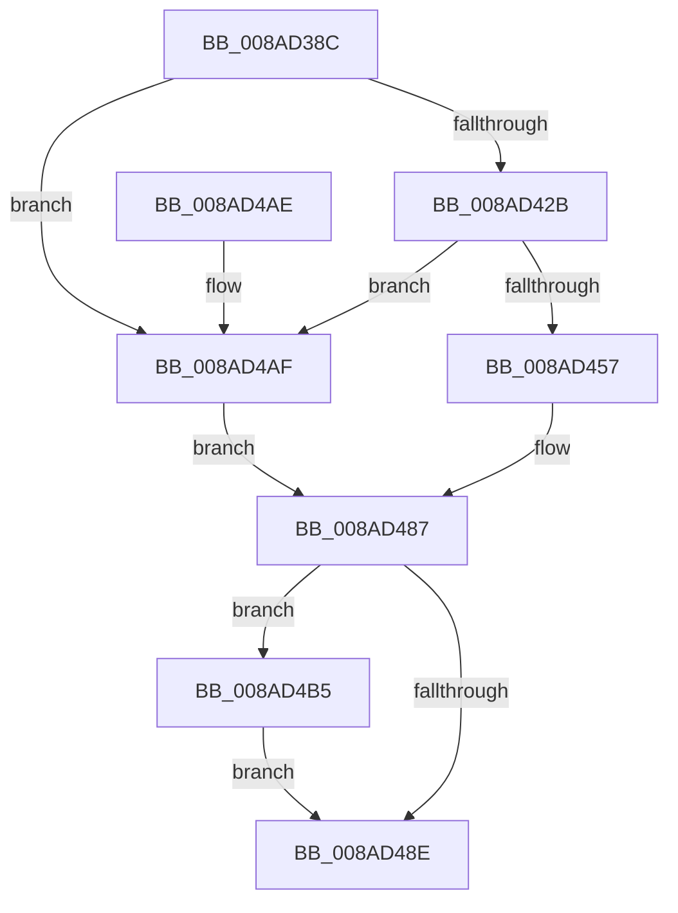

# PfSnQueryVolumeInfo

- RVA: `0x008AD38C`–`0x008AD4C3` (길이 `311` bytes)
- VA: `0x00000001408AD38C`
- 실행 섹션: `PAGE`
- PDB 이름 있음: `예`; PDB Function 태그: `아니요`
- unwind 정보 RVA: `0x0007F88C`
- 디코드: `87`개 명령, `311/311` bytes 표시
- 미해석 바이트: `0` (있으면 어셈블리에 `.byte`로 보존)

> 이 문서는 커널 이미지의 기계어와 PDB 기호를 분석해 생성했습니다. 4번과 5번은 함수 원형과 자료형을 바이너리 사용 방식에서 추정한 C 해석이며 원본 소스 복구 결과는 아닙니다.

## 1. Dependencies

- 직접 호출 지점: **5**; 고유 호출 대상: **5**
- 직접 호출자로 확인된 함수: **1**
- RIP 상대 이미지 참조: **1**

### Outgoing calls
- `0x008AD3F1` → [RtlInitUnicodeString](../../text/42/RtlInitUnicodeString_function_0042A780.md) (function, `0x0042A780`)
- `0x008AD41C` → [PfpOpenHandleCreate](PfpOpenHandleCreate_function_008A9EDC.md) (function, `0x008A9EDC`)
- `0x008AD445` → [NtQueryVolumeInformationFile](NtQueryVolumeInformationFile_function_008AC8C0.md) (function, `0x008AC8C0`)
- `0x008AD497` → [_security_check_cookie](../../text/6A/_security_check_cookie_function_006AC640.md) (function, `0x006AC640`)
- `0x008AD4BC` → [PfpOpenHandleClose](PfpOpenHandleClose_function_008A9E74.md) (function, `0x008A9E74`)

### Direct callers
- [PfSnOpenVolumesForPrefetch](PfSnOpenVolumesForPrefetch_function_008AA4AC.md) at `0x008AA6B4`

### Static image references
- `0x008AD3A3` → RVA `0x00E0A740` (`.data`; read)

## 2. Other-region calls and transfers

- 다른 실행 섹션으로 향하는 call: **2**
  - `0x008AD3F1` → [RtlInitUnicodeString](../../text/42/RtlInitUnicodeString_function_0042A780.md) (`PAGE` → `.text`)
  - `0x008AD497` → [_security_check_cookie](../../text/6A/_security_check_cookie_function_006AC640.md) (`PAGE` → `.text`)
- 별도 외부 분기/꼬리 이동을 확인하지 못했습니다.

## 3. Assembly (complete function range)

```asm
008AD38C  40 55                           push rbp
008AD38E  53                              push rbx
008AD38F  56                              push rsi
008AD390  57                              push rdi
008AD391  41 54                           push r12
008AD393  41 56                           push r14
008AD395  41 57                           push r15
008AD397  48 8D 6C 24 E1                  lea rbp, [rsp - 0x1f]
008AD39C  48 81 EC A0 00 00 00            sub rsp, 0xa0
008AD3A3  48 8B 05 96 D3 55 00            mov rax, qword ptr [rip + 0x55d396]
008AD3AA  48 33 C4                        xor rax, rsp
008AD3AD  48 89 45 17                     mov qword ptr [rbp + 0x17], rax
008AD3B1  4C 8B 65 7F                     mov r12, qword ptr [rbp + 0x7f]
008AD3B5  0F 57 C0                        xorps xmm0, xmm0
008AD3B8  33 C0                           xor eax, eax
008AD3BA  4C 8B F1                        mov r14, rcx
008AD3BD  48 21 45 BF                     and qword ptr [rbp - 0x41], rax
008AD3C1  48 8D 4D DF                     lea rcx, [rbp - 0x21]
008AD3C5  0F 57 C9                        xorps xmm1, xmm1
008AD3C8  48 89 45 0F                     mov qword ptr [rbp + 0xf], rax
008AD3CC  48 BF 00 00 00 00 02 00 00 00   movabs rdi, 0x200000000
008AD3D6  4D 8B F9                        mov r15, r9
008AD3D9  0F 11 45 FF                     movups xmmword ptr [rbp - 1], xmm0
008AD3DD  48 89 7D D7                     mov qword ptr [rbp - 0x29], rdi
008AD3E1  49 8B F0                        mov rsi, r8
008AD3E4  0F 11 45 DF                     movups xmmword ptr [rbp - 0x21], xmm0
008AD3E8  0F 11 4D EF                     movups xmmword ptr [rbp - 0x11], xmm1
008AD3EC  F3 0F 7F 45 C7                  movdqu xmmword ptr [rbp - 0x39], xmm0
008AD3F1  E8 8A D3 B7 FF                  call 0x14042a780
008AD3F6  48 83 64 24 38 00               and qword ptr [rsp + 0x38], 0
008AD3FC  4C 8D 45 DF                     lea r8, [rbp - 0x21]
008AD400  83 64 24 30 00                  and dword ptr [rsp + 0x30], 0
008AD405  48 8D 4D BF                     lea rcx, [rbp - 0x41]
008AD409  83 64 24 28 00                  and dword ptr [rsp + 0x28], 0
008AD40E  45 33 C9                        xor r9d, r9d
008AD411  49 8B D6                        mov rdx, r14
008AD414  C7 44 24 20 80 01 10 00         mov dword ptr [rsp + 0x20], 0x100180
008AD41C  E8 BB CA FF FF                  call 0x1408a9edc
008AD421  8B D8                           mov ebx, eax
008AD423  85 C0                           test eax, eax
008AD425  0F 88 84 00 00 00               js 0x1408ad4af
008AD42B  48 8B 4D BF                     mov rcx, qword ptr [rbp - 0x41]
008AD42F  4C 8D 45 FF                     lea r8, [rbp - 1]
008AD433  41 B9 18 00 00 00               mov r9d, 0x18
008AD439  C7 44 24 20 01 00 00 00         mov dword ptr [rsp + 0x20], 1
008AD441  48 8D 55 EF                     lea rdx, [rbp - 0x11]
008AD445  E8 76 F4 FF FF                  call 0x1408ac8c0
008AD44A  B9 00 00 00 C0                  mov ecx, 0xc0000000
008AD44F  8B D8                           mov ebx, eax
008AD451  23 C1                           and eax, ecx
008AD453  3B C1                           cmp eax, ecx
008AD455  74 58                           je 0x1408ad4af
008AD457  0F 10 45 BF                     movups xmm0, xmmword ptr [rbp - 0x41]
008AD45B  48 8B 45 FF                     mov rax, qword ptr [rbp - 1]
008AD45F  0F 10 4D CF                     movups xmm1, xmmword ptr [rbp - 0x31]
008AD463  48 83 65 BF 00                  and qword ptr [rbp - 0x41], 0
008AD468  49 89 07                        mov qword ptr [r15], rax
008AD46B  33 DB                           xor ebx, ebx
008AD46D  8B 45 07                        mov eax, dword ptr [rbp + 7]
008AD470  41 89 04 24                     mov dword ptr [r12], eax
008AD474  0F 11 06                        movups xmmword ptr [rsi], xmm0
008AD477  48 89 7D D7                     mov qword ptr [rbp - 0x29], rdi
008AD47B  0F 57 C0                        xorps xmm0, xmm0
008AD47E  F3 0F 7F 45 C7                  movdqu xmmword ptr [rbp - 0x39], xmm0
008AD483  0F 11 4E 10                     movups xmmword ptr [rsi + 0x10], xmm1
008AD487  48 0F BA E7 22                  bt rdi, 0x22
008AD48C  72 27                           jb 0x1408ad4b5
008AD48E  8B C3                           mov eax, ebx
008AD490  48 8B 4D 17                     mov rcx, qword ptr [rbp + 0x17]
008AD494  48 33 CC                        xor rcx, rsp
008AD497  E8 A4 F1 DF FF                  call 0x1406ac640
008AD49C  48 81 C4 A0 00 00 00            add rsp, 0xa0
008AD4A3  41 5F                           pop r15
008AD4A5  41 5E                           pop r14
008AD4A7  41 5C                           pop r12
008AD4A9  5F                              pop rdi
008AD4AA  5E                              pop rsi
008AD4AB  5B                              pop rbx
008AD4AC  5D                              pop rbp
008AD4AD  C3                              ret
008AD4AE  CC                              int3
008AD4AF  48 8B 7D D7                     mov rdi, qword ptr [rbp - 0x29]
008AD4B3  EB D2                           jmp 0x1408ad487
008AD4B5  49 8B D6                        mov rdx, r14
008AD4B8  48 8D 4D BF                     lea rcx, [rbp - 0x41]
008AD4BC  E8 B3 C9 FF FF                  call 0x1408a9e74
008AD4C1  EB CB                           jmp 0x1408ad48e
```

## 4. C-style interpretation (structured pseudocode)

```c
__int64 __fastcall PfSnQueryVolumeInfo(__int64 a1, __int64 a2, __int64 a3, __int64 a4, __int64 a5)
{
    __int64 result;
    __int64 v_rbx;
    __int64 v_rsp;
    unsigned __int64 v_stack_m40;
    unsigned __int64 v_stack_m48;
    unsigned int v_stack_m50;
    unsigned __int64 v_stack_m57;
    unsigned __int64 v_stack_m58;
    unsigned __int64 v_stack_m68;
    unsigned __int64 v_stack_m78;
    unsigned __int64 v_stack_m80;
    unsigned __int64 v_stack_m88;
    unsigned __int64 v_stack_m90;
    unsigned __int64 v_stack_m98;
    unsigned __int64 v_stack_mA0;
    unsigned int v_stack_mA8;
    unsigned int v_stack_mB0;
    unsigned int v_stack_mB8;

    v_rsp = (v_rsp) - (160);
    result = (*(unsigned __int64 *)(v_rip + 5624726)) ^ (v_rsp);
    v_stack_m40 = result;
    result = 0;
    v_stack_m48 = 0;
    v_stack_m58 = v_xmm0;
    v_stack_m80 = v_rdi;
    v_stack_m78 = v_xmm0;
    v_stack_m68 = v_xmm1;
    v_stack_m90 = v_xmm0;
    result = RtlInitUnicodeString(v_stack_m78, a2, a3, a4);
    a4 = 0;
    v_stack_mB8 = 0x100180ULL;
    result = PfpOpenHandleCreate(v_stack_m98, a1, v_stack_m78, a4);
    if (sign_flag) goto loc_008AD4AF;
    v_stack_mB8 = 1;
    result = NtQueryVolumeInformationFile(v_stack_m98, v_stack_m68, v_stack_m58, 24);
    result = (unsigned int)((result) & ((unsigned int)((unsigned int)(0xC0000000ULL))));
    if (((unsigned int)(result)) == ((unsigned int)((unsigned int)(0xC0000000ULL)))) goto loc_008AD4AF;
    *(unsigned __int64 *)(a4) = v_stack_m58;
    v_rbx = 0;
    *(unsigned int *)(a5) = (unsigned int)((unsigned int)(v_stack_m50));
    *(unsigned __int64 *)(a3) = v_xmm0;
    v_stack_m80 = v_rdi;
    v_stack_m90 = v_xmm0;
    *(unsigned __int64 *)(a3 + 16) = v_xmm1;
loc_008AD487:
    if (condition_is_below) goto loc_008AD4B5;
loc_008AD48E:
    a1 = (v_stack_m40) ^ (v_rsp);
    result = _security_check_cookie(a1, v_stack_m68, v_stack_m58, 24);
    v_rsp = (v_rsp) + (160);
    return result;
loc_008AD4AF:
    goto loc_008AD487;
loc_008AD4B5:
    result = PfpOpenHandleClose(v_stack_m98, a1, v_stack_m58, 24);
    goto loc_008AD48E;
}
```

## 5. (Beta) C Style

```c
int64_t PfSnQueryVolumeInfo(int64_t Arg1, int64_t Arg2, void *Arg3, void *Arg4, void *Arg5)
{
    uint8_t *arg3 = (uint8_t *)Arg3;
    uint8_t *arg4 = (uint8_t *)Arg4;
    uint8_t *arg5 = (uint8_t *)Arg5;

    int64_t result;
    int64_t local_rbx;
    int64_t local_rsp;
    uint64_t v_stack_m40;
    uint64_t v_stack_m48;
    uint32_t v_stack_m50;
    uint64_t v_stack_m57;
    uint64_t v_stack_m58;
    uint64_t v_stack_m68;
    uint64_t v_stack_m78;
    uint64_t v_stack_m80;
    uint64_t v_stack_m88;
    uint64_t v_stack_m90;
    uint64_t v_stack_m98;
    uint64_t v_stack_mA0;
    uint32_t v_stack_mA8;
    uint32_t v_stack_mB0;
    uint32_t v_stack_mB8;

    local_rsp = (local_rsp) - (160);
    result = (*(uint64_t *)(v_rip + 0x55D396)) ^ (local_rsp);
    v_stack_m40 = result;
    result = 0;
    v_stack_m48 = 0;
    v_stack_m58 = v_xmm0;
    v_stack_m80 = local_rdi;
    v_stack_m78 = v_xmm0;
    v_stack_m68 = v_xmm1;
    v_stack_m90 = v_xmm0;
    result = RtlInitUnicodeString(v_stack_m78, Arg2, Arg3, Arg4);
    Arg4 = 0;
    v_stack_mB8 = 0x100180ULL;
    result = PfpOpenHandleCreate(v_stack_m98, Arg1, v_stack_m78, Arg4);
    if (sign_flag) goto loc_008AD4AF;
    v_stack_mB8 = 1;
    result = NtQueryVolumeInformationFile(v_stack_m98, v_stack_m68, v_stack_m58, 24);
    result = (uint32_t)((result) & ((uint32_t)((uint32_t)(0xC0000000ULL))));
    if (((uint32_t)(result)) == ((uint32_t)((uint32_t)(0xC0000000ULL)))) goto loc_008AD4AF;
    *(uint64_t *)(arg4) = v_stack_m58;
    local_rbx = 0;
    *(uint32_t *)(arg5) = (uint32_t)((uint32_t)(v_stack_m50));
    *(uint64_t *)(arg3) = v_xmm0;
    v_stack_m80 = local_rdi;
    v_stack_m90 = v_xmm0;
    *(uint64_t *)(arg3 + 0x10) = v_xmm1;
loc_008AD487:
    if (condition_is_below) goto loc_008AD4B5;
loc_008AD48E:
    Arg1 = (v_stack_m40) ^ (local_rsp);
    result = _security_check_cookie(Arg1, v_stack_m68, v_stack_m58, 24);
    local_rsp = (local_rsp) + (160);
    return result;
loc_008AD4AF:
    goto loc_008AD487;
loc_008AD4B5:
    result = PfpOpenHandleClose(v_stack_m98, Arg1, v_stack_m58, 24);
    goto loc_008AD48E;
}
```

### 관측된 메모리 오프셋

구조체 형식이 확인되지 않은 접근은 인자 기준의 오프셋으로만 기록했습니다.

| 기준 인자 | 오프셋 표현 | 폭 (bit) | 접근 |
|---|---:|---:|---|
| `Arg3` | `+ 0x0` | `128` | `R` |
| `Arg3` | `+ 0x10` | `128` | `R` |
| `Arg4` | `+ 0x0` | `64` | `W` |
| `Arg5` | `+ 0x0` | `32` | `W` |

## 6. Execution-region graph

[열기: 2D/3D 그래프와 함수 탐색 컨트롤 패널](../../../control-panel.html?section=page&rva=0x008AD38C&view=graph)

- 2D 그래프는 위에서 아래로 흐르고, 3D 그래프는 빈 공간을 드래그해 회전합니다. Shift+드래그는 이동, 휠은 확대·축소, 함수 노드 선택은 대상 보고서 이동입니다.

### Static fallback


