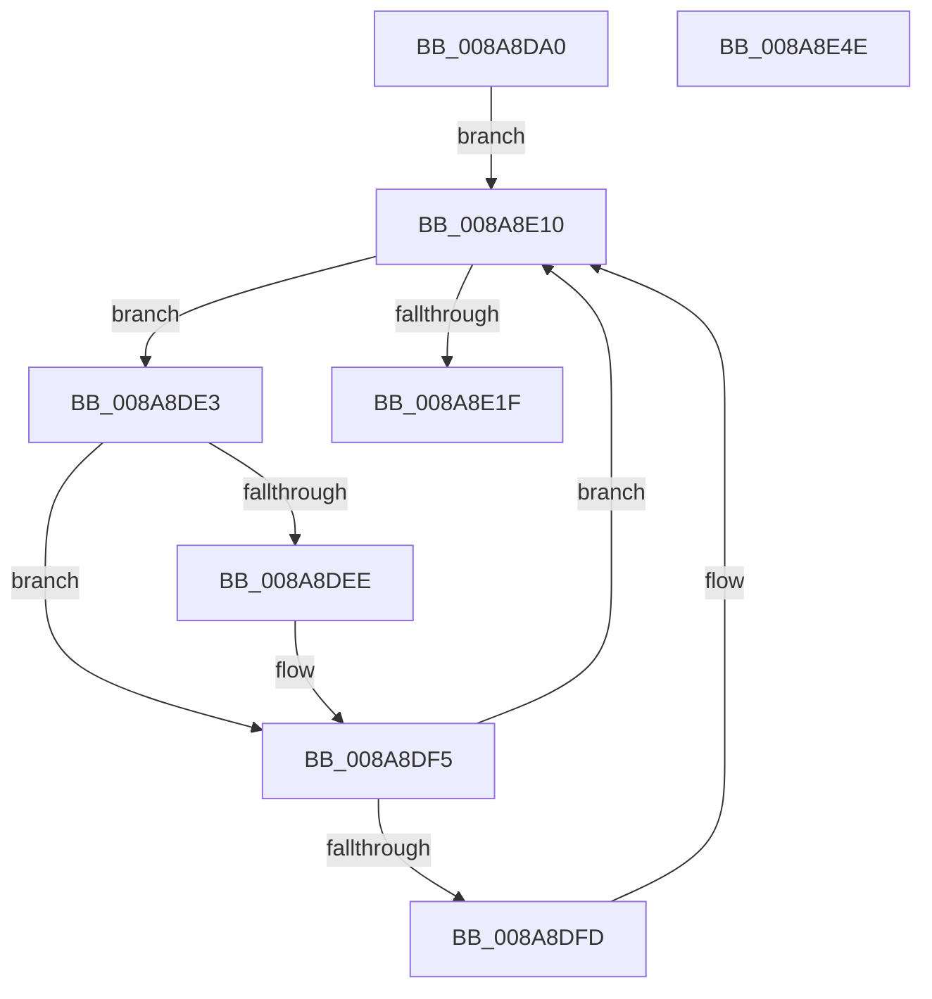

# PfSnSectionInfoCleanupWorkItem

- RVA: `0x008A8DA0`–`0x008A8E4F` (길이 `175` bytes)
- VA: `0x00000001408A8DA0`
- 실행 섹션: `PAGE`
- PDB 이름 있음: `예`; PDB Function 태그: `아니요`
- unwind 정보 RVA: `0x0007F3F8`
- 디코드: `48`개 명령, `175/175` bytes 표시
- 미해석 바이트: `0` (있으면 어셈블리에 `.byte`로 보존)

> 이 문서는 커널 이미지의 기계어와 PDB 기호를 분석해 생성했습니다. 4번과 5번은 함수 원형과 자료형을 바이너리 사용 방식에서 추정한 C 해석이며 원본 소스 복구 결과는 아닙니다.

## 1. Dependencies

- 직접 호출 지점: **6**; 고유 호출 대상: **5**
- 직접 호출자로 확인된 함수: **0**
- RIP 상대 이미지 참조: **0**

### Outgoing calls
- `0x008A8DCB` → [PsSetCurrentThreadPrefetching](PsSetCurrentThreadPrefetching_function_008A9A40.md) (function, `0x008A9A40`)
- `0x008A8DF0` → [ExFreePoolWithTag](../../poolcode/B8/ExFreePoolWithTag_function_00B82870.md) (function, `0x00B82870`)
- `0x008A8E0B` → [PfSnCleanupPrefetchSectionInfo](PfSnCleanupPrefetchSectionInfo_function_008AA0B8.md) (function, `0x008AA0B8`)
- `0x008A8E1F` → [KeLeaveCriticalRegion](../../text/25/KeLeaveCriticalRegion_function_0025D8B0.md) (function, `0x0025D8B0`)
- `0x008A8E26` → [PsSetCurrentThreadPrefetching](PsSetCurrentThreadPrefetching_function_008A9A40.md) (function, `0x008A9A40`)
- `0x008A8E2E` → [ExReleaseRundownProtection](../../text/34/ExReleaseRundownProtection_function_00349E80.md) (function, `0x00349E80`)

### Direct callers
- 이 함수 시작 RVA로 연결되는 직접 call은 확인되지 않았습니다. 간접 호출은 완전히 역산할 수 없습니다.

### Static image references
- 디코드된 RIP-relative 메모리 참조가 없습니다.

## 2. Other-region calls and transfers

- 다른 실행 섹션으로 향하는 call: **3**
  - `0x008A8DF0` → [ExFreePoolWithTag](../../poolcode/B8/ExFreePoolWithTag_function_00B82870.md) (`PAGE` → `POOLCODE`)
  - `0x008A8E1F` → [KeLeaveCriticalRegion](../../text/25/KeLeaveCriticalRegion_function_0025D8B0.md) (`PAGE` → `.text`)
  - `0x008A8E2E` → [ExReleaseRundownProtection](../../text/34/ExReleaseRundownProtection_function_00349E80.md) (`PAGE` → `.text`)
- 별도 외부 분기/꼬리 이동을 확인하지 못했습니다.

## 3. Assembly (complete function range)

```asm
008A8DA0  48 8B C4                        mov rax, rsp
008A8DA3  48 89 58 08                     mov qword ptr [rax + 8], rbx
008A8DA7  48 89 70 10                     mov qword ptr [rax + 0x10], rsi
008A8DAB  48 89 78 18                     mov qword ptr [rax + 0x18], rdi
008A8DAF  4C 89 70 20                     mov qword ptr [rax + 0x20], r14
008A8DB3  41 57                           push r15
008A8DB5  48 83 EC 20                     sub rsp, 0x20
008A8DB9  48 8B 59 20                     mov rbx, qword ptr [rcx + 0x20]
008A8DBD  B1 01                           mov cl, 1
008A8DBF  48 8B 73 08                     mov rsi, qword ptr [rbx + 8]
008A8DC3  4C 8B 7E 40                     mov r15, qword ptr [rsi + 0x40]
008A8DC7  4C 8B 76 48                     mov r14, qword ptr [rsi + 0x48]
008A8DCB  E8 70 0C 00 00                  call 0x1408a9a40
008A8DD0  65 48 8B 04 25 88 01 00 00      mov rax, qword ptr gs:[0x188]
008A8DD9  66 FF 88 E4 01 00 00            dec word ptr [rax + 0x1e4]
008A8DE0  90                              nop
008A8DE1  EB 2D                           jmp 0x1408a8e10
008A8DE3  8B F8                           mov edi, eax
008A8DE5  49 8B 0C FF                     mov rcx, qword ptr [r15 + rdi*8]
008A8DE9  48 85 C9                        test rcx, rcx
008A8DEC  74 07                           je 0x1408a8df5
008A8DEE  33 D2                           xor edx, edx
008A8DF0  E8 7B 9A 2D 00                  call 0x140b82870
008A8DF5  41 8B 04 BE                     mov eax, dword ptr [r14 + rdi*4]
008A8DF9  85 C0                           test eax, eax
008A8DFB  78 13                           js 0x1408a8e10
008A8DFD  48 6B C8 38                     imul rcx, rax, 0x38
008A8E01  41 B0 01                        mov r8b, 1
008A8E04  48 8B D6                        mov rdx, rsi
008A8E07  48 03 4E 38                     add rcx, qword ptr [rsi + 0x38]
008A8E0B  E8 A8 12 00 00                  call 0x1408aa0b8
008A8E10  B8 01 00 00 00                  mov eax, 1
008A8E15  F0 0F C1 43 1C                  lock xadd dword ptr [rbx + 0x1c], eax
008A8E1A  3B 43 20                        cmp eax, dword ptr [rbx + 0x20]
008A8E1D  72 C4                           jb 0x1408a8de3
008A8E1F  E8 8C 4A 9B FF                  call 0x14025d8b0
008A8E24  33 C9                           xor ecx, ecx
008A8E26  E8 15 0C 00 00                  call 0x1408a9a40
008A8E2B  48 8B CB                        mov rcx, rbx
008A8E2E  E8 4D 10 AA FF                  call 0x140349e80
008A8E33  48 8B 5C 24 30                  mov rbx, qword ptr [rsp + 0x30]
008A8E38  48 8B 74 24 38                  mov rsi, qword ptr [rsp + 0x38]
008A8E3D  48 8B 7C 24 40                  mov rdi, qword ptr [rsp + 0x40]
008A8E42  4C 8B 74 24 48                  mov r14, qword ptr [rsp + 0x48]
008A8E47  48 83 C4 20                     add rsp, 0x20
008A8E4B  41 5F                           pop r15
008A8E4D  C3                              ret
008A8E4E  CC                              int3
```

## 4. C-style interpretation (structured pseudocode)

```c
__int64 __fastcall PfSnSectionInfoCleanupWorkItem(__int64 a1, int a2)
{
    __int64 result;
    __int64 v_rsp;
    unsigned __int64 v_stack_p10;
    unsigned __int64 v_stack_p18;
    unsigned __int64 v_stack_p20;
    unsigned __int64 v_stack_p8;

    *(unsigned __int64 *)(v_rsp + 8) = v_rbx;
    *(unsigned __int64 *)(v_rsp + 16) = v_rsi;
    *(unsigned __int64 *)(v_rsp + 24) = v_rdi;
    *(unsigned __int64 *)(v_rsp + 32) = v_r14;
    v_rsp = (v_rsp) - (32);
    result = PsSetCurrentThreadPrefetching(1, a2, a3, a4);
    goto loc_008A8E10;
loc_008A8DE3:
    result = *(unsigned __int64 *)(gs_base + (0 + 392));
    if (*(unsigned __int64 *)(*(unsigned __int64 *)(*(unsigned __int64 *)(*(unsigned __int64 *)(a1 + 32) + 8) + 64) + (unsigned int)((unsigned int)(*(unsigned __int64 *)(gs_base + (0 + 392)))) * 8) != 0) {
        a2 = 0;
        result = ExFreePoolWithTag(*(unsigned __int64 *)(*(unsigned __int64 *)(*(unsigned __int64 *)(*(unsigned __int64 *)(a1 + 32) + 8) + 64) + (unsigned int)((unsigned int)(*(unsigned __int64 *)(gs_base + (0 + 392)))) * 8), a2, a3, a4);
    }
    result = (unsigned int)(*(unsigned int *)(*(unsigned __int64 *)(*(unsigned __int64 *)(*(unsigned __int64 *)(a1 + 32) + 8) + 72) + (unsigned int)((unsigned int)(*(unsigned __int64 *)(gs_base + (0 + 392)))) * 4));
    if (!(sign_flag)) {
        a1 = (*(unsigned __int64 *)(*(unsigned __int64 *)(*(unsigned __int64 *)(*(unsigned __int64 *)(a1 + 32) + 8) + 64) + (unsigned int)((unsigned int)(*(unsigned __int64 *)(gs_base + (0 + 392)))) * 8)) * ((unsigned int)(*(unsigned int *)(*(unsigned __int64 *)(*(unsigned __int64 *)(*(unsigned __int64 *)(a1 + 32) + 8) + 72) + (unsigned int)((unsigned int)(*(unsigned __int64 *)(gs_base + (0 + 392)))) * 4)));
        a3 = 1;
        a2 = *(unsigned __int64 *)(*(unsigned __int64 *)(a1 + 32) + 8);
        a1 = (a1) + (*(unsigned __int64 *)(*(unsigned __int64 *)(*(unsigned __int64 *)(a1 + 32) + 8) + 56));
        result = PfSnCleanupPrefetchSectionInfo(a1, a2, a3, a4);
    }
    if (1 < (*(unsigned int *)(*(unsigned __int64 *)(a1 + 32) + 32))) goto loc_008A8DE3;
    result = KeLeaveCriticalRegion(a1, a2, a3, a4);
    a1 = 0;
    result = PsSetCurrentThreadPrefetching(a1, a2, a3, a4);
    result = ExReleaseRundownProtection(*(unsigned __int64 *)(a1 + 32), a2, a3, a4);
    v_rsp = (v_rsp) + (32);
    return result;
}
```

## 5. (Beta) C Style

```c
int64_t PfSnSectionInfoCleanupWorkItem(void *Arg1, int32_t Arg2)
{
    uint8_t *arg1 = (uint8_t *)Arg1;

    int64_t result;
    int64_t local_rsp;
    uint64_t v_stack_p10;
    uint64_t v_stack_p18;
    uint64_t v_stack_p20;
    uint64_t v_stack_p8;

    *(uint64_t *)(local_rsp + 0x8) = local_rbx;
    *(uint64_t *)(local_rsp + 0x10) = local_rsi;
    *(uint64_t *)(local_rsp + 0x18) = local_rdi;
    *(uint64_t *)(local_rsp + 0x20) = local_r14;
    local_rsp = (local_rsp) - (32);
    result = PsSetCurrentThreadPrefetching(1, Arg2, a3, a4);
    goto loc_008A8E10;
loc_008A8DE3:
    result = *(uint64_t *)(gs_base + (0 + 0x188));
    if (*(uint64_t *)(*(uint64_t *)(*(uint64_t *)(*(uint64_t *)(arg1 + 0x20) + 0x8) + 0x40) + (uint32_t)((uint32_t)(*(uint64_t *)(gs_base + (0 + 0x188)))) * 8) != 0) {
        Arg2 = 0;
        result = ExFreePoolWithTag(*(uint64_t *)(*(uint64_t *)(*(uint64_t *)(*(uint64_t *)(arg1 + 0x20) + 0x8) + 0x40) + (uint32_t)((uint32_t)(*(uint64_t *)(gs_base + (0 + 0x188)))) * 8), Arg2, a3, a4);
    }
    result = (uint32_t)(*(uint32_t *)(*(uint64_t *)(*(uint64_t *)(*(uint64_t *)(arg1 + 0x20) + 0x8) + 0x48) + (uint32_t)((uint32_t)(*(uint64_t *)(gs_base + (0 + 0x188)))) * 4));
    if (!(sign_flag)) {
        Arg1 = (*(uint64_t *)(*(uint64_t *)(*(uint64_t *)(*(uint64_t *)(arg1 + 0x20) + 0x8) + 0x40) + (uint32_t)((uint32_t)(*(uint64_t *)(gs_base + (0 + 0x188)))) * 8)) * ((uint32_t)(*(uint32_t *)(*(uint64_t *)(*(uint64_t *)(*(uint64_t *)(arg1 + 0x20) + 0x8) + 0x48) + (uint32_t)((uint32_t)(*(uint64_t *)(gs_base + (0 + 0x188)))) * 4)));
        a3 = 1;
        Arg2 = *(uint64_t *)(*(uint64_t *)(arg1 + 0x20) + 0x8);
        Arg1 = (Arg1) + (*(uint64_t *)(*(uint64_t *)(*(uint64_t *)(arg1 + 0x20) + 0x8) + 0x38));
        result = PfSnCleanupPrefetchSectionInfo(Arg1, Arg2, a3, a4);
    }
    if (1 < (*(uint32_t *)(*(uint64_t *)(arg1 + 0x20) + 0x20))) goto loc_008A8DE3;
    result = KeLeaveCriticalRegion(Arg1, Arg2, a3, a4);
    Arg1 = 0;
    result = PsSetCurrentThreadPrefetching(Arg1, Arg2, a3, a4);
    result = ExReleaseRundownProtection(*(uint64_t *)(arg1 + 0x20), Arg2, a3, a4);
    local_rsp = (local_rsp) + (32);
    return result;
}
```

### 관측된 메모리 오프셋

구조체 형식이 확인되지 않은 접근은 인자 기준의 오프셋으로만 기록했습니다.

| 기준 인자 | 오프셋 표현 | 폭 (bit) | 접근 |
|---|---:|---:|---|
| `Arg1` | `+ 0x20` | `64` | `R` |

## 6. Execution-region graph

[열기: 2D/3D 그래프와 함수 탐색 컨트롤 패널](../../../control-panel.html?section=page&rva=0x008A8DA0&view=graph)

- 2D 그래프는 위에서 아래로 흐르고, 3D 그래프는 빈 공간을 드래그해 회전합니다. Shift+드래그는 이동, 휠은 확대·축소, 함수 노드 선택은 대상 보고서 이동입니다.

### Static fallback


