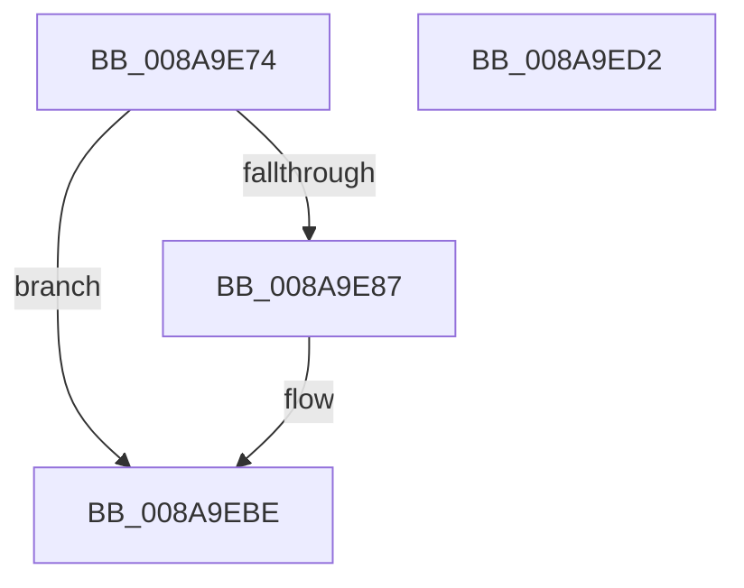

# PfpOpenHandleClose

- RVA: `0x008A9E74`–`0x008A9ED3` (길이 `95` bytes)
- VA: `0x00000001408A9E74`
- 실행 섹션: `PAGE`
- PDB 이름 있음: `예`; PDB Function 태그: `아니요`
- unwind 정보 RVA: `0x0007F554`
- 디코드: `25`개 명령, `95/95` bytes 표시
- 미해석 바이트: `0` (있으면 어셈블리에 `.byte`로 보존)

> 이 문서는 커널 이미지의 기계어와 PDB 기호를 분석해 생성했습니다. 4번과 5번은 함수 원형과 자료형을 바이너리 사용 방식에서 추정한 C 해석이며 원본 소스 복구 결과는 아닙니다.

## 1. Dependencies

- 직접 호출 지점: **1**; 고유 호출 대상: **1**
- 직접 호출자로 확인된 함수: **13**
- RIP 상대 이미지 참조: **1**

### Outgoing calls
- `0x008A9EB9` → [guard_dispatch_icall](../../text/6B/guard_dispatch_icall_function_006BAAD0.md) (function, `0x006BAAD0`)

### Direct callers
- [PfpQueryFileExtentsRequest](../75/PfpQueryFileExtentsRequest_function_007508E8.md) at `0x00750F0B`
- [PfpQueryFileExtentsRequest](../75/PfpQueryFileExtentsRequest_function_007508E8.md) at `0x00750F25`
- [sub_008A9284](Unknown_function_008A9284.md) at `0x008A92EA`
- [PfSnCleanupPrefetchSectionInfo](PfSnCleanupPrefetchSectionInfo_function_008AA0B8.md) at `0x008AA10D`
- [PfSnCleanupPrefetchSectionInfo](PfSnCleanupPrefetchSectionInfo_function_008AA0B8.md) at `0x008AA169`
- [PfSnOpenVolumesForPrefetch](PfSnOpenVolumesForPrefetch_function_008AA4AC.md) at `0x008AA8E1`
- [PfSnOpenVolumesForPrefetch](PfSnOpenVolumesForPrefetch_function_008AA4AC.md) at `0x008AAABC`
- [PfSnQueryVolumeInfo](PfSnQueryVolumeInfo_function_008AD38C.md) at `0x008AD4BC`
- [PfpVolumeOpenAndVerify](../93/PfpVolumeOpenAndVerify_function_009381F4.md) at `0x0093859E`
- [PfpVolumeOpenAndVerify](../93/PfpVolumeOpenAndVerify_function_009381F4.md) at `0x009385AF`
- [PfpPrefetchRequestPerform](../93/PfpPrefetchRequestPerform_function_00938F74.md) at `0x00939237`
- [PfpPrefetchVolumesCleanup](../93/PfpPrefetchVolumesCleanup_function_009393FC.md) at `0x0093944E`
- [PfpPrefetchVolumesCleanup](../93/PfpPrefetchVolumesCleanup_function_009393FC.md) at `0x00939465`
- [PfSnCleanupPrefetchHeader](../93/PfSnCleanupPrefetchHeader_function_00939898.md) at `0x009398F5`
- [PfSnCleanupPrefetchHeader](../93/PfSnCleanupPrefetchHeader_function_00939898.md) at `0x009399A1`
- [PfSnCleanupPrefetchHeader](../93/PfSnCleanupPrefetchHeader_function_00939898.md) at `0x009399AE`
- [PfpPrefetchDirectoryStream](../93/PfpPrefetchDirectoryStream_function_0093AA94.md) at `0x0093AD48`
- [PfpPrefetchEntireDirectory](../93/PfpPrefetchEntireDirectory_function_0093B0FC.md) at `0x0093B23E`
- [PfpFileBuildReadSupport](../93/PfpFileBuildReadSupport_function_0093B504.md) at `0x0093B7A0`
- [PfpReadSupportCleanup](../93/PfpReadSupportCleanup_function_0093B8E0.md) at `0x0093B91C`

### Static image references
- `0x008A9EAA` → RVA `0x00E671E8` (`.data`; read)

## 2. Other-region calls and transfers

- 다른 실행 섹션으로 향하는 call: **1**
  - `0x008A9EB9` → [guard_dispatch_icall](../../text/6B/guard_dispatch_icall_function_006BAAD0.md) (`PAGE` → `.text`)
- 별도 외부 분기/꼬리 이동을 확인하지 못했습니다.

## 3. Assembly (complete function range)

```asm
008A9E74  4C 8B DC                        mov r11, rsp
008A9E77  53                              push rbx
008A9E78  48 83 EC 40                     sub rsp, 0x40
008A9E7C  48 0F BA 61 18 24               bt qword ptr [rcx + 0x18], 0x24
008A9E82  48 8B D9                        mov rbx, rcx
008A9E85  72 37                           jb 0x1408a9ebe
008A9E87  48 8B 01                        mov rax, qword ptr [rcx]
008A9E8A  49 89 43 E0                     mov qword ptr [r11 - 0x20], rax
008A9E8E  48 8B 41 08                     mov rax, qword ptr [rcx + 8]
008A9E92  49 89 43 E8                     mov qword ptr [r11 - 0x18], rax
008A9E96  48 8B 41 10                     mov rax, qword ptr [rcx + 0x10]
008A9E9A  49 89 43 F0                     mov qword ptr [r11 - 0x10], rax
008A9E9E  48 8D 42 28                     lea rax, [rdx + 0x28]
008A9EA2  49 89 43 D8                     mov qword ptr [r11 - 0x28], rax
008A9EA6  F0 FF 42 54                     lock inc dword ptr [rdx + 0x54]
008A9EAA  48 8B 05 37 D3 5B 00            mov rax, qword ptr [rip + 0x5bd337]
008A9EB1  49 8D 4B D8                     lea rcx, [r11 - 0x28]
008A9EB5  48 8B 40 08                     mov rax, qword ptr [rax + 8]
008A9EB9  E8 12 0C E1 FF                  call 0x1406baad0
008A9EBE  48 B8 00 00 00 00 08 00 00 00   movabs rax, 0x800000000
008A9EC8  48 09 43 18                     or qword ptr [rbx + 0x18], rax
008A9ECC  48 83 C4 40                     add rsp, 0x40
008A9ED0  5B                              pop rbx
008A9ED1  C3                              ret
008A9ED2  CC                              int3
```

## 4. C-style interpretation (structured pseudocode)

```c
__int64 __fastcall PfpOpenHandleClose(__int64 a1, __int64 a2)
{
    __int64 result;
    __int64 v_rsp;

    v_rsp = (v_rsp) - (64);
    if (!(condition_is_below)) {
        result = *(unsigned __int64 *)(a1);
        *(unsigned __int64 *)(v_rsp - 32) = result;
        result = *(unsigned __int64 *)(a1 + 8);
        *(unsigned __int64 *)(v_rsp - 24) = result;
        result = *(unsigned __int64 *)(a1 + 16);
        *(unsigned __int64 *)(v_rsp - 16) = result;
        result = a2 + 40;
        *(unsigned __int64 *)(v_rsp - 40) = result;
        result = *(unsigned __int64 *)(v_rip + 6017847);
        a1 = v_rsp - 40;
        result = *(unsigned __int64 *)(result + 8);
        result = guard_dispatch_icall(a1, a2, a3, a4);
    }
    v_rsp = (v_rsp) + (64);
    return result;
}
```

## 5. (Beta) C Style

```c
int64_t PfpOpenHandleClose(void *Arg1, void *Arg2)
{
    uint8_t *arg1 = (uint8_t *)Arg1;
    uint8_t *arg2 = (uint8_t *)Arg2;

    int64_t result;
    int64_t local_rsp;

    local_rsp = (local_rsp) - (64);
    if (!(condition_is_below)) {
        result = *(uint64_t *)(arg1);
        *(uint64_t *)(local_rsp - 0x20) = result;
        result = *(uint64_t *)(arg1 + 0x8);
        *(uint64_t *)(local_rsp - 0x18) = result;
        result = *(uint64_t *)(arg1 + 0x10);
        *(uint64_t *)(local_rsp - 0x10) = result;
        result = Arg2 + 40;
        *(uint64_t *)(local_rsp - 0x28) = result;
        result = *(uint64_t *)(v_rip + 0x5BD337);
        Arg1 = local_rsp - 40;
        result = *(uint64_t *)(result + 0x8);
        result = guard_dispatch_icall(Arg1, Arg2, a3, a4);
    }
    local_rsp = (local_rsp) + (64);
    return result;
}
```

### 관측된 메모리 오프셋

구조체 형식이 확인되지 않은 접근은 인자 기준의 오프셋으로만 기록했습니다.

| 기준 인자 | 오프셋 표현 | 폭 (bit) | 접근 |
|---|---:|---:|---|
| `Arg1` | `+ 0x0` | `64` | `R` |
| `Arg1` | `+ 0x8` | `64` | `R` |
| `Arg1` | `+ 0x10` | `64` | `R` |
| `Arg1` | `+ 0x18` | `64` | `R` |
| `Arg1` | `+ 0x18` | `64` | `R/W` |
| `Arg2` | `+ 0x28` | `64` | `R` |
| `Arg2` | `+ 0x54` | `32` | `R/W` |

## 6. Execution-region graph

[열기: 2D/3D 그래프와 함수 탐색 컨트롤 패널](../../../control-panel.html?section=page&rva=0x008A9E74&view=graph)

- 2D 그래프는 위에서 아래로 흐르고, 3D 그래프는 빈 공간을 드래그해 회전합니다. Shift+드래그는 이동, 휠은 확대·축소, 함수 노드 선택은 대상 보고서 이동입니다.

### Static fallback


