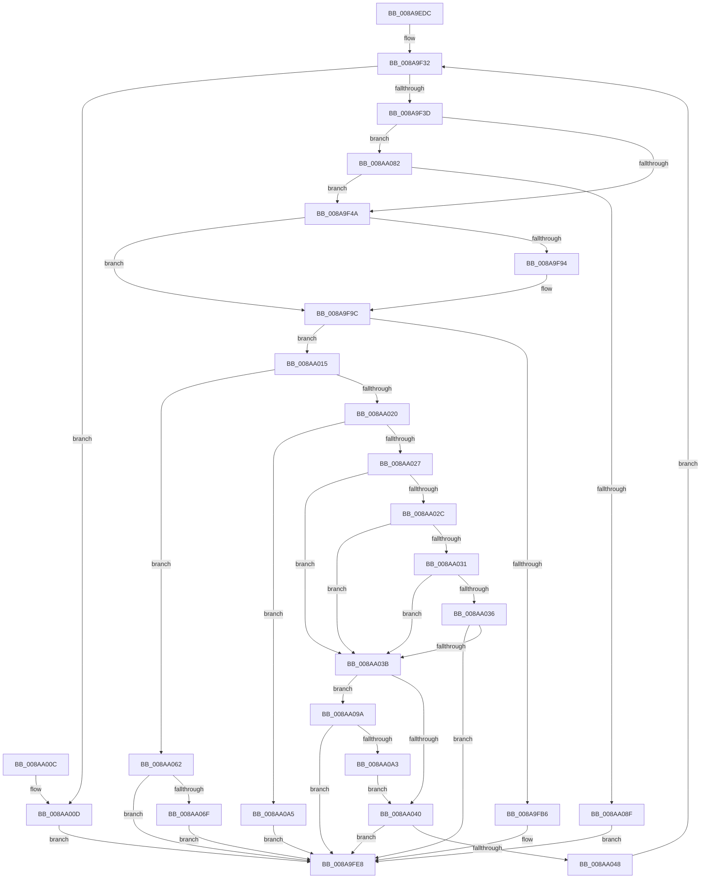

# PfpOpenHandleCreate

- RVA: `0x008A9EDC`–`0x008AA0B1` (길이 `469` bytes)
- VA: `0x00000001408A9EDC`
- 실행 섹션: `PAGE`
- PDB 이름 있음: `예`; PDB Function 태그: `아니요`
- unwind 정보 RVA: `0x0007F560`
- 디코드: `129`개 명령, `469/469` bytes 표시
- 미해석 바이트: `0` (있으면 어셈블리에 `.byte`로 보존)

> 이 문서는 커널 이미지의 기계어와 PDB 기호를 분석해 생성했습니다. 4번과 5번은 함수 원형과 자료형을 바이너리 사용 방식에서 추정한 C 해석이며 원본 소스 복구 결과는 아닙니다.

## 1. Dependencies

- 직접 호출 지점: **5**; 고유 호출 대상: **4**
- 직접 호출자로 확인된 함수: **8**
- RIP 상대 이미지 참조: **1**

### Outgoing calls
- `0x008A9F15` → [memset](../../text/6C/memset_function_006C6C40.md) (function, `0x006C6C40`)
- `0x008A9F54` → [memset](../../text/6C/memset_function_006C6C40.md) (function, `0x006C6C40`)
- `0x008A9FAA` → [guard_dispatch_icall](../../text/6B/guard_dispatch_icall_function_006BAAD0.md) (function, `0x006BAAD0`)
- `0x008AA050` → [KeDelayExecutionThread](../../text/20/KeDelayExecutionThread_function_00209550.md) (function, `0x00209550`)
- `0x008AA082` → [PfpCheckPrefetchAbort](../../text/49/PfpCheckPrefetchAbort_function_00492808.md) (function, `0x00492808`)

### Direct callers
- [PfpQueryFileExtentsRequest](../75/PfpQueryFileExtentsRequest_function_007508E8.md) at `0x00750BBB`
- [PfpQueryFileExtentsRequest](../75/PfpQueryFileExtentsRequest_function_007508E8.md) at `0x00750C23`
- [PfSnGetSectionObject](PfSnGetSectionObject_function_008A9448.md) at `0x008A9562`
- [PfSnOpenVolumesForPrefetch](PfSnOpenVolumesForPrefetch_function_008AA4AC.md) at `0x008AA9FE`
- [PfSnQueryVolumeInfo](PfSnQueryVolumeInfo_function_008AD38C.md) at `0x008AD41C`
- [PfpVolumeOpenAndVerify](../93/PfpVolumeOpenAndVerify_function_009381F4.md) at `0x009383AB`
- [PfpVolumeOpenAndVerify](../93/PfpVolumeOpenAndVerify_function_009381F4.md) at `0x00938462`
- [PfpPrefetchDirectoryStream](../93/PfpPrefetchDirectoryStream_function_0093AA94.md) at `0x0093AB4B`
- [PfpPrefetchEntireDirectory](../93/PfpPrefetchEntireDirectory_function_0093B0FC.md) at `0x0093B17C`
- [PfpFileBuildReadSupport](../93/PfpFileBuildReadSupport_function_0093B504.md) at `0x0093B669`

### Static image references
- `0x008A9F9C` → RVA `0x00E671E8` (`.data`; read)

## 2. Other-region calls and transfers

- 다른 실행 섹션으로 향하는 call: **5**
  - `0x008A9F15` → [memset](../../text/6C/memset_function_006C6C40.md) (`PAGE` → `.text`)
  - `0x008A9F54` → [memset](../../text/6C/memset_function_006C6C40.md) (`PAGE` → `.text`)
  - `0x008A9FAA` → [guard_dispatch_icall](../../text/6B/guard_dispatch_icall_function_006BAAD0.md) (`PAGE` → `.text`)
  - `0x008AA050` → [KeDelayExecutionThread](../../text/20/KeDelayExecutionThread_function_00209550.md) (`PAGE` → `.text`)
  - `0x008AA082` → [PfpCheckPrefetchAbort](../../text/49/PfpCheckPrefetchAbort_function_00492808.md) (`PAGE` → `.text`)
- 별도 외부 분기/꼬리 이동을 확인하지 못했습니다.

## 3. Assembly (complete function range)

```asm
008A9EDC  48 8B C4                        mov rax, rsp
008A9EDF  48 89 58 08                     mov qword ptr [rax + 8], rbx
008A9EE3  48 89 70 18                     mov qword ptr [rax + 0x18], rsi
008A9EE7  48 89 78 20                     mov qword ptr [rax + 0x20], rdi
008A9EEB  55                              push rbp
008A9EEC  41 54                           push r12
008A9EEE  41 55                           push r13
008A9EF0  41 56                           push r14
008A9EF2  41 57                           push r15
008A9EF4  48 8D 68 C1                     lea rbp, [rax - 0x3f]
008A9EF8  48 81 EC 90 00 00 00            sub rsp, 0x90
008A9EFF  48 8B DA                        mov rbx, rdx
008A9F02  4D 8B E0                        mov r12, r8
008A9F05  33 D2                           xor edx, edx
008A9F07  48 8B F9                        mov rdi, rcx
008A9F0A  48 8D 4D A7                     lea rcx, [rbp - 0x59]
008A9F0E  4D 8B F9                        mov r15, r9
008A9F11  44 8D 42 70                     lea r8d, [rdx + 0x70]
008A9F15  E8 26 CD E1 FF                  call 0x1406c6c40
008A9F1A  8B 43 38                        mov eax, dword ptr [rbx + 0x38]
008A9F1D  33 F6                           xor esi, esi
008A9F1F  4C 8B 75 7F                     mov r14, qword ptr [rbp + 0x7f]
008A9F23  44 8B 6D 77                     mov r13d, dword ptr [rbp + 0x77]
008A9F27  4C 69 C0 F0 D8 FF FF            imul r8, rax, -0x2710
008A9F2E  4C 89 45 4F                     mov qword ptr [rbp + 0x4f], r8
008A9F32  8B 43 44                        mov eax, dword ptr [rbx + 0x44]
008A9F35  A8 04                           test al, 4
008A9F37  0F 85 D0 00 00 00               jne 0x1408aa00d
008A9F3D  48 8B 4B 18                     mov rcx, qword ptr [rbx + 0x18]
008A9F41  48 85 C9                        test rcx, rcx
008A9F44  0F 85 38 01 00 00               jne 0x1408aa082
008A9F4A  33 D2                           xor edx, edx
008A9F4C  48 8D 4D A7                     lea rcx, [rbp - 0x59]
008A9F50  44 8D 42 70                     lea r8d, [rdx + 0x70]
008A9F54  E8 E7 CC E1 FF                  call 0x1406c6c40
008A9F59  C7 45 B7 30 00 00 00            mov dword ptr [rbp - 0x49], 0x30
008A9F60  48 8D 43 28                     lea rax, [rbx + 0x28]
008A9F64  48 89 45 A7                     mov qword ptr [rbp - 0x59], rax
008A9F68  0F 57 C0                        xorps xmm0, xmm0
008A9F6B  8B 45 67                        mov eax, dword ptr [rbp + 0x67]
008A9F6E  89 45 E7                        mov dword ptr [rbp - 0x19], eax
008A9F71  8B 45 6F                        mov eax, dword ptr [rbp + 0x6f]
008A9F74  89 45 EF                        mov dword ptr [rbp - 0x11], eax
008A9F77  4C 89 7D BF                     mov qword ptr [rbp - 0x41], r15
008A9F7B  C7 45 CF 40 02 00 00            mov dword ptr [rbp - 0x31], 0x240
008A9F82  4C 89 65 C7                     mov qword ptr [rbp - 0x39], r12
008A9F86  66 0F 7F 45 D7                  movdqa xmmword ptr [rbp - 0x29], xmm0
008A9F8B  44 89 6D EB                     mov dword ptr [rbp - 0x15], r13d
008A9F8F  4D 85 F6                        test r14, r14
008A9F92  74 08                           je 0x1408a9f9c
008A9F94  49 8B 46 08                     mov rax, qword ptr [r14 + 8]
008A9F98  48 89 45 AF                     mov qword ptr [rbp - 0x51], rax
008A9F9C  48 8B 05 45 D2 5B 00            mov rax, qword ptr [rip + 0x5bd245]
008A9FA3  48 8D 4D A7                     lea rcx, [rbp - 0x59]
008A9FA7  48 8B 00                        mov rax, qword ptr [rax]
008A9FAA  E8 21 0B E1 FF                  call 0x1406baad0
008A9FAF  44 8B C0                        mov r8d, eax
008A9FB2  85 C0                           test eax, eax
008A9FB4  78 5F                           js 0x1408aa015
008A9FB6  48 8B 45 FF                     mov rax, qword ptr [rbp - 1]
008A9FBA  48 89 47 08                     mov qword ptr [rdi + 8], rax
008A9FBE  48 8B 45 F7                     mov rax, qword ptr [rbp - 9]
008A9FC2  48 89 07                        mov qword ptr [rdi], rax
008A9FC5  48 8B 45 07                     mov rax, qword ptr [rbp + 7]
008A9FC9  48 89 47 10                     mov qword ptr [rdi + 0x10], rax
008A9FCD  8B 45 13                        mov eax, dword ptr [rbp + 0x13]
008A9FD0  89 47 18                        mov dword ptr [rdi + 0x18], eax
008A9FD3  F0 FF 43 4C                     lock inc dword ptr [rbx + 0x4c]
008A9FD7  48 B8 00 00 00 00 04 00 00 00   movabs rax, 0x400000000
008A9FE1  48 09 47 18                     or qword ptr [rdi + 0x18], rax
008A9FE5  45 33 C0                        xor r8d, r8d
008A9FE8  4C 8D 9C 24 90 00 00 00         lea r11, [rsp + 0x90]
008A9FF0  41 8B C0                        mov eax, r8d
008A9FF3  49 8B 5B 30                     mov rbx, qword ptr [r11 + 0x30]
008A9FF7  49 8B 73 40                     mov rsi, qword ptr [r11 + 0x40]
008A9FFB  49 8B 7B 48                     mov rdi, qword ptr [r11 + 0x48]
008A9FFF  49 8B E3                        mov rsp, r11
008AA002  41 5F                           pop r15
008AA004  41 5E                           pop r14
008AA006  41 5D                           pop r13
008AA008  41 5C                           pop r12
008AA00A  5D                              pop rbp
008AA00B  C3                              ret
008AA00C  CC                              int3
008AA00D  41 B8 89 01 00 C0               mov r8d, 0xc0000189
008AA013  EB D3                           jmp 0x1408a9fe8
008AA015  FF 43 50                        inc dword ptr [rbx + 0x50]
008AA018  8B 45 0F                        mov eax, dword ptr [rbp + 0xf]
008AA01B  83 F8 02                        cmp eax, 2
008AA01E  74 42                           je 0x1408aa062
008AA020  8B D0                           mov edx, eax
008AA022  83 EA 05                        sub edx, 5
008AA025  74 7E                           je 0x1408aa0a5
008AA027  83 EA 06                        sub edx, 6
008AA02A  74 0F                           je 0x1408aa03b
008AA02C  83 EA 01                        sub edx, 1
008AA02F  74 0A                           je 0x1408aa03b
008AA031  83 EA 01                        sub edx, 1
008AA034  74 05                           je 0x1408aa03b
008AA036  83 FA 03                        cmp edx, 3
008AA039  75 AD                           jne 0x1408a9fe8
008AA03B  83 F8 10                        cmp eax, 0x10
008AA03E  74 5A                           je 0x1408aa09a
008AA040  8B 43 40                        mov eax, dword ptr [rbx + 0x40]
008AA043  39 43 3C                        cmp dword ptr [rbx + 0x3c], eax
008AA046  76 A0                           jbe 0x1408a9fe8
008AA048  4C 8D 45 4F                     lea r8, [rbp + 0x4f]
008AA04C  33 D2                           xor edx, edx
008AA04E  33 C9                           xor ecx, ecx
008AA050  E8 FB F4 95 FF                  call 0x140209550
008AA055  8B 43 38                        mov eax, dword ptr [rbx + 0x38]
008AA058  01 43 40                        add dword ptr [rbx + 0x40], eax
008AA05B  FF C6                           inc esi
008AA05D  E9 D0 FE FF FF                  jmp 0x1408a9f32
008AA062  41 81 F8 22 00 00 C0            cmp r8d, 0xc0000022
008AA069  0F 84 79 FF FF FF               je 0x1408a9fe8
008AA06F  48 B8 00 00 00 00 01 00 00 00   movabs rax, 0x100000000
008AA079  48 09 47 18                     or qword ptr [rdi + 0x18], rax
008AA07D  E9 66 FF FF FF                  jmp 0x1408a9fe8
008AA082  E8 81 87 BE FF                  call 0x140492808
008AA087  85 C0                           test eax, eax
008AA089  0F 84 BB FE FF FF               je 0x1408a9f4a
008AA08F  41 B8 40 02 00 C0               mov r8d, 0xc0000240
008AA095  E9 4E FF FF FF                  jmp 0x1408a9fe8
008AA09A  83 FE 01                        cmp esi, 1
008AA09D  0F 87 45 FF FF FF               ja 0x1408a9fe8
008AA0A3  EB 9B                           jmp 0x1408aa040
008AA0A5  C7 43 48 01 00 00 00            mov dword ptr [rbx + 0x48], 1
008AA0AC  E9 37 FF FF FF                  jmp 0x1408a9fe8
```

## 4. C-style interpretation (structured pseudocode)

```c
__int64 __fastcall PfpOpenHandleCreate(__int64 a1, __int64 a2, __int64 a3, __int64 a4)
{
    __int64 result;
    __int64 v_rsi;
    __int64 v_rsp;
    unsigned __int64 v_stack_m28;

    *(unsigned __int64 *)(v_rsp + 8) = v_rbx;
    *(unsigned __int64 *)(v_rsp + 24) = v_rsi;
    *(unsigned __int64 *)(v_rsp + 32) = v_rdi;
    v_rsp = (v_rsp) - (144);
    a2 = 0;
    result = memset(v_rsp - 63 - 89, a2, a2 + 112, a4);
    v_rsi = 0;
    a3 = (a2 + 112) * ((unsigned int)(*(unsigned int *)(a2 + 56)));
    *(unsigned __int64 *)(v_rsp - 63 + 79) = a3;
loc_008A9F32:
    if ((((unsigned __int8)((unsigned int)(*(unsigned int *)(a2 + 68)))) & (4)) != 0) goto loc_008AA00D;
    if (*(unsigned __int64 *)(a2 + 24) != 0) goto loc_008AA082;
loc_008A9F4A:
    a2 = 0;
    result = memset(v_rsp - 63 - 89, a2, a2 + 112, a4);
    *(unsigned int *)(v_rsp - 63 - 73) = 48;
    *(unsigned __int64 *)(v_rsp - 63 - 89) = a2 + 40;
    *(unsigned int *)(v_rsp - 63 - 25) = (unsigned int)((unsigned int)(*(unsigned int *)(v_rsp - 63 + 103)));
    *(unsigned int *)(v_rsp - 63 - 17) = (unsigned int)((unsigned int)(*(unsigned int *)(v_rsp - 63 + 111)));
    *(unsigned __int64 *)(v_rsp - 63 - 65) = a4;
    *(unsigned int *)(v_rsp - 63 - 49) = 576;
    *(unsigned __int64 *)(v_rsp - 63 - 57) = a3;
    *(unsigned __int64 *)(v_rsp - 63 - 41) = v_xmm0;
    *(unsigned int *)(v_rsp - 63 - 21) = (unsigned int)((unsigned int)(*(unsigned int *)(v_rsp - 63 + 119)));
    result = (unsigned int)(*(unsigned int *)(v_rsp - 63 + 111));
    if (*(unsigned __int64 *)(v_rsp - 63 + 127) != 0) {
        result = *(unsigned __int64 *)(*(unsigned __int64 *)(v_rsp - 63 + 127) + 8);
        *(unsigned __int64 *)(v_rsp - 63 - 81) = result;
    }
    result = guard_dispatch_icall(v_rsp - 63 - 89, a2, a2 + 112, a4);
    if (sign_flag) goto loc_008AA015;
    *(unsigned __int64 *)(a1 + 8) = *(unsigned __int64 *)(v_rsp - 63 - 1);
    *(unsigned __int64 *)(a1) = *(unsigned __int64 *)(v_rsp - 63 - 9);
    *(unsigned __int64 *)(a1 + 16) = *(unsigned __int64 *)(v_rsp - 63 + 7);
    *(unsigned int *)(a1 + 24) = (unsigned int)((unsigned int)(*(unsigned int *)(v_rsp - 63 + 19)));
    a3 = 0;
loc_008A9FE8:
    return 0;
loc_008AA00D:
    goto loc_008A9FE8;
loc_008AA015:
    if (((unsigned int)((unsigned int)(*(unsigned int *)(v_rsp - 63 + 15)))) == 2) goto loc_008AA062;
    a2 = (unsigned int)(((unsigned int)((unsigned int)((unsigned int)(*(unsigned int *)(v_rsp - 63 + 15))))) - (5));
    if (condition_is_equal) goto loc_008AA0A5;
    a2 = (unsigned int)((a2) - (6));
    if (condition_is_equal) goto loc_008AA03B;
    a2 = (unsigned int)((a2) - (1));
    if (condition_is_equal) goto loc_008AA03B;
    a2 = (unsigned int)((a2) - (1));
    if (condition_is_equal) goto loc_008AA03B;
    if (((unsigned int)(a2)) != 3) goto loc_008A9FE8;
loc_008AA03B:
    if (((unsigned int)((unsigned int)(*(unsigned int *)(v_rsp - 63 + 15)))) == 16) goto loc_008AA09A;
loc_008AA040:
    if ((*(unsigned int *)(*(unsigned __int64 *)(v_stack_m28 + 48) + 60)) <= ((unsigned int)((unsigned int)(*(unsigned int *)(*(unsigned __int64 *)(v_stack_m28 + 48) + 64))))) goto loc_008A9FE8;
    a2 = 0;
    a1 = 0;
    result = KeDelayExecutionThread(a1, a2, v_rsp - 63 + 79, a4);
    v_rsi = (unsigned int)((*(unsigned __int64 *)(v_stack_m28 + 64)) + 1);
    goto loc_008A9F32;
loc_008AA062:
    if (((unsigned int)(v_rsp - 63 + 79)) == 0xC0000022ULL) goto loc_008A9FE8;
    goto loc_008A9FE8;
loc_008AA082:
    result = PfpCheckPrefetchAbort(a1, a2, v_rsp - 63 + 79, a4);
    if ((unsigned int)(result) == 0) goto loc_008A9F4A;
    goto loc_008A9FE8;
loc_008AA09A:
    if (((unsigned int)(v_rsi)) > 1) goto loc_008A9FE8;
    goto loc_008AA040;
loc_008AA0A5:
    *(unsigned int *)(*(unsigned __int64 *)(v_stack_m28 + 48) + 72) = 1;
    goto loc_008A9FE8;
}
```

## 5. (Beta) C Style

```c
int64_t PfpOpenHandleCreate(void *Arg1, void *Arg2, int64_t Arg3, int64_t Arg4)
{
    uint8_t *arg1 = (uint8_t *)Arg1;
    uint8_t *arg2 = (uint8_t *)Arg2;

    int64_t result;
    int64_t local_rsi;
    int64_t local_rsp;
    uint64_t v_stack_m28;

    *(uint64_t *)(local_rsp + 0x8) = local_rbx;
    *(uint64_t *)(local_rsp + 0x18) = local_rsi;
    *(uint64_t *)(local_rsp + 0x20) = local_rdi;
    local_rsp = (local_rsp) - (144);
    Arg2 = 0;
    result = memset(local_rsp - 63 - 89, Arg2, Arg2 + 112, Arg4);
    local_rsi = 0;
    Arg3 = (Arg2 + 112) * ((uint32_t)(*(uint32_t *)(arg2 + 0x38)));
    *(uint64_t *)(local_rsp - 0x3F + 0x4F) = Arg3;
loc_008A9F32:
    if ((((uint8_t)((uint32_t)(*(uint32_t *)(arg2 + 0x44)))) & (4)) != 0) goto loc_008AA00D;
    if (*(uint64_t *)(arg2 + 0x18) != 0) goto loc_008AA082;
loc_008A9F4A:
    Arg2 = 0;
    result = memset(local_rsp - 63 - 89, Arg2, Arg2 + 112, Arg4);
    *(uint32_t *)(local_rsp - 0x3F - 0x49) = 48;
    *(void **)(local_rsp - 0x3F - 0x59) = Arg2 + 40;
    *(uint32_t *)(local_rsp - 0x3F - 0x19) = (uint32_t)((uint32_t)(*(uint32_t *)(local_rsp - 0x3F + 0x67)));
    *(uint32_t *)(local_rsp - 0x3F - 0x11) = (uint32_t)((uint32_t)(*(uint32_t *)(local_rsp - 0x3F + 0x6F)));
    *(uint64_t *)(local_rsp - 0x3F - 0x41) = Arg4;
    *(uint32_t *)(local_rsp - 0x3F - 0x31) = 576;
    *(uint64_t *)(local_rsp - 0x3F - 0x39) = Arg3;
    *(uint64_t *)(local_rsp - 0x3F - 0x29) = v_xmm0;
    *(uint32_t *)(local_rsp - 0x3F - 0x15) = (uint32_t)((uint32_t)(*(uint32_t *)(local_rsp - 0x3F + 0x77)));
    result = (uint32_t)(*(uint32_t *)(local_rsp - 0x3F + 0x6F));
    if (*(uint64_t *)(local_rsp - 0x3F + 0x7F) != 0) {
        result = *(uint64_t *)(*(uint64_t *)(local_rsp - 0x3F + 0x7F) + 0x8);
        *(uint64_t *)(local_rsp - 0x3F - 0x51) = result;
    }
    result = guard_dispatch_icall(local_rsp - 63 - 89, Arg2, Arg2 + 112, Arg4);
    if (sign_flag) goto loc_008AA015;
    *(uint64_t *)(arg1 + 0x8) = *(uint64_t *)(local_rsp - 0x3F - 0x1);
    *(uint64_t *)(arg1) = *(uint64_t *)(local_rsp - 0x3F - 0x9);
    *(uint64_t *)(arg1 + 0x10) = *(uint64_t *)(local_rsp - 0x3F + 0x7);
    *(uint32_t *)(arg1 + 0x18) = (uint32_t)((uint32_t)(*(uint32_t *)(local_rsp - 0x3F + 0x13)));
    Arg3 = 0;
loc_008A9FE8:
    return 0;
loc_008AA00D:
    goto loc_008A9FE8;
loc_008AA015:
    if (((uint32_t)((uint32_t)(*(uint32_t *)(local_rsp - 0x3F + 0xF)))) == 2) goto loc_008AA062;
    Arg2 = (uint32_t)(((uint32_t)((uint32_t)((uint32_t)(*(uint32_t *)(local_rsp - 0x3F + 0xF))))) - (5));
    if (condition_is_equal) goto loc_008AA0A5;
    Arg2 = (uint32_t)((Arg2) - (6));
    if (condition_is_equal) goto loc_008AA03B;
    Arg2 = (uint32_t)((Arg2) - (1));
    if (condition_is_equal) goto loc_008AA03B;
    Arg2 = (uint32_t)((Arg2) - (1));
    if (condition_is_equal) goto loc_008AA03B;
    if (((uint32_t)(Arg2)) != 3) goto loc_008A9FE8;
loc_008AA03B:
    if (((uint32_t)((uint32_t)(*(uint32_t *)(local_rsp - 0x3F + 0xF)))) == 16) goto loc_008AA09A;
loc_008AA040:
    if ((*(uint32_t *)(*(uint64_t *)(v_stack_m28 + 0x30) + 0x3C)) <= ((uint32_t)((uint32_t)(*(uint32_t *)(*(uint64_t *)(v_stack_m28 + 0x30) + 0x40))))) goto loc_008A9FE8;
    Arg2 = 0;
    Arg1 = 0;
    result = KeDelayExecutionThread(Arg1, Arg2, local_rsp - 63 + 79, Arg4);
    local_rsi = (uint32_t)((*(uint64_t *)(v_stack_m28 + 0x40)) + 1);
    goto loc_008A9F32;
loc_008AA062:
    if (((uint32_t)(local_rsp - 63 + 79)) == 0xC0000022ULL) goto loc_008A9FE8;
    goto loc_008A9FE8;
loc_008AA082:
    result = PfpCheckPrefetchAbort(Arg1, Arg2, local_rsp - 63 + 79, Arg4);
    if ((uint32_t)(result) == 0) goto loc_008A9F4A;
    goto loc_008A9FE8;
loc_008AA09A:
    if (((uint32_t)(local_rsi)) > 1) goto loc_008A9FE8;
    goto loc_008AA040;
loc_008AA0A5:
    *(uint32_t *)(*(uint64_t *)(v_stack_m28 + 0x30) + 0x48) = 1;
    goto loc_008A9FE8;
}
```

### 관측된 메모리 오프셋

구조체 형식이 확인되지 않은 접근은 인자 기준의 오프셋으로만 기록했습니다.

| 기준 인자 | 오프셋 표현 | 폭 (bit) | 접근 |
|---|---:|---:|---|
| `Arg1` | `+ 0x0` | `64` | `W` |
| `Arg1` | `+ 0x8` | `64` | `W` |
| `Arg1` | `+ 0x10` | `64` | `W` |
| `Arg1` | `+ 0x18` | `32` | `W` |
| `Arg1` | `+ 0x18` | `64` | `R/W` |
| `Arg2` | `+ 0x18` | `64` | `R` |
| `Arg2` | `+ 0x28` | `64` | `R` |
| `Arg2` | `+ 0x38` | `32` | `R` |
| `Arg2` | `+ 0x3C` | `32` | `R` |
| `Arg2` | `+ 0x40` | `32` | `R` |
| `Arg2` | `+ 0x40` | `32` | `R/W` |
| `Arg2` | `+ 0x44` | `32` | `R` |
| `Arg2` | `+ 0x48` | `32` | `W` |
| `Arg2` | `+ 0x4C` | `32` | `R/W` |
| `Arg2` | `+ 0x50` | `32` | `R/W` |

## 6. Execution-region graph

[열기: 2D/3D 그래프와 함수 탐색 컨트롤 패널](../../../control-panel.html?section=page&rva=0x008A9EDC&view=graph)

- 2D 그래프는 위에서 아래로 흐르고, 3D 그래프는 빈 공간을 드래그해 회전합니다. Shift+드래그는 이동, 휠은 확대·축소, 함수 노드 선택은 대상 보고서 이동입니다.

### Static fallback


