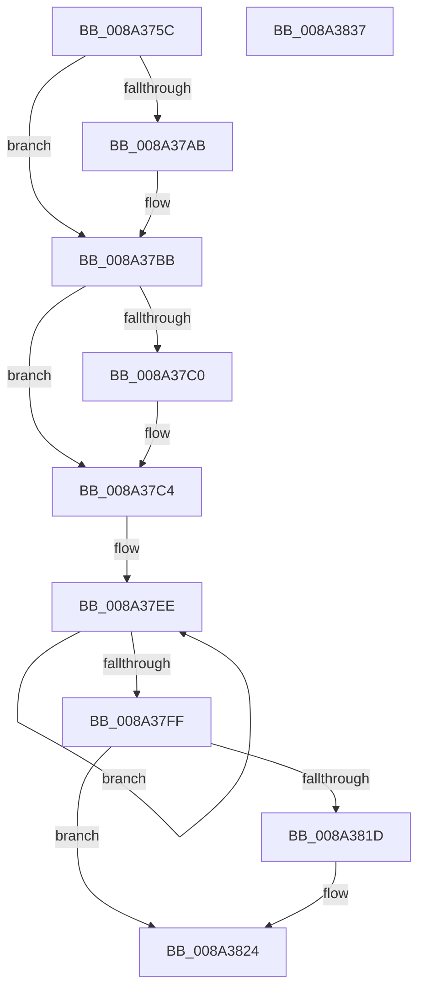

# PsGetProcessDeepFreezeStats

- RVA: `0x008A375C`–`0x008A3838` (길이 `220` bytes)
- VA: `0x00000001408A375C`
- 실행 섹션: `PAGE`
- PDB 이름 있음: `예`; PDB Function 태그: `아니요`
- unwind 정보 RVA: `0x000701D4`
- 디코드: `60`개 명령, `220/220` bytes 표시
- 미해석 바이트: `0` (있으면 어셈블리에 `.byte`로 보존)

> 이 문서는 커널 이미지의 기계어와 PDB 기호를 분석해 생성했습니다. 4번과 5번은 함수 원형과 자료형을 바이너리 사용 방식에서 추정한 C 해석이며 원본 소스 복구 결과는 아닙니다.

## 1. Dependencies

- 직접 호출 지점: **3**; 고유 호출 대상: **3**
- 직접 호출자로 확인된 함수: **2**
- RIP 상대 이미지 참조: **0**

### Outgoing calls
- `0x008A3795` → [KeAbPreAcquire](../../text/21/KeAbPreAcquire_function_00210230.md) (function, `0x00210230`)
- `0x008A37B6` → [ExfAcquirePushLockSharedEx](../../text/21/ExfAcquirePushLockSharedEx_function_0021044C.md) (function, `0x0021044C`)
- `0x008A3805` → [PspUnlockProcessShared](../../text/26/PspUnlockProcessShared_function_00263950.md) (function, `0x00263950`)

### Direct callers
- [PsSetProcessTelemetryAppState](PsSetProcessTelemetryAppState_function_008A35F0.md) at `0x008A363F`
- [NtQueryInformationProcess](../9A/NtQueryInformationProcess_function_009AA250.md) at `0x009AD151`

### Static image references
- 디코드된 RIP-relative 메모리 참조가 없습니다.

## 2. Other-region calls and transfers

- 다른 실행 섹션으로 향하는 call: **3**
  - `0x008A3795` → [KeAbPreAcquire](../../text/21/KeAbPreAcquire_function_00210230.md) (`PAGE` → `.text`)
  - `0x008A37B6` → [ExfAcquirePushLockSharedEx](../../text/21/ExfAcquirePushLockSharedEx_function_0021044C.md) (`PAGE` → `.text`)
  - `0x008A3805` → [PspUnlockProcessShared](../../text/26/PspUnlockProcessShared_function_00263950.md) (`PAGE` → `.text`)
- 별도 외부 분기/꼬리 이동을 확인하지 못했습니다.

## 3. Assembly (complete function range)

```asm
008A375C  48 89 5C 24 10                  mov qword ptr [rsp + 0x10], rbx
008A3761  48 89 6C 24 18                  mov qword ptr [rsp + 0x18], rbp
008A3766  56                              push rsi
008A3767  57                              push rdi
008A3768  41 56                           push r14
008A376A  48 83 EC 20                     sub rsp, 0x20
008A376E  65 4C 8B 34 25 88 01 00 00      mov r14, qword ptr gs:[0x188]
008A3777  48 8D B1 C8 01 00 00            lea rsi, [rcx + 0x1c8]
008A377E  48 8B DA                        mov rbx, rdx
008A3781  48 8B E9                        mov rbp, rcx
008A3784  45 33 C0                        xor r8d, r8d
008A3787  33 D2                           xor edx, edx
008A3789  48 8B CE                        mov rcx, rsi
008A378C  66 41 FF 8E E4 01 00 00         dec word ptr [r14 + 0x1e4]
008A3794  90                              nop
008A3795  E8 96 CA 96 FF                  call 0x140210230
008A379A  48 8B F8                        mov rdi, rax
008A379D  B9 11 00 00 00                  mov ecx, 0x11
008A37A2  33 C0                           xor eax, eax
008A37A4  F0 48 0F B1 0E                  lock cmpxchg qword ptr [rsi], rcx
008A37A9  74 10                           je 0x1408a37bb
008A37AB  4C 8B CE                        mov r9, rsi
008A37AE  4C 8B C7                        mov r8, rdi
008A37B1  33 D2                           xor edx, edx
008A37B3  48 8B CE                        mov rcx, rsi
008A37B6  E8 91 CC 96 FF                  call 0x14021044c
008A37BB  48 85 FF                        test rdi, rdi
008A37BE  74 04                           je 0x1408a37c4
008A37C0  C6 47 0A 01                     mov byte ptr [rdi + 0xa], 1
008A37C4  48 8B 85 90 06 00 00            mov rax, qword ptr [rbp + 0x690]
008A37CB  48 B9 B0 03 00 00 80 F7 FF FF   movabs rcx, 0xfffff780000003b0
008A37D5  48 89 43 10                     mov qword ptr [rbx + 0x10], rax
008A37D9  48 BA 08 00 00 00 80 F7 FF FF   movabs rdx, 0xfffff78000000008
008A37E3  48 8B 85 30 06 00 00            mov rax, qword ptr [rbp + 0x630]
008A37EA  48 89 43 18                     mov qword ptr [rbx + 0x18], rax
008A37EE  48 8B 39                        mov rdi, qword ptr [rcx]
008A37F1  48 8B 02                        mov rax, qword ptr [rdx]
008A37F4  48 89 03                        mov qword ptr [rbx], rax
008A37F7  48 8B 01                        mov rax, qword ptr [rcx]
008A37FA  48 3B F8                        cmp rdi, rax
008A37FD  75 EF                           jne 0x1408a37ee
008A37FF  49 8B D6                        mov rdx, r14
008A3802  48 8B CD                        mov rcx, rbp
008A3805  E8 46 01 9C FF                  call 0x140263950
008A380A  48 8B 03                        mov rax, qword ptr [rbx]
008A380D  48 8B 4B 18                     mov rcx, qword ptr [rbx + 0x18]
008A3811  48 2B C7                        sub rax, rdi
008A3814  48 89 43 08                     mov qword ptr [rbx + 8], rax
008A3818  48 85 C9                        test rcx, rcx
008A381B  74 07                           je 0x1408a3824
008A381D  48 2B C1                        sub rax, rcx
008A3820  48 01 43 10                     add qword ptr [rbx + 0x10], rax
008A3824  48 8B 5C 24 48                  mov rbx, qword ptr [rsp + 0x48]
008A3829  48 8B 6C 24 50                  mov rbp, qword ptr [rsp + 0x50]
008A382E  48 83 C4 20                     add rsp, 0x20
008A3832  41 5E                           pop r14
008A3834  5F                              pop rdi
008A3835  5E                              pop rsi
008A3836  C3                              ret
008A3837  CC                              int3
```

## 4. C-style interpretation (structured pseudocode)

```c
__int64 __fastcall PsGetProcessDeepFreezeStats(__int64 a1, __int64 a2, int a3)
{
    __int64 result;
    __int64 v_rsp;
    unsigned __int64 v_stack_p10;
    unsigned __int64 v_stack_p18;

    v_stack_p10 = v_rbx;
    v_stack_p18 = v_rbp;
    v_rsp = (v_rsp) - (32);
    a3 = 0;
    a2 = 0;
    result = KeAbPreAcquire(a1 + 456, a2, a3, a4);
    result = 0;
    if (!(condition_is_equal)) {
        a4 = a1 + 456;
        a3 = 0;
        a2 = 0;
        a1 = a1 + 456;
        result = ExfAcquirePushLockSharedEx(a1, a2, a3, a4);
    }
    if (result != 0) {
        *(unsigned __int8 *)(result + 10) = 1;
    }
    *(unsigned __int64 *)(a2 + 16) = *(unsigned __int64 *)(a1 + 1680);
    *(unsigned __int64 *)(a2 + 24) = *(unsigned __int64 *)(a1 + 1584);
loc_008A37EE:
    *(unsigned __int64 *)(a2) = *(unsigned __int64 *)(a2);
    if ((*(unsigned __int64 *)(a1)) != (*(unsigned __int64 *)(a1))) goto loc_008A37EE;
    result = PspUnlockProcessShared(a1, *(unsigned __int64 *)(gs_base + (0 + 392)), a3, a4);
    result = (*(unsigned __int64 *)(a2)) - (*(unsigned __int64 *)(a1));
    *(unsigned __int64 *)(a2 + 8) = result;
    if (*(unsigned __int64 *)(a2 + 24) != 0) {
        result = (result) - (*(unsigned __int64 *)(a2 + 24));
    }
    v_rsp = (v_rsp) + (32);
    return result;
}
```

## 5. (Beta) C Style

```c
int64_t PsGetProcessDeepFreezeStats(void *Arg1, void *Arg2, int32_t Arg3)
{
    uint8_t *arg1 = (uint8_t *)Arg1;
    uint8_t *arg2 = (uint8_t *)Arg2;

    int64_t result;
    int64_t local_rsp;
    uint64_t v_stack_p10;
    uint64_t v_stack_p18;

    v_stack_p10 = local_rbx;
    v_stack_p18 = local_rbp;
    local_rsp = (local_rsp) - (32);
    Arg3 = 0;
    Arg2 = 0;
    result = KeAbPreAcquire(Arg1 + 456, Arg2, Arg3, a4);
    result = 0;
    if (!(condition_is_equal)) {
        a4 = Arg1 + 456;
        Arg3 = 0;
        Arg2 = 0;
        Arg1 = Arg1 + 456;
        result = ExfAcquirePushLockSharedEx(Arg1, Arg2, Arg3, a4);
    }
    if (result != 0) {
        *(uint8_t *)(result + 0xA) = 1;
    }
    *(uint64_t *)(arg2 + 0x10) = *(uint64_t *)(arg1 + 0x690);
    *(uint64_t *)(arg2 + 0x18) = *(uint64_t *)(arg1 + 0x630);
loc_008A37EE:
    *(uint64_t *)(arg2) = *(uint64_t *)(arg2);
    if ((*(uint64_t *)(arg1)) != (*(uint64_t *)(arg1))) goto loc_008A37EE;
    result = PspUnlockProcessShared(Arg1, *(uint64_t *)(gs_base + (0 + 0x188)), Arg3, a4);
    result = (*(uint64_t *)(arg2)) - (*(uint64_t *)(arg1));
    *(uint64_t *)(arg2 + 0x8) = result;
    if (*(uint64_t *)(arg2 + 0x18) != 0) {
        result = (result) - (*(uint64_t *)(arg2 + 0x18));
    }
    local_rsp = (local_rsp) + (32);
    return result;
}
```

### 관측된 메모리 오프셋

구조체 형식이 확인되지 않은 접근은 인자 기준의 오프셋으로만 기록했습니다.

| 기준 인자 | 오프셋 표현 | 폭 (bit) | 접근 |
|---|---:|---:|---|
| `Arg1` | `+ 0x0` | `64` | `R` |
| `Arg1` | `+ 0x1C8` | `64` | `R` |
| `Arg1` | `+ 0x630` | `64` | `R` |
| `Arg1` | `+ 0x690` | `64` | `R` |
| `Arg2` | `+ 0x0` | `64` | `R` |
| `Arg2` | `+ 0x0` | `64` | `W` |
| `Arg2` | `+ 0x8` | `64` | `W` |
| `Arg2` | `+ 0x10` | `64` | `R/W` |
| `Arg2` | `+ 0x10` | `64` | `W` |
| `Arg2` | `+ 0x18` | `64` | `R` |
| `Arg2` | `+ 0x18` | `64` | `W` |

## 6. Execution-region graph

[열기: 2D/3D 그래프와 함수 탐색 컨트롤 패널](../../../control-panel.html?section=page&rva=0x008A375C&view=graph)

- 2D 그래프는 위에서 아래로 흐르고, 3D 그래프는 빈 공간을 드래그해 회전합니다. Shift+드래그는 이동, 휠은 확대·축소, 함수 노드 선택은 대상 보고서 이동입니다.

### Static fallback


