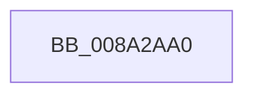

# PsLookupProcessByProcessId

- RVA: `0x008A2AA0`–`0x008A2AAB` (길이 `11` bytes)
- VA: `0x00000001408A2AA0`
- 실행 섹션: `PAGE`
- PDB 이름 있음: `예`; PDB Function 태그: `예`
- unwind 정보 RVA: `0x0007ED58`
- 디코드: `3`개 명령, `11/11` bytes 표시
- 미해석 바이트: `0` (있으면 어셈블리에 `.byte`로 보존)

> 이 문서는 커널 이미지의 기계어와 PDB 기호를 분석해 생성했습니다. 4번과 5번은 함수 원형과 자료형을 바이너리 사용 방식에서 추정한 C 해석이며 원본 소스 복구 결과는 아닙니다.

## 1. Dependencies

- 직접 호출 지점: **0**; 고유 호출 대상: **0**
- 직접 호출자로 확인된 함수: **23**
- RIP 상대 이미지 참조: **0**

### Outgoing calls
- 직접 디코드된 call 명령이 없습니다.

### Direct callers
- [IopLiveDumpAddProcessFilter](../../text/59/IopLiveDumpAddProcessFilter_function_00599008.md) at `0x00599074`
- [PiUEventIsProcessFrozen](../6F/PiUEventIsProcessFrozen_function_006FDF30.md) at `0x006FDF43`
- [EtwpGetPrivateSessionTraceHandle](../7B/EtwpGetPrivateSessionTraceHandle_function_007BC5A8.md) at `0x007BC63E`
- [CmpDumpOneKeyBody](../7E/CmpDumpOneKeyBody_function_007EAC5C.md) at `0x007EAC8F`
- [PsOpenProcess](../89/PsOpenProcess_function_00894A30.md) at `0x00894C58`
- [PspOneDirectionSecurityDomainCombine](PspOneDirectionSecurityDomainCombine_function_008A23BC.md) at `0x008A2429`
- [ExpSnapShotHandleTables](ExpSnapShotHandleTables_function_008A25C0.md) at `0x008A26BE`
- [EtwpPsProvTraceProcess](EtwpPsProvTraceProcess_function_008A3954.md) at `0x008A3AA2`
- [SeAuditProcessCreation](../94/SeAuditProcessCreation_function_00947624.md) at `0x009476D9`
- [PfpCopyEvent](../97/PfpCopyEvent_function_0097BE5C.md) at `0x0097BFD4`
- [EtwpEnableDisableUMGL](../9E/EtwpEnableDisableUMGL_function_009E3C88.md) at `0x009E3D80`
- [PopInitSystemSleeperThread](../9E/PopInitSystemSleeperThread_function_009ECBA8.md) at `0x009ECC80`
- [ExpQuerySystemInformation](../A5/ExpQuerySystemInformation_function_00A57858.md) at `0x00A58F52`
- [PopManageTransitionRecordRequest](../A6/PopManageTransitionRecordRequest_function_00A63B34.md) at `0x00A63BF8`
- [EtwpUpdatePerProcessTracing](../A6/EtwpUpdatePerProcessTracing_function_00A67374.md) at `0x00A67436`
- [PopDiagTraceAppPowerMessage](../A7/PopDiagTraceAppPowerMessage_function_00A7080C.md) at `0x00A70873`
- [PfpRpControlRequestUpdate](../A7/PfpRpControlRequestUpdate_function_00A7D2A8.md) at `0x00A7D30E`
- [PnpLogVetoInformation](../AB/PnpLogVetoInformation_function_00AB6BE8.md) at `0x00AB6C37`
- [PiUEventGetProcessImagePath](../AB/PiUEventGetProcessImagePath_function_00AB76F0.md) at `0x00AB771B`
- [sub_00B2EDF4](../B2/Unknown_function_00B2EDF4.md) at `0x00B2EE3F`
- [sub_00B3066E](../B3/Unknown_function_00B3066E.md) at `0x00B30693`
- [PopTransitionSystemPowerStateEx](../../pagelk/B7/PopTransitionSystemPowerStateEx_function_00B7E8C0.md) at `0x00B7F677`
- [ViCreateProcessCallbackInternal](../../pagevrfy/BA/ViCreateProcessCallbackInternal_function_00BA68C0.md) at `0x00BA68F3`

### Static image references
- 디코드된 RIP-relative 메모리 참조가 없습니다.

## 2. Other-region calls and transfers

- 다른 실행 섹션으로 향하는 call: **0**
- 별도 외부 분기/꼬리 이동을 확인하지 못했습니다.

## 3. Assembly (complete function range)

```asm
008A2AA0  48 89 5C 24 20                  mov qword ptr [rsp + 0x20], rbx
008A2AA5  41 56                           push r14
008A2AA7  48 83 EC 40                     sub rsp, 0x40
```

## 4. C-style interpretation (structured pseudocode)

```c
void __fastcall PsLookupProcessByProcessId(void)
{
    __int64 v_rsp;
    unsigned __int64 v_stack_p20;

    v_stack_p20 = v_rbx;
    v_rsp = (v_rsp) - (64);
    return;
}
```

## 5. (Beta) C Style

```c
void PsLookupProcessByProcessId(void)
{
    int64_t local_rsp;
    uint64_t v_stack_p20;

    v_stack_p20 = local_rbx;
    local_rsp = (local_rsp) - (64);
    return;
}
```

## 6. Execution-region graph

[열기: 2D/3D 그래프와 함수 탐색 컨트롤 패널](../../../control-panel.html?section=page&rva=0x008A2AA0&view=graph)

- 2D 그래프는 위에서 아래로 흐르고, 3D 그래프는 빈 공간을 드래그해 회전합니다. Shift+드래그는 이동, 휠은 확대·축소, 함수 노드 선택은 대상 보고서 이동입니다.

### Static fallback


