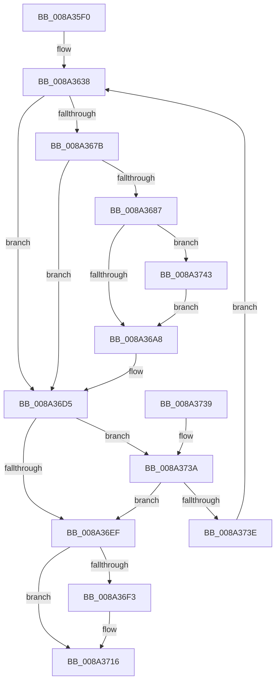

# PsSetProcessTelemetryAppState

- RVA: `0x008A35F0`–`0x008A3754` (길이 `356` bytes)
- VA: `0x00000001408A35F0`
- 실행 섹션: `PAGE`
- PDB 이름 있음: `예`; PDB Function 태그: `아니요`
- unwind 정보 RVA: `0x0007EE94`
- 디코드: `94`개 명령, `356/356` bytes 표시
- 미해석 바이트: `0` (있으면 어셈블리에 `.byte`로 보존)

> 이 문서는 커널 이미지의 기계어와 PDB 기호를 분석해 생성했습니다. 4번과 5번은 함수 원형과 자료형을 바이너리 사용 방식에서 추정한 C 해석이며 원본 소스 복구 결과는 아닙니다.

## 1. Dependencies

- 직접 호출 지점: **4**; 고유 호출 대상: **4**
- 직접 호출자로 확인된 함수: **4**
- RIP 상대 이미지 참조: **0**

### Outgoing calls
- `0x008A363F` → [PsGetProcessDeepFreezeStats](PsGetProcessDeepFreezeStats_function_008A375C.md) (function, `0x008A375C`)
- `0x008A365E` → [PspLockProcessExclusive](../../text/46/PspLockProcessExclusive_function_00460164.md) (function, `0x00460164`)
- `0x008A36DB` → [PspUnlockProcessExclusive](../../text/46/PspUnlockProcessExclusive_function_004601C0.md) (function, `0x004601C0`)
- `0x008A3711` → [EtwTraceAppStateChange](EtwTraceAppStateChange_function_008A452C.md) (function, `0x008A452C`)

### Direct callers
- [DbgkForwardException](DbgkForwardException_function_008A2D60.md) at `0x008A2E19`
- [PspExitProcess](../90/PspExitProcess_function_00904830.md) at `0x0090489C`
- [PsSetProcessFaultInformation](../A7/PsSetProcessFaultInformation_function_00A75400.md) at `0x00A754C7`
- [EtwpPsProvProcessEnumCallback](../A7/EtwpPsProvProcessEnumCallback_function_00A76690.md) at `0x00A76753`

### Static image references
- 디코드된 RIP-relative 메모리 참조가 없습니다.

## 2. Other-region calls and transfers

- 다른 실행 섹션으로 향하는 call: **2**
  - `0x008A365E` → [PspLockProcessExclusive](../../text/46/PspLockProcessExclusive_function_00460164.md) (`PAGE` → `.text`)
  - `0x008A36DB` → [PspUnlockProcessExclusive](../../text/46/PspUnlockProcessExclusive_function_004601C0.md) (`PAGE` → `.text`)
- 별도 외부 분기/꼬리 이동을 확인하지 못했습니다.

## 3. Assembly (complete function range)

```asm
008A35F0  48 89 5C 24 08                  mov qword ptr [rsp + 8], rbx
008A35F5  48 89 74 24 10                  mov qword ptr [rsp + 0x10], rsi
008A35FA  48 89 7C 24 18                  mov qword ptr [rsp + 0x18], rdi
008A35FF  55                              push rbp
008A3600  41 54                           push r12
008A3602  41 55                           push r13
008A3604  41 56                           push r14
008A3606  41 57                           push r15
008A3608  48 8B EC                        mov rbp, rsp
008A360B  48 81 EC 80 00 00 00            sub rsp, 0x80
008A3612  65 4C 8B 24 25 88 01 00 00      mov r12, qword ptr gs:[0x188]
008A361B  33 C0                           xor eax, eax
008A361D  0F 57 C0                        xorps xmm0, xmm0
008A3620  48 89 45 D0                     mov qword ptr [rbp - 0x30], rax
008A3624  0F 11 45 A0                     movups xmmword ptr [rbp - 0x60], xmm0
008A3628  48 89 45 D8                     mov qword ptr [rbp - 0x28], rax
008A362C  8B FA                           mov edi, edx
008A362E  0F 11 45 B0                     movups xmmword ptr [rbp - 0x50], xmm0
008A3632  89 45 F0                        mov dword ptr [rbp - 0x10], eax
008A3635  48 8B D9                        mov rbx, rcx
008A3638  48 8D 55 A0                     lea rdx, [rbp - 0x60]
008A363C  48 8B CB                        mov rcx, rbx
008A363F  E8 18 01 00 00                  call 0x1408a375c
008A3644  4C 8B 6D A8                     mov r13, qword ptr [rbp - 0x58]
008A3648  49 8B D4                        mov rdx, r12
008A364B  4D 8B F5                        mov r14, r13
008A364E  48 8B CB                        mov rcx, rbx
008A3651  4C 2B 75 B0                     sub r14, qword ptr [rbp - 0x50]
008A3655  33 F6                           xor esi, esi
008A3657  4C 2B B3 88 06 00 00            sub r14, qword ptr [rbx + 0x688]
008A365E  E8 01 CB BB FF                  call 0x140460164
008A3663  48 8B 8B A0 06 00 00            mov rcx, qword ptr [rbx + 0x6a0]
008A366A  4C 8B 7D A0                     mov r15, qword ptr [rbp - 0x60]
008A366E  48 8B C1                        mov rax, rcx
008A3671  48 C1 E8 3D                     shr rax, 0x3d
008A3675  48 83 F8 03                     cmp rax, 3
008A3679  74 5A                           je 0x1408a36d5
008A367B  48 8B 93 98 06 00 00            mov rdx, qword ptr [rbx + 0x698]
008A3682  49 3B D7                        cmp rdx, r15
008A3685  77 4E                           ja 0x1408a36d5
008A3687  48 89 55 D0                     mov qword ptr [rbp - 0x30], rdx
008A368B  48 BA FF FF FF FF FF FF FF 1F   movabs rdx, 0x1fffffffffffffff
008A3695  48 23 CA                        and rcx, rdx
008A3698  89 45 F0                        mov dword ptr [rbp - 0x10], eax
008A369B  48 89 4D D8                     mov qword ptr [rbp - 0x28], rcx
008A369F  83 FF 05                        cmp edi, 5
008A36A2  0F 84 9B 00 00 00               je 0x1408a3743
008A36A8  48 63 C7                        movsxd rax, edi
008A36AB  48 B9 00 00 00 00 00 00 00 E0   movabs rcx, 0xe000000000000000
008A36B5  48 C1 E0 3D                     shl rax, 0x3d
008A36B9  BE 01 00 00 00                  mov esi, 1
008A36BE  49 33 C6                        xor rax, r14
008A36C1  4C 89 BB 98 06 00 00            mov qword ptr [rbx + 0x698], r15
008A36C8  48 23 C1                        and rax, rcx
008A36CB  49 33 C6                        xor rax, r14
008A36CE  48 89 83 A0 06 00 00            mov qword ptr [rbx + 0x6a0], rax
008A36D5  49 8B D4                        mov rdx, r12
008A36D8  48 8B CB                        mov rcx, rbx
008A36DB  E8 E0 CA BB FF                  call 0x1404601c0
008A36E0  48 8B 83 A0 06 00 00            mov rax, qword ptr [rbx + 0x6a0]
008A36E7  48 C1 E8 3D                     shr rax, 0x3d
008A36EB  3C 03                           cmp al, 3
008A36ED  75 4B                           jne 0x1408a373a
008A36EF  85 F6                           test esi, esi
008A36F1  74 23                           je 0x1408a3716
008A36F3  48 8B 45 B0                     mov rax, qword ptr [rbp - 0x50]
008A36F7  48 8D 55 C0                     lea rdx, [rbp - 0x40]
008A36FB  48 8B CB                        mov rcx, rbx
008A36FE  48 89 45 E8                     mov qword ptr [rbp - 0x18], rax
008A3702  4C 89 7D C0                     mov qword ptr [rbp - 0x40], r15
008A3706  4C 89 6D C8                     mov qword ptr [rbp - 0x38], r13
008A370A  4C 89 75 E0                     mov qword ptr [rbp - 0x20], r14
008A370E  89 7D F4                        mov dword ptr [rbp - 0xc], edi
008A3711  E8 16 0E 00 00                  call 0x1408a452c
008A3716  4C 8D 9C 24 80 00 00 00         lea r11, [rsp + 0x80]
008A371E  8B C6                           mov eax, esi
008A3720  49 8B 5B 30                     mov rbx, qword ptr [r11 + 0x30]
008A3724  49 8B 73 38                     mov rsi, qword ptr [r11 + 0x38]
008A3728  49 8B 7B 40                     mov rdi, qword ptr [r11 + 0x40]
008A372C  49 8B E3                        mov rsp, r11
008A372F  41 5F                           pop r15
008A3731  41 5E                           pop r14
008A3733  41 5D                           pop r13
008A3735  41 5C                           pop r12
008A3737  5D                              pop rbp
008A3738  C3                              ret
008A3739  CC                              int3
008A373A  85 F6                           test esi, esi
008A373C  75 B1                           jne 0x1408a36ef
008A373E  E9 F5 FE FF FF                  jmp 0x1408a3638
008A3743  48 83 F8 01                     cmp rax, 1
008A3747  B9 06 00 00 00                  mov ecx, 6
008A374C  0F 44 F9                        cmove edi, ecx
008A374F  E9 54 FF FF FF                  jmp 0x1408a36a8
```

## 4. C-style interpretation (structured pseudocode)

```c
__int64 __fastcall PsSetProcessTelemetryAppState(__int64 a1, int a2)
{
    __int64 result;
    __int64 v_r14;
    __int64 v_rdi;
    __int64 v_rsi;
    __int64 v_rsp;
    unsigned __int64 v_stack_m28;
    unsigned int v_stack_m34;
    unsigned int v_stack_m38;
    unsigned __int64 v_stack_m40;
    unsigned __int64 v_stack_m48;
    unsigned __int64 v_stack_m50;
    unsigned __int64 v_stack_m58;
    unsigned __int64 v_stack_m60;
    unsigned __int64 v_stack_m68;
    unsigned __int64 v_stack_m78;
    unsigned __int64 v_stack_m80;
    unsigned __int64 v_stack_m88;
    unsigned __int64 v_stack_p10;
    unsigned __int64 v_stack_p18;
    unsigned __int64 v_stack_p8;

    v_stack_p8 = v_rbx;
    v_stack_p10 = v_rsi;
    v_stack_p18 = v_rdi;
    v_rsp = (v_rsp) - (128);
    result = 0;
    v_stack_m58 = 0;
    v_stack_m88 = v_xmm0;
    v_stack_m50 = 0;
    v_stack_m78 = v_xmm0;
    v_stack_m38 = 0;
loc_008A3638:
    result = PsGetProcessDeepFreezeStats(a1, v_stack_m88, a3, a4);
    v_r14 = (v_stack_m80) - (v_stack_m78);
    v_rsi = 0;
    v_r14 = (v_r14) - (*(unsigned __int64 *)(a1 + 1672));
    result = PspLockProcessExclusive(a1, *(unsigned __int64 *)(gs_base + (0 + 392)), a3, a4);
    result = (*(unsigned __int64 *)(a1 + 1696)) >> (61);
    if (result == 3) goto loc_008A36D5;
    if ((*(unsigned __int64 *)(a1 + 1688)) > v_stack_m88) goto loc_008A36D5;
    v_stack_m58 = *(unsigned __int64 *)(a1 + 1688);
    a1 = (*(unsigned __int64 *)(a1 + 1696)) & (*(unsigned __int64 *)(a1 + 1688));
    v_stack_m38 = (unsigned int)(result);
    v_stack_m50 = a1;
    if (((unsigned int)((unsigned int)(a2))) == 5) goto loc_008A3743;
loc_008A36A8:
    result = ((int)((unsigned int)((unsigned int)(a2)))) << (61);
    result = (result) ^ (v_r14);
    *(unsigned __int64 *)(a1 + 1688) = v_stack_m88;
    result = (result) & (a1);
    result = (result) ^ (v_r14);
    *(unsigned __int64 *)(a1 + 1696) = result;
loc_008A36D5:
    result = PspUnlockProcessExclusive(a1, *(unsigned __int64 *)(gs_base + (0 + 392)), a3, a4);
    result = (*(unsigned __int64 *)(a1 + 1696)) >> (61);
    if (((unsigned __int8)(result)) != 3) goto loc_008A373A;
loc_008A36EF:
    if (1 != 0) {
        result = v_stack_m78;
        a2 = v_stack_m68;
        a1 = a1;
        v_stack_m40 = result;
        v_stack_m68 = v_stack_m88;
        v_stack_m60 = v_stack_m80;
        v_stack_m48 = v_r14;
        v_stack_m34 = (unsigned int)((unsigned int)(a2));
        result = EtwTraceAppStateChange(a1, a2, a3, a4);
    }
    return 1;
loc_008A373A:
    if ((unsigned int)(*(unsigned __int64 *)(v_stack_m28 + 56)) != 0) goto loc_008A36EF;
    goto loc_008A3638;
loc_008A3743:
    v_rdi = *(unsigned __int64 *)(v_stack_m28 + 64);
    if (1 == 1) { v_rdi = 6; }
    goto loc_008A36A8;
}
```

## 5. (Beta) C Style

```c
int64_t PsSetProcessTelemetryAppState(void *Arg1, int32_t Arg2)
{
    uint8_t *arg1 = (uint8_t *)Arg1;

    int64_t result;
    int64_t local_r14;
    int64_t local_rdi;
    int64_t local_rsi;
    int64_t local_rsp;
    uint64_t v_stack_m28;
    uint32_t v_stack_m34;
    uint32_t v_stack_m38;
    uint64_t v_stack_m40;
    uint64_t v_stack_m48;
    uint64_t v_stack_m50;
    uint64_t v_stack_m58;
    uint64_t v_stack_m60;
    uint64_t v_stack_m68;
    uint64_t v_stack_m78;
    uint64_t v_stack_m80;
    uint64_t v_stack_m88;
    uint64_t v_stack_p10;
    uint64_t v_stack_p18;
    uint64_t v_stack_p8;

    v_stack_p8 = local_rbx;
    v_stack_p10 = local_rsi;
    v_stack_p18 = local_rdi;
    local_rsp = (local_rsp) - (128);
    result = 0;
    v_stack_m58 = 0;
    v_stack_m88 = v_xmm0;
    v_stack_m50 = 0;
    v_stack_m78 = v_xmm0;
    v_stack_m38 = 0;
loc_008A3638:
    result = PsGetProcessDeepFreezeStats(Arg1, v_stack_m88, a3, a4);
    local_r14 = (v_stack_m80) - (v_stack_m78);
    local_rsi = 0;
    local_r14 = (local_r14) - (*(uint64_t *)(arg1 + 0x688));
    result = PspLockProcessExclusive(Arg1, *(uint64_t *)(gs_base + (0 + 0x188)), a3, a4);
    result = (*(uint64_t *)(arg1 + 0x6A0)) >> (61);
    if (result == 3) goto loc_008A36D5;
    if ((*(uint64_t *)(arg1 + 0x698)) > v_stack_m88) goto loc_008A36D5;
    v_stack_m58 = *(uint64_t *)(arg1 + 0x698);
    Arg1 = (*(uint64_t *)(arg1 + 0x6A0)) & (*(uint64_t *)(arg1 + 0x698));
    v_stack_m38 = (uint32_t)(result);
    v_stack_m50 = Arg1;
    if (((uint32_t)((uint32_t)(Arg2))) == 5) goto loc_008A3743;
loc_008A36A8:
    result = ((int32_t)((uint32_t)((uint32_t)(Arg2)))) << (61);
    result = (result) ^ (local_r14);
    *(uint64_t *)(arg1 + 0x698) = v_stack_m88;
    result = (result) & (Arg1);
    result = (result) ^ (local_r14);
    *(uint64_t *)(arg1 + 0x6A0) = result;
loc_008A36D5:
    result = PspUnlockProcessExclusive(Arg1, *(uint64_t *)(gs_base + (0 + 0x188)), a3, a4);
    result = (*(uint64_t *)(arg1 + 0x6A0)) >> (61);
    if (((uint8_t)(result)) != 3) goto loc_008A373A;
loc_008A36EF:
    if (1 != 0) {
        result = v_stack_m78;
        Arg2 = v_stack_m68;
        Arg1 = Arg1;
        v_stack_m40 = result;
        v_stack_m68 = v_stack_m88;
        v_stack_m60 = v_stack_m80;
        v_stack_m48 = local_r14;
        v_stack_m34 = (uint32_t)((uint32_t)(Arg2));
        result = EtwTraceAppStateChange(Arg1, Arg2, a3, a4);
    }
    return 1;
loc_008A373A:
    if ((uint32_t)(*(uint64_t *)(v_stack_m28 + 0x38)) != 0) goto loc_008A36EF;
    goto loc_008A3638;
loc_008A3743:
    local_rdi = *(uint64_t *)(v_stack_m28 + 0x40);
    if (1 == 1) { local_rdi = 6; }
    goto loc_008A36A8;
}
```

### 관측된 메모리 오프셋

구조체 형식이 확인되지 않은 접근은 인자 기준의 오프셋으로만 기록했습니다.

| 기준 인자 | 오프셋 표현 | 폭 (bit) | 접근 |
|---|---:|---:|---|
| `Arg1` | `+ 0x688` | `64` | `R` |
| `Arg1` | `+ 0x698` | `64` | `R` |
| `Arg1` | `+ 0x698` | `64` | `W` |
| `Arg1` | `+ 0x6A0` | `64` | `R` |
| `Arg1` | `+ 0x6A0` | `64` | `W` |

## 6. Execution-region graph

[열기: 2D/3D 그래프와 함수 탐색 컨트롤 패널](../../../control-panel.html?section=page&rva=0x008A35F0&view=graph)

- 2D 그래프는 위에서 아래로 흐르고, 3D 그래프는 빈 공간을 드래그해 회전합니다. Shift+드래그는 이동, 휠은 확대·축소, 함수 노드 선택은 대상 보고서 이동입니다.

### Static fallback


