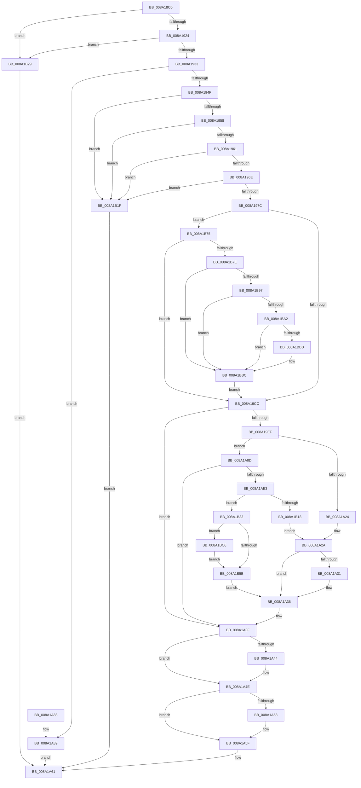

# PspCombineSecurityDomains

- RVA: `0x008A18C0`–`0x008A1BEF` (길이 `815` bytes)
- VA: `0x00000001408A18C0`
- 실행 섹션: `PAGE`
- PDB 이름 있음: `예`; PDB Function 태그: `아니요`
- unwind 정보 RVA: `0x0007EC24`
- 디코드: `183`개 명령, `815/815` bytes 표시
- 미해석 바이트: `0` (있으면 어셈블리에 `.byte`로 보존)

> 이 문서는 커널 이미지의 기계어와 PDB 기호를 분석해 생성했습니다. 4번과 5번은 함수 원형과 자료형을 바이너리 사용 방식에서 추정한 C 해석이며 원본 소스 복구 결과는 아닙니다.

## 1. Dependencies

- 직접 호출 지점: **15**; 고유 호출 대상: **10**
- 직접 호출자로 확인된 함수: **1**
- RIP 상대 이미지 참조: **5**

### Outgoing calls
- `0x008A1900` → [memset](../../text/6C/memset_function_006C6C40.md) (function, `0x006C6C40`)
- `0x008A1911` → [memset](../../text/6C/memset_function_006C6C40.md) (function, `0x006C6C40`)
- `0x008A19B6` → [PsReferencePrimaryTokenWithTag](../../text/20/PsReferencePrimaryTokenWithTag_function_0020FF80.md) (function, `0x0020FF80`)
- `0x008A19E4` → [SepCreateAccessStateFromSubjectContext](../../text/3E/SepCreateAccessStateFromSubjectContext_function_003EBF40.md) (function, `0x003EBF40`)
- `0x008A1A19` → [ObOpenObjectByPointer](../8B/ObOpenObjectByPointer_function_008B7420.md) (function, `0x008B7420`)
- `0x008A1A3A` → [SeDeleteAccessState](../8C/SeDeleteAccessState_function_008C5F70.md) (function, `0x008C5F70`)
- `0x008A1A49` → [ObCloseHandle](ObCloseHandle_function_008A1870.md) (function, `0x008A1870`)
- `0x008A1A5A` → [ObCloseHandle](ObCloseHandle_function_008A1870.md) (function, `0x008A1870`)
- `0x008A1A6B` → [_security_check_cookie](../../text/6A/_security_check_cookie_function_006AC640.md) (function, `0x006AC640`)
- `0x008A1A91` → [SeDeleteAccessState](../8C/SeDeleteAccessState_function_008C5F70.md) (function, `0x008C5F70`)
- `0x008A1AB7` → [SeCaptureSubjectContextEx](../8C/SeCaptureSubjectContextEx_function_008C4C90.md) (function, `0x008C4C90`)
- `0x008A1AD4` → [SepCreateAccessStateFromSubjectContext](../../text/3E/SepCreateAccessStateFromSubjectContext_function_003EBF40.md) (function, `0x003EBF40`)
- `0x008A1B0D` → [ObOpenObjectByPointer](../8B/ObOpenObjectByPointer_function_008B7420.md) (function, `0x008B7420`)
- `0x008A1B5E` → [KeSynchronizeSecurityDomain](../../text/4B/KeSynchronizeSecurityDomain_function_004B0FE0.md) (function, `0x004B0FE0`)
- `0x008A1B66` → [PspSynchronizeThreadIsolationDomains](../../text/3C/PspSynchronizeThreadIsolationDomains_function_003C479C.md) (function, `0x003C479C`)

### Direct callers
- [NtSetInformationProcess](../AE/NtSetInformationProcess_function_00AE5370.md) at `0x00AE9810`

### Static image references
- `0x008A18DD` → RVA `0x00E0A740` (`.data`; read)
- `0x008A197C` → RVA `0x00FC6A98` (`ALMOSTRO`; read)
- `0x008A19BB` → RVA `0x00FD8010` (`PAGEDATA`; read)
- `0x008A1B8E` → RVA `0x00E67B90` (`.data`; read)
- `0x008A1BCB` → RVA `0x00E0C590` (`.data`; read/write)

## 2. Other-region calls and transfers

- 다른 실행 섹션으로 향하는 call: **8**
  - `0x008A1900` → [memset](../../text/6C/memset_function_006C6C40.md) (`PAGE` → `.text`)
  - `0x008A1911` → [memset](../../text/6C/memset_function_006C6C40.md) (`PAGE` → `.text`)
  - `0x008A19B6` → [PsReferencePrimaryTokenWithTag](../../text/20/PsReferencePrimaryTokenWithTag_function_0020FF80.md) (`PAGE` → `.text`)
  - `0x008A19E4` → [SepCreateAccessStateFromSubjectContext](../../text/3E/SepCreateAccessStateFromSubjectContext_function_003EBF40.md) (`PAGE` → `.text`)
  - `0x008A1A6B` → [_security_check_cookie](../../text/6A/_security_check_cookie_function_006AC640.md) (`PAGE` → `.text`)
  - `0x008A1AD4` → [SepCreateAccessStateFromSubjectContext](../../text/3E/SepCreateAccessStateFromSubjectContext_function_003EBF40.md) (`PAGE` → `.text`)
  - `0x008A1B5E` → [KeSynchronizeSecurityDomain](../../text/4B/KeSynchronizeSecurityDomain_function_004B0FE0.md) (`PAGE` → `.text`)
  - `0x008A1B66` → [PspSynchronizeThreadIsolationDomains](../../text/3C/PspSynchronizeThreadIsolationDomains_function_003C479C.md) (`PAGE` → `.text`)
- 별도 외부 분기/꼬리 이동을 확인하지 못했습니다.

## 3. Assembly (complete function range)

```asm
008A18C0  48 89 5C 24 18                  mov qword ptr [rsp + 0x18], rbx
008A18C5  48 89 74 24 20                  mov qword ptr [rsp + 0x20], rsi
008A18CA  55                              push rbp
008A18CB  57                              push rdi
008A18CC  41 56                           push r14
008A18CE  48 8D AC 24 E0 FE FF FF         lea rbp, [rsp - 0x120]
008A18D6  48 81 EC 20 02 00 00            sub rsp, 0x220
008A18DD  48 8B 05 5C 8E 56 00            mov rax, qword ptr [rip + 0x568e5c]
008A18E4  48 33 C4                        xor rax, rsp
008A18E7  48 89 85 10 01 00 00            mov qword ptr [rbp + 0x110], rax
008A18EE  4C 8B F2                        mov r14, rdx
008A18F1  48 8B F9                        mov rdi, rcx
008A18F4  33 D2                           xor edx, edx
008A18F6  48 8D 4D 90                     lea rcx, [rbp - 0x70]
008A18FA  41 B8 A0 00 00 00               mov r8d, 0xa0
008A1900  E8 3B 53 E2 FF                  call 0x1406c6c40
008A1905  33 D2                           xor edx, edx
008A1907  48 8D 4D 30                     lea rcx, [rbp + 0x30]
008A190B  41 B8 E0 00 00 00               mov r8d, 0xe0
008A1911  E8 2A 53 E2 FF                  call 0x1406c6c40
008A1916  0F BA A7 FC 05 00 00 16         bt dword ptr [rdi + 0x5fc], 0x16
008A191E  0F 83 05 02 00 00               jae 0x1408a1b29
008A1924  41 0F BA A6 FC 05 00 00 16      bt dword ptr [r14 + 0x5fc], 0x16
008A192D  0F 83 F6 01 00 00               jae 0x1408a1b29
008A1933  F0 83 0C 24 00                  lock or dword ptr [rsp], 0
008A1938  48 8B 8F 60 07 00 00            mov rcx, qword ptr [rdi + 0x760]
008A193F  49 8B 86 60 07 00 00            mov rax, qword ptr [r14 + 0x760]
008A1946  48 3B C8                        cmp rcx, rax
008A1949  0F 84 3A 01 00 00               je 0x1408a1a89
008A194F  48 85 C9                        test rcx, rcx
008A1952  0F 84 C7 01 00 00               je 0x1408a1b1f
008A1958  48 85 C0                        test rax, rax
008A195B  0F 84 BE 01 00 00               je 0x1408a1b1f
008A1961  83 BF 50 07 00 00 00            cmp dword ptr [rdi + 0x750], 0
008A1968  0F 8C B1 01 00 00               jl 0x1408a1b1f
008A196E  41 83 BE 50 07 00 00 00         cmp dword ptr [r14 + 0x750], 0
008A1976  0F 8C A3 01 00 00               jl 0x1408a1b1f
008A197C  48 8B 1D 15 51 72 00            mov rbx, qword ptr [rip + 0x725115]
008A1983  33 F6                           xor esi, esi
008A1985  49 8B 86 D0 01 00 00            mov rax, qword ptr [r14 + 0x1d0]
008A198C  0F 57 C0                        xorps xmm0, xmm0
008A198F  48 21 74 24 50                  and qword ptr [rsp + 0x50], rsi
008A1994  BA 53 65 53 75                  mov edx, 0x75536553
008A1999  48 83 64 24 48 00               and qword ptr [rsp + 0x48], 0
008A199F  49 8B CE                        mov rcx, r14
008A19A2  48 89 74 24 40                  mov qword ptr [rsp + 0x40], rsi
008A19A7  48 83 C3 4C                     add rbx, 0x4c
008A19AB  F3 0F 7F 44 24 58               movdqu xmmword ptr [rsp + 0x58], xmm0
008A19B1  48 89 44 24 68                  mov qword ptr [rsp + 0x68], rax
008A19B6  E8 C5 E5 96 FF                  call 0x14020ff80
008A19BB  39 35 4F 66 73 00               cmp dword ptr [rip + 0x73664f], esi
008A19C1  48 89 44 24 60                  mov qword ptr [rsp + 0x60], rax
008A19C6  0F 85 A9 01 00 00               jne 0x1408a1b75
008A19CC  41 B9 28 00 00 00               mov r9d, 0x28
008A19D2  48 89 5C 24 20                  mov qword ptr [rsp + 0x20], rbx
008A19D7  4C 8D 45 30                     lea r8, [rbp + 0x30]
008A19DB  48 8D 55 90                     lea rdx, [rbp - 0x70]
008A19DF  48 8D 4C 24 50                  lea rcx, [rsp + 0x50]
008A19E4  E8 57 A5 B4 FF                  call 0x1403ebf40
008A19E9  8B D8                           mov ebx, eax
008A19EB  85 C0                           test eax, eax
008A19ED  78 50                           js 0x1408a1a3f
008A19EF  48 8D 44 24 48                  lea rax, [rsp + 0x48]
008A19F4  45 33 C9                        xor r9d, r9d
008A19F7  48 89 44 24 30                  mov qword ptr [rsp + 0x30], rax
008A19FC  4C 8D 45 90                     lea r8, [rbp - 0x70]
008A1A00  48 8B 05 91 50 72 00            mov rax, qword ptr [rip + 0x725091]
008A1A07  BA 00 06 00 00                  mov edx, 0x600
008A1A0C  C6 44 24 28 00                  mov byte ptr [rsp + 0x28], 0
008A1A11  48 8B CF                        mov rcx, rdi
008A1A14  48 89 44 24 20                  mov qword ptr [rsp + 0x20], rax
008A1A19  E8 02 5A 01 00                  call 0x1408b7420
008A1A1E  8B D8                           mov ebx, eax
008A1A20  85 C0                           test eax, eax
008A1A22  79 69                           jns 0x1408a1a8d
008A1A24  48 83 64 24 48 00               and qword ptr [rsp + 0x48], 0
008A1A2A  3D 22 00 00 C0                  cmp eax, 0xc0000022
008A1A2F  75 05                           jne 0x1408a1a36
008A1A31  BB 65 04 00 C0                  mov ebx, 0xc0000465
008A1A36  48 8D 4D 90                     lea rcx, [rbp - 0x70]
008A1A3A  E8 31 45 02 00                  call 0x1408c5f70
008A1A3F  48 85 F6                        test rsi, rsi
008A1A42  74 0A                           je 0x1408a1a4e
008A1A44  33 D2                           xor edx, edx
008A1A46  48 8B CE                        mov rcx, rsi
008A1A49  E8 22 FE FF FF                  call 0x1408a1870
008A1A4E  48 8B 4C 24 48                  mov rcx, qword ptr [rsp + 0x48]
008A1A53  48 85 C9                        test rcx, rcx
008A1A56  74 07                           je 0x1408a1a5f
008A1A58  33 D2                           xor edx, edx
008A1A5A  E8 11 FE FF FF                  call 0x1408a1870
008A1A5F  8B C3                           mov eax, ebx
008A1A61  48 8B 8D 10 01 00 00            mov rcx, qword ptr [rbp + 0x110]
008A1A68  48 33 CC                        xor rcx, rsp
008A1A6B  E8 D0 AB E0 FF                  call 0x1406ac640
008A1A70  4C 8D 9C 24 20 02 00 00         lea r11, [rsp + 0x220]
008A1A78  49 8B 5B 30                     mov rbx, qword ptr [r11 + 0x30]
008A1A7C  49 8B 73 38                     mov rsi, qword ptr [r11 + 0x38]
008A1A80  49 8B E3                        mov rsp, r11
008A1A83  41 5E                           pop r14
008A1A85  5F                              pop rdi
008A1A86  5D                              pop rbp
008A1A87  C3                              ret
008A1A88  CC                              int3
008A1A89  33 C0                           xor eax, eax
008A1A8B  EB D4                           jmp 0x1408a1a61
008A1A8D  48 8D 4D 90                     lea rcx, [rbp - 0x70]
008A1A91  E8 DA 44 02 00                  call 0x1408c5f70
008A1A96  48 8B 1D FB 4F 72 00            mov rbx, qword ptr [rip + 0x724ffb]
008A1A9D  4C 8D 44 24 70                  lea r8, [rsp + 0x70]
008A1AA2  0F 57 C0                        xorps xmm0, xmm0
008A1AA5  48 8B D7                        mov rdx, rdi
008A1AA8  33 C9                           xor ecx, ecx
008A1AAA  48 83 C3 4C                     add rbx, 0x4c
008A1AAE  0F 11 44 24 70                  movups xmmword ptr [rsp + 0x70], xmm0
008A1AB3  0F 11 45 80                     movups xmmword ptr [rbp - 0x80], xmm0
008A1AB7  E8 D4 31 02 00                  call 0x1408c4c90
008A1ABC  41 B9 28 00 00 00               mov r9d, 0x28
008A1AC2  48 89 5C 24 20                  mov qword ptr [rsp + 0x20], rbx
008A1AC7  4C 8D 45 30                     lea r8, [rbp + 0x30]
008A1ACB  48 8D 55 90                     lea rdx, [rbp - 0x70]
008A1ACF  48 8D 4C 24 70                  lea rcx, [rsp + 0x70]
008A1AD4  E8 67 A4 B4 FF                  call 0x1403ebf40
008A1AD9  8B D8                           mov ebx, eax
008A1ADB  85 C0                           test eax, eax
008A1ADD  0F 88 5C FF FF FF               js 0x1408a1a3f
008A1AE3  48 8D 44 24 40                  lea rax, [rsp + 0x40]
008A1AE8  45 33 C9                        xor r9d, r9d
008A1AEB  48 89 44 24 30                  mov qword ptr [rsp + 0x30], rax
008A1AF0  4C 8D 45 90                     lea r8, [rbp - 0x70]
008A1AF4  48 8B 05 9D 4F 72 00            mov rax, qword ptr [rip + 0x724f9d]
008A1AFB  BA 00 06 00 00                  mov edx, 0x600
008A1B00  C6 44 24 28 00                  mov byte ptr [rsp + 0x28], 0
008A1B05  49 8B CE                        mov rcx, r14
008A1B08  48 89 44 24 20                  mov qword ptr [rsp + 0x20], rax
008A1B0D  E8 0E 59 01 00                  call 0x1408b7420
008A1B12  8B D8                           mov ebx, eax
008A1B14  85 C0                           test eax, eax
008A1B16  79 1B                           jns 0x1408a1b33
008A1B18  33 F6                           xor esi, esi
008A1B1A  E9 0B FF FF FF                  jmp 0x1408a1a2a
008A1B1F  B8 65 04 00 C0                  mov eax, 0xc0000465
008A1B24  E9 38 FF FF FF                  jmp 0x1408a1a61
008A1B29  B8 7C 00 00 C0                  mov eax, 0xc000007c
008A1B2E  E9 2E FF FF FF                  jmp 0x1408a1a61
008A1B33  F0 81 8F FC 05 00 00 00 00 20 00  lock or dword ptr [rdi + 0x5fc], 0x200000
008A1B3E  49 8B 86 60 07 00 00            mov rax, qword ptr [r14 + 0x760]
008A1B45  48 89 87 60 07 00 00            mov qword ptr [rdi + 0x760], rax
008A1B4C  41 8B 86 50 07 00 00            mov eax, dword ptr [r14 + 0x750]
008A1B53  0B 87 50 07 00 00               or eax, dword ptr [rdi + 0x750]
008A1B59  7C 6B                           jl 0x1408a1bc6
008A1B5B  48 8B CF                        mov rcx, rdi
008A1B5E  E8 7D F4 C0 FF                  call 0x1404b0fe0
008A1B63  48 8B CF                        mov rcx, rdi
008A1B66  E8 31 2C B2 FF                  call 0x1403c479c
008A1B6B  48 8B 74 24 40                  mov rsi, qword ptr [rsp + 0x40]
008A1B70  E9 C1 FE FF FF                  jmp 0x1408a1a36
008A1B75  48 85 C0                        test rax, rax
008A1B78  0F 84 4E FE FF FF               je 0x1408a19cc
008A1B7E  48 8B 88 78 04 00 00            mov rcx, qword ptr [rax + 0x478]
008A1B85  BA 1C 01 00 00                  mov edx, 0x11c
008A1B8A  F0 FF 04 11                     lock inc dword ptr [rcx + rdx]
008A1B8E  48 3B 05 FB 5F 5C 00            cmp rax, qword ptr [rip + 0x5c5ffb]
008A1B95  75 25                           jne 0x1408a1bbc
008A1B97  CC                              int3
008A1B98  48 8B 44 24 50                  mov rax, qword ptr [rsp + 0x50]
008A1B9D  48 85 C0                        test rax, rax
008A1BA0  74 1A                           je 0x1408a1bbc
008A1BA2  48 8B 80 78 04 00 00            mov rax, qword ptr [rax + 0x478]
008A1BA9  F0 FF 04 10                     lock inc dword ptr [rax + rdx]
008A1BAD  48 8B 05 DC 5F 5C 00            mov rax, qword ptr [rip + 0x5c5fdc]
008A1BB4  48 39 44 24 50                  cmp qword ptr [rsp + 0x50], rax
008A1BB9  75 01                           jne 0x1408a1bbc
008A1BBB  CC                              int3
008A1BBC  48 8B 74 24 40                  mov rsi, qword ptr [rsp + 0x40]
008A1BC1  E9 06 FE FF FF                  jmp 0x1408a19cc
008A1BC6  B8 01 00 00 00                  mov eax, 1
008A1BCB  F0 48 0F C1 05 BC A9 56 00      lock xadd qword ptr [rip + 0x56a9bc], rax
008A1BD4  48 FF C0                        inc rax
008A1BD7  BB 65 04 00 C0                  mov ebx, 0xc0000465
008A1BDC  48 89 87 60 07 00 00            mov qword ptr [rdi + 0x760], rax
008A1BE3  48 89 87 68 07 00 00            mov qword ptr [rdi + 0x768], rax
008A1BEA  E9 6C FF FF FF                  jmp 0x1408a1b5b
```

## 4. C-style interpretation (structured pseudocode)

```c
__int64 __fastcall PspCombineSecurityDomains(__int64 a1, __int64 a2)
{
    __int64 result;
    __int64 v_rbx;
    __int64 v_rsi;
    __int64 v_rsp;
    unsigned __int64 v_stack_m108;
    unsigned __int64 v_stack_m138;
    unsigned __int64 v_stack_m18;
    unsigned __int64 v_stack_m1A8;
    unsigned __int64 v_stack_m1B0;
    unsigned __int64 v_stack_m1B8;
    unsigned __int64 v_stack_m1D0;
    unsigned __int64 v_stack_m1D8;
    unsigned __int64 v_stack_m1E0;
    unsigned __int64 v_stack_m1E8;
    unsigned __int64 v_stack_m1F0;
    unsigned __int64 v_stack_m1F8;
    unsigned __int64 v_stack_m200;
    unsigned __int64 v_stack_m208;
    unsigned __int8 v_stack_m210;
    unsigned __int64 v_stack_m218;
    unsigned int v_stack_m238;
    unsigned __int64 v_stack_m28;
    unsigned __int64 v_stack_p18;
    unsigned __int64 v_stack_p20;

    v_stack_p18 = v_rbx;
    v_stack_p20 = v_rsi;
    v_rsp = (v_rsp) - (544);
    result = (*(unsigned __int64 *)(v_rip + 5672540)) ^ (v_rsp);
    v_stack_m28 = result;
    a2 = 0;
    result = memset(v_stack_m1A8, a2, 160, a4);
    a2 = 0;
    result = memset(v_stack_m108, a2, 224, a4);
    if (condition_is_above_or_equal) goto loc_008A1B29;
    if (condition_is_above_or_equal) goto loc_008A1B29;
    if ((*(unsigned __int64 *)(a1 + 1888)) == (*(unsigned __int64 *)(a2 + 1888))) goto loc_008A1A89;
    if (*(unsigned __int64 *)(a1 + 1888) == 0) goto loc_008A1B1F;
    if (*(unsigned __int64 *)(a2 + 1888) == 0) goto loc_008A1B1F;
    if ((*(unsigned int *)(a1 + 1872)) < 0) goto loc_008A1B1F;
    if ((*(unsigned int *)(a2 + 1872)) < 0) goto loc_008A1B1F;
    v_rsi = 0;
    v_stack_m1F8 = 0;
    v_rbx = (*(unsigned __int64 *)(v_rip + 7491861)) + (76);
    v_stack_m1E0 = v_xmm0;
    v_stack_m1D0 = *(unsigned __int64 *)(a2 + 464);
    result = PsReferencePrimaryTokenWithTag(0, (unsigned int)(0x75536553ULL), 224, a4);
    v_stack_m1D8 = result;
    if ((*(unsigned int *)(v_rip + 7562831)) != 0) goto loc_008A1B75;
loc_008A19CC:
    v_stack_m218 = v_rbx;
    result = SepCreateAccessStateFromSubjectContext(v_stack_m1E8, v_stack_m1A8, v_stack_m108, 40);
    if (sign_flag) goto loc_008A1A3F;
    a4 = 0;
    v_stack_m208 = v_stack_m1F0;
    v_stack_m210 = 0;
    v_stack_m218 = *(unsigned __int64 *)(v_rip + 7491729);
    result = ObOpenObjectByPointer(a1, (unsigned int)(0x600ULL), v_stack_m1A8, a4);
    if (!sign_flag) goto loc_008A1A8D;
loc_008A1A2A:
    v_rbx = (unsigned int)((unsigned int)(result));
    if (((unsigned int)(result)) == 0xC0000022ULL) {
        v_rbx = 0xC0000465ULL;
    }
    result = SeDeleteAccessState(v_stack_m1A8, (unsigned int)(0x600ULL), v_stack_m1A8, a4);
loc_008A1A3F:
    if (0 != 0) {
        a2 = 0;
        a1 = 0;
        result = ObCloseHandle(a1, a2, v_stack_m1A8, a4);
    }
    if (v_stack_m1F0 != 0) {
        a2 = 0;
        result = ObCloseHandle(v_stack_m1F0, a2, v_stack_m1A8, a4);
    }
loc_008A1A61:
    a1 = (v_stack_m28) ^ (v_rsp);
    result = _security_check_cookie(a1, a2, v_stack_m1A8, a4);
    return result;
loc_008A1A89:
    result = 0;
    goto loc_008A1A61;
loc_008A1A8D:
    result = SeDeleteAccessState(v_stack_m1A8, a2, v_stack_m1A8, a4);
    a1 = 0;
    v_rbx = (*(unsigned __int64 *)(v_rip + 7491579)) + (76);
    v_stack_m1B0 = v_xmm0;
    v_stack_m1B8 = v_xmm0;
    result = SeCaptureSubjectContextEx(a1, a1, v_stack_m1B0, a4);
    v_stack_m200 = v_rbx;
    result = SepCreateAccessStateFromSubjectContext(v_stack_m1B0, v_stack_m1A8, v_stack_m108, 40);
    if (sign_flag) goto loc_008A1A3F;
    a4 = 0;
    v_stack_m1F0 = v_stack_m1E0;
    v_stack_m1F8 = 0;
    v_stack_m200 = *(unsigned __int64 *)(v_rip + 7491485);
    result = ObOpenObjectByPointer(0, (unsigned int)(0x600ULL), v_stack_m1A8, a4);
    if (!sign_flag) goto loc_008A1B33;
    v_rsi = 0;
    goto loc_008A1A2A;
loc_008A1B1F:
    goto loc_008A1A61;
loc_008A1B29:
    goto loc_008A1A61;
loc_008A1B33:
    *(unsigned __int64 *)(a1 + 1888) = *(unsigned __int64 *)(a2 + 1888);
    result = (unsigned int)(((unsigned int)(*(unsigned int *)(a2 + 1872))) | (*(unsigned int *)(a1 + 1872)));
    if (condition_is_less) goto loc_008A1BC6;
loc_008A1B5B:
    result = KeSynchronizeSecurityDomain(0, (unsigned int)(0x600ULL), v_stack_m1A8, a4);
    result = PspSynchronizeThreadIsolationDomains(0, (unsigned int)(0x600ULL), v_stack_m1A8, a4);
    goto loc_008A1A36;
loc_008A1B75:
    if (result == 0) goto loc_008A19CC;
    if (result != (*(unsigned __int64 *)(v_rip + 6053883))) goto loc_008A1BBC;
    if (v_stack_m1D0 == 0) goto loc_008A1BBC;
    if (v_stack_m1D0 == (*(unsigned __int64 *)(v_rip + 6053852))) {
    }
    goto loc_008A19CC;
loc_008A1BC6:
    result = (1) + 1;
    *(unsigned __int64 *)(a1 + 1888) = result;
    *(unsigned __int64 *)(a1 + 1896) = result;
    goto loc_008A1B5B;
}
```

## 5. (Beta) C Style

```c
int64_t PspCombineSecurityDomains(void *Arg1, void *Arg2)
{
    uint8_t *arg1 = (uint8_t *)Arg1;
    uint8_t *arg2 = (uint8_t *)Arg2;

    int64_t result;
    int64_t local_rbx;
    int64_t local_rsi;
    int64_t local_rsp;
    uint64_t v_stack_m108;
    uint64_t v_stack_m138;
    uint64_t v_stack_m18;
    uint64_t v_stack_m1A8;
    uint64_t v_stack_m1B0;
    uint64_t v_stack_m1B8;
    uint64_t v_stack_m1D0;
    uint64_t v_stack_m1D8;
    uint64_t v_stack_m1E0;
    uint64_t v_stack_m1E8;
    uint64_t v_stack_m1F0;
    uint64_t v_stack_m1F8;
    uint64_t v_stack_m200;
    uint64_t v_stack_m208;
    uint8_t v_stack_m210;
    uint64_t v_stack_m218;
    uint32_t v_stack_m238;
    uint64_t v_stack_m28;
    uint64_t v_stack_p18;
    uint64_t v_stack_p20;

    v_stack_p18 = local_rbx;
    v_stack_p20 = local_rsi;
    local_rsp = (local_rsp) - (544);
    result = (*(uint64_t *)(v_rip + 0x568E5C)) ^ (local_rsp);
    v_stack_m28 = result;
    Arg2 = 0;
    result = memset(v_stack_m1A8, Arg2, 160, a4);
    Arg2 = 0;
    result = memset(v_stack_m108, Arg2, 224, a4);
    if (condition_is_above_or_equal) goto loc_008A1B29;
    if (condition_is_above_or_equal) goto loc_008A1B29;
    if ((*(uint64_t *)(arg1 + 0x760)) == (*(uint64_t *)(arg2 + 0x760))) goto loc_008A1A89;
    if (*(uint64_t *)(arg1 + 0x760) == 0) goto loc_008A1B1F;
    if (*(uint64_t *)(arg2 + 0x760) == 0) goto loc_008A1B1F;
    if ((*(uint32_t *)(arg1 + 0x750)) < 0) goto loc_008A1B1F;
    if ((*(uint32_t *)(arg2 + 0x750)) < 0) goto loc_008A1B1F;
    local_rsi = 0;
    v_stack_m1F8 = 0;
    local_rbx = (*(uint64_t *)(v_rip + 0x725115)) + (76);
    v_stack_m1E0 = v_xmm0;
    v_stack_m1D0 = *(uint64_t *)(arg2 + 0x1D0);
    result = PsReferencePrimaryTokenWithTag(0, (uint32_t)(0x75536553ULL), 224, a4);
    v_stack_m1D8 = result;
    if ((*(uint32_t *)(v_rip + 0x73664F)) != 0) goto loc_008A1B75;
loc_008A19CC:
    v_stack_m218 = local_rbx;
    result = SepCreateAccessStateFromSubjectContext(v_stack_m1E8, v_stack_m1A8, v_stack_m108, 40);
    if (sign_flag) goto loc_008A1A3F;
    a4 = 0;
    v_stack_m208 = v_stack_m1F0;
    v_stack_m210 = 0;
    v_stack_m218 = *(uint64_t *)(v_rip + 0x725091);
    result = ObOpenObjectByPointer(Arg1, (uint32_t)(0x600ULL), v_stack_m1A8, a4);
    if (!sign_flag) goto loc_008A1A8D;
loc_008A1A2A:
    local_rbx = (uint32_t)((uint32_t)(result));
    if (((uint32_t)(result)) == 0xC0000022ULL) {
        local_rbx = 0xC0000465ULL;
    }
    result = SeDeleteAccessState(v_stack_m1A8, (uint32_t)(0x600ULL), v_stack_m1A8, a4);
loc_008A1A3F:
    if (0 != 0) {
        Arg2 = 0;
        Arg1 = 0;
        result = ObCloseHandle(Arg1, Arg2, v_stack_m1A8, a4);
    }
    if (v_stack_m1F0 != 0) {
        Arg2 = 0;
        result = ObCloseHandle(v_stack_m1F0, Arg2, v_stack_m1A8, a4);
    }
loc_008A1A61:
    Arg1 = (v_stack_m28) ^ (local_rsp);
    result = _security_check_cookie(Arg1, Arg2, v_stack_m1A8, a4);
    return result;
loc_008A1A89:
    result = 0;
    goto loc_008A1A61;
loc_008A1A8D:
    result = SeDeleteAccessState(v_stack_m1A8, Arg2, v_stack_m1A8, a4);
    Arg1 = 0;
    local_rbx = (*(uint64_t *)(v_rip + 0x724FFB)) + (76);
    v_stack_m1B0 = v_xmm0;
    v_stack_m1B8 = v_xmm0;
    result = SeCaptureSubjectContextEx(Arg1, Arg1, v_stack_m1B0, a4);
    v_stack_m200 = local_rbx;
    result = SepCreateAccessStateFromSubjectContext(v_stack_m1B0, v_stack_m1A8, v_stack_m108, 40);
    if (sign_flag) goto loc_008A1A3F;
    a4 = 0;
    v_stack_m1F0 = v_stack_m1E0;
    v_stack_m1F8 = 0;
    v_stack_m200 = *(uint64_t *)(v_rip + 0x724F9D);
    result = ObOpenObjectByPointer(0, (uint32_t)(0x600ULL), v_stack_m1A8, a4);
    if (!sign_flag) goto loc_008A1B33;
    local_rsi = 0;
    goto loc_008A1A2A;
loc_008A1B1F:
    goto loc_008A1A61;
loc_008A1B29:
    goto loc_008A1A61;
loc_008A1B33:
    *(uint64_t *)(arg1 + 0x760) = *(uint64_t *)(arg2 + 0x760);
    result = (uint32_t)(((uint32_t)(*(uint32_t *)(arg2 + 0x750))) | (*(uint32_t *)(arg1 + 0x750)));
    if (condition_is_less) goto loc_008A1BC6;
loc_008A1B5B:
    result = KeSynchronizeSecurityDomain(0, (uint32_t)(0x600ULL), v_stack_m1A8, a4);
    result = PspSynchronizeThreadIsolationDomains(0, (uint32_t)(0x600ULL), v_stack_m1A8, a4);
    goto loc_008A1A36;
loc_008A1B75:
    if (result == 0) goto loc_008A19CC;
    if (result != (*(uint64_t *)(v_rip + 0x5C5FFB))) goto loc_008A1BBC;
    if (v_stack_m1D0 == 0) goto loc_008A1BBC;
    if (v_stack_m1D0 == (*(uint64_t *)(v_rip + 0x5C5FDC))) {
    }
    goto loc_008A19CC;
loc_008A1BC6:
    result = (1) + 1;
    *(uint64_t *)(arg1 + 0x760) = result;
    *(uint64_t *)(arg1 + 0x768) = result;
    goto loc_008A1B5B;
}
```

### 관측된 메모리 오프셋

구조체 형식이 확인되지 않은 접근은 인자 기준의 오프셋으로만 기록했습니다.

| 기준 인자 | 오프셋 표현 | 폭 (bit) | 접근 |
|---|---:|---:|---|
| `Arg1` | `+ 0x5FC` | `32` | `R` |
| `Arg1` | `+ 0x5FC` | `32` | `R/W` |
| `Arg1` | `+ 0x750` | `32` | `R` |
| `Arg1` | `+ 0x760` | `64` | `R` |
| `Arg1` | `+ 0x760` | `64` | `W` |
| `Arg1` | `+ 0x768` | `64` | `W` |
| `Arg2` | `+ 0x1D0` | `64` | `R` |
| `Arg2` | `+ 0x5FC` | `32` | `R` |
| `Arg2` | `+ 0x750` | `32` | `R` |
| `Arg2` | `+ 0x760` | `64` | `R` |

## 6. Execution-region graph

[열기: 2D/3D 그래프와 함수 탐색 컨트롤 패널](../../../control-panel.html?section=page&rva=0x008A18C0&view=graph)

- 2D 그래프는 위에서 아래로 흐르고, 3D 그래프는 빈 공간을 드래그해 회전합니다. Shift+드래그는 이동, 휠은 확대·축소, 함수 노드 선택은 대상 보고서 이동입니다.

### Static fallback


