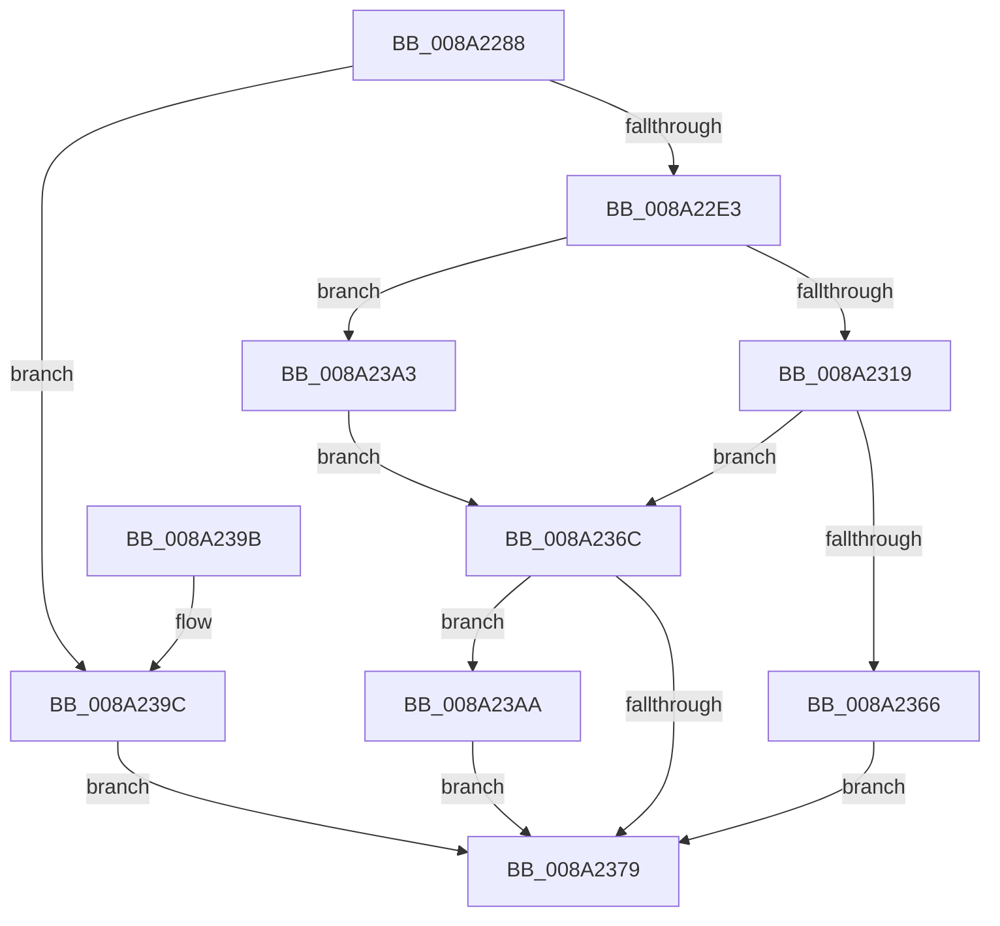

# PspCreateUserProcessEcp

- RVA: `0x008A2288`–`0x008A23B4` (길이 `300` bytes)
- VA: `0x00000001408A2288`
- 실행 섹션: `PAGE`
- PDB 이름 있음: `예`; PDB Function 태그: `아니요`
- unwind 정보 RVA: `0x0007ECF8`
- 디코드: `75`개 명령, `300/300` bytes 표시
- 미해석 바이트: `0` (있으면 어셈블리에 `.byte`로 보존)

> 이 문서는 커널 이미지의 기계어와 PDB 기호를 분석해 생성했습니다. 4번과 5번은 함수 원형과 자료형을 바이너리 사용 방식에서 추정한 C 해석이며 원본 소스 복구 결과는 아닙니다.

## 1. Dependencies

- 직접 호출 지점: **5**; 고유 호출 대상: **5**
- 직접 호출자로 확인된 함수: **1**
- RIP 상대 이미지 참조: **2**

### Outgoing calls
- `0x008A22D0` → [ExAllocateFromPagedLookasideList](../../text/3F/ExAllocateFromPagedLookasideList_function_003FB730.md) (function, `0x003FB730`)
- `0x008A230B` → [ExAllocatePool2](../../poolcode/B8/ExAllocatePool2_function_00B820F0.md) (function, `0x00B820F0`)
- `0x008A235B` → [FsRtlInsertExtraCreateParameter](FsRtlInsertExtraCreateParameter_function_008A1F30.md) (function, `0x008A1F30`)
- `0x008A236F` → [FsRtlFreeExtraCreateParameterList](FsRtlFreeExtraCreateParameterList_function_008A1420.md) (function, `0x008A1420`)
- `0x008A23AD` → [FsRtlFreeExtraCreateParameter](FsRtlFreeExtraCreateParameter_function_008A1760.md) (function, `0x008A1760`)

### Direct callers
- [NtCreateUserProcess](../AE/NtCreateUserProcess_function_00AEA680.md) at `0x00AEAC33`

### Static image references
- `0x008A22A8` → RVA `0x00011160` (`.rdata`; read)
- `0x008A22C9` → RVA `0x00E11D00` (`.data`; read)

## 2. Other-region calls and transfers

- 다른 실행 섹션으로 향하는 call: **2**
  - `0x008A22D0` → [ExAllocateFromPagedLookasideList](../../text/3F/ExAllocateFromPagedLookasideList_function_003FB730.md) (`PAGE` → `.text`)
  - `0x008A230B` → [ExAllocatePool2](../../poolcode/B8/ExAllocatePool2_function_00B820F0.md) (`PAGE` → `POOLCODE`)
- 별도 외부 분기/꼬리 이동을 확인하지 못했습니다.

## 3. Assembly (complete function range)

```asm
008A2288  48 8B C4                        mov rax, rsp
008A228B  48 89 58 08                     mov qword ptr [rax + 8], rbx
008A228F  48 89 68 10                     mov qword ptr [rax + 0x10], rbp
008A2293  48 89 70 18                     mov qword ptr [rax + 0x18], rsi
008A2297  48 89 78 20                     mov qword ptr [rax + 0x20], rdi
008A229B  41 56                           push r14
008A229D  48 83 EC 30                     sub rsp, 0x30
008A22A1  0F 57 C0                        xorps xmm0, xmm0
008A22A4  0F 29 70 E8                     movaps xmmword ptr [rax - 0x18], xmm6
008A22A8  0F 10 35 B1 EE 76 FF            movups xmm6, xmmword ptr [rip - 0x89114f]
008A22AF  4C 8B F1                        mov r14, rcx
008A22B2  48 8B DA                        mov rbx, rdx
008A22B5  0F 11 01                        movups xmmword ptr [rcx], xmm0
008A22B8  0F 11 41 10                     movups xmmword ptr [rcx + 0x10], xmm0
008A22BC  66 C7 01 28 00                  mov word ptr [rcx], 0x28
008A22C1  48 C7 41 20 01 00 00 00         mov qword ptr [rcx + 0x20], 1
008A22C9  48 8D 0D 30 FA 56 00            lea rcx, [rip + 0x56fa30]
008A22D0  E8 5B 94 B5 FF                  call 0x1403fb730
008A22D5  33 ED                           xor ebp, ebp
008A22D7  48 8B F8                        mov rdi, rax
008A22DA  48 85 C0                        test rax, rax
008A22DD  0F 84 B9 00 00 00               je 0x1408a239c
008A22E3  48 83 C0 08                     add rax, 8
008A22E7  8D 55 58                        lea edx, [rbp + 0x58]
008A22EA  B9 00 01 00 00                  mov ecx, 0x100
008A22EF  41 B8 50 73 43 70               mov r8d, 0x70437350
008A22F5  8B F5                           mov esi, ebp
008A22F7  48 89 40 08                     mov qword ptr [rax + 8], rax
008A22FB  48 89 00                        mov qword ptr [rax], rax
008A22FE  C7 47 04 06 00 00 00            mov dword ptr [rdi + 4], 6
008A2305  C7 07 45 63 70 4C               mov dword ptr [rdi], 0x4c706345
008A230B  E8 E0 FD 2D 00                  call 0x140b820f0
008A2310  48 85 C0                        test rax, rax
008A2313  0F 84 8A 00 00 00               je 0x1408a23a3
008A2319  48 8D 70 48                     lea rsi, [rax + 0x48]
008A231D  48 C7 00 45 63 70 48            mov qword ptr [rax], 0x48706345
008A2324  48 89 68 10                     mov qword ptr [rax + 0x10], rbp
008A2328  48 8B D6                        mov rdx, rsi
008A232B  48 89 68 08                     mov qword ptr [rax + 8], rbp
008A232F  48 8B CF                        mov rcx, rdi
008A2332  F3 0F 7F 70 18                  movdqu xmmword ptr [rax + 0x18], xmm6
008A2337  48 89 68 28                     mov qword ptr [rax + 0x28], rbp
008A233B  C7 40 30 02 00 00 00            mov dword ptr [rax + 0x30], 2
008A2342  C7 40 34 58 00 00 00            mov dword ptr [rax + 0x34], 0x58
008A2349  48 89 68 38                     mov qword ptr [rax + 0x38], rbp
008A234D  48 89 68 40                     mov qword ptr [rax + 0x40], rbp
008A2351  C7 06 10 00 00 00               mov dword ptr [rsi], 0x10
008A2357  48 89 5E 08                     mov qword ptr [rsi + 8], rbx
008A235B  E8 D0 FB FF FF                  call 0x1408a1f30
008A2360  8B D8                           mov ebx, eax
008A2362  85 C0                           test eax, eax
008A2364  78 06                           js 0x1408a236c
008A2366  49 89 7E 08                     mov qword ptr [r14 + 8], rdi
008A236A  EB 0D                           jmp 0x1408a2379
008A236C  48 8B CF                        mov rcx, rdi
008A236F  E8 AC F0 FF FF                  call 0x1408a1420
008A2374  48 85 F6                        test rsi, rsi
008A2377  75 31                           jne 0x1408a23aa
008A2379  48 8B 6C 24 48                  mov rbp, qword ptr [rsp + 0x48]
008A237E  8B C3                           mov eax, ebx
008A2380  48 8B 5C 24 40                  mov rbx, qword ptr [rsp + 0x40]
008A2385  48 8B 74 24 50                  mov rsi, qword ptr [rsp + 0x50]
008A238A  48 8B 7C 24 58                  mov rdi, qword ptr [rsp + 0x58]
008A238F  0F 28 74 24 20                  movaps xmm6, xmmword ptr [rsp + 0x20]
008A2394  48 83 C4 30                     add rsp, 0x30
008A2398  41 5E                           pop r14
008A239A  C3                              ret
008A239B  CC                              int3
008A239C  BB 9A 00 00 C0                  mov ebx, 0xc000009a
008A23A1  EB D6                           jmp 0x1408a2379
008A23A3  BB 9A 00 00 C0                  mov ebx, 0xc000009a
008A23A8  EB C2                           jmp 0x1408a236c
008A23AA  48 8B CE                        mov rcx, rsi
008A23AD  E8 AE F3 FF FF                  call 0x1408a1760
008A23B2  EB C5                           jmp 0x1408a2379
```

## 4. C-style interpretation (structured pseudocode)

```c
__int64 __fastcall PspCreateUserProcessEcp(__int64 a1, __int64 a2)
{
    __int64 result;
    __int64 v_rbp;
    __int64 v_rsp;
    unsigned __int64 v_stack_m18;
    unsigned __int64 v_stack_p10;
    unsigned __int64 v_stack_p18;
    unsigned __int64 v_stack_p20;
    unsigned __int64 v_stack_p8;

    *(unsigned __int64 *)(v_rsp + 8) = v_rbx;
    *(unsigned __int64 *)(v_rsp + 16) = v_rbp;
    *(unsigned __int64 *)(v_rsp + 24) = v_rsi;
    *(unsigned __int64 *)(v_rsp + 32) = v_rdi;
    v_rsp = (v_rsp) - (48);
    *(unsigned __int64 *)(v_rsp - 24) = v_xmm6;
    *(unsigned __int64 *)(a1) = v_xmm0;
    *(unsigned __int64 *)(a1 + 16) = v_xmm0;
    *(unsigned __int16 *)(a1) = 40;
    *(unsigned __int64 *)(a1 + 32) = 1;
    result = ExAllocateFromPagedLookasideList(v_rip + 5700144, a2, a3, a4);
    v_rbp = 0;
    if (result == 0) goto loc_008A239C;
    result = (result) + (8);
    *(unsigned __int64 *)(result + 8) = result;
    *(unsigned __int64 *)(result) = result;
    *(unsigned int *)(result + 4) = 6;
    *(unsigned int *)(result) = 0x4C706345ULL;
    result = ExAllocatePool2(256, v_rbp + 88, (unsigned int)(0x70437350ULL), a4);
    if (result == 0) goto loc_008A23A3;
    *(unsigned __int64 *)(result) = 0x48706345ULL;
    *(unsigned __int64 *)(result + 16) = 0;
    *(unsigned __int64 *)(result + 8) = 0;
    *(unsigned __int64 *)(result + 24) = v_xmm6;
    *(unsigned __int64 *)(result + 40) = 0;
    *(unsigned int *)(result + 48) = 2;
    *(unsigned int *)(result + 52) = 88;
    *(unsigned __int64 *)(result + 56) = 0;
    *(unsigned __int64 *)(result + 64) = 0;
    *(unsigned int *)(result + 72) = 16;
    *(unsigned __int64 *)(result + 72 + 8) = a2;
    result = FsRtlInsertExtraCreateParameter(result, result + 72, (unsigned int)(0x70437350ULL), a4);
    if (sign_flag) goto loc_008A236C;
    *(unsigned __int64 *)(a1 + 8) = result;
    goto loc_008A2379;
loc_008A236C:
    result = FsRtlFreeExtraCreateParameterList(result, result + 72, (unsigned int)(0x70437350ULL), a4);
    if (result + 72 != 0) goto loc_008A23AA;
loc_008A2379:
    v_rsp = (v_rsp) + (48);
    return (unsigned int)((unsigned int)((unsigned int)((unsigned int)(result))));
loc_008A239C:
    goto loc_008A2379;
loc_008A23A3:
    goto loc_008A236C;
loc_008A23AA:
    result = FsRtlFreeExtraCreateParameter(v_stack_p18, result + 72, (unsigned int)(0x70437350ULL), a4);
    goto loc_008A2379;
}
```

## 5. (Beta) C Style

```c
int64_t PspCreateUserProcessEcp(void *Arg1, int64_t Arg2)
{
    uint8_t *arg1 = (uint8_t *)Arg1;

    int64_t result;
    int64_t local_rbp;
    int64_t local_rsp;
    uint64_t v_stack_m18;
    uint64_t v_stack_p10;
    uint64_t v_stack_p18;
    uint64_t v_stack_p20;
    uint64_t v_stack_p8;

    *(uint64_t *)(local_rsp + 0x8) = local_rbx;
    *(uint64_t *)(local_rsp + 0x10) = local_rbp;
    *(uint64_t *)(local_rsp + 0x18) = local_rsi;
    *(uint64_t *)(local_rsp + 0x20) = local_rdi;
    local_rsp = (local_rsp) - (48);
    *(uint64_t *)(local_rsp - 0x18) = v_xmm6;
    *(uint64_t *)(arg1) = v_xmm0;
    *(uint64_t *)(arg1 + 0x10) = v_xmm0;
    *(uint16_t *)(arg1) = 40;
    *(uint64_t *)(arg1 + 0x20) = 1;
    result = ExAllocateFromPagedLookasideList(v_rip + 5700144, Arg2, a3, a4);
    local_rbp = 0;
    if (result == 0) goto loc_008A239C;
    result = (result) + (8);
    *(uint64_t *)(result + 0x8) = result;
    *(uint64_t *)(result) = result;
    *(uint32_t *)(result + 0x4) = 6;
    *(uint32_t *)(result) = 0x4C706345ULL;
    result = ExAllocatePool2(256, local_rbp + 88, (uint32_t)(0x70437350ULL), a4);
    if (result == 0) goto loc_008A23A3;
    *(uint64_t *)(result) = 0x48706345ULL;
    *(uint64_t *)(result + 0x10) = 0;
    *(uint64_t *)(result + 0x8) = 0;
    *(uint64_t *)(result + 0x18) = v_xmm6;
    *(uint64_t *)(result + 0x28) = 0;
    *(uint32_t *)(result + 0x30) = 2;
    *(uint32_t *)(result + 0x34) = 88;
    *(uint64_t *)(result + 0x38) = 0;
    *(uint64_t *)(result + 0x40) = 0;
    *(uint32_t *)(result + 0x48) = 16;
    *(uint64_t *)(result + 0x48 + 0x8) = Arg2;
    result = FsRtlInsertExtraCreateParameter(result, result + 72, (uint32_t)(0x70437350ULL), a4);
    if (sign_flag) goto loc_008A236C;
    *(uint64_t *)(arg1 + 0x8) = result;
    goto loc_008A2379;
loc_008A236C:
    result = FsRtlFreeExtraCreateParameterList(result, result + 72, (uint32_t)(0x70437350ULL), a4);
    if (result + 72 != 0) goto loc_008A23AA;
loc_008A2379:
    local_rsp = (local_rsp) + (48);
    return (uint32_t)((uint32_t)((uint32_t)((uint32_t)(result))));
loc_008A239C:
    goto loc_008A2379;
loc_008A23A3:
    goto loc_008A236C;
loc_008A23AA:
    result = FsRtlFreeExtraCreateParameter(v_stack_p18, result + 72, (uint32_t)(0x70437350ULL), a4);
    goto loc_008A2379;
}
```

### 관측된 메모리 오프셋

구조체 형식이 확인되지 않은 접근은 인자 기준의 오프셋으로만 기록했습니다.

| 기준 인자 | 오프셋 표현 | 폭 (bit) | 접근 |
|---|---:|---:|---|
| `Arg1` | `+ 0x0` | `16` | `W` |
| `Arg1` | `+ 0x0` | `128` | `R` |
| `Arg1` | `+ 0x8` | `64` | `W` |
| `Arg1` | `+ 0x10` | `128` | `R` |
| `Arg1` | `+ 0x20` | `64` | `W` |

## 6. Execution-region graph

[열기: 2D/3D 그래프와 함수 탐색 컨트롤 패널](../../../control-panel.html?section=page&rva=0x008A2288&view=graph)

- 2D 그래프는 위에서 아래로 흐르고, 3D 그래프는 빈 공간을 드래그해 회전합니다. Shift+드래그는 이동, 휠은 확대·축소, 함수 노드 선택은 대상 보고서 이동입니다.

### Static fallback


