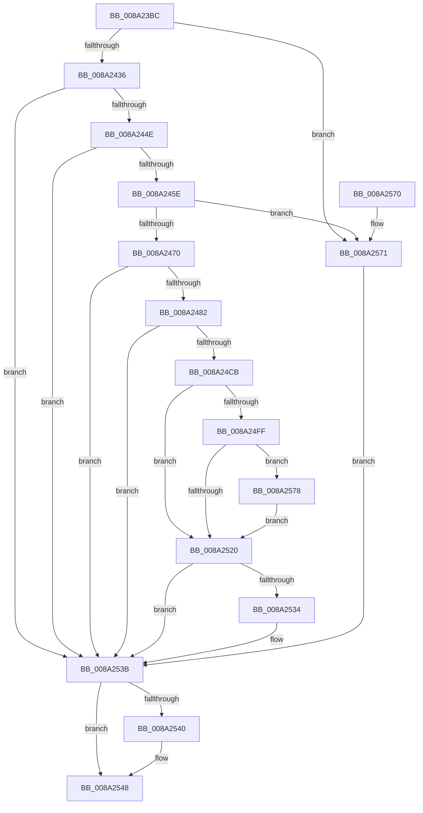

# PspOneDirectionSecurityDomainCombine

- RVA: `0x008A23BC`–`0x008A25B4` (길이 `504` bytes)
- VA: `0x00000001408A23BC`
- 실행 섹션: `PAGE`
- PDB 이름 있음: `예`; PDB Function 태그: `아니요`
- unwind 정보 RVA: `0x0007ED18`
- 디코드: `109`개 명령, `504/504` bytes 표시
- 미해석 바이트: `0` (있으면 어셈블리에 `.byte`로 보존)

> 이 문서는 커널 이미지의 기계어와 PDB 기호를 분석해 생성했습니다. 4번과 5번은 함수 원형과 자료형을 바이너리 사용 방식에서 추정한 C 해석이며 원본 소스 복구 결과는 아닙니다.

## 1. Dependencies

- 직접 호출 지점: **12**; 고유 호출 대상: **11**
- 직접 호출자로 확인된 함수: **1**
- RIP 상대 이미지 참조: **3**

### Outgoing calls
- `0x008A23FB` → [memset](../../text/6C/memset_function_006C6C40.md) (function, `0x006C6C40`)
- `0x008A240C` → [memset](../../text/6C/memset_function_006C6C40.md) (function, `0x006C6C40`)
- `0x008A2429` → [PsLookupProcessByProcessId](PsLookupProcessByProcessId_function_008A2AA0.md) (function, `0x008A2AA0`)
- `0x008A2441` → [PspIsParentProcess](../../text/45/PspIsParentProcess_function_00458BD8.md) (function, `0x00458BD8`)
- `0x008A24A4` → [SeCaptureSubjectContextEx](../8C/SeCaptureSubjectContextEx_function_008C4C90.md) (function, `0x008C4C90`)
- `0x008A24C2` → [SepCreateAccessStateFromSubjectContext](../../text/3E/SepCreateAccessStateFromSubjectContext_function_003EBF40.md) (function, `0x003EBF40`)
- `0x008A24F6` → [ObOpenObjectByPointer](../8B/ObOpenObjectByPointer_function_008B7420.md) (function, `0x008B7420`)
- `0x008A2525` → [SeDeleteAccessState](../8C/SeDeleteAccessState_function_008C5F70.md) (function, `0x008C5F70`)
- `0x008A2536` → [ObCloseHandle](ObCloseHandle_function_008A1870.md) (function, `0x008A1870`)
- `0x008A2543` → [ObfDereferenceObject](../../text/2F/ObfDereferenceObject_function_002F9350.md) (function, `0x002F9350`)
- `0x008A2552` → [_security_check_cookie](../../text/6A/_security_check_cookie_function_006AC640.md) (function, `0x006AC640`)
- `0x008A25A5` → [PspSynchronizeThreadIsolationDomains](../../text/3C/PspSynchronizeThreadIsolationDomains_function_003C479C.md) (function, `0x003C479C`)

### Direct callers
- [PspDisablePrimaryTokenExchange](../8D/PspDisablePrimaryTokenExchange_function_008D5C10.md) at `0x008D5CE2`

### Static image references
- `0x008A23DA` → RVA `0x00E0A740` (`.data`; read)
- `0x008A2482` → RVA `0x00FC6A98` (`ALMOSTRO`; read)
- `0x008A2588` → RVA `0x00E0C590` (`.data`; read/write)

## 2. Other-region calls and transfers

- 다른 실행 섹션으로 향하는 call: **7**
  - `0x008A23FB` → [memset](../../text/6C/memset_function_006C6C40.md) (`PAGE` → `.text`)
  - `0x008A240C` → [memset](../../text/6C/memset_function_006C6C40.md) (`PAGE` → `.text`)
  - `0x008A2441` → [PspIsParentProcess](../../text/45/PspIsParentProcess_function_00458BD8.md) (`PAGE` → `.text`)
  - `0x008A24C2` → [SepCreateAccessStateFromSubjectContext](../../text/3E/SepCreateAccessStateFromSubjectContext_function_003EBF40.md) (`PAGE` → `.text`)
  - `0x008A2543` → [ObfDereferenceObject](../../text/2F/ObfDereferenceObject_function_002F9350.md) (`PAGE` → `.text`)
  - `0x008A2552` → [_security_check_cookie](../../text/6A/_security_check_cookie_function_006AC640.md) (`PAGE` → `.text`)
  - `0x008A25A5` → [PspSynchronizeThreadIsolationDomains](../../text/3C/PspSynchronizeThreadIsolationDomains_function_003C479C.md) (`PAGE` → `.text`)
- 별도 외부 분기/꼬리 이동을 확인하지 못했습니다.

## 3. Assembly (complete function range)

```asm
008A23BC  48 8B C4                        mov rax, rsp
008A23BF  48 89 58 10                     mov qword ptr [rax + 0x10], rbx
008A23C3  48 89 70 18                     mov qword ptr [rax + 0x18], rsi
008A23C7  48 89 78 20                     mov qword ptr [rax + 0x20], rdi
008A23CB  55                              push rbp
008A23CC  48 8D A8 F8 FE FF FF            lea rbp, [rax - 0x108]
008A23D3  48 81 EC 00 02 00 00            sub rsp, 0x200
008A23DA  48 8B 05 5F 83 56 00            mov rax, qword ptr [rip + 0x56835f]
008A23E1  48 33 C4                        xor rax, rsp
008A23E4  48 89 85 F0 00 00 00            mov qword ptr [rbp + 0xf0], rax
008A23EB  48 8B F1                        mov rsi, rcx
008A23EE  33 D2                           xor edx, edx
008A23F0  48 8D 4C 24 70                  lea rcx, [rsp + 0x70]
008A23F5  41 B8 A0 00 00 00               mov r8d, 0xa0
008A23FB  E8 40 48 E2 FF                  call 0x1406c6c40
008A2400  33 D2                           xor edx, edx
008A2402  48 8D 4D 10                     lea rcx, [rbp + 0x10]
008A2406  41 B8 E0 00 00 00               mov r8d, 0xe0
008A240C  E8 2F 48 E2 FF                  call 0x1406c6c40
008A2411  48 8B 8E D0 02 00 00            mov rcx, qword ptr [rsi + 0x2d0]
008A2418  48 8D 54 24 40                  lea rdx, [rsp + 0x40]
008A241D  48 83 64 24 40 00               and qword ptr [rsp + 0x40], 0
008A2423  48 83 64 24 48 00               and qword ptr [rsp + 0x48], 0
008A2429  E8 72 06 00 00                  call 0x1408a2aa0
008A242E  85 C0                           test eax, eax
008A2430  0F 88 3B 01 00 00               js 0x1408a2571
008A2436  48 8B 7C 24 40                  mov rdi, qword ptr [rsp + 0x40]
008A243B  48 8B D6                        mov rdx, rsi
008A243E  48 8B CF                        mov rcx, rdi
008A2441  E8 92 67 BB FF                  call 0x140458bd8
008A2446  84 C0                           test al, al
008A2448  0F 84 ED 00 00 00               je 0x1408a253b
008A244E  F7 87 FC 05 00 00 00 00 40 00   test dword ptr [rdi + 0x5fc], 0x400000
008A2458  0F 84 DD 00 00 00               je 0x1408a253b
008A245E  F0 83 0C 24 00                  lock or dword ptr [rsp], 0
008A2463  83 BE 50 07 00 00 00            cmp dword ptr [rsi + 0x750], 0
008A246A  0F 8C 01 01 00 00               jl 0x1408a2571
008A2470  48 8B 7C 24 40                  mov rdi, qword ptr [rsp + 0x40]
008A2475  83 BF 50 07 00 00 00            cmp dword ptr [rdi + 0x750], 0
008A247C  0F 8C B9 00 00 00               jl 0x1408a253b
008A2482  48 8B 1D 0F 46 72 00            mov rbx, qword ptr [rip + 0x72460f]
008A2489  4C 8D 44 24 50                  lea r8, [rsp + 0x50]
008A248E  0F 57 C0                        xorps xmm0, xmm0
008A2491  48 8B D7                        mov rdx, rdi
008A2494  33 C9                           xor ecx, ecx
008A2496  48 83 C3 4C                     add rbx, 0x4c
008A249A  0F 11 44 24 50                  movups xmmword ptr [rsp + 0x50], xmm0
008A249F  0F 11 44 24 60                  movups xmmword ptr [rsp + 0x60], xmm0
008A24A4  E8 E7 27 02 00                  call 0x1408c4c90
008A24A9  41 B9 28 00 00 00               mov r9d, 0x28
008A24AF  48 89 5C 24 20                  mov qword ptr [rsp + 0x20], rbx
008A24B4  4C 8D 45 10                     lea r8, [rbp + 0x10]
008A24B8  48 8D 54 24 70                  lea rdx, [rsp + 0x70]
008A24BD  48 8D 4C 24 50                  lea rcx, [rsp + 0x50]
008A24C2  E8 79 9A B4 FF                  call 0x1403ebf40
008A24C7  85 C0                           test eax, eax
008A24C9  78 70                           js 0x1408a253b
008A24CB  48 8D 44 24 48                  lea rax, [rsp + 0x48]
008A24D0  45 33 C9                        xor r9d, r9d
008A24D3  48 89 44 24 30                  mov qword ptr [rsp + 0x30], rax
008A24D8  4C 8D 44 24 70                  lea r8, [rsp + 0x70]
008A24DD  48 8B 05 B4 45 72 00            mov rax, qword ptr [rip + 0x7245b4]
008A24E4  BA 00 06 00 00                  mov edx, 0x600
008A24E9  C6 44 24 28 00                  mov byte ptr [rsp + 0x28], 0
008A24EE  48 8B CE                        mov rcx, rsi
008A24F1  48 89 44 24 20                  mov qword ptr [rsp + 0x20], rax
008A24F6  E8 25 4F 01 00                  call 0x1408b7420
008A24FB  85 C0                           test eax, eax
008A24FD  78 21                           js 0x1408a2520
008A24FF  48 8B 87 60 07 00 00            mov rax, qword ptr [rdi + 0x760]
008A2506  48 8B 7C 24 40                  mov rdi, qword ptr [rsp + 0x40]
008A250B  48 89 86 68 07 00 00            mov qword ptr [rsi + 0x768], rax
008A2512  8B 87 50 07 00 00               mov eax, dword ptr [rdi + 0x750]
008A2518  0B 86 50 07 00 00               or eax, dword ptr [rsi + 0x750]
008A251E  7C 58                           jl 0x1408a2578
008A2520  48 8D 4C 24 70                  lea rcx, [rsp + 0x70]
008A2525  E8 46 3A 02 00                  call 0x1408c5f70
008A252A  48 8B 4C 24 48                  mov rcx, qword ptr [rsp + 0x48]
008A252F  48 85 C9                        test rcx, rcx
008A2532  74 07                           je 0x1408a253b
008A2534  33 D2                           xor edx, edx
008A2536  E8 35 F3 FF FF                  call 0x1408a1870
008A253B  48 85 FF                        test rdi, rdi
008A253E  74 08                           je 0x1408a2548
008A2540  48 8B CF                        mov rcx, rdi
008A2543  E8 08 6E A5 FF                  call 0x1402f9350
008A2548  48 8B 8D F0 00 00 00            mov rcx, qword ptr [rbp + 0xf0]
008A254F  48 33 CC                        xor rcx, rsp
008A2552  E8 E9 A0 E0 FF                  call 0x1406ac640
008A2557  4C 8D 9C 24 00 02 00 00         lea r11, [rsp + 0x200]
008A255F  49 8B 5B 18                     mov rbx, qword ptr [r11 + 0x18]
008A2563  49 8B 73 20                     mov rsi, qword ptr [r11 + 0x20]
008A2567  49 8B 7B 28                     mov rdi, qword ptr [r11 + 0x28]
008A256B  49 8B E3                        mov rsp, r11
008A256E  5D                              pop rbp
008A256F  C3                              ret
008A2570  CC                              int3
008A2571  48 8B 7C 24 40                  mov rdi, qword ptr [rsp + 0x40]
008A2576  EB C3                           jmp 0x1408a253b
008A2578  F0 81 8E FC 05 00 00 00 00 20 00  lock or dword ptr [rsi + 0x5fc], 0x200000
008A2583  B8 01 00 00 00                  mov eax, 1
008A2588  F0 48 0F C1 05 FF 9F 56 00      lock xadd qword ptr [rip + 0x569fff], rax
008A2591  48 FF C0                        inc rax
008A2594  48 8B CE                        mov rcx, rsi
008A2597  48 89 86 60 07 00 00            mov qword ptr [rsi + 0x760], rax
008A259E  48 89 86 68 07 00 00            mov qword ptr [rsi + 0x768], rax
008A25A5  E8 F2 21 B2 FF                  call 0x1403c479c
008A25AA  48 8B 7C 24 40                  mov rdi, qword ptr [rsp + 0x40]
008A25AF  E9 6C FF FF FF                  jmp 0x1408a2520
```

## 4. C-style interpretation (structured pseudocode)

```c
__int64 __fastcall PspOneDirectionSecurityDomainCombine(__int64 a1, int a2)
{
    __int64 result;
    __int64 v_rbx;
    __int64 v_rsp;
    unsigned __int64 v_stack_m198;
    unsigned __int64 v_stack_m1A8;
    unsigned __int64 v_stack_m1B8;
    unsigned __int64 v_stack_m1C0;
    unsigned __int64 v_stack_m1C8;
    unsigned __int64 v_stack_m1D8;
    unsigned __int8 v_stack_m1E0;
    unsigned __int64 v_stack_m1E8;
    unsigned int v_stack_m208;
    unsigned __int64 v_stack_m8;

    *(unsigned __int64 *)(v_rsp + 16) = v_rbx;
    *(unsigned __int64 *)(v_rsp + 24) = v_rsi;
    *(unsigned __int64 *)(v_rsp + 32) = v_rdi;
    v_rsp = (v_rsp) - (512);
    result = (*(unsigned __int64 *)(v_rip + 5669727)) ^ (v_rsp);
    *(unsigned __int64 *)(v_rsp - 264 + 240) = result;
    a2 = 0;
    result = memset(v_stack_m198, a2, 160, a4);
    a2 = 0;
    result = memset(v_rsp - 264 + 16, a2, 224, a4);
    result = PsLookupProcessByProcessId(*(unsigned __int64 *)(a1 + 720), v_stack_m1C8, 224, a4);
    if (sign_flag) goto loc_008A2571;
    result = PspIsParentProcess(v_stack_m1C8, a1, 224, a4);
    if ((unsigned __int8)(result) == 0) goto loc_008A253B;
    if (((*(unsigned int *)(v_stack_m1C8 + 1532)) & (0x400000ULL)) == 0) goto loc_008A253B;
    if ((*(unsigned int *)(a1 + 1872)) < 0) goto loc_008A2571;
    if ((*(unsigned int *)(v_stack_m1C8 + 1872)) < 0) goto loc_008A253B;
    a1 = 0;
    v_rbx = (*(unsigned __int64 *)(v_rip + 7489039)) + (76);
    v_stack_m1B8 = v_xmm0;
    v_stack_m1A8 = v_xmm0;
    result = SeCaptureSubjectContextEx(a1, v_stack_m1C8, v_stack_m1B8, a4);
    v_stack_m1E8 = v_rbx;
    result = SepCreateAccessStateFromSubjectContext(v_stack_m1B8, v_stack_m198, v_rsp - 264 + 16, 40);
    if (sign_flag) goto loc_008A253B;
    a4 = 0;
    v_stack_m1D8 = v_stack_m1C0;
    v_stack_m1E0 = 0;
    v_stack_m1E8 = *(unsigned __int64 *)(v_rip + 7488948);
    result = ObOpenObjectByPointer(0, (unsigned int)(0x600ULL), v_stack_m198, a4);
    if (sign_flag) goto loc_008A2520;
    *(unsigned __int64 *)(a1 + 1896) = *(unsigned __int64 *)(v_stack_m1C8 + 1888);
    result = (unsigned int)(((unsigned int)(*(unsigned int *)(v_stack_m1C8 + 1872))) | (*(unsigned int *)(a1 + 1872)));
    if (condition_is_less) goto loc_008A2578;
loc_008A2520:
    result = SeDeleteAccessState(v_stack_m198, (unsigned int)(0x600ULL), v_stack_m198, a4);
    if (v_stack_m1C0 != 0) {
        a2 = 0;
        result = ObCloseHandle(v_stack_m1C0, a2, v_stack_m198, a4);
    }
    if (v_stack_m1C8 != 0) {
        a1 = v_stack_m1C8;
        result = ObfDereferenceObject(a1, a2, v_stack_m198, a4);
    }
    a1 = (*(unsigned __int64 *)(v_rsp - 264 + 240)) ^ (v_rsp);
    result = _security_check_cookie(a1, a2, v_stack_m198, a4);
    return result;
loc_008A2571:
    goto loc_008A253B;
loc_008A2578:
    result = (1) + 1;
    *(unsigned __int64 *)(*(unsigned __int64 *)(v_stack_m8 + 32) + 1888) = result;
    *(unsigned __int64 *)(*(unsigned __int64 *)(v_stack_m8 + 32) + 1896) = result;
    result = PspSynchronizeThreadIsolationDomains(*(unsigned __int64 *)(v_stack_m8 + 32), a2, v_stack_m198, a4);
    goto loc_008A2520;
}
```

## 5. (Beta) C Style

```c
int64_t PspOneDirectionSecurityDomainCombine(void *Arg1, int32_t Arg2)
{
    uint8_t *arg1 = (uint8_t *)Arg1;

    int64_t result;
    int64_t local_rbx;
    int64_t local_rsp;
    uint64_t v_stack_m198;
    uint64_t v_stack_m1A8;
    uint64_t v_stack_m1B8;
    uint64_t v_stack_m1C0;
    uint64_t v_stack_m1C8;
    uint64_t v_stack_m1D8;
    uint8_t v_stack_m1E0;
    uint64_t v_stack_m1E8;
    uint32_t v_stack_m208;
    uint64_t v_stack_m8;

    *(uint64_t *)(local_rsp + 0x10) = local_rbx;
    *(uint64_t *)(local_rsp + 0x18) = local_rsi;
    *(uint64_t *)(local_rsp + 0x20) = local_rdi;
    local_rsp = (local_rsp) - (512);
    result = (*(uint64_t *)(v_rip + 0x56835F)) ^ (local_rsp);
    *(uint64_t *)(local_rsp - 0x108 + 0xF0) = result;
    Arg2 = 0;
    result = memset(v_stack_m198, Arg2, 160, a4);
    Arg2 = 0;
    result = memset(local_rsp - 264 + 16, Arg2, 224, a4);
    result = PsLookupProcessByProcessId(*(uint64_t *)(arg1 + 0x2D0), v_stack_m1C8, 224, a4);
    if (sign_flag) goto loc_008A2571;
    result = PspIsParentProcess(v_stack_m1C8, Arg1, 224, a4);
    if ((uint8_t)(result) == 0) goto loc_008A253B;
    if (((*(uint32_t *)(v_stack_m1C8 + 0x5FC)) & (0x400000ULL)) == 0) goto loc_008A253B;
    if ((*(uint32_t *)(arg1 + 0x750)) < 0) goto loc_008A2571;
    if ((*(uint32_t *)(v_stack_m1C8 + 0x750)) < 0) goto loc_008A253B;
    Arg1 = 0;
    local_rbx = (*(uint64_t *)(v_rip + 0x72460F)) + (76);
    v_stack_m1B8 = v_xmm0;
    v_stack_m1A8 = v_xmm0;
    result = SeCaptureSubjectContextEx(Arg1, v_stack_m1C8, v_stack_m1B8, a4);
    v_stack_m1E8 = local_rbx;
    result = SepCreateAccessStateFromSubjectContext(v_stack_m1B8, v_stack_m198, local_rsp - 264 + 16, 40);
    if (sign_flag) goto loc_008A253B;
    a4 = 0;
    v_stack_m1D8 = v_stack_m1C0;
    v_stack_m1E0 = 0;
    v_stack_m1E8 = *(uint64_t *)(v_rip + 0x7245B4);
    result = ObOpenObjectByPointer(0, (uint32_t)(0x600ULL), v_stack_m198, a4);
    if (sign_flag) goto loc_008A2520;
    *(uint64_t *)(arg1 + 0x768) = *(uint64_t *)(v_stack_m1C8 + 0x760);
    result = (uint32_t)(((uint32_t)(*(uint32_t *)(v_stack_m1C8 + 0x750))) | (*(uint32_t *)(arg1 + 0x750)));
    if (condition_is_less) goto loc_008A2578;
loc_008A2520:
    result = SeDeleteAccessState(v_stack_m198, (uint32_t)(0x600ULL), v_stack_m198, a4);
    if (v_stack_m1C0 != 0) {
        Arg2 = 0;
        result = ObCloseHandle(v_stack_m1C0, Arg2, v_stack_m198, a4);
    }
    if (v_stack_m1C8 != 0) {
        Arg1 = v_stack_m1C8;
        result = ObfDereferenceObject(Arg1, Arg2, v_stack_m198, a4);
    }
    Arg1 = (*(uint64_t *)(local_rsp - 0x108 + 0xF0)) ^ (local_rsp);
    result = _security_check_cookie(Arg1, Arg2, v_stack_m198, a4);
    return result;
loc_008A2571:
    goto loc_008A253B;
loc_008A2578:
    result = (1) + 1;
    *(uint64_t *)(*(uint64_t *)(v_stack_m8 + 0x20) + 0x760) = result;
    *(uint64_t *)(*(uint64_t *)(v_stack_m8 + 0x20) + 0x768) = result;
    result = PspSynchronizeThreadIsolationDomains(*(uint64_t *)(v_stack_m8 + 0x20), Arg2, v_stack_m198, a4);
    goto loc_008A2520;
}
```

### 관측된 메모리 오프셋

구조체 형식이 확인되지 않은 접근은 인자 기준의 오프셋으로만 기록했습니다.

| 기준 인자 | 오프셋 표현 | 폭 (bit) | 접근 |
|---|---:|---:|---|
| `Arg1` | `+ 0x2D0` | `64` | `R` |
| `Arg1` | `+ 0x5FC` | `32` | `R/W` |
| `Arg1` | `+ 0x750` | `32` | `R` |
| `Arg1` | `+ 0x760` | `64` | `W` |
| `Arg1` | `+ 0x768` | `64` | `W` |

## 6. Execution-region graph

[열기: 2D/3D 그래프와 함수 탐색 컨트롤 패널](../../../control-panel.html?section=page&rva=0x008A23BC&view=graph)

- 2D 그래프는 위에서 아래로 흐르고, 3D 그래프는 빈 공간을 드래그해 회전합니다. Shift+드래그는 이동, 휠은 확대·축소, 함수 노드 선택은 대상 보고서 이동입니다.

### Static fallback


