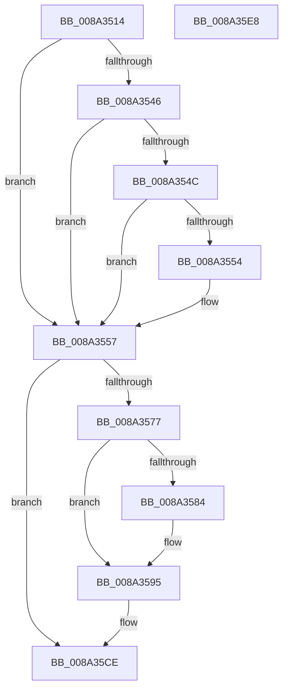

# PspRecordCrashedProcessIntoBlackbox

- RVA: `0x008A3514`–`0x008A35E9` (길이 `213` bytes)
- VA: `0x00000001408A3514`
- 실행 섹션: `PAGE`
- PDB 이름 있음: `예`; PDB Function 태그: `아니요`
- unwind 정보 RVA: `0x0007EE78`
- 디코드: `60`개 명령, `213/213` bytes 표시
- 미해석 바이트: `0` (있으면 어셈블리에 `.byte`로 보존)

> 이 문서는 커널 이미지의 기계어와 PDB 기호를 분석해 생성했습니다. 4번과 5번은 함수 원형과 자료형을 바이너리 사용 방식에서 추정한 C 해석이며 원본 소스 복구 결과는 아닙니다.

## 1. Dependencies

- 직접 호출 지점: **4**; 고유 호출 대상: **4**
- 직접 호출자로 확인된 함수: **2**
- RIP 상대 이미지 참조: **0**

### Outgoing calls
- `0x008A356A` → [ExAllocatePool2](../../poolcode/B8/ExAllocatePool2_function_00B820F0.md) (function, `0x00B820F0`)
- `0x008A3590` → [memcpy](../../text/6C/memcpy_function_006C6840.md) (function, `0x006C6840`)
- `0x008A35BC` → [ZwPowerInformation](../../text/6A/ZwPowerInformation_function_006ADCB0.md) (function, `0x006ADCB0`)
- `0x008A35C9` → [ExFreePoolWithTag](../../poolcode/B8/ExFreePoolWithTag_function_00B82870.md) (function, `0x00B82870`)

### Direct callers
- [DbgkForwardException](DbgkForwardException_function_008A2D60.md) at `0x008A2E0C`
- [PsSetProcessFaultInformation](../A7/PsSetProcessFaultInformation_function_00A75400.md) at `0x00A754BA`

### Static image references
- 디코드된 RIP-relative 메모리 참조가 없습니다.

## 2. Other-region calls and transfers

- 다른 실행 섹션으로 향하는 call: **4**
  - `0x008A356A` → [ExAllocatePool2](../../poolcode/B8/ExAllocatePool2_function_00B820F0.md) (`PAGE` → `POOLCODE`)
  - `0x008A3590` → [memcpy](../../text/6C/memcpy_function_006C6840.md) (`PAGE` → `.text`)
  - `0x008A35BC` → [ZwPowerInformation](../../text/6A/ZwPowerInformation_function_006ADCB0.md) (`PAGE` → `.text`)
  - `0x008A35C9` → [ExFreePoolWithTag](../../poolcode/B8/ExFreePoolWithTag_function_00B82870.md) (`PAGE` → `POOLCODE`)
- 별도 외부 분기/꼬리 이동을 확인하지 못했습니다.

## 3. Assembly (complete function range)

```asm
008A3514  48 8B C4                        mov rax, rsp
008A3517  48 89 58 08                     mov qword ptr [rax + 8], rbx
008A351B  48 89 68 10                     mov qword ptr [rax + 0x10], rbp
008A351F  48 89 70 18                     mov qword ptr [rax + 0x18], rsi
008A3523  57                              push rdi
008A3524  41 56                           push r14
008A3526  41 57                           push r15
008A3528  48 83 EC 50                     sub rsp, 0x50
008A352C  48 8B 99 50 03 00 00            mov rbx, qword ptr [rcx + 0x350]
008A3533  45 33 FF                        xor r15d, r15d
008A3536  4C 89 78 D8                     mov qword ptr [rax - 0x28], r15
008A353A  41 8B FF                        mov edi, r15d
008A353D  44 89 78 E4                     mov dword ptr [rax - 0x1c], r15d
008A3541  48 85 DB                        test rbx, rbx
008A3544  74 11                           je 0x1408a3557
008A3546  4C 39 7B 08                     cmp qword ptr [rbx + 8], r15
008A354A  74 0B                           je 0x1408a3557
008A354C  0F B7 03                        movzx eax, word ptr [rbx]
008A354F  66 85 C0                        test ax, ax
008A3552  74 03                           je 0x1408a3557
008A3554  8D 78 02                        lea edi, [rax + 2]
008A3557  8D 6F 08                        lea ebp, [rdi + 8]
008A355A  41 B8 50 73 42 62               mov r8d, 0x62427350
008A3560  8B D5                           mov edx, ebp
008A3562  B9 00 01 00 00                  mov ecx, 0x100
008A3567  44 8B F5                        mov r14d, ebp
008A356A  E8 81 EB 2D 00                  call 0x140b820f0
008A356F  48 8B F0                        mov rsi, rax
008A3572  48 85 C0                        test rax, rax
008A3575  74 57                           je 0x1408a35ce
008A3577  C7 00 01 00 00 00               mov dword ptr [rax], 1
008A357D  89 68 04                        mov dword ptr [rax + 4], ebp
008A3580  85 FF                           test edi, edi
008A3582  74 11                           je 0x1408a3595
008A3584  44 0F B7 03                     movzx r8d, word ptr [rbx]
008A3588  48 8D 48 08                     lea rcx, [rax + 8]
008A358C  48 8B 53 08                     mov rdx, qword ptr [rbx + 8]
008A3590  E8 AB 32 E2 FF                  call 0x1406c6840
008A3595  45 33 C9                        xor r9d, r9d
008A3598  C7 44 24 48 0D 00 00 00         mov dword ptr [rsp + 0x48], 0xd
008A35A0  48 8D 54 24 30                  lea rdx, [rsp + 0x30]
008A35A5  48 89 74 24 30                  mov qword ptr [rsp + 0x30], rsi
008A35AA  4C 89 74 24 38                  mov qword ptr [rsp + 0x38], r14
008A35AF  44 89 7C 24 20                  mov dword ptr [rsp + 0x20], r15d
008A35B4  45 8D 41 20                     lea r8d, [r9 + 0x20]
008A35B8  41 8D 49 5E                     lea ecx, [r9 + 0x5e]
008A35BC  E8 EF A6 E0 FF                  call 0x1406adcb0
008A35C1  BA 50 73 42 62                  mov edx, 0x62427350
008A35C6  48 8B CE                        mov rcx, rsi
008A35C9  E8 A2 F2 2D 00                  call 0x140b82870
008A35CE  4C 8D 5C 24 50                  lea r11, [rsp + 0x50]
008A35D3  49 8B 5B 20                     mov rbx, qword ptr [r11 + 0x20]
008A35D7  49 8B 6B 28                     mov rbp, qword ptr [r11 + 0x28]
008A35DB  49 8B 73 30                     mov rsi, qword ptr [r11 + 0x30]
008A35DF  49 8B E3                        mov rsp, r11
008A35E2  41 5F                           pop r15
008A35E4  41 5E                           pop r14
008A35E6  5F                              pop rdi
008A35E7  C3                              ret
008A35E8  CC                              int3
```

## 4. C-style interpretation (structured pseudocode)

```c
__int64 __fastcall PspRecordCrashedProcessIntoBlackbox(__int64 a1, __int64 a2, __int64 a3, int a4)
{
    __int64 result;
    __int64 v_r15;
    __int64 v_rdi;
    __int64 v_rsp;
    unsigned __int64 v_stack_m18;
    unsigned int v_stack_m20;
    unsigned __int64 v_stack_m30;
    unsigned __int64 v_stack_m38;
    unsigned int v_stack_m48;

    *(unsigned __int64 *)(v_rsp + 8) = v_rbx;
    *(unsigned __int64 *)(v_rsp + 16) = v_rbp;
    *(unsigned __int64 *)(v_rsp + 24) = v_rsi;
    v_rsp = (v_rsp) - (80);
    v_r15 = 0;
    *(unsigned __int64 *)(v_rsp - 40) = 0;
    *(unsigned int *)(v_rsp - 28) = 0;
    if (*(unsigned __int64 *)(a1 + 848) == 0) goto loc_008A3557;
    if ((*(unsigned __int64 *)(*(unsigned __int64 *)(a1 + 848) + 8)) == 0) goto loc_008A3557;
    v_rdi = 0;
    if ((unsigned __int16)(*(unsigned __int16 *)(*(unsigned __int64 *)(a1 + 848))) != 0) {
        v_rdi = *(unsigned __int16 *)(*(unsigned __int64 *)(a1 + 848)) + 2;
    }
    result = ExAllocatePool2(256, (unsigned int)((unsigned int)(v_rdi + 8)), (unsigned int)(0x62427350ULL), a4);
    if (result == 0) goto loc_008A35CE;
    *(unsigned int *)(result) = 1;
    *(unsigned int *)(result + 4) = (unsigned int)(v_rdi + 8);
    if ((unsigned int)(v_rdi) != 0) {
        a3 = *(unsigned __int16 *)(*(unsigned __int64 *)(a1 + 848));
        a1 = result + 8;
        a2 = *(unsigned __int64 *)(*(unsigned __int64 *)(a1 + 848) + 8);
        result = memcpy(a1, a2, a3, a4);
    }
    a4 = 0;
    v_stack_m20 = 13;
    v_stack_m38 = result;
    v_stack_m30 = (unsigned int)((unsigned int)(v_rdi + 8));
    v_stack_m48 = 0;
    result = ZwPowerInformation(a4 + 94, v_stack_m38, a4 + 32, a4);
    result = ExFreePoolWithTag(result, (unsigned int)(0x62427350ULL), a4 + 32, a4);
loc_008A35CE:
    return result;
}
```

## 5. (Beta) C Style

```c
int64_t PspRecordCrashedProcessIntoBlackbox(void *Arg1, int64_t Arg2, int64_t Arg3, int32_t Arg4)
{
    uint8_t *arg1 = (uint8_t *)Arg1;

    int64_t result;
    int64_t local_r15;
    int64_t local_rdi;
    int64_t local_rsp;
    uint64_t v_stack_m18;
    uint32_t v_stack_m20;
    uint64_t v_stack_m30;
    uint64_t v_stack_m38;
    uint32_t v_stack_m48;

    *(uint64_t *)(local_rsp + 0x8) = local_rbx;
    *(uint64_t *)(local_rsp + 0x10) = local_rbp;
    *(uint64_t *)(local_rsp + 0x18) = local_rsi;
    local_rsp = (local_rsp) - (80);
    local_r15 = 0;
    *(uint64_t *)(local_rsp - 0x28) = 0;
    *(uint32_t *)(local_rsp - 0x1C) = 0;
    if (*(uint64_t *)(arg1 + 0x350) == 0) goto loc_008A3557;
    if ((*(uint64_t *)(*(uint64_t *)(arg1 + 0x350) + 0x8)) == 0) goto loc_008A3557;
    local_rdi = 0;
    if ((uint16_t)(*(uint16_t *)(*(uint64_t *)(arg1 + 0x350))) != 0) {
        local_rdi = *(uint16_t *)(*(uint64_t *)(arg1 + 0x350)) + 2;
    }
    result = ExAllocatePool2(256, (uint32_t)((uint32_t)(local_rdi + 8)), (uint32_t)(0x62427350ULL), Arg4);
    if (result == 0) goto loc_008A35CE;
    *(uint32_t *)(result) = 1;
    *(uint32_t *)(result + 0x4) = (uint32_t)(local_rdi + 8);
    if ((uint32_t)(local_rdi) != 0) {
        Arg3 = *(uint16_t *)(*(uint64_t *)(arg1 + 0x350));
        Arg1 = result + 8;
        Arg2 = *(uint64_t *)(*(uint64_t *)(arg1 + 0x350) + 0x8);
        result = memcpy(Arg1, Arg2, Arg3, Arg4);
    }
    Arg4 = 0;
    v_stack_m20 = 13;
    v_stack_m38 = result;
    v_stack_m30 = (uint32_t)((uint32_t)(local_rdi + 8));
    v_stack_m48 = 0;
    result = ZwPowerInformation(Arg4 + 94, v_stack_m38, Arg4 + 32, Arg4);
    result = ExFreePoolWithTag(result, (uint32_t)(0x62427350ULL), Arg4 + 32, Arg4);
loc_008A35CE:
    return result;
}
```

### 관측된 메모리 오프셋

구조체 형식이 확인되지 않은 접근은 인자 기준의 오프셋으로만 기록했습니다.

| 기준 인자 | 오프셋 표현 | 폭 (bit) | 접근 |
|---|---:|---:|---|
| `Arg1` | `+ 0x350` | `64` | `R` |

## 6. Execution-region graph

[열기: 2D/3D 그래프와 함수 탐색 컨트롤 패널](../../../control-panel.html?section=page&rva=0x008A3514&view=graph)

- 2D 그래프는 위에서 아래로 흐르고, 3D 그래프는 빈 공간을 드래그해 회전합니다. Shift+드래그는 이동, 휠은 확대·축소, 함수 노드 선택은 대상 보고서 이동입니다.

### Static fallback


