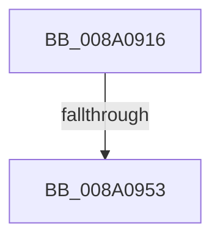

# sub_008A0916

- RVA: `0x008A0916`–`0x008A095D` (길이 `71` bytes)
- VA: `0x00000001408A0916`
- 실행 섹션: `PAGE`
- PDB 이름 있음: `아니요`; PDB Function 태그: `아니요`
- unwind 정보 RVA: `0x0007E8A0`
- 디코드: `17`개 명령, `71/71` bytes 표시
- 미해석 바이트: `0` (있으면 어셈블리에 `.byte`로 보존)

> 이 문서는 커널 이미지의 기계어와 PDB 기호를 분석해 생성했습니다. 4번과 5번은 함수 원형과 자료형을 바이너리 사용 방식에서 추정한 C 해석이며 원본 소스 복구 결과는 아닙니다.

## 1. Dependencies

- 직접 호출 지점: **0**; 고유 호출 대상: **0**
- 직접 호출자로 확인된 함수: **0**
- RIP 상대 이미지 참조: **0**

### Outgoing calls
- 직접 디코드된 call 명령이 없습니다.

### Direct callers
- 이 함수 시작 RVA로 연결되는 직접 call은 확인되지 않았습니다. 간접 호출은 완전히 역산할 수 없습니다.

### Static image references
- 디코드된 RIP-relative 메모리 참조가 없습니다.

## 2. Other-region calls and transfers

- 다른 실행 섹션으로 향하는 call: **0**
- call이 아닌 외부 분기/꼬리 이동: **2**
  - `0x008A094D` → [sub_008A0B4F](Unknown_function_008A0B4F.md) (`tail-transfer`)
  - `0x008A0957` → [sub_008A0B4F](Unknown_function_008A0B4F.md) (`tail-transfer`)

## 3. Assembly (complete function range)

```asm
008A0916  49 89 6B 18                     mov qword ptr [r11 + 0x18], rbp
008A091A  41 8D 41 FF                     lea eax, [r9 - 1]
008A091E  0F BA E9 08                     bts ecx, 8
008A0922  49 89 7B E0                     mov qword ptr [r11 - 0x20], rdi
008A0926  89 4B 0C                        mov dword ptr [rbx + 0xc], ecx
008A0929  8B 4B 10                        mov ecx, dword ptr [rbx + 0x10]
008A092C  8B E9                           mov ebp, ecx
008A092E  81 CD BF 01 1F 01               or ebp, 0x11f01bf
008A0934  4D 89 7B C8                     mov qword ptr [r11 - 0x38], r15
008A0938  0F BA E1 19                     bt ecx, 0x19
008A093C  41 BF 01 00 00 00               mov r15d, 1
008A0942  0F 43 E9                        cmovae ebp, ecx
008A0945  45 33 D2                        xor r10d, r10d
008A0948  A9 F9 FF FF FF                  test eax, 0xfffffff9
008A094D  0F 85 FC 01 00 00               jne 0x1408a0b4f
008A0953  41 83 F9 07                     cmp r9d, 7
008A0957  0F 84 F2 01 00 00               je 0x1408a0b4f
```

## 4. C-style interpretation (structured pseudocode)

```c
__int64 __fastcall sub_008A0916(int a1, __int64 a2, __int64 a3, __int64 a4)
{
    __int64 v_r10;
    __int64 v_rbp;

    *(unsigned __int64 *)(v_r11 + 24) = v_rbp;
    *(unsigned __int64 *)(v_r11 - 32) = v_rdi;
    *(unsigned int *)(v_rbx + 12) = a1;
    v_rbp = (unsigned int)(((unsigned int)((unsigned int)((unsigned int)(*(unsigned int *)(v_rbx + 16))))) | (0x11F01BFULL));
    *(unsigned __int64 *)(v_r11 - 56) = v_r15;
    if (condition_is_above_or_equal) { v_rbp = (unsigned int)((unsigned int)(*(unsigned int *)(v_rbx + 16))); }
    v_r10 = 0;
}
```

## 5. (Beta) C Style

```c
int64_t sub_008A0916(int32_t Arg1, int64_t Arg2, int64_t Arg3, void *Arg4)
{
    uint8_t *arg4 = (uint8_t *)Arg4;

    int64_t local_r10;
    int64_t local_rbp;

    *(uint64_t *)(local_r11 + 0x18) = local_rbp;
    *(uint64_t *)(local_r11 - 0x20) = local_rdi;
    *(uint32_t *)(local_rbx + 0xC) = Arg1;
    local_rbp = (uint32_t)(((uint32_t)((uint32_t)((uint32_t)(*(uint32_t *)(local_rbx + 0x10))))) | (0x11F01BFULL));
    *(uint64_t *)(local_r11 - 0x38) = local_r15;
    if (condition_is_above_or_equal) { local_rbp = (uint32_t)((uint32_t)(*(uint32_t *)(local_rbx + 0x10))); }
    local_r10 = 0;
}
```

### 관측된 메모리 오프셋

구조체 형식이 확인되지 않은 접근은 인자 기준의 오프셋으로만 기록했습니다.

| 기준 인자 | 오프셋 표현 | 폭 (bit) | 접근 |
|---|---:|---:|---|
| `Arg4` | `- 0x1` | `32` | `R` |

## 6. Execution-region graph

[열기: 2D/3D 그래프와 함수 탐색 컨트롤 패널](../../../control-panel.html?section=page&rva=0x008A0916&view=graph)

- 2D 그래프는 위에서 아래로 흐르고, 3D 그래프는 빈 공간을 드래그해 회전합니다. Shift+드래그는 이동, 휠은 확대·축소, 함수 노드 선택은 대상 보고서 이동입니다.

### Static fallback


