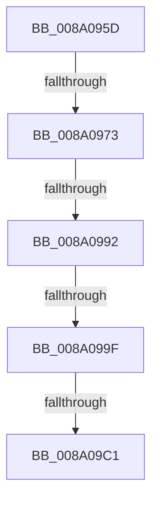

# sub_008A095D

- RVA: `0x008A095D`–`0x008A09C5` (길이 `104` bytes)
- VA: `0x00000001408A095D`
- 실행 섹션: `PAGE`
- PDB 이름 있음: `아니요`; PDB Function 태그: `아니요`
- unwind 정보 RVA: `0x0007E8BC`
- 디코드: `27`개 명령, `104/104` bytes 표시
- 미해석 바이트: `0` (있으면 어셈블리에 `.byte`로 보존)

> 이 문서는 커널 이미지의 기계어와 PDB 기호를 분석해 생성했습니다. 4번과 5번은 함수 원형과 자료형을 바이너리 사용 방식에서 추정한 C 해석이며 원본 소스 복구 결과는 아닙니다.

## 1. Dependencies

- 직접 호출 지점: **1**; 고유 호출 대상: **1**
- 직접 호출자로 확인된 함수: **0**
- RIP 상대 이미지 참조: **1**

### Outgoing calls
- `0x008A09B3` → [SepPrivilegeCheck](../../text/40/SepPrivilegeCheck_function_0040B6B0.md) (function, `0x0040B6B0`)

### Direct callers
- 이 함수 시작 RVA로 연결되는 직접 call은 확인되지 않았습니다. 간접 호출은 완전히 역산할 수 없습니다.

### Static image references
- `0x008A0973` → RVA `0x00FD9AC0` (`PAGEDATA`; read)

## 2. Other-region calls and transfers

- 다른 실행 섹션으로 향하는 call: **1**
  - `0x008A09B3` → [SepPrivilegeCheck](../../text/40/SepPrivilegeCheck_function_0040B6B0.md) (`PAGE` → `.text`)
- call이 아닌 외부 분기/꼬리 이동: **4**
  - `0x008A096D` → [sub_008A0A32 + 0x8](Unknown_function_008A0A32.md) (`tail-transfer`)
  - `0x008A0990` → [sub_008A09C5](Unknown_function_008A09C5.md) (`tail-transfer`)
  - `0x008A0999` → [sub_008A0B2F](Unknown_function_008A0B2F.md) (`tail-transfer`)
  - `0x008A09BF` → [sub_008A0A32](Unknown_function_008A0A32.md) (`tail-transfer`)

## 3. Assembly (complete function range)

```asm
008A095D  4D 89 63 D8                     mov qword ptr [r11 - 0x28], r12
008A0961  8B FD                           mov edi, ebp
008A0963  44 8B E5                        mov r12d, ebp
008A0966  41 81 E4 A9 00 12 01            and r12d, 0x11200a9
008A096D  0F 84 C7 00 00 00               je 0x1408a0a3a
008A0973  48 8B 05 46 91 73 00            mov rax, qword ptr [rip + 0x739146]
008A097A  41 8B FF                        mov edi, r15d
008A097D  49 89 43 A8                     mov qword ptr [r11 - 0x58], rax
008A0981  45 89 7B A0                     mov dword ptr [r11 - 0x60], r15d
008A0985  45 89 7B A4                     mov dword ptr [r11 - 0x5c], r15d
008A0989  45 89 53 B0                     mov dword ptr [r11 - 0x50], r10d
008A098D  45 84 C0                        test r8b, r8b
008A0990  74 33                           je 0x1408a09c5
008A0992  48 8B 4B 20                     mov rcx, qword ptr [rbx + 0x20]
008A0996  48 85 C9                        test rcx, rcx
008A0999  0F 85 90 01 00 00               jne 0x1408a0b2f
008A099F  48 8B 4B 30                     mov rcx, qword ptr [rbx + 0x30]
008A09A3  44 88 44 24 20                  mov byte ptr [rsp + 0x20], r8b
008A09A8  48 8D 54 24 40                  lea rdx, [rsp + 0x40]
008A09AD  45 8B C7                        mov r8d, r15d
008A09B0  45 8B CF                        mov r9d, r15d
008A09B3  E8 F8 AC B6 FF                  call 0x14040b6b0
008A09B8  45 33 D2                        xor r10d, r10d
008A09BB  8B FD                           mov edi, ebp
008A09BD  84 C0                           test al, al
008A09BF  74 71                           je 0x1408a0a32
008A09C1  8B 7C 24 38                     mov edi, dword ptr [rsp + 0x38]
```

## 4. C-style interpretation (structured pseudocode)

```c
__int64 __fastcall sub_008A095D(__int64 a1, __int64 a2, unsigned __int8 a3, __int64 a4, __int64 a5, __int64 a6, unsigned int a7, __int64 a8)
{
    __int64 result;
    __int64 v_r10;
    __int64 v_r12;
    unsigned __int8 v_stack_p20;

    *(unsigned __int64 *)(v_r11 - 40) = v_r12;
    v_r12 = (unsigned int)(((unsigned int)((unsigned int)(v_rbp))) & (0x11200A9ULL));
    *(unsigned __int64 *)(v_r11 - 88) = *(unsigned __int64 *)(v_rip + 7573830);
    *(unsigned int *)(v_r11 - 96) = (unsigned int)(v_r15);
    *(unsigned int *)(v_r11 - 92) = (unsigned int)(v_r15);
    *(unsigned int *)(v_r11 - 80) = (unsigned int)(v_r10);
    v_stack_p20 = a3;
    result = SepPrivilegeCheck(*(unsigned __int64 *)(v_rbx + 48), a8, (unsigned int)((unsigned int)(v_r15)), (unsigned int)((unsigned int)(v_r15)));
    v_r10 = 0;
    return result;
}
```

## 5. (Beta) C Style

```c
int64_t sub_008A095D(int64_t Arg1, int64_t Arg2, uint8_t Arg3, int64_t Arg4, uint64_t Arg5, uint64_t Arg6, uint32_t Arg7, int64_t Arg8)
{
    int64_t result;
    int64_t local_r10;
    int64_t local_r12;
    uint8_t v_stack_p20;

    *(uint64_t *)(local_r11 - 0x28) = local_r12;
    local_r12 = (uint32_t)(((uint32_t)((uint32_t)(local_rbp))) & (0x11200A9ULL));
    *(uint64_t *)(local_r11 - 0x58) = *(uint64_t *)(v_rip + 0x739146);
    *(uint32_t *)(local_r11 - 0x60) = (uint32_t)(local_r15);
    *(uint32_t *)(local_r11 - 0x5C) = (uint32_t)(local_r15);
    *(uint32_t *)(local_r11 - 0x50) = (uint32_t)(local_r10);
    v_stack_p20 = Arg3;
    result = SepPrivilegeCheck(*(uint64_t *)(local_rbx + 0x30), Arg8, (uint32_t)((uint32_t)(local_r15)), (uint32_t)((uint32_t)(local_r15)));
    local_r10 = 0;
    return result;
}
```

## 6. Execution-region graph

[열기: 2D/3D 그래프와 함수 탐색 컨트롤 패널](../../../control-panel.html?section=page&rva=0x008A095D&view=graph)

- 2D 그래프는 위에서 아래로 흐르고, 3D 그래프는 빈 공간을 드래그해 회전합니다. Shift+드래그는 이동, 휠은 확대·축소, 함수 노드 선택은 대상 보고서 이동입니다.

### Static fallback


