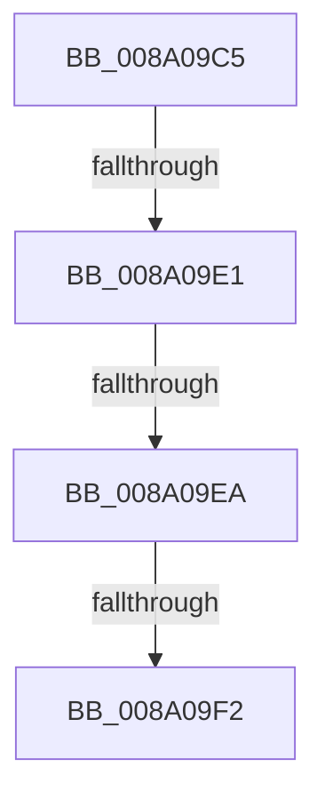

# sub_008A09C5

- RVA: `0x008A09C5`–`0x008A0A32` (길이 `109` bytes)
- VA: `0x00000001408A09C5`
- 실행 섹션: `PAGE`
- PDB 이름 있음: `아니요`; PDB Function 태그: `아니요`
- unwind 정보 RVA: `0x0007E8D0`
- 디코드: `26`개 명령, `109/109` bytes 표시
- 미해석 바이트: `0` (있으면 어셈블리에 `.byte`로 보존)

> 이 문서는 커널 이미지의 기계어와 PDB 기호를 분석해 생성했습니다. 4번과 5번은 함수 원형과 자료형을 바이너리 사용 방식에서 추정한 C 해석이며 원본 소스 복구 결과는 아닙니다.

## 1. Dependencies

- 직접 호출 지점: **1**; 고유 호출 대상: **1**
- 직접 호출자로 확인된 함수: **0**
- RIP 상대 이미지 참조: **0**

### Outgoing calls
- `0x008A0A07` → [memcpy](../../text/6C/memcpy_function_006C6840.md) (function, `0x006C6840`)

### Direct callers
- 이 함수 시작 RVA로 연결되는 직접 call은 확인되지 않았습니다. 간접 호출은 완전히 역산할 수 없습니다.

### Static image references
- 디코드된 RIP-relative 메모리 참조가 없습니다.

## 2. Other-region calls and transfers

- 다른 실행 섹션으로 향하는 call: **1**
  - `0x008A0A07` → [memcpy](../../text/6C/memcpy_function_006C6840.md) (`PAGE` → `.text`)
- call이 아닌 외부 분기/꼬리 이동: **3**
  - `0x008A09DB` → [sub_008A0B76](Unknown_function_008A0B76.md) (`tail-transfer`)
  - `0x008A09E4` → [sub_008A0B27](Unknown_function_008A0B27.md) (`tail-transfer`)
  - `0x008A09EC` → [sub_008A0B5A](Unknown_function_008A0B5A.md) (`tail-transfer`)

## 3. Assembly (complete function range)

```asm
008A09C5  4C 89 6C 24 68                  mov qword ptr [rsp + 0x68], r13
008A09CA  4C 8B 6B 48                     mov r13, qword ptr [rbx + 0x48]
008A09CE  4D 8B 75 00                     mov r14, qword ptr [r13]
008A09D2  41 8B 0E                        mov ecx, dword ptr [r14]
008A09D5  8D 04 39                        lea eax, [rcx + rdi]
008A09D8  83 F8 03                        cmp eax, 3
008A09DB  0F 87 95 01 00 00               ja 0x1408a0b76
008A09E1  4D 85 F6                        test r14, r14
008A09E4  0F 84 3D 01 00 00               je 0x1408a0b27
008A09EA  85 C9                           test ecx, ecx
008A09EC  0F 85 68 01 00 00               jne 0x1408a0b5a
008A09F2  B9 08 00 00 00                  mov ecx, 8
008A09F7  44 8D 04 7F                     lea r8d, [rdi + rdi*2]
008A09FB  49 03 CE                        add rcx, r14
008A09FE  41 C1 E0 02                     shl r8d, 2
008A0A02  48 8D 54 24 40                  lea rdx, [rsp + 0x40]
008A0A07  E8 34 5E E2 FF                  call 0x1406c6840
008A0A0C  41 01 3E                        add dword ptr [r14], edi
008A0A0F  44 09 63 14                     or dword ptr [rbx + 0x14], r12d
008A0A13  8B FD                           mov edi, ebp
008A0A15  81 63 10 56 FF ED FE            and dword ptr [rbx + 0x10], 0xfeedff56
008A0A1C  81 E7 56 FF ED FE               and edi, 0xfeedff56
008A0A22  83 4B 0C 02                     or dword ptr [rbx + 0xc], 2
008A0A26  45 0F B6 F7                     movzx r14d, r15b
008A0A2A  4C 8B 6C 24 68                  mov r13, qword ptr [rsp + 0x68]
008A0A2F  45 33 D2                        xor r10d, r10d
```

## 4. C-style interpretation (structured pseudocode)

```c
__int64 __fastcall sub_008A09C5(__int64 a1, __int64 a2, __int64 a3, __int64 a4, __int64 a5, __int64 a6, __int64 a7, __int64 a8, __int64 a9, __int64 a10, __int64 a11, __int64 a12, __int64 a13)
{
    __int64 result;
    __int64 v_r10;
    __int64 v_rdi;
    unsigned __int64 v_stack_p68;

    v_stack_p68 = v_r13;
    a1 = (8) + (*(unsigned __int64 *)(*(unsigned __int64 *)(v_rbx + 72)));
    a3 = (unsigned int)((v_rdi + v_rdi * 2) << (2));
    result = memcpy(a1, a8, a3, a4);
    v_rdi = (unsigned int)(((unsigned int)((unsigned int)(v_rbp))) & (0xFEEDFF56ULL));
    v_r10 = 0;
    return result;
}
```

## 5. (Beta) C Style

```c
int64_t sub_008A09C5(int64_t Arg1, int64_t Arg2, int64_t Arg3, int64_t Arg4, uint64_t Arg5, uint64_t Arg6, uint64_t Arg7, int64_t Arg8, uint64_t Arg9, uint64_t Arg10, uint64_t Arg11, uint64_t Arg12, int64_t Arg13)
{
    int64_t result;
    int64_t local_r10;
    int64_t local_rdi;
    uint64_t v_stack_p68;

    v_stack_p68 = local_r13;
    Arg1 = (8) + (*(uint64_t *)(*(uint64_t *)(local_rbx + 0x48)));
    Arg3 = (uint32_t)((local_rdi + local_rdi * 2) << (2));
    result = memcpy(Arg1, Arg8, Arg3, Arg4);
    local_rdi = (uint32_t)(((uint32_t)((uint32_t)(local_rbp))) & (0xFEEDFF56ULL));
    local_r10 = 0;
    return result;
}
```

## 6. Execution-region graph

[열기: 2D/3D 그래프와 함수 탐색 컨트롤 패널](../../../control-panel.html?section=page&rva=0x008A09C5&view=graph)

- 2D 그래프는 위에서 아래로 흐르고, 3D 그래프는 빈 공간을 드래그해 회전합니다. Shift+드래그는 이동, 휠은 확대·축소, 함수 노드 선택은 대상 보고서 이동입니다.

### Static fallback


