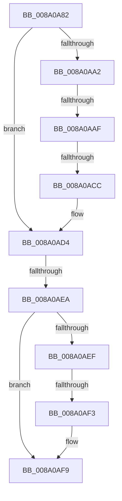

# sub_008A0A82

- RVA: `0x008A0A82`–`0x008A0B27` (길이 `165` bytes)
- VA: `0x00000001408A0A82`
- 실행 섹션: `PAGE`
- PDB 이름 있음: `아니요`; PDB Function 태그: `아니요`
- unwind 정보 RVA: `0x0007E930`
- 디코드: `42`개 명령, `165/165` bytes 표시
- 미해석 바이트: `0` (있으면 어셈블리에 `.byte`로 보존)

> 이 문서는 커널 이미지의 기계어와 PDB 기호를 분석해 생성했습니다. 4번과 5번은 함수 원형과 자료형을 바이너리 사용 방식에서 추정한 C 해석이며 원본 소스 복구 결과는 아닙니다.

## 1. Dependencies

- 직접 호출 지점: **2**; 고유 호출 대상: **2**
- 직접 호출자로 확인된 함수: **0**
- RIP 상대 이미지 참조: **1**

### Outgoing calls
- `0x008A0AC3` → [SepPrivilegeCheck](../../text/40/SepPrivilegeCheck_function_0040B6B0.md) (function, `0x0040B6B0`)
- `0x008A0B0C` → [memcpy](../../text/6C/memcpy_function_006C6840.md) (function, `0x006C6840`)

### Direct callers
- 이 함수 시작 RVA로 연결되는 직접 call은 확인되지 않았습니다. 간접 호출은 완전히 역산할 수 없습니다.

### Static image references
- `0x008A0A82` → RVA `0x00FD9AE0` (`PAGEDATA`; read)

## 2. Other-region calls and transfers

- 다른 실행 섹션으로 향하는 call: **2**
  - `0x008A0AC3` → [SepPrivilegeCheck](../../text/40/SepPrivilegeCheck_function_0040B6B0.md) (`PAGE` → `.text`)
  - `0x008A0B0C` → [memcpy](../../text/6C/memcpy_function_006C6840.md) (`PAGE` → `.text`)
- call이 아닌 외부 분기/꼬리 이동: **5**
  - `0x008A0AA9` → [sub_008A0B40](Unknown_function_008A0B40.md) (`tail-transfer`)
  - `0x008A0ACA` → [sub_008A0A4F + 0x4](Unknown_function_008A0A4F.md) (`tail-transfer`)
  - `0x008A0AE4` → [sub_008A0C14](Unknown_function_008A0C14.md) (`tail-transfer`)
  - `0x008A0AF1` → [sub_008A0B69](Unknown_function_008A0B69.md) (`tail-transfer`)
  - `0x008A0B22` → [sub_008A0A4F + 0xF](Unknown_function_008A0A4F.md) (`tail-transfer`)

## 3. Assembly (complete function range)

```asm
008A0A82  48 8B 05 57 90 73 00            mov rax, qword ptr [rip + 0x739057]
008A0A89  48 89 44 24 40                  mov qword ptr [rsp + 0x40], rax
008A0A8E  44 89 7C 24 38                  mov dword ptr [rsp + 0x38], r15d
008A0A93  44 89 7C 24 3C                  mov dword ptr [rsp + 0x3c], r15d
008A0A98  44 89 54 24 48                  mov dword ptr [rsp + 0x48], r10d
008A0A9D  45 84 C0                        test r8b, r8b
008A0AA0  74 32                           je 0x1408a0ad4
008A0AA2  48 8B 4B 20                     mov rcx, qword ptr [rbx + 0x20]
008A0AA6  48 85 C9                        test rcx, rcx
008A0AA9  0F 85 91 00 00 00               jne 0x1408a0b40
008A0AAF  48 8B 4B 30                     mov rcx, qword ptr [rbx + 0x30]
008A0AB3  44 88 44 24 20                  mov byte ptr [rsp + 0x20], r8b
008A0AB8  48 8D 54 24 40                  lea rdx, [rsp + 0x40]
008A0ABD  45 8B C7                        mov r8d, r15d
008A0AC0  45 8B CF                        mov r9d, r15d
008A0AC3  E8 E8 AB B6 FF                  call 0x14040b6b0
008A0AC8  84 C0                           test al, al
008A0ACA  74 87                           je 0x1408a0a53
008A0ACC  44 8B 7C 24 38                  mov r15d, dword ptr [rsp + 0x38]
008A0AD1  45 33 D2                        xor r10d, r10d
008A0AD4  4C 8B 73 48                     mov r14, qword ptr [rbx + 0x48]
008A0AD8  49 8B 36                        mov rsi, qword ptr [r14]
008A0ADB  8B 0E                           mov ecx, dword ptr [rsi]
008A0ADD  42 8D 04 39                     lea eax, [rcx + r15]
008A0AE1  83 F8 03                        cmp eax, 3
008A0AE4  0F 87 2A 01 00 00               ja 0x1408a0c14
008A0AEA  48 85 F6                        test rsi, rsi
008A0AED  74 0A                           je 0x1408a0af9
008A0AEF  85 C9                           test ecx, ecx
008A0AF1  75 76                           jne 0x1408a0b69
008A0AF3  41 BA 08 00 00 00               mov r10d, 8
008A0AF9  47 8D 04 7F                     lea r8d, [r15 + r15*2]
008A0AFD  41 8B CA                        mov ecx, r10d
008A0B00  41 C1 E0 02                     shl r8d, 2
008A0B04  48 8D 54 24 40                  lea rdx, [rsp + 0x40]
008A0B09  48 03 CE                        add rcx, rsi
008A0B0C  E8 2F 5D E2 FF                  call 0x1406c6840
008A0B11  44 01 3E                        add dword ptr [rsi], r15d
008A0B14  09 7B 14                        or dword ptr [rbx + 0x14], edi
008A0B17  81 63 10 E9 FE E0 FE            and dword ptr [rbx + 0x10], 0xfee0fee9
008A0B1E  83 4B 0C 04                     or dword ptr [rbx + 0xc], 4
008A0B22  E9 37 FF FF FF                  jmp 0x1408a0a5e
```

## 4. C-style interpretation (structured pseudocode)

```c
__int64 __fastcall sub_008A0A82(__int64 a1, __int64 a2, unsigned __int8 a3, __int64 a4, __int64 a5, __int64 a6, unsigned int a7, __int64 a8)
{
    __int64 result;
    __int64 v_r10;
    unsigned __int8 v_stack_p20;
    unsigned int v_stack_p38;
    unsigned int v_stack_p3C;
    unsigned __int64 v_stack_p40;
    unsigned int v_stack_p48;

    v_stack_p40 = *(unsigned __int64 *)(v_rip + 7573591);
    v_stack_p38 = (unsigned int)(v_r15);
    v_stack_p3C = (unsigned int)(v_r15);
    v_stack_p48 = (unsigned int)(v_r10);
    if (a3 == 0) goto loc_008A0AD4;
    v_stack_p20 = a3;
    result = SepPrivilegeCheck(*(unsigned __int64 *)(v_rbx + 48), a8, (unsigned int)((unsigned int)(v_r15)), (unsigned int)((unsigned int)(v_r15)));
    v_r10 = 0;
loc_008A0AD4:
    if (*(unsigned __int64 *)(*(unsigned __int64 *)(v_rbx + 72)) == 0) goto loc_008A0AF9;
loc_008A0AF9:
    a3 = (unsigned int)(((unsigned int)(a7) + (unsigned int)(a7) * 2) << (2));
    a1 = (8) + (*(unsigned __int64 *)(*(unsigned __int64 *)(v_rbx + 72)));
    result = memcpy(a1, a8, a3, (unsigned int)((unsigned int)(v_r15)));
}
```

## 5. (Beta) C Style

```c
int64_t sub_008A0A82(int64_t Arg1, int64_t Arg2, uint8_t Arg3, int64_t Arg4, uint64_t Arg5, uint64_t Arg6, uint32_t Arg7, int64_t Arg8)
{
    int64_t result;
    int64_t local_r10;
    uint8_t v_stack_p20;
    uint32_t v_stack_p38;
    uint32_t v_stack_p3C;
    uint64_t v_stack_p40;
    uint32_t v_stack_p48;

    v_stack_p40 = *(uint64_t *)(v_rip + 0x739057);
    v_stack_p38 = (uint32_t)(local_r15);
    v_stack_p3C = (uint32_t)(local_r15);
    v_stack_p48 = (uint32_t)(local_r10);
    if (Arg3 == 0) goto loc_008A0AD4;
    v_stack_p20 = Arg3;
    result = SepPrivilegeCheck(*(uint64_t *)(local_rbx + 0x30), Arg8, (uint32_t)((uint32_t)(local_r15)), (uint32_t)((uint32_t)(local_r15)));
    local_r10 = 0;
loc_008A0AD4:
    if (*(uint64_t *)(*(uint64_t *)(local_rbx + 0x48)) == 0) goto loc_008A0AF9;
loc_008A0AF9:
    Arg3 = (uint32_t)(((uint32_t)(Arg7) + (uint32_t)(Arg7) * 2) << (2));
    Arg1 = (8) + (*(uint64_t *)(*(uint64_t *)(local_rbx + 0x48)));
    result = memcpy(Arg1, Arg8, Arg3, (uint32_t)((uint32_t)(local_r15)));
}
```

## 6. Execution-region graph

[열기: 2D/3D 그래프와 함수 탐색 컨트롤 패널](../../../control-panel.html?section=page&rva=0x008A0A82&view=graph)

- 2D 그래프는 위에서 아래로 흐르고, 3D 그래프는 빈 공간을 드래그해 회전합니다. Shift+드래그는 이동, 휠은 확대·축소, 함수 노드 선택은 대상 보고서 이동입니다.

### Static fallback


