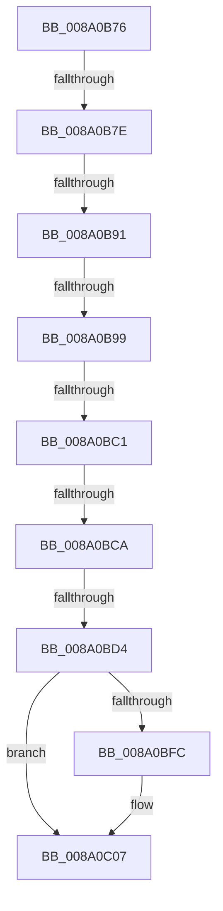

# sub_008A0B76

- RVA: `0x008A0B76`–`0x008A0C14` (길이 `158` bytes)
- VA: `0x00000001408A0B76`
- 실행 섹션: `PAGE`
- PDB 이름 있음: `아니요`; PDB Function 태그: `아니요`
- unwind 정보 RVA: `0x0007E9FC`
- 디코드: `39`개 명령, `158/158` bytes 표시
- 미해석 바이트: `0` (있으면 어셈블리에 `.byte`로 보존)

> 이 문서는 커널 이미지의 기계어와 PDB 기호를 분석해 생성했습니다. 4번과 5번은 함수 원형과 자료형을 바이너리 사용 방식에서 추정한 C 해석이며 원본 소스 복구 결과는 아닙니다.

## 1. Dependencies

- 직접 호출 지점: **4**; 고유 호출 대상: **4**
- 직접 호출자로 확인된 함수: **0**
- RIP 상대 이미지 참조: **0**

### Outgoing calls
- `0x008A0BB0` → [ExAllocatePool2](../../poolcode/B8/ExAllocatePool2_function_00B820F0.md) (function, `0x00B820F0`)
- `0x008A0BE4` → [memcpy](../../text/6C/memcpy_function_006C6840.md) (function, `0x006C6840`)
- `0x008A0BF1` → [SepConcatenatePrivileges](../9D/SepConcatenatePrivileges_function_009D7AD0.md) (function, `0x009D7AD0`)
- `0x008A0C02` → [ExFreePoolWithTag](../../poolcode/B8/ExFreePoolWithTag_function_00B82870.md) (function, `0x00B82870`)

### Direct callers
- 이 함수 시작 RVA로 연결되는 직접 call은 확인되지 않았습니다. 간접 호출은 완전히 역산할 수 없습니다.

### Static image references
- 디코드된 RIP-relative 메모리 참조가 없습니다.

## 2. Other-region calls and transfers

- 다른 실행 섹션으로 향하는 call: **3**
  - `0x008A0BB0` → [ExAllocatePool2](../../poolcode/B8/ExAllocatePool2_function_00B820F0.md) (`PAGE` → `POOLCODE`)
  - `0x008A0BE4` → [memcpy](../../text/6C/memcpy_function_006C6840.md) (`PAGE` → `.text`)
  - `0x008A0C02` → [ExFreePoolWithTag](../../poolcode/B8/ExFreePoolWithTag_function_00B82870.md) (`PAGE` → `POOLCODE`)
- call이 아닌 외부 분기/꼬리 이동: **7**
  - `0x008A0B78` → [sub_008A0C1F](Unknown_function_008A0C1F.md) (`tail-transfer`)
  - `0x008A0B8B` → [sub_008A0C1F + 0xA](Unknown_function_008A0C1F.md) (`tail-transfer`)
  - `0x008A0B93` → [sub_008A0C1F + 0x12](Unknown_function_008A0C1F.md) (`tail-transfer`)
  - `0x008A0BBB` → [sub_008A09C5 + 0x4A](Unknown_function_008A09C5.md) (`tail-transfer`)
  - `0x008A0BC8` → [sub_008A0C1F + 0x1C](Unknown_function_008A0C1F.md) (`tail-transfer`)
  - `0x008A0BCE` → [sub_008A0CF0](Unknown_function_008A0CF0.md) (`tail-transfer`)
  - `0x008A0C0F` → [sub_008A09C5 + 0x4A](Unknown_function_008A09C5.md) (`tail-transfer`)

## 3. Assembly (complete function range)

```asm
008A0B76  85 FF                           test edi, edi
008A0B78  0F 84 A1 00 00 00               je 0x1408a0c1f
008A0B7E  8D 04 7F                        lea eax, [rdi + rdi*2]
008A0B81  8D 14 85 08 00 00 00            lea edx, [rax*4 + 8]
008A0B88  4D 85 F6                        test r14, r14
008A0B8B  0F 84 98 00 00 00               je 0x1408a0c29
008A0B91  85 C9                           test ecx, ecx
008A0B93  0F 84 98 00 00 00               je 0x1408a0c31
008A0B99  8D 04 49                        lea eax, [rcx + rcx*2]
008A0B9C  8D 04 85 08 00 00 00            lea eax, [rax*4 + 8]
008A0BA3  03 D0                           add edx, eax
008A0BA5  B9 00 01 00 00                  mov ecx, 0x100
008A0BAA  41 B8 53 65 50 72               mov r8d, 0x72506553
008A0BB0  E8 3B 15 2E 00                  call 0x140b820f0
008A0BB5  48 8B F8                        mov rdi, rax
008A0BB8  48 85 C0                        test rax, rax
008A0BBB  0F 84 4E FE FF FF               je 0x1408a0a0f
008A0BC1  49 8B 55 00                     mov rdx, qword ptr [r13]
008A0BC5  48 85 D2                        test rdx, rdx
008A0BC8  74 71                           je 0x1408a0c3b
008A0BCA  8B 02                           mov eax, dword ptr [rdx]
008A0BCC  85 C0                           test eax, eax
008A0BCE  0F 84 1C 01 00 00               je 0x1408a0cf0
008A0BD4  8D 04 40                        lea eax, [rax + rax*2]
008A0BD7  8D 04 85 08 00 00 00            lea eax, [rax*4 + 8]
008A0BDE  44 8B C0                        mov r8d, eax
008A0BE1  48 8B CF                        mov rcx, rdi
008A0BE4  E8 57 5C E2 FF                  call 0x1406c6840
008A0BE9  4C 8D 44 24 38                  lea r8, [rsp + 0x38]
008A0BEE  48 8B CF                        mov rcx, rdi
008A0BF1  E8 DA 6E 13 00                  call 0x1409d7ad0
008A0BF6  80 7B 0B 00                     cmp byte ptr [rbx + 0xb], 0
008A0BFA  74 0B                           je 0x1408a0c07
008A0BFC  49 8B 4D 00                     mov rcx, qword ptr [r13]
008A0C00  33 D2                           xor edx, edx
008A0C02  E8 69 1C 2E 00                  call 0x140b82870
008A0C07  49 89 7D 00                     mov qword ptr [r13], rdi
008A0C0B  44 88 7B 0B                     mov byte ptr [rbx + 0xb], r15b
008A0C0F  E9 FB FD FF FF                  jmp 0x1408a0a0f
```

## 4. C-style interpretation (structured pseudocode)

```c
__int64 __fastcall sub_008A0B76(__int64 a1, __int64 a2, __int64 a3, __int64 a4, __int64 a5, __int64 a6, __int64 a7)
{
    __int64 result;

    a2 = (unsigned int)((v_rdi + v_rdi * 2 * 4 + 8) + ((unsigned int)(a1 + a1 * 2 * 4 + 8)));
    result = ExAllocatePool2(256, a2, (unsigned int)(0x72506553ULL), a4);
    result = memcpy(result, *(unsigned __int64 *)(v_r13), (unsigned int)((unsigned int)((unsigned int)(*(unsigned int *)(*(unsigned __int64 *)(v_r13))) + (unsigned int)(*(unsigned int *)(*(unsigned __int64 *)(v_r13))) * 2 * 4 + 8)), a4);
    result = SepConcatenatePrivileges(result, *(unsigned __int64 *)(v_r13), a7, a4);
    if ((*(unsigned __int8 *)(v_rbx + 11)) != 0) {
        a1 = *(unsigned __int64 *)(v_r13);
        a2 = 0;
        result = ExFreePoolWithTag(a1, a2, a7, a4);
    }
    *(unsigned __int64 *)(v_r13) = result;
    *(unsigned __int8 *)(v_rbx + 11) = (unsigned __int8)(v_r15);
}
```

## 5. (Beta) C Style

```c
int64_t sub_008A0B76(int64_t Arg1, int64_t Arg2, int64_t Arg3, int64_t Arg4, uint64_t Arg5, uint64_t Arg6, int64_t Arg7)
{
    int64_t result;

    Arg2 = (uint32_t)((local_rdi + local_rdi * 2 * 4 + 8) + ((uint32_t)(Arg1 + Arg1 * 2 * 4 + 8)));
    result = ExAllocatePool2(256, Arg2, (uint32_t)(0x72506553ULL), Arg4);
    result = memcpy(result, *(uint64_t *)(local_r13), (uint32_t)((uint32_t)((uint32_t)(*(uint32_t *)(*(uint64_t *)(local_r13))) + (uint32_t)(*(uint32_t *)(*(uint64_t *)(local_r13))) * 2 * 4 + 8)), Arg4);
    result = SepConcatenatePrivileges(result, *(uint64_t *)(local_r13), Arg7, Arg4);
    if ((*(uint8_t *)(local_rbx + 0xB)) != 0) {
        Arg1 = *(uint64_t *)(local_r13);
        Arg2 = 0;
        result = ExFreePoolWithTag(Arg1, Arg2, Arg7, Arg4);
    }
    *(uint64_t *)(local_r13) = result;
    *(uint8_t *)(local_rbx + 0xB) = (uint8_t)(local_r15);
}
```

## 6. Execution-region graph

[열기: 2D/3D 그래프와 함수 탐색 컨트롤 패널](../../../control-panel.html?section=page&rva=0x008A0B76&view=graph)

- 2D 그래프는 위에서 아래로 흐르고, 3D 그래프는 빈 공간을 드래그해 회전합니다. Shift+드래그는 이동, 휠은 확대·축소, 함수 노드 선택은 대상 보고서 이동입니다.

### Static fallback


