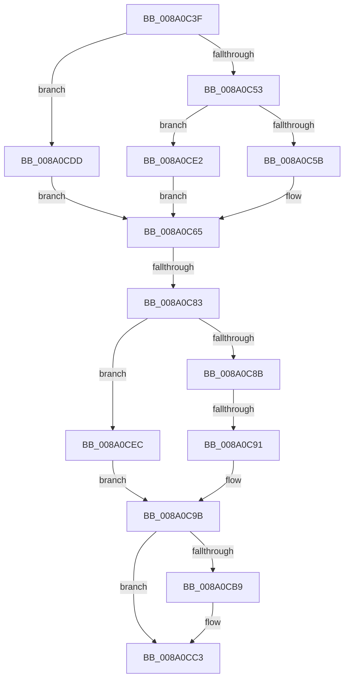

# sub_008A0C3F

- RVA: `0x008A0C3F`–`0x008A0CF0` (길이 `177` bytes)
- VA: `0x00000001408A0C3F`
- 실행 섹션: `PAGE`
- PDB 이름 있음: `아니요`; PDB Function 태그: `아니요`
- unwind 정보 RVA: `0x0007EA5C`
- 디코드: `46`개 명령, `177/177` bytes 표시
- 미해석 바이트: `0` (있으면 어셈블리에 `.byte`로 보존)

> 이 문서는 커널 이미지의 기계어와 PDB 기호를 분석해 생성했습니다. 4번과 5번은 함수 원형과 자료형을 바이너리 사용 방식에서 추정한 C 해석이며 원본 소스 복구 결과는 아닙니다.

## 1. Dependencies

- 직접 호출 지점: **4**; 고유 호출 대상: **4**
- 직접 호출자로 확인된 함수: **0**
- RIP 상대 이미지 참조: **0**

### Outgoing calls
- `0x008A0C72` → [ExAllocatePool2](../../poolcode/B8/ExAllocatePool2_function_00B820F0.md) (function, `0x00B820F0`)
- `0x008A0CA1` → [memcpy](../../text/6C/memcpy_function_006C6840.md) (function, `0x006C6840`)
- `0x008A0CAE` → [SepConcatenatePrivileges](../9D/SepConcatenatePrivileges_function_009D7AD0.md) (function, `0x009D7AD0`)
- `0x008A0CBE` → [ExFreePoolWithTag](../../poolcode/B8/ExFreePoolWithTag_function_00B82870.md) (function, `0x00B82870`)

### Direct callers
- 이 함수 시작 RVA로 연결되는 직접 call은 확인되지 않았습니다. 간접 호출은 완전히 역산할 수 없습니다.

### Static image references
- 디코드된 RIP-relative 메모리 참조가 없습니다.

## 2. Other-region calls and transfers

- 다른 실행 섹션으로 향하는 call: **3**
  - `0x008A0C72` → [ExAllocatePool2](../../poolcode/B8/ExAllocatePool2_function_00B820F0.md) (`PAGE` → `POOLCODE`)
  - `0x008A0CA1` → [memcpy](../../text/6C/memcpy_function_006C6840.md) (`PAGE` → `.text`)
  - `0x008A0CBE` → [ExFreePoolWithTag](../../poolcode/B8/ExFreePoolWithTag_function_00B82870.md) (`PAGE` → `POOLCODE`)
- call이 아닌 외부 분기/꼬리 이동: **3**
  - `0x008A0C7D` → [sub_008A0A82 + 0x92](Unknown_function_008A0A82.md) (`tail-transfer`)
  - `0x008A0C8F` → [sub_008A0CFA](Unknown_function_008A0CFA.md) (`tail-transfer`)
  - `0x008A0CD8` → [sub_008A0A4F + 0xF](Unknown_function_008A0A4F.md) (`tail-transfer`)

## 3. Assembly (complete function range)

```asm
008A0C3F  43 8D 04 7F                     lea eax, [r15 + r15*2]
008A0C43  8D 14 85 08 00 00 00            lea edx, [rax*4 + 8]
008A0C4A  48 85 F6                        test rsi, rsi
008A0C4D  0F 84 8A 00 00 00               je 0x1408a0cdd
008A0C53  85 C9                           test ecx, ecx
008A0C55  0F 84 87 00 00 00               je 0x1408a0ce2
008A0C5B  8D 04 49                        lea eax, [rcx + rcx*2]
008A0C5E  8D 04 85 08 00 00 00            lea eax, [rax*4 + 8]
008A0C65  03 D0                           add edx, eax
008A0C67  B9 00 01 00 00                  mov ecx, 0x100
008A0C6C  41 B8 53 65 50 72               mov r8d, 0x72506553
008A0C72  E8 79 14 2E 00                  call 0x140b820f0
008A0C77  48 8B F0                        mov rsi, rax
008A0C7A  48 85 C0                        test rax, rax
008A0C7D  0F 84 91 FE FF FF               je 0x1408a0b14
008A0C83  49 8B 16                        mov rdx, qword ptr [r14]
008A0C86  48 85 D2                        test rdx, rdx
008A0C89  74 61                           je 0x1408a0cec
008A0C8B  8B 02                           mov eax, dword ptr [rdx]
008A0C8D  85 C0                           test eax, eax
008A0C8F  74 69                           je 0x1408a0cfa
008A0C91  8D 04 40                        lea eax, [rax + rax*2]
008A0C94  8D 04 85 08 00 00 00            lea eax, [rax*4 + 8]
008A0C9B  44 8B C0                        mov r8d, eax
008A0C9E  48 8B CE                        mov rcx, rsi
008A0CA1  E8 9A 5B E2 FF                  call 0x1406c6840
008A0CA6  4C 8D 44 24 38                  lea r8, [rsp + 0x38]
008A0CAB  48 8B CE                        mov rcx, rsi
008A0CAE  E8 1D 6E 13 00                  call 0x1409d7ad0
008A0CB3  80 7B 0B 00                     cmp byte ptr [rbx + 0xb], 0
008A0CB7  74 0A                           je 0x1408a0cc3
008A0CB9  49 8B 0E                        mov rcx, qword ptr [r14]
008A0CBC  33 D2                           xor edx, edx
008A0CBE  E8 AD 1B 2E 00                  call 0x140b82870
008A0CC3  49 89 36                        mov qword ptr [r14], rsi
008A0CC6  09 7B 14                        or dword ptr [rbx + 0x14], edi
008A0CC9  81 63 10 E9 FE E0 FE            and dword ptr [rbx + 0x10], 0xfee0fee9
008A0CD0  83 4B 0C 04                     or dword ptr [rbx + 0xc], 4
008A0CD4  C6 43 0B 01                     mov byte ptr [rbx + 0xb], 1
008A0CD8  E9 81 FD FF FF                  jmp 0x1408a0a5e
008A0CDD  41 8B C2                        mov eax, r10d
008A0CE0  EB 83                           jmp 0x1408a0c65
008A0CE2  B8 08 00 00 00                  mov eax, 8
008A0CE7  E9 79 FF FF FF                  jmp 0x1408a0c65
008A0CEC  33 C0                           xor eax, eax
008A0CEE  EB AB                           jmp 0x1408a0c9b
```

## 4. C-style interpretation (structured pseudocode)

```c
__int64 __fastcall sub_008A0C3F(__int64 a1, __int64 a2, __int64 a3, __int64 a4, __int64 a5, __int64 a6, __int64 a7)
{
    __int64 result;

    if (v_rsi == 0) goto loc_008A0CDD;
    if ((unsigned int)(a1) == 0) goto loc_008A0CE2;
loc_008A0C65:
    a2 = (unsigned int)((v_r15 + v_r15 * 2 * 4 + 8) + ((unsigned int)(a1 + a1 * 2 * 4 + 8)));
    result = ExAllocatePool2(256, a2, (unsigned int)(0x72506553ULL), a4);
    if (*(unsigned __int64 *)(v_r14) == 0) goto loc_008A0CEC;
loc_008A0C9B:
    result = memcpy(result, *(unsigned __int64 *)(v_r14), (unsigned int)((unsigned int)((unsigned int)(*(unsigned int *)(*(unsigned __int64 *)(v_r14))) + (unsigned int)(*(unsigned int *)(*(unsigned __int64 *)(v_r14))) * 2 * 4 + 8)), a4);
    result = SepConcatenatePrivileges(result, *(unsigned __int64 *)(v_r14), a7, a4);
    if ((*(unsigned __int8 *)(v_rbx + 11)) != 0) {
        a1 = *(unsigned __int64 *)(v_r14);
        a2 = 0;
        result = ExFreePoolWithTag(a1, a2, a7, a4);
    }
    *(unsigned __int64 *)(v_r14) = result;
    *(unsigned __int8 *)(v_rbx + 11) = 1;
loc_008A0CDD:
    goto loc_008A0C65;
loc_008A0CE2:
    goto loc_008A0C65;
loc_008A0CEC:
    result = 0;
    goto loc_008A0C9B;
}
```

## 5. (Beta) C Style

```c
int64_t sub_008A0C3F(int64_t Arg1, int64_t Arg2, int64_t Arg3, int64_t Arg4, uint64_t Arg5, uint64_t Arg6, int64_t Arg7)
{
    int64_t result;

    if (local_rsi == 0) goto loc_008A0CDD;
    if ((uint32_t)(Arg1) == 0) goto loc_008A0CE2;
loc_008A0C65:
    Arg2 = (uint32_t)((local_r15 + local_r15 * 2 * 4 + 8) + ((uint32_t)(Arg1 + Arg1 * 2 * 4 + 8)));
    result = ExAllocatePool2(256, Arg2, (uint32_t)(0x72506553ULL), Arg4);
    if (*(uint64_t *)(local_r14) == 0) goto loc_008A0CEC;
loc_008A0C9B:
    result = memcpy(result, *(uint64_t *)(local_r14), (uint32_t)((uint32_t)((uint32_t)(*(uint32_t *)(*(uint64_t *)(local_r14))) + (uint32_t)(*(uint32_t *)(*(uint64_t *)(local_r14))) * 2 * 4 + 8)), Arg4);
    result = SepConcatenatePrivileges(result, *(uint64_t *)(local_r14), Arg7, Arg4);
    if ((*(uint8_t *)(local_rbx + 0xB)) != 0) {
        Arg1 = *(uint64_t *)(local_r14);
        Arg2 = 0;
        result = ExFreePoolWithTag(Arg1, Arg2, Arg7, Arg4);
    }
    *(uint64_t *)(local_r14) = result;
    *(uint8_t *)(local_rbx + 0xB) = 1;
loc_008A0CDD:
    goto loc_008A0C65;
loc_008A0CE2:
    goto loc_008A0C65;
loc_008A0CEC:
    result = 0;
    goto loc_008A0C9B;
}
```

## 6. Execution-region graph

[열기: 2D/3D 그래프와 함수 탐색 컨트롤 패널](../../../control-panel.html?section=page&rva=0x008A0C3F&view=graph)

- 2D 그래프는 위에서 아래로 흐르고, 3D 그래프는 빈 공간을 드래그해 회전합니다. Shift+드래그는 이동, 휠은 확대·축소, 함수 노드 선택은 대상 보고서 이동입니다.

### Static fallback


