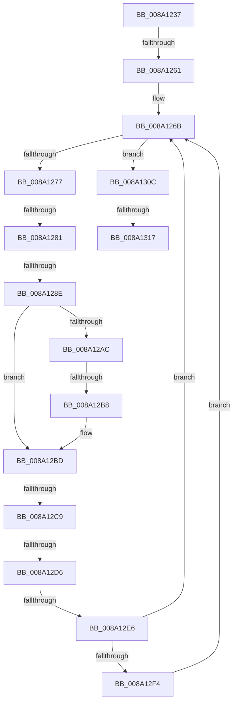

# sub_008A1237

- RVA: `0x008A1237`–`0x008A134C` (길이 `277` bytes)
- VA: `0x00000001408A1237`
- 실행 섹션: `PAGE`
- PDB 이름 있음: `아니요`; PDB Function 태그: `아니요`
- unwind 정보 RVA: `0x0007EB38`
- 디코드: `66`개 명령, `277/277` bytes 표시
- 미해석 바이트: `0` (있으면 어셈블리에 `.byte`로 보존)

> 이 문서는 커널 이미지의 기계어와 PDB 기호를 분석해 생성했습니다. 4번과 5번은 함수 원형과 자료형을 바이너리 사용 방식에서 추정한 C 해석이며 원본 소스 복구 결과는 아닙니다.

## 1. Dependencies

- 직접 호출 지점: **4**; 고유 호출 대상: **3**
- 직접 호출자로 확인된 함수: **0**
- RIP 상대 이미지 참조: **3**

### Outgoing calls
- `0x008A12B8` → [IopSymlinkFreeRelatedMountPointChain](IopSymlinkFreeRelatedMountPointChain_function_008A1828.md) (function, `0x008A1828`)
- `0x008A12E6` → [ExFreeToPagedLookasideList](../../text/38/ExFreeToPagedLookasideList_function_00387D30.md) (function, `0x00387D30`)
- `0x008A1302` → [guard_dispatch_icall](../../text/6B/guard_dispatch_icall_function_006BAAD0.md) (function, `0x006BAAD0`)
- `0x008A1321` → [ExFreeToPagedLookasideList](../../text/38/ExFreeToPagedLookasideList_function_00387D30.md) (function, `0x00387D30`)

### Direct callers
- 이 함수 시작 RVA로 연결되는 직접 call은 확인되지 않았습니다. 간접 호출은 완전히 역산할 수 없습니다.

### Static image references
- `0x008A1264` → RVA `0x008A2270` (`IopSymlinkCleanupECP`; read)
- `0x008A12F4` → RVA `0x00E65BF0` (`.data`; read)
- `0x008A131A` → RVA `0x00E11D00` (`.data`; read)

## 2. Other-region calls and transfers

- 다른 실행 섹션으로 향하는 call: **3**
  - `0x008A12E6` → [ExFreeToPagedLookasideList](../../text/38/ExFreeToPagedLookasideList_function_00387D30.md) (`PAGE` → `.text`)
  - `0x008A1302` → [guard_dispatch_icall](../../text/6B/guard_dispatch_icall_function_006BAAD0.md) (`PAGE` → `.text`)
  - `0x008A1321` → [ExFreeToPagedLookasideList](../../text/38/ExFreeToPagedLookasideList_function_00387D30.md) (`PAGE` → `.text`)
- call이 아닌 외부 분기/꼬리 이동: **8**
  - `0x008A125B` → [sub_008A134D](Unknown_function_008A134D.md) (`tail-transfer`)
  - `0x008A127B` → [sub_008A134D + 0x2A](Unknown_function_008A134D.md) (`tail-transfer`)
  - `0x008A1288` → [sub_008A134D + 0x2A](Unknown_function_008A134D.md) (`tail-transfer`)
  - `0x008A12B2` → [sub_008A13F1 + 0xF](Unknown_function_008A13F1.md) (`tail-transfer`)
  - `0x008A12C3` → [sub_008A134D + 0x31](Unknown_function_008A134D.md) (`tail-transfer`)
  - `0x008A12D0` → [sub_008A134D + 0x85](Unknown_function_008A134D.md) (`tail-transfer`)
  - `0x008A12E0` → [sub_008A134D + 0x7B](Unknown_function_008A134D.md) (`tail-transfer`)
  - `0x008A1311` → [sub_008A13F1](Unknown_function_008A13F1.md) (`tail-transfer`)

## 3. Assembly (complete function range)

```asm
008A1237  48 89 5C 24 40                  mov qword ptr [rsp + 0x40], rbx
008A123C  48 8D 59 08                     lea rbx, [rcx + 8]
008A1240  48 89 6C 24 48                  mov qword ptr [rsp + 0x48], rbp
008A1245  48 89 74 24 50                  mov qword ptr [rsp + 0x50], rsi
008A124A  4C 89 64 24 58                  mov qword ptr [rsp + 0x58], r12
008A124F  4C 89 74 24 28                  mov qword ptr [rsp + 0x28], r14
008A1254  4C 89 7C 24 20                  mov qword ptr [rsp + 0x20], r15
008A1259  A8 01                           test al, 1
008A125B  0F 85 EC 00 00 00               jne 0x1408a134d
008A1261  45 33 FF                        xor r15d, r15d
008A1264  4C 8D 25 05 10 00 00            lea r12, [rip + 0x1005]
008A126B  48 8B 03                        mov rax, qword ptr [rbx]
008A126E  48 3B C3                        cmp rax, rbx
008A1271  0F 84 95 00 00 00               je 0x1408a130c
008A1277  48 39 58 08                     cmp qword ptr [rax + 8], rbx
008A127B  0F 85 F6 00 00 00               jne 0x1408a1377
008A1281  48 8B 08                        mov rcx, qword ptr [rax]
008A1284  48 39 41 08                     cmp qword ptr [rcx + 8], rax
008A1288  0F 85 E9 00 00 00               jne 0x1408a1377
008A128E  48 89 0B                        mov qword ptr [rbx], rcx
008A1291  4C 8D 70 40                     lea r14, [rax + 0x40]
008A1295  48 89 59 08                     mov qword ptr [rcx + 8], rbx
008A1299  49 8B EF                        mov rbp, r15
008A129C  4C 89 78 08                     mov qword ptr [rax + 8], r15
008A12A0  4C 89 38                        mov qword ptr [rax], r15
008A12A3  49 8B 46 E0                     mov rax, qword ptr [r14 - 0x20]
008A12A7  48 85 C0                        test rax, rax
008A12AA  74 11                           je 0x1408a12bd
008A12AC  49 8B CE                        mov rcx, r14
008A12AF  49 3B C4                        cmp rax, r12
008A12B2  0F 85 48 01 00 00               jne 0x1408a1400
008A12B8  E8 6B 05 00 00                  call 0x1408a1828
008A12BD  41 8B 46 E8                     mov eax, dword ptr [r14 - 0x18]
008A12C1  A8 20                           test al, 0x20
008A12C3  0F 85 B5 00 00 00               jne 0x1408a137e
008A12C9  49 8B 4E F0                     mov rcx, qword ptr [r14 - 0x10]
008A12CD  48 85 C9                        test rcx, rcx
008A12D0  0F 84 FC 00 00 00               je 0x1408a13d2
008A12D6  41 8B 46 E8                     mov eax, dword ptr [r14 - 0x18]
008A12DA  49 8D 56 B8                     lea rdx, [r14 - 0x48]
008A12DE  A8 40                           test al, 0x40
008A12E0  0F 85 E2 00 00 00               jne 0x1408a13c8
008A12E6  E8 45 6A AE FF                  call 0x140387d30
008A12EB  48 85 ED                        test rbp, rbp
008A12EE  0F 84 77 FF FF FF               je 0x1408a126b
008A12F4  48 8B 05 F5 48 5C 00            mov rax, qword ptr [rip + 0x5c48f5]
008A12FB  48 8B CD                        mov rcx, rbp
008A12FE  48 8B 40 08                     mov rax, qword ptr [rax + 8]
008A1302  E8 C9 97 E1 FF                  call 0x1406baad0
008A1307  E9 5F FF FF FF                  jmp 0x1408a126b
008A130C  8B 47 04                        mov eax, dword ptr [rdi + 4]
008A130F  A8 04                           test al, 4
008A1311  0F 84 DA 00 00 00               je 0x1408a13f1
008A1317  48 8B D7                        mov rdx, rdi
008A131A  48 8D 0D DF 09 57 00            lea rcx, [rip + 0x5709df]
008A1321  E8 0A 6A AE FF                  call 0x140387d30
008A1326  B0 01                           mov al, 1
008A1328  4C 8B 74 24 28                  mov r14, qword ptr [rsp + 0x28]
008A132D  4C 8B 64 24 58                  mov r12, qword ptr [rsp + 0x58]
008A1332  48 8B 74 24 50                  mov rsi, qword ptr [rsp + 0x50]
008A1337  48 8B 6C 24 48                  mov rbp, qword ptr [rsp + 0x48]
008A133C  48 8B 5C 24 40                  mov rbx, qword ptr [rsp + 0x40]
008A1341  4C 8B 7C 24 20                  mov r15, qword ptr [rsp + 0x20]
008A1346  48 83 C4 30                     add rsp, 0x30
008A134A  5F                              pop rdi
008A134B  C3                              ret
```

## 4. C-style interpretation (structured pseudocode)

```c
__int64 __fastcall sub_008A1237(__int64 a1, __int64 a2, __int64 a3, __int64 a4, __int64 a5, __int64 a6, __int64 a7, __int64 a8, __int64 a9, __int64 a10, __int64 a11)
{
    __int64 result;
    __int64 v_r15;
    __int64 v_rsp;
    unsigned __int64 v_stack_p20;
    unsigned __int64 v_stack_p28;
    unsigned __int64 v_stack_p40;
    unsigned __int64 v_stack_p48;
    unsigned __int64 v_stack_p50;
    unsigned __int64 v_stack_p58;

    v_stack_p40 = v_rbx;
    v_stack_p48 = v_rbp;
    v_stack_p50 = v_rsi;
    v_stack_p58 = v_r12;
    v_stack_p28 = v_r14;
    v_stack_p20 = v_r15;
    v_r15 = 0;
loc_008A126B:
    if ((*(unsigned __int64 *)(a1 + 8)) == (a1 + 8)) goto loc_008A130C;
    *(unsigned __int64 *)(a1 + 8) = *(unsigned __int64 *)(*(unsigned __int64 *)(a1 + 8));
    *(unsigned __int64 *)(*(unsigned __int64 *)(*(unsigned __int64 *)(a1 + 8)) + 8) = a1 + 8;
    *(unsigned __int64 *)(*(unsigned __int64 *)(a1 + 8) + 8) = 0;
    *(unsigned __int64 *)(*(unsigned __int64 *)(a1 + 8)) = 0;
    if (*(unsigned __int64 *)(*(unsigned __int64 *)(a1 + 8) + 64 - 32) == 0) goto loc_008A12BD;
    result = IopSymlinkFreeRelatedMountPointChain(*(unsigned __int64 *)(a1 + 8) + 64, a2, a3, a4);
loc_008A12BD:
    result = ExFreeToPagedLookasideList(*(unsigned __int64 *)(*(unsigned __int64 *)(a1 + 8) + 64 - 16), *(unsigned __int64 *)(a1 + 8) + 64 - 72, a3, a4);
    if (0 == 0) goto loc_008A126B;
    result = guard_dispatch_icall(0, *(unsigned __int64 *)(a1 + 8) + 64 - 72, a3, a4);
    goto loc_008A126B;
loc_008A130C:
    result = ExFreeToPagedLookasideList(v_rip + 5704159, v_rdi, a3, a4);
    v_rsp = (v_rsp) + (48);
    return 1;
}
```

## 5. (Beta) C Style

```c
int64_t sub_008A1237(void *Arg1, int64_t Arg2, int64_t Arg3, int64_t Arg4, int64_t Arg5, uint64_t Arg6, uint64_t Arg7, int64_t Arg8, int64_t Arg9, int64_t Arg10, int64_t Arg11)
{
    uint8_t *arg1 = (uint8_t *)Arg1;

    int64_t result;
    int64_t local_r15;
    int64_t local_rsp;
    uint64_t v_stack_p20;
    uint64_t v_stack_p28;
    uint64_t v_stack_p40;
    uint64_t v_stack_p48;
    uint64_t v_stack_p50;
    uint64_t v_stack_p58;

    v_stack_p40 = local_rbx;
    v_stack_p48 = local_rbp;
    v_stack_p50 = local_rsi;
    v_stack_p58 = local_r12;
    v_stack_p28 = local_r14;
    v_stack_p20 = local_r15;
    local_r15 = 0;
loc_008A126B:
    if ((*(uint64_t *)(arg1 + 0x8)) == (Arg1 + 8)) goto loc_008A130C;
    *(uint64_t *)(arg1 + 0x8) = *(uint64_t *)(*(uint64_t *)(arg1 + 0x8));
    *(void **)(*(uint64_t *)(*(uint64_t *)(arg1 + 0x8)) + 0x8) = Arg1 + 8;
    *(uint64_t *)(*(uint64_t *)(arg1 + 0x8) + 0x8) = 0;
    *(uint64_t *)(*(uint64_t *)(arg1 + 0x8)) = 0;
    if (*(uint64_t *)(*(uint64_t *)(arg1 + 0x8) + 0x40 - 0x20) == 0) goto loc_008A12BD;
    result = IopSymlinkFreeRelatedMountPointChain(*(uint64_t *)(arg1 + 0x8) + 64, Arg2, Arg3, Arg4);
loc_008A12BD:
    result = ExFreeToPagedLookasideList(*(uint64_t *)(*(uint64_t *)(arg1 + 0x8) + 0x40 - 0x10), *(uint64_t *)(arg1 + 0x8) + 64 - 72, Arg3, Arg4);
    if (0 == 0) goto loc_008A126B;
    result = guard_dispatch_icall(0, *(uint64_t *)(arg1 + 0x8) + 64 - 72, Arg3, Arg4);
    goto loc_008A126B;
loc_008A130C:
    result = ExFreeToPagedLookasideList(v_rip + 5704159, local_rdi, Arg3, Arg4);
    local_rsp = (local_rsp) + (48);
    return 1;
}
```

### 관측된 메모리 오프셋

구조체 형식이 확인되지 않은 접근은 인자 기준의 오프셋으로만 기록했습니다.

| 기준 인자 | 오프셋 표현 | 폭 (bit) | 접근 |
|---|---:|---:|---|
| `Arg1` | `+ 0x0` | `64` | `R` |
| `Arg1` | `+ 0x0` | `64` | `W` |
| `Arg1` | `+ 0x8` | `64` | `R` |

## 6. Execution-region graph

[열기: 2D/3D 그래프와 함수 탐색 컨트롤 패널](../../../control-panel.html?section=page&rva=0x008A1237&view=graph)

- 2D 그래프는 위에서 아래로 흐르고, 3D 그래프는 빈 공간을 드래그해 회전합니다. Shift+드래그는 이동, 휠은 확대·축소, 함수 노드 선택은 대상 보고서 이동입니다.

### Static fallback


