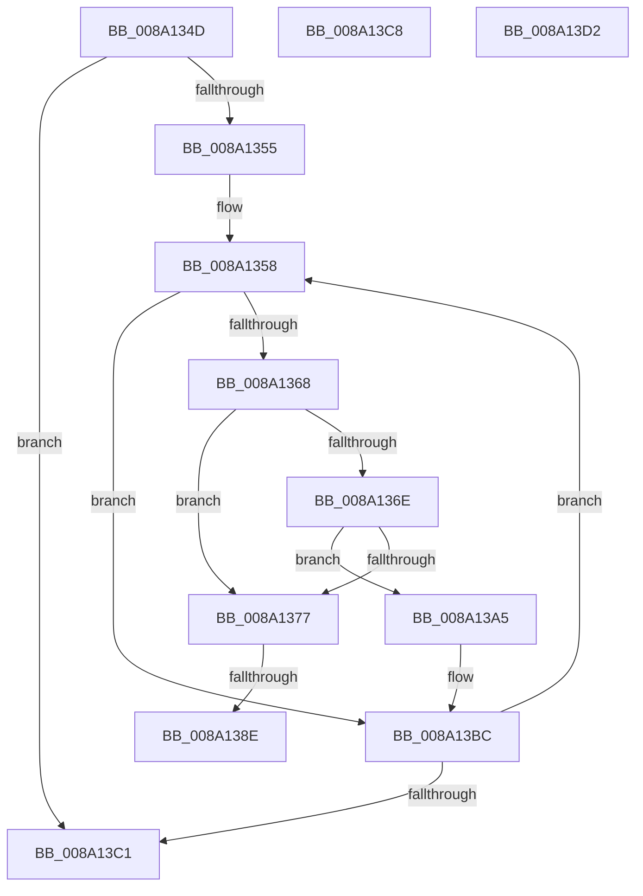

# sub_008A134D

- RVA: `0x008A134D`–`0x008A13E2` (길이 `149` bytes)
- VA: `0x00000001408A134D`
- 실행 섹션: `PAGE`
- PDB 이름 있음: `아니요`; PDB Function 태그: `아니요`
- unwind 정보 RVA: `0x0007EB74`
- 디코드: `42`개 명령, `149/149` bytes 표시
- 미해석 바이트: `0` (있으면 어셈블리에 `.byte`로 보존)

> 이 문서는 커널 이미지의 기계어와 PDB 기호를 분석해 생성했습니다. 4번과 5번은 함수 원형과 자료형을 바이너리 사용 방식에서 추정한 C 해석이며 원본 소스 복구 결과는 아닙니다.

## 1. Dependencies

- 직접 호출 지점: **4**; 고유 호출 대상: **4**
- 직접 호출자로 확인된 함수: **0**
- RIP 상대 이미지 참조: **1**

### Outgoing calls
- `0x008A139B` → [guard_dispatch_icall](../../text/6B/guard_dispatch_icall_function_006BAAD0.md) (function, `0x006BAAD0`)
- `0x008A13B7` → [FsRtlFreeExtraCreateParameter](FsRtlFreeExtraCreateParameter_function_008A1760.md) (function, `0x008A1760`)
- `0x008A13C8` → [ExFreeToNPagedLookasideList](../../text/38/ExFreeToNPagedLookasideList_function_0038D9D0.md) (function, `0x0038D9D0`)
- `0x008A13D8` → [ExFreePoolWithTag](../../poolcode/B8/ExFreePoolWithTag_function_00B82870.md) (function, `0x00B82870`)

### Direct callers
- 이 함수 시작 RVA로 연결되는 직접 call은 확인되지 않았습니다. 간접 호출은 완전히 역산할 수 없습니다.

### Static image references
- `0x008A137E` → RVA `0x00E65BF0` (`.data`; read)

## 2. Other-region calls and transfers

- 다른 실행 섹션으로 향하는 call: **3**
  - `0x008A139B` → [guard_dispatch_icall](../../text/6B/guard_dispatch_icall_function_006BAAD0.md) (`PAGE` → `.text`)
  - `0x008A13C8` → [ExFreeToNPagedLookasideList](../../text/38/ExFreeToNPagedLookasideList_function_0038D9D0.md) (`PAGE` → `.text`)
  - `0x008A13D8` → [ExFreePoolWithTag](../../poolcode/B8/ExFreePoolWithTag_function_00B82870.md) (`PAGE` → `POOLCODE`)
- call이 아닌 외부 분기/꼬리 이동: **5**
  - `0x008A1388` → [sub_008A1237 + 0x92](Unknown_function_008A1237.md) (`tail-transfer`)
  - `0x008A13A0` → [sub_008A1237 + 0x92](Unknown_function_008A1237.md) (`tail-transfer`)
  - `0x008A13C3` → [sub_008A1237 + 0xF1](Unknown_function_008A1237.md) (`tail-transfer`)
  - `0x008A13CD` → [sub_008A1237 + 0xB4](Unknown_function_008A1237.md) (`tail-transfer`)
  - `0x008A13DD` → [sub_008A1237 + 0xB4](Unknown_function_008A1237.md) (`tail-transfer`)

## 3. Assembly (complete function range)

```asm
008A134D  48 8B 3B                        mov rdi, qword ptr [rbx]
008A1350  48 3B FB                        cmp rdi, rbx
008A1353  74 6C                           je 0x1408a13c1
008A1355  45 33 FF                        xor r15d, r15d
008A1358  48 8B D7                        mov rdx, rdi
008A135B  48 8B CF                        mov rcx, rdi
008A135E  48 8B 3F                        mov rdi, qword ptr [rdi]
008A1361  8B 42 28                        mov eax, dword ptr [rdx + 0x28]
008A1364  A8 01                           test al, 1
008A1366  75 54                           jne 0x1408a13bc
008A1368  48 39 57 08                     cmp qword ptr [rdi + 8], rdx
008A136C  75 09                           jne 0x1408a1377
008A136E  48 8B 42 08                     mov rax, qword ptr [rdx + 8]
008A1372  48 39 10                        cmp qword ptr [rax], rdx
008A1375  74 2E                           je 0x1408a13a5
008A1377  B9 03 00 00 00                  mov ecx, 3
008A137C  CD 29                           int 0x29
008A137E  48 8B 05 6B 48 5C 00            mov rax, qword ptr [rip + 0x5c486b]
008A1385  48 85 C0                        test rax, rax
008A1388  0F 84 3B FF FF FF               je 0x1408a12c9
008A138E  49 8B 6E F8                     mov rbp, qword ptr [r14 - 8]
008A1392  49 8B D6                        mov rdx, r14
008A1395  48 8B 00                        mov rax, qword ptr [rax]
008A1398  48 8B CD                        mov rcx, rbp
008A139B  E8 30 97 E1 FF                  call 0x1406baad0
008A13A0  E9 24 FF FF FF                  jmp 0x1408a12c9
008A13A5  48 89 38                        mov qword ptr [rax], rdi
008A13A8  48 89 47 08                     mov qword ptr [rdi + 8], rax
008A13AC  4C 89 79 08                     mov qword ptr [rcx + 8], r15
008A13B0  4C 89 39                        mov qword ptr [rcx], r15
008A13B3  48 8D 4A 40                     lea rcx, [rdx + 0x40]
008A13B7  E8 A4 03 00 00                  call 0x1408a1760
008A13BC  48 3B FB                        cmp rdi, rbx
008A13BF  75 97                           jne 0x1408a1358
008A13C1  32 C0                           xor al, al
008A13C3  E9 60 FF FF FF                  jmp 0x1408a1328
008A13C8  E8 03 C6 AE FF                  call 0x14038d9d0
008A13CD  E9 19 FF FF FF                  jmp 0x1408a12eb
008A13D2  33 D2                           xor edx, edx
008A13D4  49 8D 4E B8                     lea rcx, [r14 - 0x48]
008A13D8  E8 93 14 2E 00                  call 0x140b82870
008A13DD  E9 09 FF FF FF                  jmp 0x1408a12eb
```

## 4. C-style interpretation (structured pseudocode)

```c
__int64 __fastcall sub_008A134D(void)
{
    __int64 result;
    __int64 v_r15;

    if ((*(unsigned __int64 *)(v_rbx)) == v_rbx) goto loc_008A13C1;
    v_r15 = 0;
loc_008A1358:
    if ((((unsigned __int8)((unsigned int)(*(unsigned int *)(*(unsigned __int64 *)(v_rbx) + 40)))) & (1)) != 0) goto loc_008A13BC;
    if ((*(unsigned __int64 *)(*(unsigned __int64 *)(*(unsigned __int64 *)(v_rbx)) + 8)) != (*(unsigned __int64 *)(v_rbx))) goto loc_008A1377;
    if ((*(unsigned __int64 *)(*(unsigned __int64 *)(*(unsigned __int64 *)(v_rbx) + 8))) == (*(unsigned __int64 *)(v_rbx))) goto loc_008A13A5;
loc_008A1377:
    result = guard_dispatch_icall(*(unsigned __int64 *)(v_r14 - 8), v_r14, a3, a4);
loc_008A13A5:
    *(unsigned __int64 *)(result) = *(unsigned __int64 *)(*(unsigned __int64 *)(v_rbx));
    *(unsigned __int64 *)(*(unsigned __int64 *)(*(unsigned __int64 *)(v_rbx)) + 8) = result;
    *(unsigned __int64 *)(*(unsigned __int64 *)(v_r14 - 8) + 8) = 0;
    *(unsigned __int64 *)(*(unsigned __int64 *)(v_r14 - 8)) = 0;
    result = FsRtlFreeExtraCreateParameter(v_r14 + 64, v_r14, a3, a4);
loc_008A13BC:
    if ((*(unsigned __int64 *)(*(unsigned __int64 *)(v_rbx))) != v_rbx) goto loc_008A1358;
loc_008A13C1:
    result = 0;
}
```

## 5. (Beta) C Style

```c
void sub_008A134D(void)
{
    int64_t result;
    int64_t local_r15;

    if ((*(uint64_t *)(local_rbx)) == local_rbx) goto loc_008A13C1;
    local_r15 = 0;
loc_008A1358:
    if ((((uint8_t)((uint32_t)(*(uint32_t *)(*(uint64_t *)(local_rbx) + 0x28)))) & (1)) != 0) goto loc_008A13BC;
    if ((*(uint64_t *)(*(uint64_t *)(*(uint64_t *)(local_rbx)) + 0x8)) != (*(uint64_t *)(local_rbx))) goto loc_008A1377;
    if ((*(uint64_t *)(*(uint64_t *)(*(uint64_t *)(local_rbx) + 0x8))) == (*(uint64_t *)(local_rbx))) goto loc_008A13A5;
loc_008A1377:
    result = guard_dispatch_icall(*(uint64_t *)(local_r14 - 0x8), local_r14, a3, a4);
loc_008A13A5:
    *(uint64_t *)(result) = *(uint64_t *)(*(uint64_t *)(local_rbx));
    *(uint64_t *)(*(uint64_t *)(*(uint64_t *)(local_rbx)) + 0x8) = result;
    *(uint64_t *)(*(uint64_t *)(local_r14 - 0x8) + 0x8) = 0;
    *(uint64_t *)(*(uint64_t *)(local_r14 - 0x8)) = 0;
    result = FsRtlFreeExtraCreateParameter(local_r14 + 64, local_r14, a3, a4);
loc_008A13BC:
    if ((*(uint64_t *)(*(uint64_t *)(local_rbx))) != local_rbx) goto loc_008A1358;
loc_008A13C1:
    result = 0;
}
```

## 6. Execution-region graph

[열기: 2D/3D 그래프와 함수 탐색 컨트롤 패널](../../../control-panel.html?section=page&rva=0x008A134D&view=graph)

- 2D 그래프는 위에서 아래로 흐르고, 3D 그래프는 빈 공간을 드래그해 회전합니다. Shift+드래그는 이동, 휠은 확대·축소, 함수 노드 선택은 대상 보고서 이동입니다.

### Static fallback


