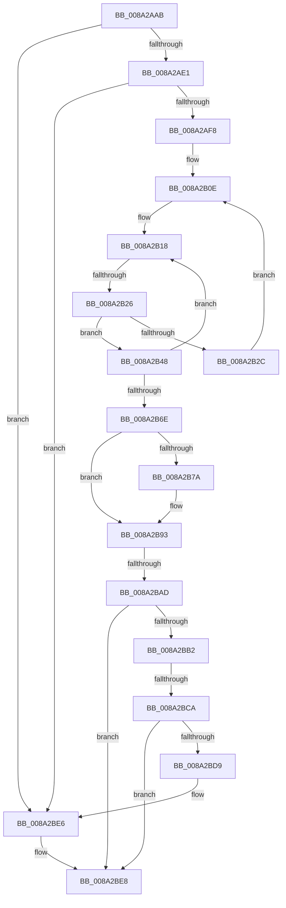

# sub_008A2AAB

- RVA: `0x008A2AAB`–`0x008A2BFD` (길이 `338` bytes)
- VA: `0x00000001408A2AAB`
- 실행 섹션: `PAGE`
- PDB 이름 있음: `아니요`; PDB Function 태그: `아니요`
- unwind 정보 RVA: `0x0007ED64`
- 디코드: `84`개 명령, `338/338` bytes 표시
- 미해석 바이트: `0` (있으면 어셈블리에 `.byte`로 보존)

> 이 문서는 커널 이미지의 기계어와 PDB 기호를 분석해 생성했습니다. 4번과 5번은 함수 원형과 자료형을 바이너리 사용 방식에서 추정한 C 해석이며 원본 소스 복구 결과는 아닙니다.

## 1. Dependencies

- 직접 호출 지점: **6**; 고유 호출 대상: **6**
- 직접 호출자로 확인된 함수: **0**
- RIP 상대 이미지 참조: **1**

### Outgoing calls
- `0x008A2AE7` → [ExpLookupHandleTableEntry](../86/ExpLookupHandleTableEntry_function_00869DB0.md) (function, `0x00869DB0`)
- `0x008A2B32` → [ExpBlockOnLockedHandleEntry](../86/ExpBlockOnLockedHandleEntry_function_00868838.md) (function, `0x00868838`)
- `0x008A2B98` → [ExGetHandlePointer](../../text/43/ExGetHandlePointer_function_00430C90.md) (function, `0x00430C90`)
- `0x008A2BB2` → [PsGetCurrentServerSilo](../../text/22/PsGetCurrentServerSilo_function_00225710.md) (function, `0x00225710`)
- `0x008A2BD0` → [PsIsProcessInSilo](../../text/41/PsIsProcessInSilo_function_004185E0.md) (function, `0x004185E0`)
- `0x008A2BE1` → [ObfDereferenceObjectWithTag](../../text/2F/ObfDereferenceObjectWithTag_function_002F78E0.md) (function, `0x002F78E0`)

### Direct callers
- 이 함수 시작 RVA로 연결되는 직접 call은 확인되지 않았습니다. 간접 호출은 완전히 역산할 수 없습니다.

### Static image references
- `0x008A2ACE` → RVA `0x00FC6CA8` (`ALMOSTRO`; read)

## 2. Other-region calls and transfers

- 다른 실행 섹션으로 향하는 call: **4**
  - `0x008A2B98` → [ExGetHandlePointer](../../text/43/ExGetHandlePointer_function_00430C90.md) (`PAGE` → `.text`)
  - `0x008A2BB2` → [PsGetCurrentServerSilo](../../text/22/PsGetCurrentServerSilo_function_00225710.md) (`PAGE` → `.text`)
  - `0x008A2BD0` → [PsIsProcessInSilo](../../text/41/PsIsProcessInSilo_function_004185E0.md) (`PAGE` → `.text`)
  - `0x008A2BE1` → [ObfDereferenceObjectWithTag](../../text/2F/ObfDereferenceObjectWithTag_function_002F78E0.md) (`PAGE` → `.text`)
- call이 아닌 외부 분기/꼬리 이동: **4**
  - `0x008A2B20` → [sub_008A2C2F](Unknown_function_008A2C2F.md) (`tail-transfer`)
  - `0x008A2BA7` → [sub_008A2C2F + 0xB1](Unknown_function_008A2C2F.md) (`tail-transfer`)
  - `0x008A2BC4` → [sub_008A2CF7 + 0x36](Unknown_function_008A2CF7.md) (`tail-transfer`)
  - `0x008A2BFB` → [sub_008A2BFD + 0x12](Unknown_function_008A2BFD.md) (`tail-transfer`)

## 3. Assembly (complete function range)

```asm
008A2AAB  48 89 6C 24 50                  mov qword ptr [rsp + 0x50], rbp
008A2AB0  4C 8B F2                        mov r14, rdx
008A2AB3  48 89 74 24 58                  mov qword ptr [rsp + 0x58], rsi
008A2AB8  65 48 8B 34 25 88 01 00 00      mov rsi, qword ptr gs:[0x188]
008A2AC1  48 89 7C 24 60                  mov qword ptr [rsp + 0x60], rdi
008A2AC6  66 FF 8E E6 01 00 00            dec word ptr [rsi + 0x1e6]
008A2ACD  90                              nop
008A2ACE  48 8B 05 D3 41 72 00            mov rax, qword ptr [rip + 0x7241d3]
008A2AD5  F7 C1 FC 03 00 00               test ecx, 0x3fc
008A2ADB  0F 84 05 01 00 00               je 0x1408a2be6
008A2AE1  48 8B D1                        mov rdx, rcx
008A2AE4  48 8B C8                        mov rcx, rax
008A2AE7  E8 C4 72 FC FF                  call 0x140869db0
008A2AEC  48 8B F8                        mov rdi, rax
008A2AEF  48 85 C0                        test rax, rax
008A2AF2  0F 84 EE 00 00 00               je 0x1408a2be6
008A2AF8  48 8B 2D A9 41 72 00            mov rbp, qword ptr [rip + 0x7241a9]
008A2AFF  0F 0D 08                        prefetchw byte ptr [rax]
008A2B02  48 8B 08                        mov rcx, qword ptr [rax]
008A2B05  48 89 4C 24 20                  mov qword ptr [rsp + 0x20], rcx
008A2B0A  48 8B 48 08                     mov rcx, qword ptr [rax + 8]
008A2B0E  4C 8B 44 24 20                  mov r8, qword ptr [rsp + 0x20]
008A2B13  48 89 4C 24 28                  mov qword ptr [rsp + 0x28], rcx
008A2B18  90                              nop
008A2B19  49 F7 C0 FE FF 01 00            test r8, 0x1fffe
008A2B20  0F 84 09 01 00 00               je 0x1408a2c2f
008A2B26  41 F6 C0 01                     test r8b, 1
008A2B2A  75 1C                           jne 0x1408a2b48
008A2B2C  48 8B D7                        mov rdx, rdi
008A2B2F  48 8B CD                        mov rcx, rbp
008A2B32  E8 01 5D FC FF                  call 0x140868838
008A2B37  0F 0D 0F                        prefetchw byte ptr [rdi]
008A2B3A  48 8B 07                        mov rax, qword ptr [rdi]
008A2B3D  48 8B 4F 08                     mov rcx, qword ptr [rdi + 8]
008A2B41  48 89 44 24 20                  mov qword ptr [rsp + 0x20], rax
008A2B46  EB C6                           jmp 0x1408a2b0e
008A2B48  49 8D 58 FE                     lea rbx, [r8 - 2]
008A2B4C  49 8B C0                        mov rax, r8
008A2B4F  48 8B D1                        mov rdx, rcx
008A2B52  F0 48 0F C7 0F                  lock cmpxchg16b xmmword ptr [rdi]
008A2B57  4C 8B C0                        mov r8, rax
008A2B5A  48 89 44 24 20                  mov qword ptr [rsp + 0x20], rax
008A2B5F  0F 94 C0                        sete al
008A2B62  48 89 54 24 28                  mov qword ptr [rsp + 0x28], rdx
008A2B67  48 8B CA                        mov rcx, rdx
008A2B6A  84 C0                           test al, al
008A2B6C  74 AA                           je 0x1408a2b18
008A2B6E  49 8B C8                        mov rcx, r8
008A2B71  48 D1 E9                        shr rcx, 1
008A2B74  66 83 F9 10                     cmp cx, 0x10
008A2B78  75 19                           jne 0x1408a2b93
008A2B7A  48 8D 41 FF                     lea rax, [rcx - 1]
008A2B7E  49 81 E0 01 00 FE FF            and r8, 0xfffffffffffe0001
008A2B85  0F B7 C8                        movzx ecx, ax
008A2B88  48 03 C9                        add rcx, rcx
008A2B8B  49 0B C8                        or rcx, r8
008A2B8E  48 89 4C 24 20                  mov qword ptr [rsp + 0x20], rcx
008A2B93  48 8D 4C 24 20                  lea rcx, [rsp + 0x20]
008A2B98  E8 F3 E0 B8 FF                  call 0x140430c90
008A2B9D  48 8B D8                        mov rbx, rax
008A2BA0  0F B6 00                        movzx eax, byte ptr [rax]
008A2BA3  24 7F                           and al, 0x7f
008A2BA5  3C 03                           cmp al, 3
008A2BA7  0F 85 33 01 00 00               jne 0x1408a2ce0
008A2BAD  48 85 DB                        test rbx, rbx
008A2BB0  74 36                           je 0x1408a2be8
008A2BB2  E8 59 2B 98 FF                  call 0x140225710
008A2BB7  F7 83 F4 01 00 00 00 00 00 04   test dword ptr [rbx + 0x1f4], 0x4000000
008A2BC1  48 8B F8                        mov rdi, rax
008A2BC4  0F 84 63 01 00 00               je 0x1408a2d2d
008A2BCA  48 8B D0                        mov rdx, rax
008A2BCD  48 8B CB                        mov rcx, rbx
008A2BD0  E8 0B 5A B7 FF                  call 0x1404185e0
008A2BD5  84 C0                           test al, al
008A2BD7  75 0F                           jne 0x1408a2be8
008A2BD9  BA 44 66 6C 74                  mov edx, 0x746c6644
008A2BDE  48 8B CB                        mov rcx, rbx
008A2BE1  E8 FA 4C A5 FF                  call 0x1402f78e0
008A2BE6  33 DB                           xor ebx, ebx
008A2BE8  48 8B 7C 24 60                  mov rdi, qword ptr [rsp + 0x60]
008A2BED  90                              nop
008A2BEE  66 83 86 E6 01 00 00 01         add word ptr [rsi + 0x1e6], 1
008A2BF6  48 8B 6C 24 50                  mov rbp, qword ptr [rsp + 0x50]
008A2BFB  75 12                           jne 0x1408a2c0f
```

## 4. C-style interpretation (structured pseudocode)

```c
__int64 __fastcall sub_008A2AAB(__int64 a1, __int64 a2, __int64 a3, __int64 a4, __int64 a5, __int64 a6, __int64 a7, __int64 a8, __int64 a9, __int64 a10, __int64 a11, __int64 a12)
{
    __int64 result;
    __int64 v_rbx;
    unsigned __int64 v_stack_p20;
    unsigned __int64 v_stack_p28;
    unsigned __int64 v_stack_p50;
    unsigned __int64 v_stack_p58;
    unsigned __int64 v_stack_p60;

    v_stack_p50 = v_rbp;
    v_stack_p58 = v_rsi;
    v_stack_p60 = v_rdi;
    if ((((unsigned int)(a1)) & (0x3FCULL)) == 0) goto loc_008A2BE6;
    result = ExpLookupHandleTableEntry(*(unsigned __int64 *)(v_rip + 7487955), a1, a3, a4);
    if (result == 0) goto loc_008A2BE6;
    v_stack_p20 = *(unsigned __int64 *)(result);
loc_008A2B0E:
    v_stack_p28 = *(unsigned __int64 *)(result + 8);
loc_008A2B18:
    if ((((unsigned __int8)(v_stack_p20)) & (1)) != 0) goto loc_008A2B48;
    result = ExpBlockOnLockedHandleEntry(*(unsigned __int64 *)(v_rip + 7487913), result, v_stack_p20, a4);
    v_stack_p20 = *(unsigned __int64 *)(result);
    goto loc_008A2B0E;
loc_008A2B48:
    v_stack_p20 = v_stack_p20;
    result = ((((unsigned __int8)(v_stack_p20)) & (1)) == 0) ? 1 : 0;
    v_stack_p28 = *(unsigned __int64 *)(result + 8);
    if ((unsigned __int8)(result) == 0) goto loc_008A2B18;
    a1 = (v_stack_p20) >> (1);
    if (((unsigned __int16)(a1)) == 16) {
        result = a1 - 1;
        a3 = (v_stack_p20) & (0xFFFFFFFFFFFE0001ULL);
        a1 = (unsigned __int16)(result);
        a1 = (a1) + (a1);
        a1 = (a1) | (a3);
        v_stack_p20 = a1;
    }
    result = ExGetHandlePointer(v_stack_p20, *(unsigned __int64 *)(result + 8), a3, a4);
    result = (unsigned __int8)((*(unsigned __int8 *)(result)) & (127));
    if (result == 0) goto loc_008A2BE8;
    result = PsGetCurrentServerSilo(v_stack_p20, *(unsigned __int64 *)(result + 8), a3, a4);
    result = PsIsProcessInSilo(result, result, a3, a4);
    if ((unsigned __int8)(result) != 0) goto loc_008A2BE8;
    result = ObfDereferenceObjectWithTag(result, (unsigned int)(0x746C6644ULL), a3, a4);
loc_008A2BE6:
    v_rbx = 0;
loc_008A2BE8:
}
```

## 5. (Beta) C Style

```c
int64_t sub_008A2AAB(int64_t Arg1, int64_t Arg2, int64_t Arg3, int64_t Arg4, uint64_t Arg5, uint64_t Arg6, uint64_t Arg7, uint64_t Arg8, uint64_t Arg9, int64_t Arg10, uint64_t Arg11, int64_t Arg12)
{
    int64_t result;
    int64_t local_rbx;
    uint64_t v_stack_p20;
    uint64_t v_stack_p28;
    uint64_t v_stack_p50;
    uint64_t v_stack_p58;
    uint64_t v_stack_p60;

    v_stack_p50 = local_rbp;
    v_stack_p58 = local_rsi;
    v_stack_p60 = local_rdi;
    if ((((uint32_t)(Arg1)) & (0x3FCULL)) == 0) goto loc_008A2BE6;
    result = ExpLookupHandleTableEntry(*(uint64_t *)(v_rip + 0x7241D3), Arg1, Arg3, Arg4);
    if (result == 0) goto loc_008A2BE6;
    v_stack_p20 = *(uint64_t *)(result);
loc_008A2B0E:
    v_stack_p28 = *(uint64_t *)(result + 0x8);
loc_008A2B18:
    if ((((uint8_t)(v_stack_p20)) & (1)) != 0) goto loc_008A2B48;
    result = ExpBlockOnLockedHandleEntry(*(uint64_t *)(v_rip + 0x7241A9), result, v_stack_p20, Arg4);
    v_stack_p20 = *(uint64_t *)(result);
    goto loc_008A2B0E;
loc_008A2B48:
    v_stack_p20 = v_stack_p20;
    result = ((((uint8_t)(v_stack_p20)) & (1)) == 0) ? 1 : 0;
    v_stack_p28 = *(uint64_t *)(result + 0x8);
    if ((uint8_t)(result) == 0) goto loc_008A2B18;
    Arg1 = (v_stack_p20) >> (1);
    if (((uint16_t)(Arg1)) == 16) {
        result = Arg1 - 1;
        Arg3 = (v_stack_p20) & (0xFFFFFFFFFFFE0001ULL);
        Arg1 = (uint16_t)(result);
        Arg1 = (Arg1) + (Arg1);
        Arg1 = (Arg1) | (Arg3);
        v_stack_p20 = Arg1;
    }
    result = ExGetHandlePointer(v_stack_p20, *(uint64_t *)(result + 0x8), Arg3, Arg4);
    result = (uint8_t)((*(uint8_t *)(result)) & (127));
    if (result == 0) goto loc_008A2BE8;
    result = PsGetCurrentServerSilo(v_stack_p20, *(uint64_t *)(result + 0x8), Arg3, Arg4);
    result = PsIsProcessInSilo(result, result, Arg3, Arg4);
    if ((uint8_t)(result) != 0) goto loc_008A2BE8;
    result = ObfDereferenceObjectWithTag(result, (uint32_t)(0x746C6644ULL), Arg3, Arg4);
loc_008A2BE6:
    local_rbx = 0;
loc_008A2BE8:
}
```

## 6. Execution-region graph

[열기: 2D/3D 그래프와 함수 탐색 컨트롤 패널](../../../control-panel.html?section=page&rva=0x008A2AAB&view=graph)

- 2D 그래프는 위에서 아래로 흐르고, 3D 그래프는 빈 공간을 드래그해 회전합니다. Shift+드래그는 이동, 휠은 확대·축소, 함수 노드 선택은 대상 보고서 이동입니다.

### Static fallback


