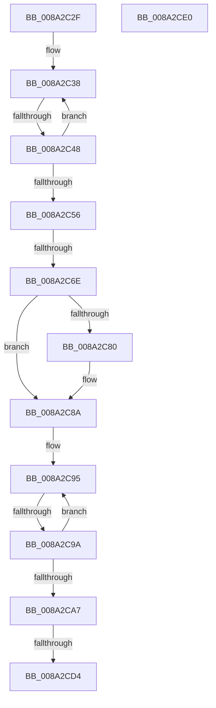

# sub_008A2C2F

- RVA: `0x008A2C2F`–`0x008A2CED` (길이 `190` bytes)
- VA: `0x00000001408A2C2F`
- 실행 섹션: `PAGE`
- PDB 이름 있음: `아니요`; PDB Function 태그: `아니요`
- unwind 정보 RVA: `0x0007EDA8`
- 디코드: `48`개 명령, `190/190` bytes 표시
- 미해석 바이트: `0` (있으면 어셈블리에 `.byte`로 보존)

> 이 문서는 커널 이미지의 기계어와 PDB 기호를 분석해 생성했습니다. 4번과 5번은 함수 원형과 자료형을 바이너리 사용 방식에서 추정한 C 해석이며 원본 소스 복구 결과는 아닙니다.

## 1. Dependencies

- 직접 호출 지점: **5**; 고유 호출 대상: **5**
- 직접 호출자로 확인된 함수: **0**
- RIP 상대 이미지 참조: **1**

### Outgoing calls
- `0x008A2C59` → [ExGetHandlePointer](../../text/43/ExGetHandlePointer_function_00430C90.md) (function, `0x00430C90`)
- `0x008A2C83` → [ExSlowReplenishHandleTableEntry](../../text/44/ExSlowReplenishHandleTableEntry_function_0044BEF0.md) (function, `0x0044BEF0`)
- `0x008A2CB1` → [ObpTraceObjectReferenceIfActive](../../text/21/ObpTraceObjectReferenceIfActive_function_00210780.md) (function, `0x00210780`)
- `0x008A2CD6` → [ExfUnblockPushLock](../../text/2A/ExfUnblockPushLock_function_002A3FE0.md) (function, `0x002A3FE0`)
- `0x008A2CE3` → [ObfDereferenceObject](../../text/2F/ObfDereferenceObject_function_002F9350.md) (function, `0x002F9350`)

### Direct callers
- 이 함수 시작 RVA로 연결되는 직접 call은 확인되지 않았습니다. 간접 호출은 완전히 역산할 수 없습니다.

### Static image references
- `0x008A2C2F` → RVA `0x00FC6CA8` (`ALMOSTRO`; read)

## 2. Other-region calls and transfers

- 다른 실행 섹션으로 향하는 call: **5**
  - `0x008A2C59` → [ExGetHandlePointer](../../text/43/ExGetHandlePointer_function_00430C90.md) (`PAGE` → `.text`)
  - `0x008A2C83` → [ExSlowReplenishHandleTableEntry](../../text/44/ExSlowReplenishHandleTableEntry_function_0044BEF0.md) (`PAGE` → `.text`)
  - `0x008A2CB1` → [ObpTraceObjectReferenceIfActive](../../text/21/ObpTraceObjectReferenceIfActive_function_00210780.md) (`PAGE` → `.text`)
  - `0x008A2CD6` → [ExfUnblockPushLock](../../text/2A/ExfUnblockPushLock_function_002A3FE0.md) (`PAGE` → `.text`)
  - `0x008A2CE3` → [ObfDereferenceObject](../../text/2F/ObfDereferenceObject_function_002F9350.md) (`PAGE` → `.text`)
- call이 아닌 외부 분기/꼬리 이동: **6**
  - `0x008A2C42` → [sub_008A2CF7](Unknown_function_008A2CF7.md) (`tail-transfer`)
  - `0x008A2C68` → [sub_008A2CF7 + 0x32](Unknown_function_008A2CF7.md) (`tail-transfer`)
  - `0x008A2C98` → [sub_008A2CF7 + 0x19](Unknown_function_008A2CF7.md) (`tail-transfer`)
  - `0x008A2CCE` → [sub_008A2AAB + 0x102](Unknown_function_008A2AAB.md) (`tail-transfer`)
  - `0x008A2CDB` → [sub_008A2AAB + 0x102](Unknown_function_008A2AAB.md) (`tail-transfer`)
  - `0x008A2CE8` → [sub_008A2AAB + 0x13B](Unknown_function_008A2AAB.md) (`tail-transfer`)

## 3. Assembly (complete function range)

```asm
008A2C2F  48 8B 1D 72 40 72 00            mov rbx, qword ptr [rip + 0x724072]
008A2C36  33 ED                           xor ebp, ebp
008A2C38  0F 0D 0F                        prefetchw byte ptr [rdi]
008A2C3B  4C 8B 07                        mov r8, qword ptr [rdi]
008A2C3E  41 F6 C0 01                     test r8b, 1
008A2C42  0F 84 AF 00 00 00               je 0x1408a2cf7
008A2C48  49 8D 48 FF                     lea rcx, [r8 - 1]
008A2C4C  49 8B C0                        mov rax, r8
008A2C4F  F0 48 0F B1 0F                  lock cmpxchg qword ptr [rdi], rcx
008A2C54  75 E2                           jne 0x1408a2c38
008A2C56  48 8B CF                        mov rcx, rdi
008A2C59  E8 32 E0 B8 FF                  call 0x140430c90
008A2C5E  48 8B D8                        mov rbx, rax
008A2C61  0F B6 00                        movzx eax, byte ptr [rax]
008A2C64  24 7F                           and al, 0x7f
008A2C66  3C 03                           cmp al, 3
008A2C68  0F 85 BB 00 00 00               jne 0x1408a2d29
008A2C6E  8B 83 F4 01 00 00               mov eax, dword ptr [rbx + 0x1f4]
008A2C74  25 0C 00 00 04                  and eax, 0x400000c
008A2C79  3D 00 00 00 04                  cmp eax, 0x4000000
008A2C7E  75 0A                           jne 0x1408a2c8a
008A2C80  48 8B CF                        mov rcx, rdi
008A2C83  E8 68 92 BA FF                  call 0x14044bef0
008A2C88  8B E8                           mov ebp, eax
008A2C8A  8D 55 01                        lea edx, [rbp + 1]
008A2C8D  0F 0D 4B D0                     prefetchw byte ptr [rbx - 0x30]
008A2C91  48 8B 43 D0                     mov rax, qword ptr [rbx - 0x30]
008A2C95  48 85 C0                        test rax, rax
008A2C98  74 76                           je 0x1408a2d10
008A2C9A  8B CA                           mov ecx, edx
008A2C9C  48 03 C8                        add rcx, rax
008A2C9F  F0 48 0F B1 4B D0               lock cmpxchg qword ptr [rbx - 0x30], rcx
008A2CA5  75 EE                           jne 0x1408a2c95
008A2CA7  41 B8 44 66 6C 74               mov r8d, 0x746c6644
008A2CAD  48 8D 4B D0                     lea rcx, [rbx - 0x30]
008A2CB1  E8 CA DA 96 FF                  call 0x140210780
008A2CB6  48 8B 0D EB 3F 72 00            mov rcx, qword ptr [rip + 0x723feb]
008A2CBD  F0 48 FF 07                     lock inc qword ptr [rdi]
008A2CC1  48 83 C1 30                     add rcx, 0x30
008A2CC5  F0 83 0C 24 00                  lock or dword ptr [rsp], 0
008A2CCA  48 83 39 00                     cmp qword ptr [rcx], 0
008A2CCE  0F 84 D9 FE FF FF               je 0x1408a2bad
008A2CD4  33 D2                           xor edx, edx
008A2CD6  E8 05 13 A0 FF                  call 0x1402a3fe0
008A2CDB  E9 CD FE FF FF                  jmp 0x1408a2bad
008A2CE0  48 8B CB                        mov rcx, rbx
008A2CE3  E8 68 66 A5 FF                  call 0x1402f9350
008A2CE8  E9 F9 FE FF FF                  jmp 0x1408a2be6
```

## 4. C-style interpretation (structured pseudocode)

```c
__int64 __fastcall sub_008A2C2F(void)
{
    __int64 result;
    __int64 v_rbp;
    unsigned int v_stack_p0;

    v_rbp = 0;
loc_008A2C38:
    if ((((unsigned __int8)(*(unsigned __int64 *)(v_rdi))) & (1)) != 0) goto loc_008A2C38;
    result = ExGetHandlePointer(v_rdi, a2, *(unsigned __int64 *)(v_rdi), a4);
    result = (unsigned __int8)((*(unsigned __int8 *)(result)) & (127));
    result = (unsigned int)(((unsigned int)(*(unsigned int *)(result + 500))) & (0x400000CULL));
    if (((unsigned int)(result)) == 0x4000000ULL) {
        a1 = v_rdi;
        result = ExSlowReplenishHandleTableEntry(a1, a2, *(unsigned __int64 *)(v_rdi), a4);
        v_rbp = (unsigned int)(result);
    }
loc_008A2C95:
    a1 = ((unsigned int)((unsigned int)(v_rbp + 1))) + (*(unsigned __int64 *)(result - 48));
    if (condition_is_not_equal) goto loc_008A2C95;
    result = ObpTraceObjectReferenceIfActive(result - 48, v_rbp + 1, (unsigned int)(0x746C6644ULL), a4);
    a1 = (*(unsigned __int64 *)(v_rip + 7487467)) + (48);
    a2 = 0;
    result = ExfUnblockPushLock(a1, a2, (unsigned int)(0x746C6644ULL), a4);
}
```

## 5. (Beta) C Style

```c
void sub_008A2C2F(void)
{
    int64_t result;
    int64_t local_rbp;
    uint32_t v_stack_p0;

    local_rbp = 0;
loc_008A2C38:
    if ((((uint8_t)(*(uint64_t *)(local_rdi))) & (1)) != 0) goto loc_008A2C38;
    result = ExGetHandlePointer(local_rdi, a2, *(uint64_t *)(local_rdi), a4);
    result = (uint8_t)((*(uint8_t *)(result)) & (127));
    result = (uint32_t)(((uint32_t)(*(uint32_t *)(result + 0x1F4))) & (0x400000CULL));
    if (((uint32_t)(result)) == 0x4000000ULL) {
        a1 = local_rdi;
        result = ExSlowReplenishHandleTableEntry(a1, a2, *(uint64_t *)(local_rdi), a4);
        local_rbp = (uint32_t)(result);
    }
loc_008A2C95:
    a1 = ((uint32_t)((uint32_t)(local_rbp + 1))) + (*(uint64_t *)(result - 0x30));
    if (condition_is_not_equal) goto loc_008A2C95;
    result = ObpTraceObjectReferenceIfActive(result - 48, local_rbp + 1, (uint32_t)(0x746C6644ULL), a4);
    a1 = (*(uint64_t *)(v_rip + 0x723FEB)) + (48);
    a2 = 0;
    result = ExfUnblockPushLock(a1, a2, (uint32_t)(0x746C6644ULL), a4);
}
```

## 6. Execution-region graph

[열기: 2D/3D 그래프와 함수 탐색 컨트롤 패널](../../../control-panel.html?section=page&rva=0x008A2C2F&view=graph)

- 2D 그래프는 위에서 아래로 흐르고, 3D 그래프는 빈 공간을 드래그해 회전합니다. Shift+드래그는 이동, 휠은 확대·축소, 함수 노드 선택은 대상 보고서 이동입니다.

### Static fallback


