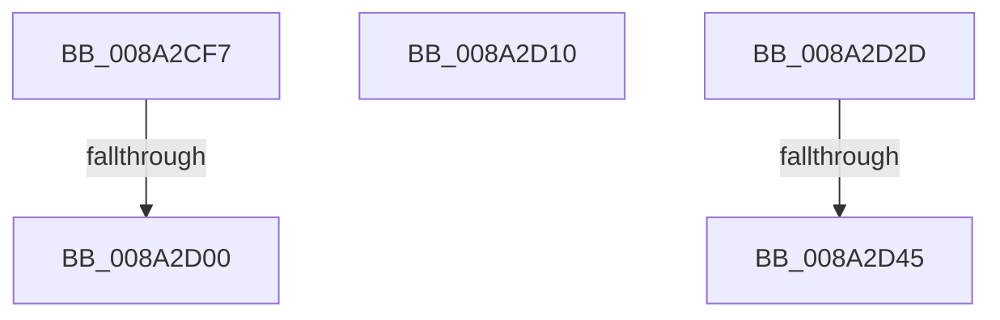

# sub_008A2CF7

- RVA: `0x008A2CF7`–`0x008A2D50` (길이 `89` bytes)
- VA: `0x00000001408A2CF7`
- 실행 섹션: `PAGE`
- PDB 이름 있음: `아니요`; PDB Function 태그: `아니요`
- unwind 정보 RVA: `0x0007EDD4`
- 디코드: `22`개 명령, `89/89` bytes 표시
- 미해석 바이트: `0` (있으면 어셈블리에 `.byte`로 보존)

> 이 문서는 커널 이미지의 기계어와 PDB 기호를 분석해 생성했습니다. 4번과 5번은 함수 원형과 자료형을 바이너리 사용 방식에서 추정한 C 해석이며 원본 소스 복구 결과는 아닙니다.

## 1. Dependencies

- 직접 호출 지점: **2**; 고유 호출 대상: **2**
- 직접 호출자로 확인된 함수: **0**
- RIP 상대 이미지 참조: **0**

### Outgoing calls
- `0x008A2D06` → [ExpBlockOnLockedHandleEntry](../86/ExpBlockOnLockedHandleEntry_function_00868838.md) (function, `0x00868838`)
- `0x008A2D45` → [ExfAcquireReleasePushLockExclusive](../../text/41/ExfAcquireReleasePushLockExclusive_function_00419C2C.md) (function, `0x00419C2C`)

### Direct callers
- 이 함수 시작 RVA로 연결되는 직접 call은 확인되지 않았습니다. 간접 호출은 완전히 역산할 수 없습니다.

### Static image references
- 디코드된 RIP-relative 메모리 참조가 없습니다.

## 2. Other-region calls and transfers

- 다른 실행 섹션으로 향하는 call: **1**
  - `0x008A2D45` → [ExfAcquireReleasePushLockExclusive](../../text/41/ExfAcquireReleasePushLockExclusive_function_00419C2C.md) (`PAGE` → `.text`)
- call이 아닌 외부 분기/꼬리 이동: **5**
  - `0x008A2CFA` → [sub_008A2AAB + 0x13B](Unknown_function_008A2AAB.md) (`tail-transfer`)
  - `0x008A2D0B` → [sub_008A2C2F + 0x9](Unknown_function_008A2C2F.md) (`tail-transfer`)
  - `0x008A2D2B` → [sub_008A2C2F + 0x87](Unknown_function_008A2C2F.md) (`tail-transfer`)
  - `0x008A2D3F` → [sub_00B19CD4](../B1/Unknown_function_00B19CD4.md) (`tail-transfer`)
  - `0x008A2D4B` → [sub_00B19CD4](../B1/Unknown_function_00B19CD4.md) (`tail-transfer`)

## 3. Assembly (complete function range)

```asm
008A2CF7  4D 85 C0                        test r8, r8
008A2CFA  0F 84 E6 FE FF FF               je 0x1408a2be6
008A2D00  48 8B D7                        mov rdx, rdi
008A2D03  48 8B CB                        mov rcx, rbx
008A2D06  E8 2D 5B FC FF                  call 0x140868838
008A2D0B  E9 28 FF FF FF                  jmp 0x1408a2c38
008A2D10  48 8B 07                        mov rax, qword ptr [rdi]
008A2D13  0F 57 C0                        xorps xmm0, xmm0
008A2D16  48 25 01 00 FE FF               and rax, 0xfffffffffffe0001
008A2D1C  0F 11 44 24 30                  movups xmmword ptr [rsp + 0x30], xmm0
008A2D21  48 89 44 24 30                  mov qword ptr [rsp + 0x30], rax
008A2D26  48 89 07                        mov qword ptr [rdi], rax
008A2D29  33 DB                           xor ebx, ebx
008A2D2B  EB 89                           jmp 0x1408a2cb6
008A2D2D  48 8D 8B C8 01 00 00            lea rcx, [rbx + 0x1c8]
008A2D34  F0 83 0C 24 00                  lock or dword ptr [rsp], 0
008A2D39  48 8B 11                        mov rdx, qword ptr [rcx]
008A2D3C  F6 C2 01                        test dl, 1
008A2D3F  0F 84 8F 6F 27 00               je 0x140b19cd4
008A2D45  E8 E2 6E B7 FF                  call 0x140419c2c
008A2D4A  90                              nop
008A2D4B  E9 84 6F 27 00                  jmp 0x140b19cd4
```

## 4. C-style interpretation (structured pseudocode)

```c
__int64 __fastcall sub_008A2CF7(__int64 a1, __int64 a2, __int64 a3)
{
    __int64 result;
    unsigned int v_stack_p0;
    unsigned __int64 v_stack_p30;

    result = ExpBlockOnLockedHandleEntry(v_rbx, v_rdi, a3, a4);
}
```

## 5. (Beta) C Style

```c
int64_t sub_008A2CF7(int64_t Arg1, int64_t Arg2, int64_t Arg3)
{
    int64_t result;
    uint32_t v_stack_p0;
    uint64_t v_stack_p30;

    result = ExpBlockOnLockedHandleEntry(local_rbx, local_rdi, Arg3, a4);
}
```

## 6. Execution-region graph

[열기: 2D/3D 그래프와 함수 탐색 컨트롤 패널](../../../control-panel.html?section=page&rva=0x008A2CF7&view=graph)

- 2D 그래프는 위에서 아래로 흐르고, 3D 그래프는 빈 공간을 드래그해 회전합니다. Shift+드래그는 이동, 휠은 확대·축소, 함수 노드 선택은 대상 보고서 이동입니다.

### Static fallback


