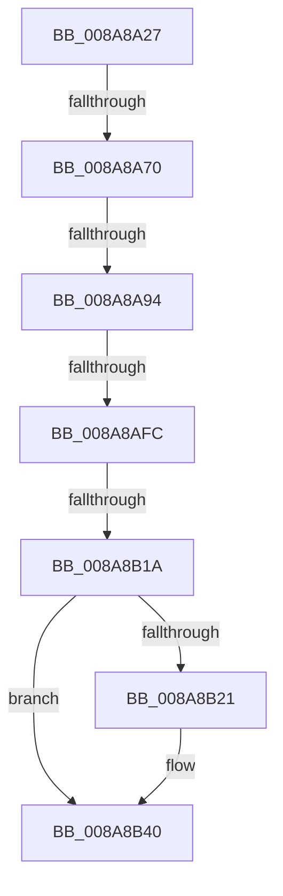

# sub_008A8A27

- RVA: `0x008A8A27`–`0x008A8B60` (길이 `313` bytes)
- VA: `0x00000001408A8A27`
- 실행 섹션: `PAGE`
- PDB 이름 있음: `아니요`; PDB Function 태그: `아니요`
- unwind 정보 RVA: `0x0007F360`
- 디코드: `65`개 명령, `313/313` bytes 표시
- 미해석 바이트: `0` (있으면 어셈블리에 `.byte`로 보존)

> 이 문서는 커널 이미지의 기계어와 PDB 기호를 분석해 생성했습니다. 4번과 5번은 함수 원형과 자료형을 바이너리 사용 방식에서 추정한 C 해석이며 원본 소스 복구 결과는 아닙니다.

## 1. Dependencies

- 직접 호출 지점: **5**; 고유 호출 대상: **5**
- 직접 호출자로 확인된 함수: **0**
- RIP 상대 이미지 참조: **0**

### Outgoing calls
- `0x008A8A3A` → [IoGetRelatedDeviceObject](../../text/29/IoGetRelatedDeviceObject_function_0029B120.md) (function, `0x0029B120`)
- `0x008A8A5F` → [IopAllocateIrpExReturn](../../text/20/IopAllocateIrpExReturn_function_00207720.md) (function, `0x00207720`)
- `0x008A8AFF` → [IopQueueThreadIrp](../../text/20/IopQueueThreadIrp_function_002075C0.md) (function, `0x002075C0`)
- `0x008A8B0A` → [IofCallDriver](../../text/29/IofCallDriver_function_0029B4B0.md) (function, `0x0029B4B0`)
- `0x008A8B37` → [KeWaitForSingleObject](../../text/20/KeWaitForSingleObject_function_0020E6B0.md) (function, `0x0020E6B0`)

### Direct callers
- 이 함수 시작 RVA로 연결되는 직접 call은 확인되지 않았습니다. 간접 호출은 완전히 역산할 수 없습니다.

### Static image references
- 디코드된 RIP-relative 메모리 참조가 없습니다.

## 2. Other-region calls and transfers

- 다른 실행 섹션으로 향하는 call: **5**
  - `0x008A8A3A` → [IoGetRelatedDeviceObject](../../text/29/IoGetRelatedDeviceObject_function_0029B120.md) (`PAGE` → `.text`)
  - `0x008A8A5F` → [IopAllocateIrpExReturn](../../text/20/IopAllocateIrpExReturn_function_00207720.md) (`PAGE` → `.text`)
  - `0x008A8AFF` → [IopQueueThreadIrp](../../text/20/IopQueueThreadIrp_function_002075C0.md) (`PAGE` → `.text`)
  - `0x008A8B0A` → [IofCallDriver](../../text/29/IofCallDriver_function_0029B4B0.md) (`PAGE` → `.text`)
  - `0x008A8B37` → [KeWaitForSingleObject](../../text/20/KeWaitForSingleObject_function_0020E6B0.md) (`PAGE` → `.text`)
- call이 아닌 외부 분기/꼬리 이동: **4**
  - `0x008A8A6A` → [sub_008A8C40](Unknown_function_008A8C40.md) (`tail-transfer`)
  - `0x008A8A8E` → [sub_008A8BD4](Unknown_function_008A8BD4.md) (`tail-transfer`)
  - `0x008A8AF6` → [sub_008A8C40 + 0x23](Unknown_function_008A8C40.md) (`tail-transfer`)
  - `0x008A8B14` → [sub_008A8BD4 + 0xB](Unknown_function_008A8BD4.md) (`tail-transfer`)

## 3. Assembly (complete function range)

```asm
008A8A27  48 89 B4 24 98 00 00 00         mov qword ptr [rsp + 0x98], rsi
008A8A2F  48 8B CF                        mov rcx, rdi
008A8A32  4C 89 BC 24 A0 00 00 00         mov qword ptr [rsp + 0xa0], r15
008A8A3A  E8 E1 26 9F FF                  call 0x14029b120
008A8A3F  44 0F B6 C5                     movzx r8d, bpl
008A8A43  41 83 FE 4B                     cmp r14d, 0x4b
008A8A47  41 BF 47 00 00 00               mov r15d, 0x47
008A8A4D  48 8B C8                        mov rcx, rax
008A8A50  45 0F 45 FE                     cmovne r15d, r14d
008A8A54  48 8B F0                        mov rsi, rax
008A8A57  0F B6 50 4C                     movzx edx, byte ptr [rax + 0x4c]
008A8A5B  41 80 F0 01                     xor r8b, 1
008A8A5F  E8 BC EC 95 FF                  call 0x140207720
008A8A64  48 8B D8                        mov rbx, rax
008A8A67  48 85 C0                        test rax, rax
008A8A6A  0F 84 D0 01 00 00               je 0x1408a8c40
008A8A70  48 89 B8 C0 00 00 00            mov qword ptr [rax + 0xc0], rdi
008A8A77  65 48 8B 04 25 88 01 00 00      mov rax, qword ptr gs:[0x188]
008A8A80  48 89 83 98 00 00 00            mov qword ptr [rbx + 0x98], rax
008A8A87  44 88 63 40                     mov byte ptr [rbx + 0x40], r12b
008A8A8B  40 84 ED                        test bpl, bpl
008A8A8E  0F 85 40 01 00 00               jne 0x1408a8bd4
008A8A94  C7 43 10 04 00 00 00            mov dword ptr [rbx + 0x10], 4
008A8A9B  48 8D 44 24 40                  lea rax, [rsp + 0x40]
008A8AA0  80 BC 24 C0 00 00 00 00         cmp byte ptr [rsp + 0xc0], 0
008A8AA8  41 B8 0A 00 00 00               mov r8d, 0xa
008A8AAE  48 89 43 50                     mov qword ptr [rbx + 0x50], rax
008A8AB2  48 8D 44 24 30                  lea rax, [rsp + 0x30]
008A8AB7  48 8B 8B B8 00 00 00            mov rcx, qword ptr [rbx + 0xb8]
008A8ABE  48 89 43 48                     mov qword ptr [rbx + 0x48], rax
008A8AC2  B8 05 00 00 00                  mov eax, 5
008A8AC7  41 0F 44 C0                     cmove eax, r8d
008A8ACB  48 C7 43 58 00 00 00 00         mov qword ptr [rbx + 0x58], 0
008A8AD3  88 41 B8                        mov byte ptr [rcx - 0x48], al
008A8AD6  48 8B 84 24 B0 00 00 00         mov rax, qword ptr [rsp + 0xb0]
008A8ADE  48 89 79 E8                     mov qword ptr [rcx - 0x18], rdi
008A8AE2  83 4B 10 10                     or dword ptr [rbx + 0x10], 0x10
008A8AE6  48 89 43 18                     mov qword ptr [rbx + 0x18], rax
008A8AEA  44 89 69 C0                     mov dword ptr [rcx - 0x40], r13d
008A8AEE  44 89 79 C8                     mov dword ptr [rcx - 0x38], r15d
008A8AF2  41 83 FE 4B                     cmp r14d, 0x4b
008A8AF6  0F 84 67 01 00 00               je 0x1408a8c63
008A8AFC  48 8B CB                        mov rcx, rbx
008A8AFF  E8 BC EA 95 FF                  call 0x1402075c0
008A8B04  48 8B D3                        mov rdx, rbx
008A8B07  48 8B CE                        mov rcx, rsi
008A8B0A  E8 A1 29 9F FF                  call 0x14029b4b0
008A8B0F  8B F0                           mov esi, eax
008A8B11  40 84 ED                        test bpl, bpl
008A8B14  0F 85 C5 00 00 00               jne 0x1408a8bdf
008A8B1A  3D 03 01 00 00                  cmp eax, 0x103
008A8B1F  75 1F                           jne 0x1408a8b40
008A8B21  45 33 C9                        xor r9d, r9d
008A8B24  48 C7 44 24 20 00 00 00 00      mov qword ptr [rsp + 0x20], 0
008A8B2D  45 33 C0                        xor r8d, r8d
008A8B30  48 8D 4C 24 40                  lea rcx, [rsp + 0x40]
008A8B35  33 D2                           xor edx, edx
008A8B37  E8 74 5B 96 FF                  call 0x14020e6b0
008A8B3C  8B 74 24 30                     mov esi, dword ptr [rsp + 0x30]
008A8B40  8B 44 24 38                     mov eax, dword ptr [rsp + 0x38]
008A8B44  48 8B 8C 24 B8 00 00 00         mov rcx, qword ptr [rsp + 0xb8]
008A8B4C  89 01                           mov dword ptr [rcx], eax
008A8B4E  8B C6                           mov eax, esi
008A8B50  48 8B B4 24 98 00 00 00         mov rsi, qword ptr [rsp + 0x98]
008A8B58  4C 8B BC 24 A0 00 00 00         mov r15, qword ptr [rsp + 0xa0]
```

## 4. C-style interpretation (structured pseudocode)

```c
__int64 __fastcall sub_008A8A27(__int64 a1, __int64 a2, __int64 a3, int a4, __int64 a5, unsigned int a6, unsigned int a7, __int64 a8, __int64 a9, __int64 a10, __int64 a11, __int64 a12, __int64 a13, __int64 a14, __int64 a15, __int64 a16, __int64 a17, __int64 a18, __int64 a19, __int64 a20, __int64 a21, __int64 a22, __int64 a23, unsigned __int8 a24)
{
    __int64 result;
    __int64 v_r15;
    __int64 v_rsi;
    unsigned __int64 v_stack_p20;
    unsigned __int64 v_stack_p98;
    unsigned __int64 v_stack_pA0;

    v_stack_p98 = v_rsi;
    v_stack_pA0 = v_r15;
    result = IoGetRelatedDeviceObject(v_rdi, a2, a3, a4);
    v_r15 = 71;
    if (((unsigned int)(v_r14)) != 75) { v_r15 = (unsigned int)(v_r14); }
    a3 = (unsigned __int8)(((unsigned __int8)(v_rbp)) ^ (1));
    result = IopAllocateIrpExReturn(result, *(unsigned __int8 *)(result + 76), a3, a4);
    *(unsigned __int64 *)(result + 192) = v_rdi;
    *(unsigned __int64 *)(result + 152) = *(unsigned __int64 *)(gs_base + (0 + 392));
    *(unsigned __int8 *)(result + 64) = (unsigned __int8)(v_r12);
    *(unsigned int *)(result + 16) = 4;
    *(unsigned __int64 *)(result + 80) = a8;
    *(unsigned __int64 *)(result + 72) = a6;
    result = 5;
    if (a24 == 0) { result = 10; }
    *(unsigned __int64 *)(result + 88) = 0;
    *(unsigned __int8 *)(*(unsigned __int64 *)(result + 184) - 72) = (unsigned __int8)(result);
    *(unsigned __int64 *)(*(unsigned __int64 *)(result + 184) - 24) = v_rdi;
    *(unsigned __int64 *)(result + 24) = a22;
    *(unsigned int *)(*(unsigned __int64 *)(result + 184) - 64) = (unsigned int)(v_r13);
    *(unsigned int *)(*(unsigned __int64 *)(result + 184) - 56) = (unsigned int)(v_r15);
    result = IopQueueThreadIrp(result, *(unsigned __int8 *)(result + 76), 10, a4);
    result = IofCallDriver(result, result, 10, a4);
    v_rsi = (unsigned int)((unsigned int)(result));
    if (((unsigned int)(result)) == 259) {
        a4 = 0;
        v_stack_p20 = 0;
        a3 = 0;
        a1 = a8;
        a2 = 0;
        result = KeWaitForSingleObject(a1, a2, a3, a4);
        v_rsi = a6;
    }
    *(unsigned int *)(a23) = (unsigned int)((unsigned int)(a7));
    return (unsigned int)((unsigned int)(v_rsi));
}
```

## 5. (Beta) C Style

```c
int64_t sub_008A8A27(int64_t Arg1, int64_t Arg2, int64_t Arg3, int32_t Arg4, uint64_t Arg5, uint32_t Arg6, uint32_t Arg7, int64_t Arg8, uint64_t Arg9, uint64_t Arg10, uint64_t Arg11, uint64_t Arg12, uint64_t Arg13, uint64_t Arg14, uint64_t Arg15, uint64_t Arg16, uint64_t Arg17, uint64_t Arg18, int64_t Arg19, int64_t Arg20, uint64_t Arg21, int64_t Arg22, void *Arg23, uint8_t Arg24)
{
    uint8_t *arg23 = (uint8_t *)Arg23;

    int64_t result;
    int64_t local_r15;
    int64_t local_rsi;
    uint64_t v_stack_p20;
    uint64_t v_stack_p98;
    uint64_t v_stack_pA0;

    v_stack_p98 = local_rsi;
    v_stack_pA0 = local_r15;
    result = IoGetRelatedDeviceObject(local_rdi, Arg2, Arg3, Arg4);
    local_r15 = 71;
    if (((uint32_t)(local_r14)) != 75) { local_r15 = (uint32_t)(local_r14); }
    Arg3 = (uint8_t)(((uint8_t)(local_rbp)) ^ (1));
    result = IopAllocateIrpExReturn(result, *(uint8_t *)(result + 0x4C), Arg3, Arg4);
    *(uint64_t *)(result + 0xC0) = local_rdi;
    *(uint64_t *)(result + 0x98) = *(uint64_t *)(gs_base + (0 + 0x188));
    *(uint8_t *)(result + 0x40) = (uint8_t)(local_r12);
    *(uint32_t *)(result + 0x10) = 4;
    *(uint64_t *)(result + 0x50) = Arg8;
    *(uint64_t *)(result + 0x48) = Arg6;
    result = 5;
    if (Arg24 == 0) { result = 10; }
    *(uint64_t *)(result + 0x58) = 0;
    *(uint8_t *)(*(uint64_t *)(result + 0xB8) - 0x48) = (uint8_t)(result);
    *(uint64_t *)(*(uint64_t *)(result + 0xB8) - 0x18) = local_rdi;
    *(uint64_t *)(result + 0x18) = Arg22;
    *(uint32_t *)(*(uint64_t *)(result + 0xB8) - 0x40) = (uint32_t)(local_r13);
    *(uint32_t *)(*(uint64_t *)(result + 0xB8) - 0x38) = (uint32_t)(local_r15);
    result = IopQueueThreadIrp(result, *(uint8_t *)(result + 0x4C), 10, Arg4);
    result = IofCallDriver(result, result, 10, Arg4);
    local_rsi = (uint32_t)((uint32_t)(result));
    if (((uint32_t)(result)) == 259) {
        Arg4 = 0;
        v_stack_p20 = 0;
        Arg3 = 0;
        Arg1 = Arg8;
        Arg2 = 0;
        result = KeWaitForSingleObject(Arg1, Arg2, Arg3, Arg4);
        local_rsi = Arg6;
    }
    *(uint32_t *)(arg23) = (uint32_t)((uint32_t)(Arg7));
    return (uint32_t)((uint32_t)(local_rsi));
}
```

### 관측된 메모리 오프셋

구조체 형식이 확인되지 않은 접근은 인자 기준의 오프셋으로만 기록했습니다.

| 기준 인자 | 오프셋 표현 | 폭 (bit) | 접근 |
|---|---:|---:|---|
| `Arg23` | `+ 0x0` | `32` | `W` |

## 6. Execution-region graph

[열기: 2D/3D 그래프와 함수 탐색 컨트롤 패널](../../../control-panel.html?section=page&rva=0x008A8A27&view=graph)

- 2D 그래프는 위에서 아래로 흐르고, 3D 그래프는 빈 공간을 드래그해 회전합니다. Shift+드래그는 이동, 휠은 확대·축소, 함수 노드 선택은 대상 보고서 이동입니다.

### Static fallback


