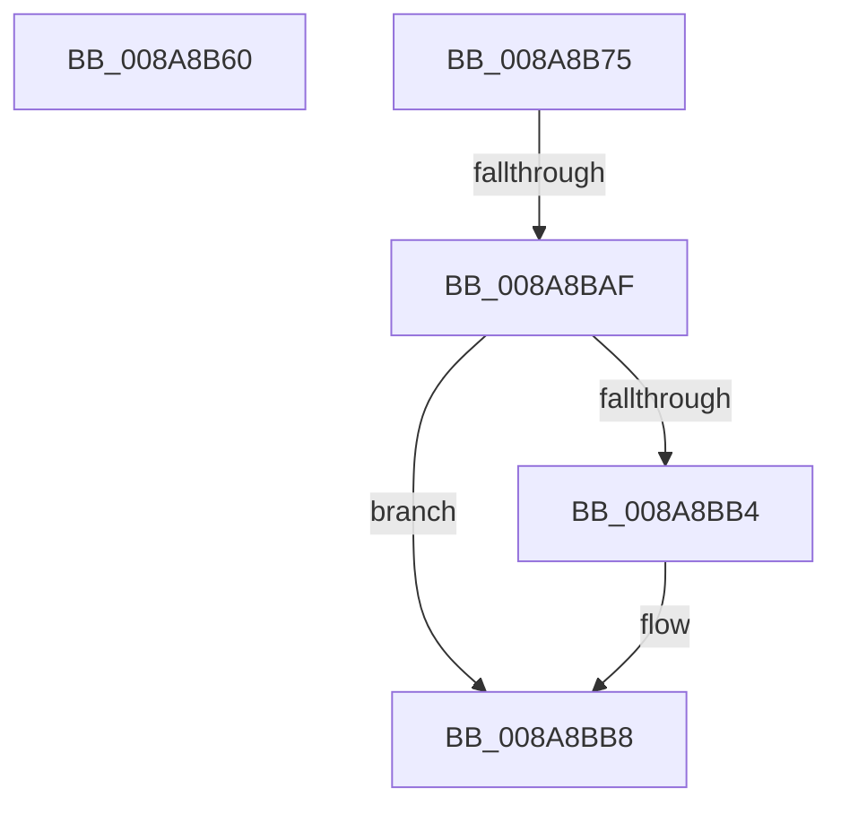

# sub_008A8B60

- RVA: `0x008A8B60`–`0x008A8BD4` (길이 `116` bytes)
- VA: `0x00000001408A8B60`
- 실행 섹션: `PAGE`
- PDB 이름 있음: `아니요`; PDB Function 태그: `아니요`
- unwind 정보 RVA: `0x0007F378`
- 디코드: `31`개 명령, `116/116` bytes 표시
- 미해석 바이트: `0` (있으면 어셈블리에 `.byte`로 보존)

> 이 문서는 커널 이미지의 기계어와 PDB 기호를 분석해 생성했습니다. 4번과 5번은 함수 원형과 자료형을 바이너리 사용 방식에서 추정한 C 해석이며 원본 소스 복구 결과는 아닙니다.

## 1. Dependencies

- 직접 호출 지점: **3**; 고유 호출 대상: **3**
- 직접 호출자로 확인된 함수: **0**
- RIP 상대 이미지 참조: **0**

### Outgoing calls
- `0x008A8B96` → [KeAbPreAcquire](../../text/21/KeAbPreAcquire_function_00210230.md) (function, `0x00210230`)
- `0x008A8BBB` → [ObfReferenceObject](../../text/20/ObfReferenceObject_function_0020FA20.md) (function, `0x0020FA20`)
- `0x008A8BC7` → [KeResetEvent](../../text/24/KeResetEvent_function_00248350.md) (function, `0x00248350`)

### Direct callers
- 이 함수 시작 RVA로 연결되는 직접 call은 확인되지 않았습니다. 간접 호출은 완전히 역산할 수 없습니다.

### Static image references
- 디코드된 RIP-relative 메모리 참조가 없습니다.

## 2. Other-region calls and transfers

- 다른 실행 섹션으로 향하는 call: **3**
  - `0x008A8B96` → [KeAbPreAcquire](../../text/21/KeAbPreAcquire_function_00210230.md) (`PAGE` → `.text`)
  - `0x008A8BBB` → [ObfReferenceObject](../../text/20/ObfReferenceObject_function_0020FA20.md) (`PAGE` → `.text`)
  - `0x008A8BC7` → [KeResetEvent](../../text/24/KeResetEvent_function_00248350.md) (`PAGE` → `.text`)
- call이 아닌 외부 분기/꼬리 이동: **2**
  - `0x008A8BAD` → [sub_008A8C05](Unknown_function_008A8C05.md) (`tail-transfer`)
  - `0x008A8BCF` → [sub_008A8A27](Unknown_function_008A8A27.md) (`tail-transfer`)

## 3. Assembly (complete function range)

```asm
008A8B60  48 8B 9C 24 A8 00 00 00         mov rbx, qword ptr [rsp + 0xa8]
008A8B68  48 83 C4 60                     add rsp, 0x60
008A8B6C  41 5E                           pop r14
008A8B6E  41 5D                           pop r13
008A8B70  41 5C                           pop r12
008A8B72  5F                              pop rdi
008A8B73  5D                              pop rbp
008A8B74  C3                              ret
008A8B75  CC                              int3
008A8B76  65 48 8B 04 25 88 01 00 00      mov rax, qword ptr gs:[0x188]
008A8B7F  48 8D 8F 80 00 00 00            lea rcx, [rdi + 0x80]
008A8B86  C1 EB 02                        shr ebx, 2
008A8B89  33 D2                           xor edx, edx
008A8B8B  80 E3 01                        and bl, 1
008A8B8E  66 FF 88 E4 01 00 00            dec word ptr [rax + 0x1e4]
008A8B95  90                              nop
008A8B96  E8 95 76 96 FF                  call 0x140210230
008A8B9B  BA 01 00 00 00                  mov edx, 1
008A8BA0  C6 84 24 90 00 00 00 00         mov byte ptr [rsp + 0x90], 0
008A8BA8  87 57 74                        xchg dword ptr [rdi + 0x74], edx
008A8BAB  85 D2                           test edx, edx
008A8BAD  75 56                           jne 0x1408a8c05
008A8BAF  48 85 C0                        test rax, rax
008A8BB2  74 04                           je 0x1408a8bb8
008A8BB4  C6 40 0A 01                     mov byte ptr [rax + 0xa], 1
008A8BB8  48 8B CF                        mov rcx, rdi
008A8BBB  E8 60 6E 96 FF                  call 0x14020fa20
008A8BC0  48 8D 8F 98 00 00 00            lea rcx, [rdi + 0x98]
008A8BC7  E8 84 F7 99 FF                  call 0x140248350
008A8BCC  40 B5 01                        mov bpl, 1
008A8BCF  E9 53 FE FF FF                  jmp 0x1408a8a27
```

## 4. C-style interpretation (structured pseudocode)

```c
__int64 __fastcall sub_008A8B60(__int64 a1, int a2, __int64 a3, __int64 a4, __int64 a5, __int64 a6, __int64 a7, __int64 a8, __int64 a9, __int64 a10, __int64 a11, __int64 a12, __int64 a13, __int64 a14, __int64 a15, __int64 a16, __int64 a17, __int64 a18, __int64 a19, __int64 a20, __int64 a21)
{
    __int64 v_rsp;
    unsigned __int8 v_stack_p118;

    v_rsp = (v_rsp) + (96);
    return result;
}
```

## 5. (Beta) C Style

```c
int64_t sub_008A8B60(int64_t Arg1, int32_t Arg2, int64_t Arg3, int64_t Arg4, uint64_t Arg5, uint64_t Arg6, uint64_t Arg7, uint64_t Arg8, uint64_t Arg9, uint64_t Arg10, uint64_t Arg11, uint64_t Arg12, uint64_t Arg13, uint64_t Arg14, uint64_t Arg15, uint64_t Arg16, uint64_t Arg17, uint64_t Arg18, uint64_t Arg19, uint64_t Arg20, int64_t Arg21)
{
    int64_t local_rsp;
    uint8_t v_stack_p118;

    local_rsp = (local_rsp) + (96);
    return result;
}
```

## 6. Execution-region graph

[열기: 2D/3D 그래프와 함수 탐색 컨트롤 패널](../../../control-panel.html?section=page&rva=0x008A8B60&view=graph)

- 2D 그래프는 위에서 아래로 흐르고, 3D 그래프는 빈 공간을 드래그해 회전합니다. Shift+드래그는 이동, 휠은 확대·축소, 함수 노드 선택은 대상 보고서 이동입니다.

### Static fallback


