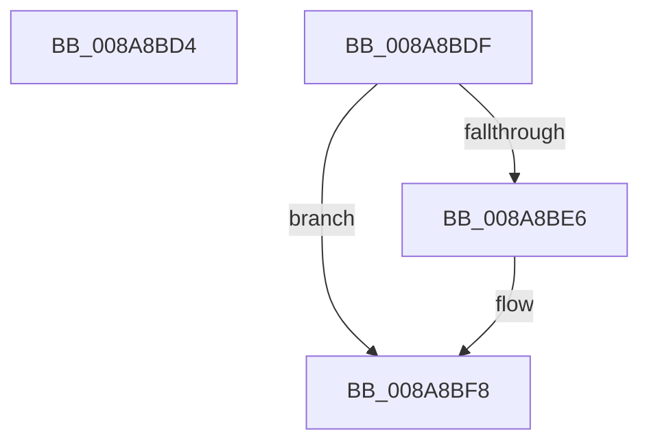

# sub_008A8BD4

- RVA: `0x008A8BD4`–`0x008A8C05` (길이 `49` bytes)
- VA: `0x00000001408A8BD4`
- 실행 섹션: `PAGE`
- PDB 이름 있음: `아니요`; PDB Function 태그: `아니요`
- unwind 정보 RVA: `0x0007F38C`
- 디코드: `13`개 명령, `49/49` bytes 표시
- 미해석 바이트: `0` (있으면 어셈블리에 `.byte`로 보존)

> 이 문서는 커널 이미지의 기계어와 PDB 기호를 분석해 생성했습니다. 4번과 5번은 함수 원형과 자료형을 바이너리 사용 방식에서 추정한 C 해석이며 원본 소스 복구 결과는 아닙니다.

## 1. Dependencies

- 직접 호출 지점: **2**; 고유 호출 대상: **2**
- 직접 호출자로 확인된 함수: **0**
- RIP 상대 이미지 참조: **0**

### Outgoing calls
- `0x008A8BF0` → [IopWaitForSynchronousIo](../../text/29/IopWaitForSynchronousIo_function_0029D6D0.md) (function, `0x0029D6D0`)
- `0x008A8BFB` → [IopReleaseFileObjectLock](../../text/25/IopReleaseFileObjectLock_function_00250A90.md) (function, `0x00250A90`)

### Direct callers
- 이 함수 시작 RVA로 연결되는 직접 call은 확인되지 않았습니다. 간접 호출은 완전히 역산할 수 없습니다.

### Static image references
- 디코드된 RIP-relative 메모리 참조가 없습니다.

## 2. Other-region calls and transfers

- 다른 실행 섹션으로 향하는 call: **2**
  - `0x008A8BF0` → [IopWaitForSynchronousIo](../../text/29/IopWaitForSynchronousIo_function_0029D6D0.md) (`PAGE` → `.text`)
  - `0x008A8BFB` → [IopReleaseFileObjectLock](../../text/25/IopReleaseFileObjectLock_function_00250A90.md) (`PAGE` → `.text`)
- call이 아닌 외부 분기/꼬리 이동: **2**
  - `0x008A8BDA` → [sub_008A8A27 + 0x79](Unknown_function_008A8A27.md) (`tail-transfer`)
  - `0x008A8C00` → [sub_008A8A27 + 0x119](Unknown_function_008A8A27.md) (`tail-transfer`)

## 3. Assembly (complete function range)

```asm
008A8BD4  80 4B 47 02                     or byte ptr [rbx + 0x47], 2
008A8BD8  33 C0                           xor eax, eax
008A8BDA  E9 C1 FE FF FF                  jmp 0x1408a8aa0
008A8BDF  3D 03 01 00 00                  cmp eax, 0x103
008A8BE4  75 12                           jne 0x1408a8bf8
008A8BE6  45 0F B6 C4                     movzx r8d, r12b
008A8BEA  48 8B D7                        mov rdx, rdi
008A8BED  48 8B CB                        mov rcx, rbx
008A8BF0  E8 DB 4A 9F FF                  call 0x14029d6d0
008A8BF5  8B 77 38                        mov esi, dword ptr [rdi + 0x38]
008A8BF8  48 8B CF                        mov rcx, rdi
008A8BFB  E8 90 7E 9A FF                  call 0x140250a90
008A8C00  E9 3B FF FF FF                  jmp 0x1408a8b40
```

## 4. C-style interpretation (structured pseudocode)

```c
__int64 __fastcall sub_008A8BD4(void)
{
    __int64 result;

    result = 0;
}
```

## 5. (Beta) C Style

```c
void sub_008A8BD4(void)
{
    int64_t result;

    result = 0;
}
```

## 6. Execution-region graph

[열기: 2D/3D 그래프와 함수 탐색 컨트롤 패널](../../../control-panel.html?section=page&rva=0x008A8BD4&view=graph)

- 2D 그래프는 위에서 아래로 흐르고, 3D 그래프는 빈 공간을 드래그해 회전합니다. Shift+드래그는 이동, 휠은 확대·축소, 함수 노드 선택은 대상 보고서 이동입니다.

### Static fallback


