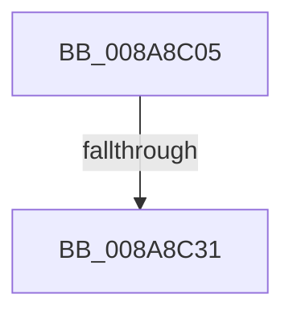

# sub_008A8C05

- RVA: `0x008A8C05`–`0x008A8C40` (길이 `59` bytes)
- VA: `0x00000001408A8C05`
- 실행 섹션: `PAGE`
- PDB 이름 있음: `아니요`; PDB Function 태그: `아니요`
- unwind 정보 RVA: `0x0007F3A4`
- 디코드: `14`개 명령, `59/59` bytes 표시
- 미해석 바이트: `0` (있으면 어셈블리에 `.byte`로 보존)

> 이 문서는 커널 이미지의 기계어와 PDB 기호를 분석해 생성했습니다. 4번과 5번은 함수 원형과 자료형을 바이너리 사용 방식에서 추정한 C 해석이며 원본 소스 복구 결과는 아닙니다.

## 1. Dependencies

- 직접 호출 지점: **2**; 고유 호출 대상: **2**
- 직접 호출자로 확인된 함수: **0**
- RIP 상대 이미지 참조: **0**

### Outgoing calls
- `0x008A8C20` → [IopWaitAndAcquireFileObjectLock](IopWaitAndAcquireFileObjectLock_function_008AE6D8.md) (function, `0x008AE6D8`)
- `0x008A8C34` → [ObfDereferenceObject](../../text/2F/ObfDereferenceObject_function_002F9350.md) (function, `0x002F9350`)

### Direct callers
- 이 함수 시작 RVA로 연결되는 직접 call은 확인되지 않았습니다. 간접 호출은 완전히 역산할 수 없습니다.

### Static image references
- 디코드된 RIP-relative 메모리 참조가 없습니다.

## 2. Other-region calls and transfers

- 다른 실행 섹션으로 향하는 call: **1**
  - `0x008A8C34` → [ObfDereferenceObject](../../text/2F/ObfDereferenceObject_function_002F9350.md) (`PAGE` → `.text`)
- call이 아닌 외부 분기/꼬리 이동: **2**
  - `0x008A8C2F` → [sub_008A8B60 + 0x60](Unknown_function_008A8B60.md) (`tail-transfer`)
  - `0x008A8C3B` → [sub_008A8B60](Unknown_function_008A8B60.md) (`tail-transfer`)

## 3. Assembly (complete function range)

```asm
008A8C05  48 8D 8C 24 90 00 00 00         lea rcx, [rsp + 0x90]
008A8C0D  4C 8B C8                        mov r9, rax
008A8C10  48 89 4C 24 20                  mov qword ptr [rsp + 0x20], rcx
008A8C15  44 0F B6 C3                     movzx r8d, bl
008A8C19  48 8B CF                        mov rcx, rdi
008A8C1C  41 0F B6 D4                     movzx edx, r12b
008A8C20  E8 B3 5A 00 00                  call 0x1408ae6d8
008A8C25  8B D8                           mov ebx, eax
008A8C27  80 BC 24 90 00 00 00 00         cmp byte ptr [rsp + 0x90], 0
008A8C2F  74 8F                           je 0x1408a8bc0
008A8C31  48 8B CF                        mov rcx, rdi
008A8C34  E8 17 07 A5 FF                  call 0x1402f9350
008A8C39  8B C3                           mov eax, ebx
008A8C3B  E9 20 FF FF FF                  jmp 0x1408a8b60
```

## 4. C-style interpretation (structured pseudocode)

```c
__int64 __fastcall sub_008A8C05(__int64 a1, __int64 a2, __int64 a3, __int64 a4, __int64 a5, __int64 a6, __int64 a7, __int64 a8, __int64 a9, __int64 a10, __int64 a11, __int64 a12, __int64 a13, __int64 a14, __int64 a15, __int64 a16, __int64 a17, unsigned __int8 a18)
{
    __int64 result;
    unsigned __int64 v_stack_p20;

    v_stack_p20 = a18;
    result = IopWaitAndAcquireFileObjectLock(v_rdi, (unsigned __int8)(v_r12), (unsigned __int8)(v_rbx), result);
    result = ObfDereferenceObject(v_rdi, (unsigned __int8)(v_r12), (unsigned __int8)(v_rbx), result);
}
```

## 5. (Beta) C Style

```c
int64_t sub_008A8C05(int64_t Arg1, int64_t Arg2, int64_t Arg3, int64_t Arg4, uint64_t Arg5, uint64_t Arg6, uint64_t Arg7, uint64_t Arg8, uint64_t Arg9, uint64_t Arg10, uint64_t Arg11, uint64_t Arg12, uint64_t Arg13, uint64_t Arg14, uint64_t Arg15, uint64_t Arg16, uint64_t Arg17, uint8_t Arg18)
{
    int64_t result;
    uint64_t v_stack_p20;

    v_stack_p20 = Arg18;
    result = IopWaitAndAcquireFileObjectLock(local_rdi, (uint8_t)(local_r12), (uint8_t)(local_rbx), result);
    result = ObfDereferenceObject(local_rdi, (uint8_t)(local_r12), (uint8_t)(local_rbx), result);
}
```

## 6. Execution-region graph

[열기: 2D/3D 그래프와 함수 탐색 컨트롤 패널](../../../control-panel.html?section=page&rva=0x008A8C05&view=graph)

- 2D 그래프는 위에서 아래로 흐르고, 3D 그래프는 빈 공간을 드래그해 회전합니다. Shift+드래그는 이동, 휠은 확대·축소, 함수 노드 선택은 대상 보고서 이동입니다.

### Static fallback


