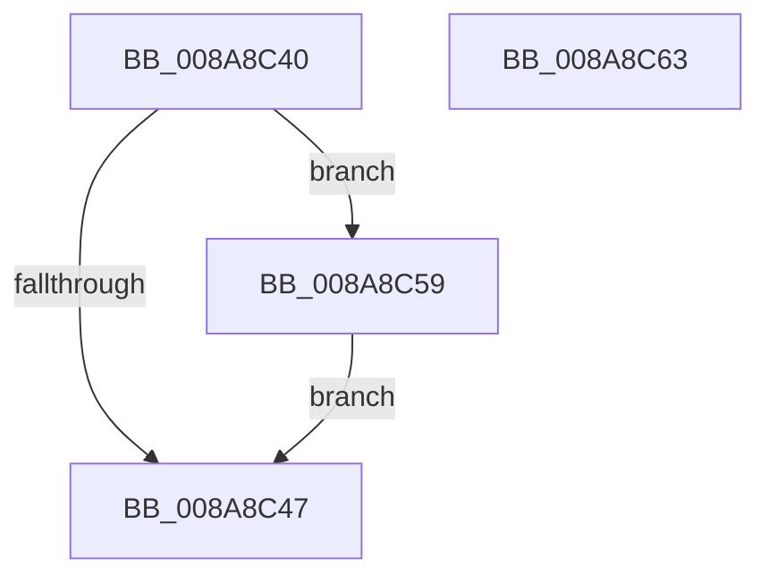

# sub_008A8C40

- RVA: `0x008A8C40`–`0x008A8C6C` (길이 `44` bytes)
- VA: `0x00000001408A8C40`
- 실행 섹션: `PAGE`
- PDB 이름 있음: `아니요`; PDB Function 태그: `아니요`
- unwind 정보 RVA: `0x0007F3B4`
- 디코드: `12`개 명령, `44/44` bytes 표시
- 미해석 바이트: `0` (있으면 어셈블리에 `.byte`로 보존)

> 이 문서는 커널 이미지의 기계어와 PDB 기호를 분석해 생성했습니다. 4번과 5번은 함수 원형과 자료형을 바이너리 사용 방식에서 추정한 C 해석이며 원본 소스 복구 결과는 아닙니다.

## 1. Dependencies

- 직접 호출 지점: **2**; 고유 호출 대상: **2**
- 직접 호출자로 확인된 함수: **0**
- RIP 상대 이미지 참조: **0**

### Outgoing calls
- `0x008A8C4A` → [ObfDereferenceObject](../../text/2F/ObfDereferenceObject_function_002F9350.md) (function, `0x002F9350`)
- `0x008A8C5C` → [IopReleaseFileObjectLock](../../text/25/IopReleaseFileObjectLock_function_00250A90.md) (function, `0x00250A90`)

### Direct callers
- 이 함수 시작 RVA로 연결되는 직접 call은 확인되지 않았습니다. 간접 호출은 완전히 역산할 수 없습니다.

### Static image references
- 디코드된 RIP-relative 메모리 참조가 없습니다.

## 2. Other-region calls and transfers

- 다른 실행 섹션으로 향하는 call: **2**
  - `0x008A8C4A` → [ObfDereferenceObject](../../text/2F/ObfDereferenceObject_function_002F9350.md) (`PAGE` → `.text`)
  - `0x008A8C5C` → [IopReleaseFileObjectLock](../../text/25/IopReleaseFileObjectLock_function_00250A90.md) (`PAGE` → `.text`)
- call이 아닌 외부 분기/꼬리 이동: **2**
  - `0x008A8C54` → [sub_008A8A27 + 0x129](Unknown_function_008A8A27.md) (`tail-transfer`)
  - `0x008A8C67` → [sub_008A8A27 + 0xD5](Unknown_function_008A8A27.md) (`tail-transfer`)

## 3. Assembly (complete function range)

```asm
008A8C40  8B 47 50                        mov eax, dword ptr [rdi + 0x50]
008A8C43  A8 02                           test al, 2
008A8C45  75 12                           jne 0x1408a8c59
008A8C47  48 8B CF                        mov rcx, rdi
008A8C4A  E8 01 07 A5 FF                  call 0x1402f9350
008A8C4F  B8 9A 00 00 C0                  mov eax, 0xc000009a
008A8C54  E9 F7 FE FF FF                  jmp 0x1408a8b50
008A8C59  48 8B CF                        mov rcx, rdi
008A8C5C  E8 2F 7E 9A FF                  call 0x140250a90
008A8C61  EB E4                           jmp 0x1408a8c47
008A8C63  80 49 BA 01                     or byte ptr [rcx - 0x46], 1
008A8C67  E9 90 FE FF FF                  jmp 0x1408a8afc
```

## 4. C-style interpretation (structured pseudocode)

```c
__int64 __fastcall sub_008A8C40(void)
{
    __int64 result;

    if ((((unsigned __int8)((unsigned int)(*(unsigned int *)(v_rdi + 80)))) & (2)) != 0) goto loc_008A8C59;
loc_008A8C47:
    result = ObfDereferenceObject(v_rdi, a2, a3, a4);
loc_008A8C59:
    result = IopReleaseFileObjectLock(v_rdi, a2, a3, a4);
    goto loc_008A8C47;
}
```

## 5. (Beta) C Style

```c
void sub_008A8C40(void)
{
    int64_t result;

    if ((((uint8_t)((uint32_t)(*(uint32_t *)(local_rdi + 0x50)))) & (2)) != 0) goto loc_008A8C59;
loc_008A8C47:
    result = ObfDereferenceObject(local_rdi, a2, a3, a4);
loc_008A8C59:
    result = IopReleaseFileObjectLock(local_rdi, a2, a3, a4);
    goto loc_008A8C47;
}
```

## 6. Execution-region graph

[열기: 2D/3D 그래프와 함수 탐색 컨트롤 패널](../../../control-panel.html?section=page&rva=0x008A8C40&view=graph)

- 2D 그래프는 위에서 아래로 흐르고, 3D 그래프는 빈 공간을 드래그해 회전합니다. Shift+드래그는 이동, 휠은 확대·축소, 함수 노드 선택은 대상 보고서 이동입니다.

### Static fallback


