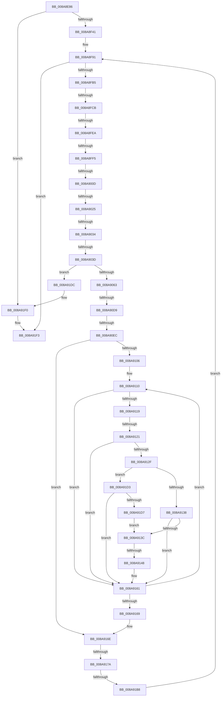

# sub_008A8E86

- RVA: `0x008A8E86`–`0x008A9216` (길이 `912` bytes)
- VA: `0x00000001408A8E86`
- 실행 섹션: `PAGE`
- PDB 이름 있음: `아니요`; PDB Function 태그: `아니요`
- unwind 정보 RVA: `0x0007F428`
- 디코드: `226`개 명령, `912/912` bytes 표시
- 미해석 바이트: `0` (있으면 어셈블리에 `.byte`로 보존)

> 이 문서는 커널 이미지의 기계어와 PDB 기호를 분석해 생성했습니다. 4번과 5번은 함수 원형과 자료형을 바이너리 사용 방식에서 추정한 C 해석이며 원본 소스 복구 결과는 아닙니다.

## 1. Dependencies

- 직접 호출 지점: **7**; 고유 호출 대상: **7**
- 직접 호출자로 확인된 함수: **0**
- RIP 상대 이미지 참조: **0**

### Outgoing calls
- `0x008A8EE5` → [KiStackAttachProcess](../../text/21/KiStackAttachProcess_function_00216820.md) (function, `0x00216820`)
- `0x008A8EEC` → [PsSetCurrentThreadPrefetching](PsSetCurrentThreadPrefetching_function_008A9A40.md) (function, `0x008A9A40`)
- `0x008A8F34` → [NtCreateEvent](../8B/NtCreateEvent_function_008B9140.md) (function, `0x008B9140`)
- `0x008A9018` → [wcsncmp](../../text/50/wcsncmp_function_00501CA0.md) (function, `0x00501CA0`)
- `0x008A9052` → [ExAllocatePool2](../../poolcode/B8/ExAllocatePool2_function_00B820F0.md) (function, `0x00B820F0`)
- `0x008A9085` → [RtlInitUnicodeString](../../text/42/RtlInitUnicodeString_function_0042A780.md) (function, `0x0042A780`)
- `0x008A90CC` → [PfSnGetSectionObject](PfSnGetSectionObject_function_008A9448.md) (function, `0x008A9448`)

### Direct callers
- 이 함수 시작 RVA로 연결되는 직접 call은 확인되지 않았습니다. 간접 호출은 완전히 역산할 수 없습니다.

### Static image references
- 디코드된 RIP-relative 메모리 참조가 없습니다.

## 2. Other-region calls and transfers

- 다른 실행 섹션으로 향하는 call: **4**
  - `0x008A8EE5` → [KiStackAttachProcess](../../text/21/KiStackAttachProcess_function_00216820.md) (`PAGE` → `.text`)
  - `0x008A9018` → [wcsncmp](../../text/50/wcsncmp_function_00501CA0.md) (`PAGE` → `.text`)
  - `0x008A9052` → [ExAllocatePool2](../../poolcode/B8/ExAllocatePool2_function_00B820F0.md) (`PAGE` → `POOLCODE`)
  - `0x008A9085` → [RtlInitUnicodeString](../../text/42/RtlInitUnicodeString_function_0042A780.md) (`PAGE` → `.text`)
- call이 아닌 외부 분기/꼬리 이동: **14**
  - `0x008A8FC5` → [sub_008A9284 + 0xF](Unknown_function_008A9284.md) (`tail-transfer`)
  - `0x008A8FE4` → [sub_008A9284 + 0xD0](Unknown_function_008A9284.md) (`tail-transfer`)
  - `0x008A8FEF` → [sub_008A9284 + 0xF](Unknown_function_008A9284.md) (`tail-transfer`)
  - `0x008A9007` → [sub_008A9284](Unknown_function_008A9284.md) (`tail-transfer`)
  - `0x008A901F` → [sub_008A9284 + 0xC8](Unknown_function_008A9284.md) (`tail-transfer`)
  - `0x008A902E` → [sub_008A9284 + 0xC8](Unknown_function_008A9284.md) (`tail-transfer`)
  - `0x008A9037` → [sub_008A9284](Unknown_function_008A9284.md) (`tail-transfer`)
  - `0x008A90D3` → [sub_008A9284 + 0xA](Unknown_function_008A9284.md) (`tail-transfer`)
  - `0x008A90E6` → [sub_008A9284 + 0x125](Unknown_function_008A9284.md) (`tail-transfer`)
  - `0x008A911B` → [sub_008A9284 + 0x16E](Unknown_function_008A9284.md) (`tail-transfer`)
  - `0x008A9142` → [sub_008A9284 + 0x10F](Unknown_function_008A9284.md) (`tail-transfer`)
  - `0x008A9174` → [sub_008A9284 + 0x14C](Unknown_function_008A9284.md) (`tail-transfer`)
  - `0x008A91B2` → [sub_008A9284 + 0x184](Unknown_function_008A9284.md) (`tail-transfer`)
  - `0x008A9210` → [sub_008A9416](Unknown_function_008A9416.md) (`tail-transfer`)

## 3. Assembly (complete function range)

```asm
008A8E86  49 89 5B 10                     mov qword ptr [r11 + 0x10], rbx
008A8E8A  0F 57 C0                        xorps xmm0, xmm0
008A8E8D  49 89 73 18                     mov qword ptr [r11 + 0x18], rsi
008A8E91  33 DB                           xor ebx, ebx
008A8E93  4D 89 63 20                     mov qword ptr [r11 + 0x20], r12
008A8E97  33 C0                           xor eax, eax
008A8E99  4D 89 6B E8                     mov qword ptr [r11 - 0x18], r13
008A8E9D  33 D2                           xor edx, edx
008A8E9F  4D 89 73 E0                     mov qword ptr [r11 - 0x20], r14
008A8EA3  44 8B E3                        mov r12d, ebx
008A8EA6  0F 11 45 F0                     movups xmmword ptr [rbp - 0x10], xmm0
008A8EAA  4D 89 7B D8                     mov qword ptr [r11 - 0x28], r15
008A8EAE  4C 8B F9                        mov r15, rcx
008A8EB1  0F 11 45 00                     movups xmmword ptr [rbp], xmm0
008A8EB5  48 89 4C 24 58                  mov qword ptr [rsp + 0x58], rcx
008A8EBA  44 8B F3                        mov r14d, ebx
008A8EBD  0F 11 45 10                     movups xmmword ptr [rbp + 0x10], xmm0
008A8EC1  89 5D C4                        mov dword ptr [rbp - 0x3c], ebx
008A8EC4  0F 11 45 B0                     movups xmmword ptr [rbp - 0x50], xmm0
008A8EC8  48 8B 77 08                     mov rsi, qword ptr [rdi + 8]
008A8ECC  48 8B 4F 10                     mov rcx, qword ptr [rdi + 0x10]
008A8ED0  89 5D DC                        mov dword ptr [rbp - 0x24], ebx
008A8ED3  48 89 7C 24 70                  mov qword ptr [rsp + 0x70], rdi
008A8ED8  48 89 74 24 78                  mov qword ptr [rsp + 0x78], rsi
008A8EDD  88 44 24 50                     mov byte ptr [rsp + 0x50], al
008A8EE1  48 89 5D 90                     mov qword ptr [rbp - 0x70], rbx
008A8EE5  E8 36 D9 96 FF                  call 0x140216820
008A8EEA  B1 01                           mov cl, 1
008A8EEC  E8 4F 0B 00 00                  call 0x1408a9a40
008A8EF1  65 48 8B 04 25 88 01 00 00      mov rax, qword ptr gs:[0x188]
008A8EFA  4C 8D 45 C0                     lea r8, [rbp - 0x40]
008A8EFE  0F 57 C0                        xorps xmm0, xmm0
008A8F01  C7 45 C0 30 00 00 00            mov dword ptr [rbp - 0x40], 0x30
008A8F08  45 33 C9                        xor r9d, r9d
008A8F0B  48 89 5D C8                     mov qword ptr [rbp - 0x38], rbx
008A8F0F  BA 03 00 1F 00                  mov edx, 0x1f0003
008A8F14  C7 45 D8 00 02 00 00            mov dword ptr [rbp - 0x28], 0x200
008A8F1B  66 FF 88 E4 01 00 00            dec word ptr [rax + 0x1e4]
008A8F22  48 8D 4D 90                     lea rcx, [rbp - 0x70]
008A8F26  90                              nop
008A8F27  48 89 5D D0                     mov qword ptr [rbp - 0x30], rbx
008A8F2B  F3 0F 7F 45 E0                  movdqu xmmword ptr [rbp - 0x20], xmm0
008A8F30  88 5C 24 20                     mov byte ptr [rsp + 0x20], bl
008A8F34  E8 07 02 01 00                  call 0x1408b9140
008A8F39  85 C0                           test eax, eax
008A8F3B  0F 88 AF 02 00 00               js 0x1408a91f0
008A8F41  48 8B 06                        mov rax, qword ptr [rsi]
008A8F44  45 8B 6F 28                     mov r13d, dword ptr [r15 + 0x28]
008A8F48  48 89 5D 88                     mov qword ptr [rbp - 0x78], rbx
008A8F4C  8B 5E 64                        mov ebx, dword ptr [rsi + 0x64]
008A8F4F  8B 50 54                        mov edx, dword ptr [rax + 0x54]
008A8F52  83 E3 07                        and ebx, 7
008A8F55  8B 48 5C                        mov ecx, dword ptr [rax + 0x5c]
008A8F58  48 03 D0                        add rdx, rax
008A8F5B  44 8B 48 64                     mov r9d, dword ptr [rax + 0x64]
008A8F5F  48 03 C8                        add rcx, rax
008A8F62  4C 03 C8                        add r9, rax
008A8F65  48 89 54 24 60                  mov qword ptr [rsp + 0x60], rdx
008A8F6A  48 8B 46 40                     mov rax, qword ptr [rsi + 0x40]
008A8F6E  83 CB 08                        or ebx, 8
008A8F71  48 89 45 A8                     mov qword ptr [rbp - 0x58], rax
008A8F75  48 8B 46 48                     mov rax, qword ptr [rsi + 0x48]
008A8F79  48 89 45 98                     mov qword ptr [rbp - 0x68], rax
008A8F7D  8B 46 60                        mov eax, dword ptr [rsi + 0x60]
008A8F80  83 E0 07                        and eax, 7
008A8F83  C1 E3 03                        shl ebx, 3
008A8F86  0B D8                           or ebx, eax
008A8F88  48 89 4D A0                     mov qword ptr [rbp - 0x60], rcx
008A8F8C  4C 89 4C 24 68                  mov qword ptr [rsp + 0x68], r9
008A8F91  41 BA 07 00 00 00               mov r10d, 7
008A8F97  41 BE 01 00 00 00               mov r14d, 1
008A8F9D  F0 44 0F C1 77 1C               lock xadd dword ptr [rdi + 0x1c], r14d
008A8FA3  45 8B F6                        mov r14d, r14d
008A8FA6  44 89 74 24 54                  mov dword ptr [rsp + 0x54], r14d
008A8FAB  44 3B 77 20                     cmp r14d, dword ptr [rdi + 0x20]
008A8FAF  0F 83 3E 02 00 00               jae 0x1408a91f3
008A8FB5  41 8B FE                        mov edi, r14d
008A8FB8  48 C1 E7 05                     shl rdi, 5
008A8FBC  48 03 FA                        add rdi, rdx
008A8FBF  8B 57 14                        mov edx, dword ptr [rdi + 0x14]
008A8FC2  F6 C2 01                        test dl, 1
008A8FC5  0F 85 C8 02 00 00               jne 0x1408a9293
008A8FCB  41 8B 4F 2C                     mov ecx, dword ptr [r15 + 0x2c]
008A8FCF  45 32 C0                        xor r8b, r8b
008A8FD2  83 E1 01                        and ecx, 1
008A8FD5  44 88 44 24 51                  mov byte ptr [rsp + 0x51], r8b
008A8FDA  8B C2                           mov eax, edx
008A8FDC  89 4D 84                        mov dword ptr [rbp - 0x7c], ecx
008A8FDF  C1 E8 08                        shr eax, 8
008A8FE2  85 C9                           test ecx, ecx
008A8FE4  0F 84 6A 03 00 00               je 0x1408a9354
008A8FEA  41 23 C5                        and eax, r13d
008A8FED  A8 7F                           test al, 0x7f
008A8FEF  0F 84 9E 02 00 00               je 0x1408a9293
008A8FF5  44 8B 77 0C                     mov r14d, dword ptr [rdi + 0xc]
008A8FF9  4C 8D 7E 28                     lea r15, [rsi + 0x28]
008A8FFD  48 8B 76 28                     mov rsi, qword ptr [rsi + 0x28]
008A9001  4D 03 F1                        add r14, r9
008A9004  49 3B F7                        cmp rsi, r15
008A9007  0F 84 77 02 00 00               je 0x1408a9284
008A900D  44 8B 46 18                     mov r8d, dword ptr [rsi + 0x18]
008A9011  49 8B CE                        mov rcx, r14
008A9014  48 8B 56 10                     mov rdx, qword ptr [rsi + 0x10]
008A9018  E8 83 8C C5 FF                  call 0x140501ca0
008A901D  85 C0                           test eax, eax
008A901F  0F 85 27 03 00 00               jne 0x1408a934c
008A9025  8B 46 18                        mov eax, dword ptr [rsi + 0x18]
008A9028  66 41 83 3C 46 5C               cmp word ptr [r14 + rax*2], 0x5c
008A902E  0F 85 18 03 00 00               jne 0x1408a934c
008A9034  48 85 F6                        test rsi, rsi
008A9037  0F 84 47 02 00 00               je 0x1408a9284
008A903D  8B 47 08                        mov eax, dword ptr [rdi + 8]
008A9040  B9 40 00 00 00                  mov ecx, 0x40
008A9045  41 B8 43 63 50 4C               mov r8d, 0x4c506343
008A904B  8D 14 C5 18 00 00 00            lea edx, [rax*8 + 0x18]
008A9052  E8 99 90 2D 00                  call 0x140b820f0
008A9057  4C 8B E0                        mov r12, rax
008A905A  48 85 C0                        test rax, rax
008A905D  0F 84 79 01 00 00               je 0x1408a91dc
008A9063  44 8B 7D 84                     mov r15d, dword ptr [rbp - 0x7c]
008A9067  33 C0                           xor eax, eax
008A9069  49 89 04 24                     mov qword ptr [r12], rax
008A906D  41 89 44 24 08                  mov dword ptr [r12 + 8], eax
008A9072  45 89 7C 24 0C                  mov dword ptr [r12 + 0xc], r15d
008A9077  8B 4E 18                        mov ecx, dword ptr [rsi + 0x18]
008A907A  48 FF C1                        inc rcx
008A907D  49 8D 14 4E                     lea rdx, [r14 + rcx*2]
008A9081  48 8D 4D B0                     lea rcx, [rbp - 0x50]
008A9085  E8 F6 16 B8 FF                  call 0x14042a780
008A908A  44 8B 74 24 54                  mov r14d, dword ptr [rsp + 0x54]
008A908F  48 8D 44 24 50                  lea rax, [rsp + 0x50]
008A9094  48 89 44 24 48                  mov qword ptr [rsp + 0x48], rax
008A9099  4C 8D 45 B0                     lea r8, [rbp - 0x50]
008A909D  48 8D 45 88                     lea rax, [rbp - 0x78]
008A90A1  48 8B D6                        mov rdx, rsi
008A90A4  48 8B 74 24 78                  mov rsi, qword ptr [rsp + 0x78]
008A90A9  4C 8B CF                        mov r9, rdi
008A90AC  48 89 44 24 40                  mov qword ptr [rsp + 0x40], rax
008A90B1  48 8B CE                        mov rcx, rsi
008A90B4  48 8B 45 90                     mov rax, qword ptr [rbp - 0x70]
008A90B8  48 89 44 24 38                  mov qword ptr [rsp + 0x38], rax
008A90BD  44 89 7C 24 30                  mov dword ptr [rsp + 0x30], r15d
008A90C2  44 89 74 24 28                  mov dword ptr [rsp + 0x28], r14d
008A90C7  44 89 6C 24 20                  mov dword ptr [rsp + 0x20], r13d
008A90CC  E8 77 03 00 00                  call 0x1408a9448
008A90D1  85 C0                           test eax, eax
008A90D3  0F 88 B5 01 00 00               js 0x1408a928e
008A90D9  33 D2                           xor edx, edx
008A90DB  44 8B CA                        mov r9d, edx
008A90DE  44 8D 5A 01                     lea r11d, [rdx + 1]
008A90E2  38 54 24 51                     cmp byte ptr [rsp + 0x51], dl
008A90E6  0F 85 BD 02 00 00               jne 0x1408a93a9
008A90EC  48 63 0F                        movsxd rcx, dword ptr [rdi]
008A90EF  44 8B D2                        mov r10d, edx
008A90F2  8B 47 04                        mov eax, dword ptr [rdi + 4]
008A90F5  03 C1                           add eax, ecx
008A90F7  89 54 24 54                     mov dword ptr [rsp + 0x54], edx
008A90FB  4C 63 C0                        movsxd r8, eax
008A90FE  48 8B D1                        mov rdx, rcx
008A9101  49 3B C8                        cmp rcx, r8
008A9104  7D 68                           jge 0x1408a916e
008A9106  4C 8B 55 A0                     mov r10, qword ptr [rbp - 0x60]
008A910A  0F B6 7C 24 51                  movzx edi, byte ptr [rsp + 0x51]
008A910F  90                              nop
008A9110  41 8B 44 D2 04                  mov eax, dword ptr [r10 + rdx*8 + 4]
008A9115  A8 01                           test al, 1
008A9117  75 48                           jne 0x1408a9161
008A9119  A8 08                           test al, 8
008A911B  0F 85 D1 02 00 00               jne 0x1408a93f2
008A9121  8B C8                           mov ecx, eax
008A9123  C1 E9 04                        shr ecx, 4
008A9126  83 E1 07                        and ecx, 7
008A9129  41 0F A3 CD                     bt r13d, ecx
008A912D  73 32                           jae 0x1408a9161
008A912F  45 85 FF                        test r15d, r15d
008A9132  0F 84 9B 00 00 00               je 0x1408a91d3
008A9138  A8 02                           test al, 2
008A913A  74 25                           je 0x1408a9161
008A913C  41 8B 04 D2                     mov eax, dword ptr [r10 + rdx*8]
008A9140  85 C0                           test eax, eax
008A9142  0F 84 4B 02 00 00               je 0x1408a9393
008A9148  48 8B C8                        mov rcx, rax
008A914B  41 8B 44 24 08                  mov eax, dword ptr [r12 + 8]
008A9150  48 C1 E1 09                     shl rcx, 9
008A9154  49 89 4C C4 10                  mov qword ptr [r12 + rax*8 + 0x10], rcx
008A9159  41 FF 44 24 08                  inc dword ptr [r12 + 8]
008A915E  41 FF C1                        inc r9d
008A9161  48 FF C2                        inc rdx
008A9164  49 3B D0                        cmp rdx, r8
008A9167  7C A7                           jl 0x1408a9110
008A9169  44 8B 54 24 54                  mov r10d, dword ptr [rsp + 0x54]
008A916E  41 83 7C 24 08 01               cmp dword ptr [r12 + 8], 1
008A9174  0F 84 56 02 00 00               je 0x1408a93d0
008A917A  48 8B 7C 24 70                  mov rdi, qword ptr [rsp + 0x70]
008A917F  B9 01 00 00 00                  mov ecx, 1
008A9184  8B C3                           mov eax, ebx
008A9186  49 09 44 24 10                  or qword ptr [r12 + 0x10], rax
008A918B  48 8B 45 88                     mov rax, qword ptr [rbp - 0x78]
008A918F  49 89 04 24                     mov qword ptr [r12], rax
008A9193  F0 0F C1 4F 18                  lock xadd dword ptr [rdi + 0x18], ecx
008A9198  48 8B 45 A8                     mov rax, qword ptr [rbp - 0x58]
008A919C  4C 89 24 C8                     mov qword ptr [rax + rcx*8], r12
008A91A0  33 C0                           xor eax, eax
008A91A2  44 8B E0                        mov r12d, eax
008A91A5  F0 44 01 4F 24                  lock add dword ptr [rdi + 0x24], r9d
008A91AA  38 44 24 50                     cmp byte ptr [rsp + 0x50], al
008A91AE  48 8B 45 98                     mov rax, qword ptr [rbp - 0x68]
008A91B2  0F 85 50 02 00 00               jne 0x1408a9408
008A91B8  C7 04 88 FF FF FF FF            mov dword ptr [rax + rcx*4], 0xffffffff
008A91BF  4C 8B 7C 24 58                  mov r15, qword ptr [rsp + 0x58]
008A91C4  48 8B 54 24 60                  mov rdx, qword ptr [rsp + 0x60]
008A91C9  4C 8B 4C 24 68                  mov r9, qword ptr [rsp + 0x68]
008A91CE  E9 BE FD FF FF                  jmp 0x1408a8f91
008A91D3  A8 04                           test al, 4
008A91D5  74 8A                           je 0x1408a9161
008A91D7  E9 60 FF FF FF                  jmp 0x1408a913c
008A91DC  44 8B 74 24 54                  mov r14d, dword ptr [rsp + 0x54]
008A91E1  B8 9A 00 00 C0                  mov eax, 0xc000009a
008A91E6  48 8B 7C 24 70                  mov rdi, qword ptr [rsp + 0x70]
008A91EB  48 8B 74 24 78                  mov rsi, qword ptr [rsp + 0x78]
008A91F0  89 47 28                        mov dword ptr [rdi + 0x28], eax
008A91F3  80 7C 24 50 00                  cmp byte ptr [rsp + 0x50], 0
008A91F8  4C 8B BC 24 30 01 00 00         mov r15, qword ptr [rsp + 0x130]
008A9200  4C 8B AC 24 40 01 00 00         mov r13, qword ptr [rsp + 0x140]
008A9208  48 8B 9C 24 68 01 00 00         mov rbx, qword ptr [rsp + 0x168]
008A9210  0F 85 00 02 00 00               jne 0x1408a9416
```

## 4. C-style interpretation (structured pseudocode)

```c
__int64 __fastcall sub_008A8E86(__int64 a1, int a2, __int64 a3, int a4, __int64 a5, __int64 a6, __int64 a7, __int64 a8, __int64 a9, unsigned __int8 a10, __int64 a11, __int64 a12, __int64 a13, __int64 a14, __int64 a15, __int64 a16, __int64 a17, __int64 a18, __int64 a19, __int64 a20, __int64 a21, __int64 a22, __int64 a23, __int64 a24, __int64 a25, __int64 a26, __int64 a27, __int64 a28, __int64 a29, __int64 a30, __int64 a31, __int64 a32, __int64 a33, __int64 a34, __int64 a35, __int64 a36, __int64 a37, __int64 a38, __int64 a39, __int64 a40, __int64 a41, __int64 a42, __int64 a43, __int64 a44, __int64 a45)
{
    __int64 result;
    __int64 v_r14;
    __int64 v_rbx;
    __int64 v_rdi;
    unsigned __int8 v_stack_p20;
    unsigned int v_stack_p28;
    unsigned int v_stack_p30;
    unsigned __int64 v_stack_p38;
    unsigned __int64 v_stack_p40;
    unsigned __int64 v_stack_p48;
    unsigned __int8 v_stack_p50;
    unsigned __int8 v_stack_p51;
    unsigned int v_stack_p54;
    unsigned __int64 v_stack_p58;
    unsigned __int64 v_stack_p60;
    unsigned __int64 v_stack_p68;
    unsigned __int64 v_stack_p70;
    unsigned __int64 v_stack_p78;

    *(unsigned __int64 *)(v_r11 + 16) = v_rbx;
    *(unsigned __int64 *)(v_r11 + 24) = v_rsi;
    v_rbx = 0;
    *(unsigned __int64 *)(v_r11 + 32) = v_r12;
    result = 0;
    *(unsigned __int64 *)(v_r11 - 24) = v_r13;
    a2 = 0;
    *(unsigned __int64 *)(v_r11 - 32) = v_r14;
    *(unsigned __int64 *)(v_rbp - 16) = v_xmm0;
    *(unsigned __int64 *)(v_r11 - 40) = v_r15;
    *(unsigned __int64 *)(v_rbp) = v_xmm0;
    v_stack_p58 = a1;
    *(unsigned __int64 *)(v_rbp + 16) = v_xmm0;
    *(unsigned int *)(v_rbp - 60) = 0;
    *(unsigned __int64 *)(v_rbp - 80) = v_xmm0;
    *(unsigned int *)(v_rbp - 36) = 0;
    v_stack_p70 = v_rdi;
    v_stack_p78 = *(unsigned __int64 *)(v_rdi + 8);
    v_stack_p50 = 0;
    *(unsigned __int64 *)(v_rbp - 112) = 0;
    result = KiStackAttachProcess(*(unsigned __int64 *)(v_rdi + 16), a2, a3, a4);
    result = PsSetCurrentThreadPrefetching(1, a2, a3, a4);
    *(unsigned int *)(v_rbp - 64) = 48;
    a4 = 0;
    *(unsigned __int64 *)(v_rbp - 56) = 0;
    *(unsigned int *)(v_rbp - 40) = 512;
    *(unsigned __int64 *)(v_rbp - 48) = 0;
    *(unsigned __int64 *)(v_rbp - 32) = v_xmm0;
    v_stack_p20 = 0;
    result = NtCreateEvent(v_rbp - 112, (unsigned int)(0x1F0003ULL), v_rbp - 64, a4);
    if (sign_flag) goto loc_008A91F0;
    *(unsigned __int64 *)(v_rbp - 120) = 0;
    v_rbx = (unsigned int)(((unsigned int)(*(unsigned int *)(*(unsigned __int64 *)(v_rdi + 8) + 100))) & (7));
    a2 = ((unsigned int)(*(unsigned int *)(*(unsigned __int64 *)(*(unsigned __int64 *)(v_rdi + 8)) + 84))) + (*(unsigned __int64 *)(*(unsigned __int64 *)(v_rdi + 8)));
    a1 = ((unsigned int)(*(unsigned int *)(*(unsigned __int64 *)(*(unsigned __int64 *)(v_rdi + 8)) + 92))) + (*(unsigned __int64 *)(*(unsigned __int64 *)(v_rdi + 8)));
    a4 = ((unsigned int)(*(unsigned int *)(*(unsigned __int64 *)(*(unsigned __int64 *)(v_rdi + 8)) + 100))) + (*(unsigned __int64 *)(*(unsigned __int64 *)(v_rdi + 8)));
    v_stack_p60 = a2;
    v_rbx = (unsigned int)((v_rbx) | (8));
    *(unsigned __int64 *)(v_rbp - 88) = *(unsigned __int64 *)(*(unsigned __int64 *)(v_rdi + 8) + 64);
    *(unsigned __int64 *)(v_rbp - 104) = *(unsigned __int64 *)(*(unsigned __int64 *)(v_rdi + 8) + 72);
    result = (unsigned int)(((unsigned int)(*(unsigned int *)(*(unsigned __int64 *)(v_rdi + 8) + 96))) & (7));
    v_rbx = (unsigned int)((v_rbx) << (3));
    v_rbx = (unsigned int)((v_rbx) | ((unsigned int)(result)));
    *(unsigned __int64 *)(v_rbp - 96) = a1;
    v_stack_p68 = a4;
loc_008A8F91:
    v_stack_p54 = 1;
    if (1 >= (*(unsigned int *)(v_rdi + 32))) goto loc_008A91F3;
    v_rdi = (1) << (5);
    v_rdi = (v_rdi) + (a2);
    a3 = 0;
    a1 = (unsigned int)(((unsigned int)(*(unsigned int *)(a1 + 44))) & (1));
    v_stack_p51 = 0;
    *(unsigned int *)(v_rbp - 124) = (unsigned int)(a1);
    result = (unsigned int)(((unsigned int)((unsigned int)((unsigned int)(*(unsigned int *)(v_rdi + 20))))) >> (8));
    result = (unsigned int)((result) & ((unsigned int)((unsigned int)(*(unsigned int *)(a1 + 40)))));
    v_r14 = ((unsigned int)(*(unsigned int *)(v_rdi + 12))) + (a4);
    result = wcsncmp(v_r14, *(unsigned __int64 *)(*(unsigned __int64 *)(*(unsigned __int64 *)(v_rdi + 8) + 40) + 16), (unsigned int)(*(unsigned int *)(*(unsigned __int64 *)(*(unsigned __int64 *)(v_rdi + 8) + 40) + 24)), a4);
    result = ExAllocatePool2(64, (unsigned int)(*(unsigned int *)(v_rdi + 8)) * 8 + 24, (unsigned int)(0x4C506343ULL), a4);
    if (result == 0) goto loc_008A91DC;
    result = 0;
    *(unsigned __int64 *)(result) = 0;
    *(unsigned int *)(result + 8) = 0;
    *(unsigned int *)(result + 12) = (unsigned int)((unsigned int)(*(unsigned int *)(v_rbp - 124)));
    a1 = ((unsigned int)(*(unsigned int *)(*(unsigned __int64 *)(*(unsigned __int64 *)(v_rdi + 8) + 40) + 24))) + 1;
    result = RtlInitUnicodeString(v_rbp - 80, v_r14 + a1 * 2, (unsigned int)(0x4C506343ULL), a4);
    v_stack_p48 = a10;
    v_stack_p40 = v_rbp - 120;
    v_stack_p38 = *(unsigned __int64 *)(v_rbp - 112);
    v_stack_p30 = (unsigned int)((unsigned int)(*(unsigned int *)(v_rbp - 124)));
    v_stack_p28 = (unsigned int)((unsigned int)(v_stack_p54));
    v_stack_p20 = (unsigned int)((unsigned int)(*(unsigned int *)(a1 + 40)));
    result = PfSnGetSectionObject(a15, *(unsigned __int64 *)(*(unsigned __int64 *)(v_rdi + 8) + 40), v_rbp - 80, v_rdi);
    a2 = 0;
    result = (unsigned int)(((unsigned int)(*(unsigned int *)(v_rdi + 4))) + ((unsigned int)((int)(*(unsigned int *)(v_rdi)))));
    v_stack_p54 = 0;
    if (((int)(*(unsigned int *)(v_rdi))) >= ((int)((unsigned int)(result)))) goto loc_008A916E;
loc_008A9110:
    if ((((unsigned __int8)((unsigned int)(*(unsigned int *)(*(unsigned __int64 *)(v_rbp - 96) + (int)(*(unsigned int *)(v_rdi)) * 8 + 4)))) & (1)) != 0) goto loc_008A9161;
    a1 = (unsigned int)(((unsigned int)((unsigned int)((unsigned int)(*(unsigned int *)(*(unsigned __int64 *)(v_rbp - 96) + (int)(*(unsigned int *)(v_rdi)) * 8 + 4))))) >> (4));
    a1 = (unsigned int)((a1) & (7));
    if (condition_is_above_or_equal) goto loc_008A9161;
    if ((unsigned int)((unsigned int)(*(unsigned int *)(v_rbp - 124))) == 0) goto loc_008A91D3;
    if ((((unsigned __int8)((unsigned int)(*(unsigned int *)(*(unsigned __int64 *)(v_rbp - 96) + (int)(*(unsigned int *)(v_rdi)) * 8 + 4)))) & (2)) == 0) goto loc_008A9161;
loc_008A913C:
    a1 = ((unsigned int)(*(unsigned int *)(*(unsigned __int64 *)(v_rbp - 96) + (int)(*(unsigned int *)(v_rdi)) * 8))) << (9);
    *(unsigned __int64 *)(result + (unsigned int)(*(unsigned int *)(result + 8)) * 8 + 16) = a1;
    a4 = (unsigned int)((0) + 1);
loc_008A9161:
    a2 = ((int)(*(unsigned int *)(v_rdi))) + 1;
    if (a2 < ((int)((unsigned int)(result)))) goto loc_008A9110;
loc_008A916E:
    *(unsigned __int64 *)(result) = *(unsigned __int64 *)(v_rbp - 120);
    *(unsigned __int64 *)(*(unsigned __int64 *)(v_rbp - 88) + 1 * 8) = result;
    result = 0;
    *(unsigned int *)(*(unsigned __int64 *)(v_rbp - 104) + 1 * 4) = 0xFFFFFFFFULL;
    goto loc_008A8F91;
loc_008A91D3:
    if ((((unsigned __int8)(*(unsigned __int64 *)(v_rbp - 104))) & (4)) == 0) goto loc_008A9161;
    goto loc_008A913C;
loc_008A91DC:
loc_008A91F0:
    *(unsigned int *)(a14 + 40) = (unsigned int)((unsigned int)(0xC000009AULL));
loc_008A91F3:
}
```

## 5. (Beta) C Style

```c
int64_t sub_008A8E86(void *Arg1, int32_t Arg2, int64_t Arg3, int32_t Arg4, uint64_t Arg5, uint64_t Arg6, uint64_t Arg7, uint64_t Arg8, uint64_t Arg9, uint8_t Arg10, int64_t Arg11, int64_t Arg12, int64_t Arg13, void *Arg14, int64_t Arg15, uint64_t Arg16, uint64_t Arg17, uint64_t Arg18, uint64_t Arg19, uint64_t Arg20, uint64_t Arg21, uint64_t Arg22, uint64_t Arg23, uint64_t Arg24, uint64_t Arg25, uint64_t Arg26, uint64_t Arg27, uint64_t Arg28, uint64_t Arg29, uint64_t Arg30, uint64_t Arg31, uint64_t Arg32, uint64_t Arg33, uint64_t Arg34, uint64_t Arg35, uint64_t Arg36, uint64_t Arg37, int64_t Arg38, uint64_t Arg39, int64_t Arg40, uint64_t Arg41, uint64_t Arg42, uint64_t Arg43, uint64_t Arg44, int64_t Arg45)
{
    uint8_t *arg1 = (uint8_t *)Arg1;
    uint8_t *arg14 = (uint8_t *)Arg14;

    int64_t result;
    int64_t local_r14;
    int64_t local_rbx;
    int64_t local_rdi;
    uint8_t v_stack_p20;
    uint32_t v_stack_p28;
    uint32_t v_stack_p30;
    uint64_t v_stack_p38;
    uint64_t v_stack_p40;
    uint64_t v_stack_p48;
    uint8_t v_stack_p50;
    uint8_t v_stack_p51;
    uint32_t v_stack_p54;
    uint64_t v_stack_p58;
    uint64_t v_stack_p60;
    uint64_t v_stack_p68;
    uint64_t v_stack_p70;
    uint64_t v_stack_p78;

    *(uint64_t *)(local_r11 + 0x10) = local_rbx;
    *(uint64_t *)(local_r11 + 0x18) = local_rsi;
    local_rbx = 0;
    *(uint64_t *)(local_r11 + 0x20) = local_r12;
    result = 0;
    *(uint64_t *)(local_r11 - 0x18) = local_r13;
    Arg2 = 0;
    *(uint64_t *)(local_r11 - 0x20) = local_r14;
    *(uint64_t *)(local_rbp - 0x10) = v_xmm0;
    *(uint64_t *)(local_r11 - 0x28) = local_r15;
    *(uint64_t *)(local_rbp) = v_xmm0;
    v_stack_p58 = Arg1;
    *(uint64_t *)(local_rbp + 0x10) = v_xmm0;
    *(uint32_t *)(local_rbp - 0x3C) = 0;
    *(uint64_t *)(local_rbp - 0x50) = v_xmm0;
    *(uint32_t *)(local_rbp - 0x24) = 0;
    v_stack_p70 = local_rdi;
    v_stack_p78 = *(uint64_t *)(local_rdi + 0x8);
    v_stack_p50 = 0;
    *(uint64_t *)(local_rbp - 0x70) = 0;
    result = KiStackAttachProcess(*(uint64_t *)(local_rdi + 0x10), Arg2, Arg3, Arg4);
    result = PsSetCurrentThreadPrefetching(1, Arg2, Arg3, Arg4);
    *(uint32_t *)(local_rbp - 0x40) = 48;
    Arg4 = 0;
    *(uint64_t *)(local_rbp - 0x38) = 0;
    *(uint32_t *)(local_rbp - 0x28) = 512;
    *(uint64_t *)(local_rbp - 0x30) = 0;
    *(uint64_t *)(local_rbp - 0x20) = v_xmm0;
    v_stack_p20 = 0;
    result = NtCreateEvent(local_rbp - 112, (uint32_t)(0x1F0003ULL), local_rbp - 64, Arg4);
    if (sign_flag) goto loc_008A91F0;
    *(uint64_t *)(local_rbp - 0x78) = 0;
    local_rbx = (uint32_t)(((uint32_t)(*(uint32_t *)(*(uint64_t *)(local_rdi + 0x8) + 0x64))) & (7));
    Arg2 = ((uint32_t)(*(uint32_t *)(*(uint64_t *)(*(uint64_t *)(local_rdi + 0x8)) + 0x54))) + (*(uint64_t *)(*(uint64_t *)(local_rdi + 0x8)));
    Arg1 = ((uint32_t)(*(uint32_t *)(*(uint64_t *)(*(uint64_t *)(local_rdi + 0x8)) + 0x5C))) + (*(uint64_t *)(*(uint64_t *)(local_rdi + 0x8)));
    Arg4 = ((uint32_t)(*(uint32_t *)(*(uint64_t *)(*(uint64_t *)(local_rdi + 0x8)) + 0x64))) + (*(uint64_t *)(*(uint64_t *)(local_rdi + 0x8)));
    v_stack_p60 = Arg2;
    local_rbx = (uint32_t)((local_rbx) | (8));
    *(uint64_t *)(local_rbp - 0x58) = *(uint64_t *)(*(uint64_t *)(local_rdi + 0x8) + 0x40);
    *(uint64_t *)(local_rbp - 0x68) = *(uint64_t *)(*(uint64_t *)(local_rdi + 0x8) + 0x48);
    result = (uint32_t)(((uint32_t)(*(uint32_t *)(*(uint64_t *)(local_rdi + 0x8) + 0x60))) & (7));
    local_rbx = (uint32_t)((local_rbx) << (3));
    local_rbx = (uint32_t)((local_rbx) | ((uint32_t)(result)));
    *(void **)(local_rbp - 0x60) = Arg1;
    v_stack_p68 = Arg4;
loc_008A8F91:
    v_stack_p54 = 1;
    if (1 >= (*(uint32_t *)(local_rdi + 0x20))) goto loc_008A91F3;
    local_rdi = (1) << (5);
    local_rdi = (local_rdi) + (Arg2);
    Arg3 = 0;
    Arg1 = (uint32_t)(((uint32_t)(*(uint32_t *)(arg1 + 0x2C))) & (1));
    v_stack_p51 = 0;
    *(uint32_t *)(local_rbp - 0x7C) = (uint32_t)(Arg1);
    result = (uint32_t)(((uint32_t)((uint32_t)((uint32_t)(*(uint32_t *)(local_rdi + 0x14))))) >> (8));
    result = (uint32_t)((result) & ((uint32_t)((uint32_t)(*(uint32_t *)(arg1 + 0x28)))));
    local_r14 = ((uint32_t)(*(uint32_t *)(local_rdi + 0xC))) + (Arg4);
    result = wcsncmp(local_r14, *(uint64_t *)(*(uint64_t *)(*(uint64_t *)(local_rdi + 0x8) + 0x28) + 0x10), (uint32_t)(*(uint32_t *)(*(uint64_t *)(*(uint64_t *)(local_rdi + 0x8) + 0x28) + 0x18)), Arg4);
    result = ExAllocatePool2(64, (uint32_t)(*(uint32_t *)(local_rdi + 0x8)) * 8 + 24, (uint32_t)(0x4C506343ULL), Arg4);
    if (result == 0) goto loc_008A91DC;
    result = 0;
    *(uint64_t *)(result) = 0;
    *(uint32_t *)(result + 0x8) = 0;
    *(uint32_t *)(result + 0xC) = (uint32_t)((uint32_t)(*(uint32_t *)(local_rbp - 0x7C)));
    Arg1 = ((uint32_t)(*(uint32_t *)(*(uint64_t *)(*(uint64_t *)(local_rdi + 0x8) + 0x28) + 0x18))) + 1;
    result = RtlInitUnicodeString(local_rbp - 80, local_r14 + Arg1 * 2, (uint32_t)(0x4C506343ULL), Arg4);
    v_stack_p48 = Arg10;
    v_stack_p40 = local_rbp - 120;
    v_stack_p38 = *(uint64_t *)(local_rbp - 0x70);
    v_stack_p30 = (uint32_t)((uint32_t)(*(uint32_t *)(local_rbp - 0x7C)));
    v_stack_p28 = (uint32_t)((uint32_t)(v_stack_p54));
    v_stack_p20 = (uint32_t)((uint32_t)(*(uint32_t *)(arg1 + 0x28)));
    result = PfSnGetSectionObject(Arg15, *(uint64_t *)(*(uint64_t *)(local_rdi + 0x8) + 0x28), local_rbp - 80, local_rdi);
    Arg2 = 0;
    result = (uint32_t)(((uint32_t)(*(uint32_t *)(local_rdi + 0x4))) + ((uint32_t)((int32_t)(*(uint32_t *)(local_rdi)))));
    v_stack_p54 = 0;
    if (((int32_t)(*(uint32_t *)(local_rdi))) >= ((int32_t)((uint32_t)(result)))) goto loc_008A916E;
loc_008A9110:
    if ((((uint8_t)((uint32_t)(*(uint32_t *)(*(uint64_t *)(local_rbp - 0x60) + (int32_t)(*(uint32_t *)(local_rdi)) * 8 + 0x4)))) & (1)) != 0) goto loc_008A9161;
    Arg1 = (uint32_t)(((uint32_t)((uint32_t)((uint32_t)(*(uint32_t *)(*(uint64_t *)(local_rbp - 0x60) + (int32_t)(*(uint32_t *)(local_rdi)) * 8 + 0x4))))) >> (4));
    Arg1 = (uint32_t)((Arg1) & (7));
    if (condition_is_above_or_equal) goto loc_008A9161;
    if ((uint32_t)((uint32_t)(*(uint32_t *)(local_rbp - 0x7C))) == 0) goto loc_008A91D3;
    if ((((uint8_t)((uint32_t)(*(uint32_t *)(*(uint64_t *)(local_rbp - 0x60) + (int32_t)(*(uint32_t *)(local_rdi)) * 8 + 0x4)))) & (2)) == 0) goto loc_008A9161;
loc_008A913C:
    Arg1 = ((uint32_t)(*(uint32_t *)(*(uint64_t *)(local_rbp - 0x60) + (int32_t)(*(uint32_t *)(local_rdi)) * 8))) << (9);
    *(void **)(result + (uint32_t)(*(uint32_t *)(result + 0x8)) * 8 + 0x10) = Arg1;
    Arg4 = (uint32_t)((0) + 1);
loc_008A9161:
    Arg2 = ((int32_t)(*(uint32_t *)(local_rdi))) + 1;
    if (Arg2 < ((int32_t)((uint32_t)(result)))) goto loc_008A9110;
loc_008A916E:
    *(uint64_t *)(result) = *(uint64_t *)(local_rbp - 0x78);
    *(uint64_t *)(*(uint64_t *)(local_rbp - 0x58) + 0x1 * 8) = result;
    result = 0;
    *(uint32_t *)(*(uint64_t *)(local_rbp - 0x68) + 0x1 * 4) = 0xFFFFFFFFULL;
    goto loc_008A8F91;
loc_008A91D3:
    if ((((uint8_t)(*(uint64_t *)(local_rbp - 0x68))) & (4)) == 0) goto loc_008A9161;
    goto loc_008A913C;
loc_008A91DC:
loc_008A91F0:
    *(uint32_t *)(arg14 + 0x28) = (uint32_t)((uint32_t)(0xC000009AULL));
loc_008A91F3:
}
```

### 관측된 메모리 오프셋

구조체 형식이 확인되지 않은 접근은 인자 기준의 오프셋으로만 기록했습니다.

| 기준 인자 | 오프셋 표현 | 폭 (bit) | 접근 |
|---|---:|---:|---|
| `Arg1` | `+ 0x28` | `32` | `R` |
| `Arg14` | `+ 0x18` | `32` | `R/W` |
| `Arg14` | `+ 0x24` | `32` | `R/W` |

## 6. Execution-region graph

[열기: 2D/3D 그래프와 함수 탐색 컨트롤 패널](../../../control-panel.html?section=page&rva=0x008A8E86&view=graph)

- 2D 그래프는 위에서 아래로 흐르고, 3D 그래프는 빈 공간을 드래그해 회전합니다. Shift+드래그는 이동, 휠은 확대·축소, 함수 노드 선택은 대상 보고서 이동입니다.

### Static fallback


