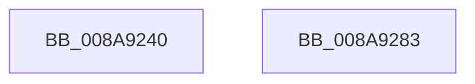

# sub_008A9240

- RVA: `0x008A9240`–`0x008A9284` (길이 `68` bytes)
- VA: `0x00000001408A9240`
- 실행 섹션: `PAGE`
- PDB 이름 있음: `아니요`; PDB Function 태그: `아니요`
- unwind 정보 RVA: `0x0007F480`
- 디코드: `18`개 명령, `68/68` bytes 표시
- 미해석 바이트: `0` (있으면 어셈블리에 `.byte`로 보존)

> 이 문서는 커널 이미지의 기계어와 PDB 기호를 분석해 생성했습니다. 4번과 5번은 함수 원형과 자료형을 바이너리 사용 방식에서 추정한 C 해석이며 원본 소스 복구 결과는 아닙니다.

## 1. Dependencies

- 직접 호출 지점: **6**; 고유 호출 대상: **6**
- 직접 호출자로 확인된 함수: **0**
- RIP 상대 이미지 참조: **0**

### Outgoing calls
- `0x008A9240` → [NtClose](../86/NtClose_function_00868870.md) (function, `0x00868870`)
- `0x008A924E` → [KeLeaveCriticalRegionThread](../../text/25/KeLeaveCriticalRegionThread_function_0025EFF0.md) (function, `0x0025EFF0`)
- `0x008A9255` → [PsSetCurrentThreadPrefetching](PsSetCurrentThreadPrefetching_function_008A9A40.md) (function, `0x008A9A40`)
- `0x008A9260` → [KiUnstackDetachProcess](../../text/21/KiUnstackDetachProcess_function_00217D30.md) (function, `0x00217D30`)
- `0x008A9268` → [ExReleaseRundownProtection](../../text/34/ExReleaseRundownProtection_function_00349E80.md) (function, `0x00349E80`)
- `0x008A9274` → [_security_check_cookie](../../text/6A/_security_check_cookie_function_006AC640.md) (function, `0x006AC640`)

### Direct callers
- 이 함수 시작 RVA로 연결되는 직접 call은 확인되지 않았습니다. 간접 호출은 완전히 역산할 수 없습니다.

### Static image references
- 디코드된 RIP-relative 메모리 참조가 없습니다.

## 2. Other-region calls and transfers

- 다른 실행 섹션으로 향하는 call: **4**
  - `0x008A924E` → [KeLeaveCriticalRegionThread](../../text/25/KeLeaveCriticalRegionThread_function_0025EFF0.md) (`PAGE` → `.text`)
  - `0x008A9260` → [KiUnstackDetachProcess](../../text/21/KiUnstackDetachProcess_function_00217D30.md) (`PAGE` → `.text`)
  - `0x008A9268` → [ExReleaseRundownProtection](../../text/34/ExReleaseRundownProtection_function_00349E80.md) (`PAGE` → `.text`)
  - `0x008A9274` → [_security_check_cookie](../../text/6A/_security_check_cookie_function_006AC640.md) (`PAGE` → `.text`)
- 별도 외부 분기/꼬리 이동을 확인하지 못했습니다.

## 3. Assembly (complete function range)

```asm
008A9240  E8 2B F6 FB FF                  call 0x140868870
008A9245  65 48 8B 0C 25 88 01 00 00      mov rcx, qword ptr gs:[0x188]
008A924E  E8 9D 5D 9B FF                  call 0x14025eff0
008A9253  33 C9                           xor ecx, ecx
008A9255  E8 E6 07 00 00                  call 0x1408a9a40
008A925A  33 D2                           xor edx, edx
008A925C  48 8D 4D F0                     lea rcx, [rbp - 0x10]
008A9260  E8 CB EA 96 FF                  call 0x140217d30
008A9265  48 8B CF                        mov rcx, rdi
008A9268  E8 13 0C AA FF                  call 0x140349e80
008A926D  48 8B 4D 20                     mov rcx, qword ptr [rbp + 0x20]
008A9271  48 33 CC                        xor rcx, rsp
008A9274  E8 C7 33 E0 FF                  call 0x1406ac640
008A9279  48 81 C4 48 01 00 00            add rsp, 0x148
008A9280  5F                              pop rdi
008A9281  5D                              pop rbp
008A9282  C3                              ret
008A9283  CC                              int3
```

## 4. C-style interpretation (structured pseudocode)

```c
__int64 __fastcall sub_008A9240(__int64 a1, int a2)
{
    __int64 result;
    __int64 v_rsp;

    result = NtClose(a1, a2, a3, a4);
    result = KeLeaveCriticalRegionThread(*(unsigned __int64 *)(gs_base + (0 + 392)), a2, a3, a4);
    a1 = 0;
    result = PsSetCurrentThreadPrefetching(a1, a2, a3, a4);
    a2 = 0;
    result = KiUnstackDetachProcess(v_rbp - 16, a2, a3, a4);
    result = ExReleaseRundownProtection(v_rdi, a2, a3, a4);
    a1 = (*(unsigned __int64 *)(v_rbp + 32)) ^ (v_rsp);
    result = _security_check_cookie(a1, a2, a3, a4);
    v_rsp = (v_rsp) + (328);
    return result;
}
```

## 5. (Beta) C Style

```c
int64_t sub_008A9240(int64_t Arg1, int32_t Arg2)
{
    int64_t result;
    int64_t local_rsp;

    result = NtClose(Arg1, Arg2, a3, a4);
    result = KeLeaveCriticalRegionThread(*(uint64_t *)(gs_base + (0 + 0x188)), Arg2, a3, a4);
    Arg1 = 0;
    result = PsSetCurrentThreadPrefetching(Arg1, Arg2, a3, a4);
    Arg2 = 0;
    result = KiUnstackDetachProcess(local_rbp - 16, Arg2, a3, a4);
    result = ExReleaseRundownProtection(local_rdi, Arg2, a3, a4);
    Arg1 = (*(uint64_t *)(local_rbp + 0x20)) ^ (local_rsp);
    result = _security_check_cookie(Arg1, Arg2, a3, a4);
    local_rsp = (local_rsp) + (328);
    return result;
}
```

## 6. Execution-region graph

[열기: 2D/3D 그래프와 함수 탐색 컨트롤 패널](../../../control-panel.html?section=page&rva=0x008A9240&view=graph)

- 2D 그래프는 위에서 아래로 흐르고, 3D 그래프는 빈 공간을 드래그해 회전합니다. Shift+드래그는 이동, 휠은 확대·축소, 함수 노드 선택은 대상 보고서 이동입니다.

### Static fallback


