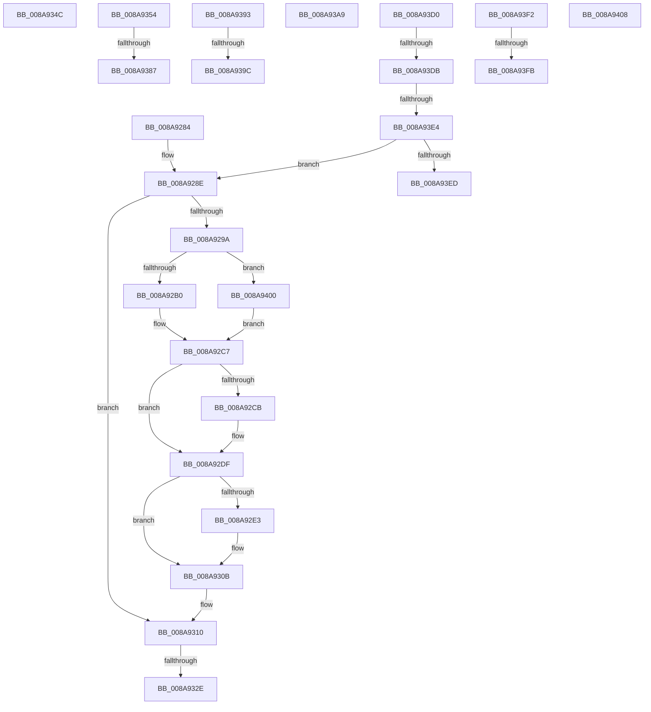

# sub_008A9284

- RVA: `0x008A9284`–`0x008A9416` (길이 `402` bytes)
- VA: `0x00000001408A9284`
- 실행 섹션: `PAGE`
- PDB 이름 있음: `아니요`; PDB Function 태그: `아니요`
- unwind 정보 RVA: `0x0007F494`
- 디코드: `98`개 명령, `402/402` bytes 표시
- 미해석 바이트: `0` (있으면 어셈블리에 `.byte`로 보존)

> 이 문서는 커널 이미지의 기계어와 PDB 기호를 분석해 생성했습니다. 4번과 5번은 함수 원형과 자료형을 바이너리 사용 방식에서 추정한 C 해석이며 원본 소스 복구 결과는 아닙니다.

## 1. Dependencies

- 직접 호출 지점: **4**; 고유 호출 대상: **3**
- 직접 호출자로 확인된 함수: **0**
- RIP 상대 이미지 참조: **0**

### Outgoing calls
- `0x008A92B4` → [ObfDereferenceObject](../../text/2F/ObfDereferenceObject_function_002F9350.md) (function, `0x002F9350`)
- `0x008A92CF` → [ObfDereferenceObject](../../text/2F/ObfDereferenceObject_function_002F9350.md) (function, `0x002F9350`)
- `0x008A92EA` → [PfpOpenHandleClose](PfpOpenHandleClose_function_008A9E74.md) (function, `0x008A9E74`)
- `0x008A9333` → [ExFreePoolWithTag](../../poolcode/B8/ExFreePoolWithTag_function_00B82870.md) (function, `0x00B82870`)

### Direct callers
- 이 함수 시작 RVA로 연결되는 직접 call은 확인되지 않았습니다. 간접 호출은 완전히 역산할 수 없습니다.

### Static image references
- 디코드된 RIP-relative 메모리 참조가 없습니다.

## 2. Other-region calls and transfers

- 다른 실행 섹션으로 향하는 call: **3**
  - `0x008A92B4` → [ObfDereferenceObject](../../text/2F/ObfDereferenceObject_function_002F9350.md) (`PAGE` → `.text`)
  - `0x008A92CF` → [ObfDereferenceObject](../../text/2F/ObfDereferenceObject_function_002F9350.md) (`PAGE` → `.text`)
  - `0x008A9333` → [ExFreePoolWithTag](../../poolcode/B8/ExFreePoolWithTag_function_00B82870.md) (`PAGE` → `POOLCODE`)
- call이 아닌 외부 분기/꼬리 이동: **14**
  - `0x008A9328` → [sub_008A8E86 + 0x111](Unknown_function_008A8E86.md) (`tail-transfer`)
  - `0x008A9347` → [sub_008A8E86 + 0x10B](Unknown_function_008A8E86.md) (`tail-transfer`)
  - `0x008A934F` → [sub_008A8E86 + 0x17E](Unknown_function_008A8E86.md) (`tail-transfer`)
  - `0x008A9381` → [sub_008A8E86 + 0x16F](Unknown_function_008A8E86.md) (`tail-transfer`)
  - `0x008A938E` → [sub_008A8E86 + 0x169](Unknown_function_008A8E86.md) (`tail-transfer`)
  - `0x008A9396` → [sub_008A8E86 + 0x2C2](Unknown_function_008A8E86.md) (`tail-transfer`)
  - `0x008A93A4` → [sub_008A8E86 + 0x2DB](Unknown_function_008A8E86.md) (`tail-transfer`)
  - `0x008A93CB` → [sub_008A8E86 + 0x266](Unknown_function_008A8E86.md) (`tail-transfer`)
  - `0x008A93D5` → [sub_008A8E86 + 0x2F4](Unknown_function_008A8E86.md) (`tail-transfer`)
  - `0x008A93DE` → [sub_008A8E86 + 0x2F4](Unknown_function_008A8E86.md) (`tail-transfer`)
  - `0x008A93ED` → [sub_008A8E86 + 0x2F4](Unknown_function_008A8E86.md) (`tail-transfer`)
  - `0x008A93F5` → [sub_008A8E86 + 0x29B](Unknown_function_008A8E86.md) (`tail-transfer`)
  - `0x008A93FB` → [sub_008A8E86 + 0x2B6](Unknown_function_008A8E86.md) (`tail-transfer`)
  - `0x008A9411` → [sub_008A8E86 + 0x339](Unknown_function_008A8E86.md) (`tail-transfer`)

## 3. Assembly (complete function range)

```asm
008A9284  48 8B 74 24 78                  mov rsi, qword ptr [rsp + 0x78]
008A9289  44 8B 74 24 54                  mov r14d, dword ptr [rsp + 0x54]
008A928E  4C 8B 7C 24 58                  mov r15, qword ptr [rsp + 0x58]
008A9293  80 7C 24 50 00                  cmp byte ptr [rsp + 0x50], 0
008A9298  74 76                           je 0x1408a9310
008A929A  41 8B C6                        mov eax, r14d
008A929D  48 6B F8 38                     imul rdi, rax, 0x38
008A92A1  48 03 7E 38                     add rdi, qword ptr [rsi + 0x38]
008A92A5  8B 47 30                        mov eax, dword ptr [rdi + 0x30]
008A92A8  A8 01                           test al, 1
008A92AA  0F 84 50 01 00 00               je 0x1408a9400
008A92B0  48 8B 4F 20                     mov rcx, qword ptr [rdi + 0x20]
008A92B4  E8 97 00 A5 FF                  call 0x1402f9350
008A92B9  45 33 F6                        xor r14d, r14d
008A92BC  83 67 30 FE                     and dword ptr [rdi + 0x30], 0xfffffffe
008A92C0  8B 47 30                        mov eax, dword ptr [rdi + 0x30]
008A92C3  4C 89 77 20                     mov qword ptr [rdi + 0x20], r14
008A92C7  A8 02                           test al, 2
008A92C9  74 14                           je 0x1408a92df
008A92CB  48 8B 4F 28                     mov rcx, qword ptr [rdi + 0x28]
008A92CF  E8 7C 00 A5 FF                  call 0x1402f9350
008A92D4  83 67 30 FD                     and dword ptr [rdi + 0x30], 0xfffffffd
008A92D8  8B 47 30                        mov eax, dword ptr [rdi + 0x30]
008A92DB  4C 89 77 28                     mov qword ptr [rdi + 0x28], r14
008A92DF  A8 04                           test al, 4
008A92E1  74 28                           je 0x1408a930b
008A92E3  48 8B 56 08                     mov rdx, qword ptr [rsi + 8]
008A92E7  48 8B CF                        mov rcx, rdi
008A92EA  E8 85 0B 00 00                  call 0x1408a9e74
008A92EF  0F 57 C0                        xorps xmm0, xmm0
008A92F2  48 B8 00 00 00 00 02 00 00 00   movabs rax, 0x200000000
008A92FC  0F 11 07                        movups xmmword ptr [rdi], xmm0
008A92FF  0F 11 47 10                     movups xmmword ptr [rdi + 0x10], xmm0
008A9303  48 09 47 18                     or qword ptr [rdi + 0x18], rax
008A9307  83 67 30 FB                     and dword ptr [rdi + 0x30], 0xfffffffb
008A930B  C6 44 24 50 00                  mov byte ptr [rsp + 0x50], 0
008A9310  48 8B 7C 24 70                  mov rdi, qword ptr [rsp + 0x70]
008A9315  41 BA 07 00 00 00               mov r10d, 7
008A931B  48 8B 54 24 60                  mov rdx, qword ptr [rsp + 0x60]
008A9320  4C 8B 4C 24 68                  mov r9, qword ptr [rsp + 0x68]
008A9325  4D 85 E4                        test r12, r12
008A9328  0F 84 69 FC FF FF               je 0x1408a8f97
008A932E  33 D2                           xor edx, edx
008A9330  49 8B CC                        mov rcx, r12
008A9333  E8 38 95 2D 00                  call 0x140b82870
008A9338  48 8B 54 24 60                  mov rdx, qword ptr [rsp + 0x60]
008A933D  33 C0                           xor eax, eax
008A933F  4C 8B 4C 24 68                  mov r9, qword ptr [rsp + 0x68]
008A9344  44 8B E0                        mov r12d, eax
008A9347  E9 45 FC FF FF                  jmp 0x1408a8f91
008A934C  48 8B 36                        mov rsi, qword ptr [rsi]
008A934F  E9 B0 FC FF FF                  jmp 0x1408a9004
008A9354  83 E0 7F                        and eax, 0x7f
008A9357  0F BC C8                        bsf ecx, eax
008A935A  0F 95 C0                        setne al
008A935D  84 C0                           test al, al
008A935F  B8 01 00 00 00                  mov eax, 1
008A9364  41 0F 44 CA                     cmove ecx, r10d
008A9368  D3 E0                           shl eax, cl
008A936A  41 23 C5                        and eax, r13d
008A936D  89 4D 80                        mov dword ptr [rbp - 0x80], ecx
008A9370  41 0F 95 C0                     setne r8b
008A9374  D1 EA                           shr edx, 1
008A9376  41 23 D5                        and edx, r13d
008A9379  44 88 44 24 51                  mov byte ptr [rsp + 0x51], r8b
008A937E  F6 C2 7F                        test dl, 0x7f
008A9381  0F 85 6E FC FF FF               jne 0x1408a8ff5
008A9387  44 88 44 24 51                  mov byte ptr [rsp + 0x51], r8b
008A938C  85 C0                           test eax, eax
008A938E  E9 5C FC FF FF                  jmp 0x1408a8fef
008A9393  40 84 FF                        test dil, dil
008A9396  0F 84 AC FD FF FF               je 0x1408a9148
008A939C  C7 44 24 54 01 00 00 00         mov dword ptr [rsp + 0x54], 1
008A93A4  E9 B8 FD FF FF                  jmp 0x1408a9161
008A93A9  41 8B 44 24 08                  mov eax, dword ptr [r12 + 8]
008A93AE  45 8B CB                        mov r9d, r11d
008A93B1  49 89 54 C4 10                  mov qword ptr [r12 + rax*8 + 0x10], rdx
008A93B6  41 FF 44 24 08                  inc dword ptr [r12 + 8]
008A93BB  48 8B 45 88                     mov rax, qword ptr [rbp - 0x78]
008A93BF  48 8B 40 28                     mov rax, qword ptr [rax + 0x28]
008A93C3  48 39 50 10                     cmp qword ptr [rax + 0x10], rdx
008A93C7  44 0F 44 DA                     cmove r11d, edx
008A93CB  E9 1C FD FF FF                  jmp 0x1408a90ec
008A93D0  80 7C 24 51 00                  cmp byte ptr [rsp + 0x51], 0
008A93D5  0F 84 9F FD FF FF               je 0x1408a917a
008A93DB  45 85 DB                        test r11d, r11d
008A93DE  0F 84 96 FD FF FF               je 0x1408a917a
008A93E4  45 85 D2                        test r10d, r10d
008A93E7  0F 84 A1 FE FF FF               je 0x1408a928e
008A93ED  E9 88 FD FF FF                  jmp 0x1408a917a
008A93F2  45 85 DB                        test r11d, r11d
008A93F5  0F 85 26 FD FF FF               jne 0x1408a9121
008A93FB  E9 3C FD FF FF                  jmp 0x1408a913c
008A9400  45 33 F6                        xor r14d, r14d
008A9403  E9 BF FE FF FF                  jmp 0x1408a92c7
008A9408  44 89 34 88                     mov dword ptr [rax + rcx*4], r14d
008A940C  44 88 64 24 50                  mov byte ptr [rsp + 0x50], r12b
008A9411  E9 A9 FD FF FF                  jmp 0x1408a91bf
```

## 4. C-style interpretation (structured pseudocode)

```c
__int64 __fastcall sub_008A9284(__int64 a1, __int64 a2, __int64 a3, __int64 a4, __int64 a5, __int64 a6, __int64 a7, __int64 a8, __int64 a9, unsigned __int8 a10, __int64 a11, __int64 a12, __int64 a13, __int64 a14, __int64 a15)
{
    __int64 result;
    __int64 v_r14;
    __int64 v_rdi;
    unsigned __int8 v_stack_p50;
    unsigned __int8 v_stack_p51;
    unsigned int v_stack_p54;

loc_008A928E:
    if (a10 == 0) goto loc_008A9310;
    v_rdi = (v_rdi) * ((unsigned int)((unsigned int)((unsigned int)(v_stack_p54))));
    v_rdi = (v_rdi) + (*(unsigned __int64 *)(a15 + 56));
    if ((((unsigned __int8)((unsigned int)(*(unsigned int *)(v_rdi + 48)))) & (1)) == 0) goto loc_008A9400;
    result = ObfDereferenceObject(*(unsigned __int64 *)(v_rdi + 32), a2, a3, a4);
    v_r14 = 0;
    *(unsigned __int64 *)(v_rdi + 32) = 0;
loc_008A92C7:
    result = (unsigned int)(*(unsigned int *)(v_rdi + 48));
    if ((((unsigned __int8)((unsigned int)(*(unsigned int *)(v_rdi + 48)))) & (2)) != 0) {
        a1 = *(unsigned __int64 *)(v_rdi + 40);
        result = ObfDereferenceObject(a1, a2, a3, a4);
        result = *(unsigned int *)(v_rdi + 48);
        *(unsigned __int64 *)(v_rdi + 40) = 0;
    }
    if ((((unsigned __int8)(result)) & (4)) != 0) {
        a2 = *(unsigned __int64 *)(a15 + 8);
        a1 = v_rdi;
        result = PfpOpenHandleClose(a1, a2, a3, a4);
        *(unsigned __int64 *)(v_rdi) = v_xmm0;
        *(unsigned __int64 *)(v_rdi + 16) = v_xmm0;
    }
    v_stack_p50 = 0;
loc_008A9310:
    a2 = 0;
    result = ExFreePoolWithTag(v_r12, a2, a3, a13);
    result = 0;
loc_008A9400:
    v_r14 = 0;
    goto loc_008A92C7;
}
```

## 5. (Beta) C Style

```c
int64_t sub_008A9284(int64_t Arg1, int64_t Arg2, int64_t Arg3, int64_t Arg4, uint64_t Arg5, uint64_t Arg6, uint64_t Arg7, uint64_t Arg8, uint64_t Arg9, uint8_t Arg10, int64_t Arg11, int64_t Arg12, int64_t Arg13, int64_t Arg14, void *Arg15)
{
    uint8_t *arg15 = (uint8_t *)Arg15;

    int64_t result;
    int64_t local_r14;
    int64_t local_rdi;
    uint8_t v_stack_p50;
    uint8_t v_stack_p51;
    uint32_t v_stack_p54;

loc_008A928E:
    if (Arg10 == 0) goto loc_008A9310;
    local_rdi = (local_rdi) * ((uint32_t)((uint32_t)((uint32_t)(v_stack_p54))));
    local_rdi = (local_rdi) + (*(uint64_t *)(arg15 + 0x38));
    if ((((uint8_t)((uint32_t)(*(uint32_t *)(local_rdi + 0x30)))) & (1)) == 0) goto loc_008A9400;
    result = ObfDereferenceObject(*(uint64_t *)(local_rdi + 0x20), Arg2, Arg3, Arg4);
    local_r14 = 0;
    *(uint64_t *)(local_rdi + 0x20) = 0;
loc_008A92C7:
    result = (uint32_t)(*(uint32_t *)(local_rdi + 0x30));
    if ((((uint8_t)((uint32_t)(*(uint32_t *)(local_rdi + 0x30)))) & (2)) != 0) {
        Arg1 = *(uint64_t *)(local_rdi + 0x28);
        result = ObfDereferenceObject(Arg1, Arg2, Arg3, Arg4);
        result = *(uint32_t *)(local_rdi + 0x30);
        *(uint64_t *)(local_rdi + 0x28) = 0;
    }
    if ((((uint8_t)(result)) & (4)) != 0) {
        Arg2 = *(uint64_t *)(arg15 + 0x8);
        Arg1 = local_rdi;
        result = PfpOpenHandleClose(Arg1, Arg2, Arg3, Arg4);
        *(uint64_t *)(local_rdi) = v_xmm0;
        *(uint64_t *)(local_rdi + 0x10) = v_xmm0;
    }
    v_stack_p50 = 0;
loc_008A9310:
    Arg2 = 0;
    result = ExFreePoolWithTag(local_r12, Arg2, Arg3, Arg13);
    result = 0;
loc_008A9400:
    local_r14 = 0;
    goto loc_008A92C7;
}
```

### 관측된 메모리 오프셋

구조체 형식이 확인되지 않은 접근은 인자 기준의 오프셋으로만 기록했습니다.

| 기준 인자 | 오프셋 표현 | 폭 (bit) | 접근 |
|---|---:|---:|---|
| `Arg15` | `+ 0x8` | `64` | `R` |
| `Arg15` | `+ 0x38` | `64` | `R` |

## 6. Execution-region graph

[열기: 2D/3D 그래프와 함수 탐색 컨트롤 패널](../../../control-panel.html?section=page&rva=0x008A9284&view=graph)

- 2D 그래프는 위에서 아래로 흐르고, 3D 그래프는 빈 공간을 드래그해 회전합니다. Shift+드래그는 이동, 휠은 확대·축소, 함수 노드 선택은 대상 보고서 이동입니다.

### Static fallback


