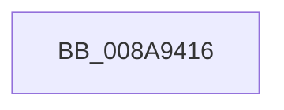

# sub_008A9416

- RVA: `0x008A9416`–`0x008A9431` (길이 `27` bytes)
- VA: `0x00000001408A9416`
- 실행 섹션: `PAGE`
- PDB 이름 있음: `아니요`; PDB Function 태그: `아니요`
- unwind 정보 RVA: `0x0007F4BC`
- 디코드: `7`개 명령, `27/27` bytes 표시
- 미해석 바이트: `0` (있으면 어셈블리에 `.byte`로 보존)

> 이 문서는 커널 이미지의 기계어와 PDB 기호를 분석해 생성했습니다. 4번과 5번은 함수 원형과 자료형을 바이너리 사용 방식에서 추정한 C 해석이며 원본 소스 복구 결과는 아닙니다.

## 1. Dependencies

- 직접 호출 지점: **1**; 고유 호출 대상: **1**
- 직접 호출자로 확인된 함수: **0**
- RIP 상대 이미지 참조: **0**

### Outgoing calls
- `0x008A9427` → [PfSnCleanupPrefetchSectionInfo](PfSnCleanupPrefetchSectionInfo_function_008AA0B8.md) (function, `0x008AA0B8`)

### Direct callers
- 이 함수 시작 RVA로 연결되는 직접 call은 확인되지 않았습니다. 간접 호출은 완전히 역산할 수 없습니다.

### Static image references
- 디코드된 RIP-relative 메모리 참조가 없습니다.

## 2. Other-region calls and transfers

- 다른 실행 섹션으로 향하는 call: **0**
- call이 아닌 외부 분기/꼬리 이동: **1**
  - `0x008A942C` → [sub_008A9216](Unknown_function_008A9216.md) (`tail-transfer`)

## 3. Assembly (complete function range)

```asm
008A9416  41 8B C6                        mov eax, r14d
008A9419  41 B0 01                        mov r8b, 1
008A941C  48 6B C8 38                     imul rcx, rax, 0x38
008A9420  48 8B D6                        mov rdx, rsi
008A9423  48 03 4E 38                     add rcx, qword ptr [rsi + 0x38]
008A9427  E8 8C 0C 00 00                  call 0x1408aa0b8
008A942C  E9 E5 FD FF FF                  jmp 0x1408a9216
```

## 4. C-style interpretation (structured pseudocode)

```c
__int64 __fastcall sub_008A9416(void)
{
    __int64 result;

    a1 = (a1) * ((unsigned int)((unsigned int)(v_r14)));
    a1 = (a1) + (*(unsigned __int64 *)(v_rsi + 56));
    result = PfSnCleanupPrefetchSectionInfo(a1, v_rsi, 1, a4);
}
```

## 5. (Beta) C Style

```c
void sub_008A9416(void)
{
    int64_t result;

    a1 = (a1) * ((uint32_t)((uint32_t)(local_r14)));
    a1 = (a1) + (*(uint64_t *)(local_rsi + 0x38));
    result = PfSnCleanupPrefetchSectionInfo(a1, local_rsi, 1, a4);
}
```

## 6. Execution-region graph

[열기: 2D/3D 그래프와 함수 탐색 컨트롤 패널](../../../control-panel.html?section=page&rva=0x008A9416&view=graph)

- 2D 그래프는 위에서 아래로 흐르고, 3D 그래프는 빈 공간을 드래그해 회전합니다. Shift+드래그는 이동, 휠은 확대·축소, 함수 노드 선택은 대상 보고서 이동입니다.

### Static fallback


