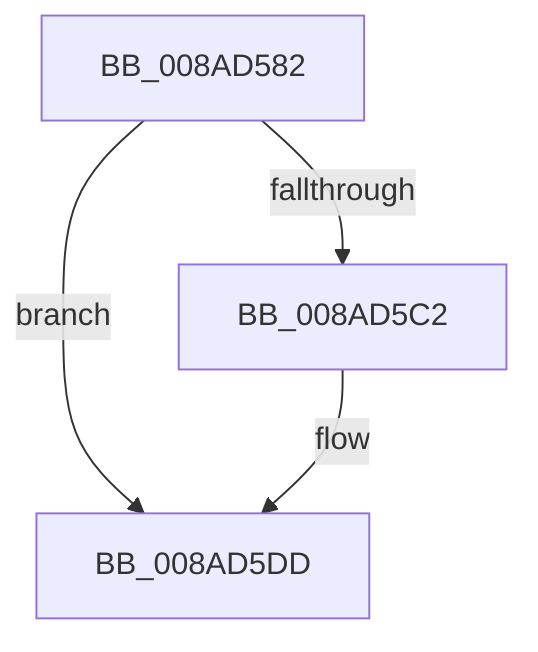

# sub_008AD582

- RVA: `0x008AD582`–`0x008AD5F5` (길이 `115` bytes)
- VA: `0x00000001408AD582`
- 실행 섹션: `PAGE`
- PDB 이름 있음: `아니요`; PDB Function 태그: `아니요`
- unwind 정보 RVA: `0x0007F8C8`
- 디코드: `28`개 명령, `115/115` bytes 표시
- 미해석 바이트: `0` (있으면 어셈블리에 `.byte`로 보존)

> 이 문서는 커널 이미지의 기계어와 PDB 기호를 분석해 생성했습니다. 4번과 5번은 함수 원형과 자료형을 바이너리 사용 방식에서 추정한 C 해석이며 원본 소스 복구 결과는 아닙니다.

## 1. Dependencies

- 직접 호출 지점: **3**; 고유 호출 대상: **3**
- 직접 호출자로 확인된 함수: **0**
- RIP 상대 이미지 참조: **0**

### Outgoing calls
- `0x008AD5A9` → [IopQueueThreadIrp](../../text/20/IopQueueThreadIrp_function_002075C0.md) (function, `0x002075C0`)
- `0x008AD5B4` → [IofCallDriver](../../text/29/IofCallDriver_function_0029B4B0.md) (function, `0x0029B4B0`)
- `0x008AD5D4` → [KeWaitForSingleObject](../../text/20/KeWaitForSingleObject_function_0020E6B0.md) (function, `0x0020E6B0`)

### Direct callers
- 이 함수 시작 RVA로 연결되는 직접 call은 확인되지 않았습니다. 간접 호출은 완전히 역산할 수 없습니다.

### Static image references
- 디코드된 RIP-relative 메모리 참조가 없습니다.

## 2. Other-region calls and transfers

- 다른 실행 섹션으로 향하는 call: **3**
  - `0x008AD5A9` → [IopQueueThreadIrp](../../text/20/IopQueueThreadIrp_function_002075C0.md) (`PAGE` → `.text`)
  - `0x008AD5B4` → [IofCallDriver](../../text/29/IofCallDriver_function_0029B4B0.md) (`PAGE` → `.text`)
  - `0x008AD5D4` → [KeWaitForSingleObject](../../text/20/KeWaitForSingleObject_function_0020E6B0.md) (`PAGE` → `.text`)
- 별도 외부 분기/꼬리 이동을 확인하지 못했습니다.

## 3. Assembly (complete function range)

```asm
008AD582  4C 89 A4 24 80 00 00 00         mov qword ptr [rsp + 0x80], r12
008AD58A  45 33 E4                        xor r12d, r12d
008AD58D  4C 89 63 58                     mov qword ptr [rbx + 0x58], r12
008AD591  C6 40 B8 05                     mov byte ptr [rax - 0x48], 5
008AD595  48 89 78 E8                     mov qword ptr [rax - 0x18], rdi
008AD599  83 4B 10 10                     or dword ptr [rbx + 0x10], 0x10
008AD59D  48 89 6B 18                     mov qword ptr [rbx + 0x18], rbp
008AD5A1  44 89 78 C0                     mov dword ptr [rax - 0x40], r15d
008AD5A5  44 89 70 C8                     mov dword ptr [rax - 0x38], r14d
008AD5A9  E8 12 A0 95 FF                  call 0x1402075c0
008AD5AE  48 8B D3                        mov rdx, rbx
008AD5B1  48 8B CE                        mov rcx, rsi
008AD5B4  E8 F7 DE 9E FF                  call 0x14029b4b0
008AD5B9  8B D0                           mov edx, eax
008AD5BB  3D 03 01 00 00                  cmp eax, 0x103
008AD5C0  75 1B                           jne 0x1408ad5dd
008AD5C2  45 33 C9                        xor r9d, r9d
008AD5C5  4C 89 64 24 20                  mov qword ptr [rsp + 0x20], r12
008AD5CA  45 33 C0                        xor r8d, r8d
008AD5CD  48 8D 4C 24 40                  lea rcx, [rsp + 0x40]
008AD5D2  33 D2                           xor edx, edx
008AD5D4  E8 D7 10 96 FF                  call 0x14020e6b0
008AD5D9  8B 54 24 30                     mov edx, dword ptr [rsp + 0x30]
008AD5DD  8B 44 24 38                     mov eax, dword ptr [rsp + 0x38]
008AD5E1  48 8B 8C 24 A0 00 00 00         mov rcx, qword ptr [rsp + 0xa0]
008AD5E9  4C 8B A4 24 80 00 00 00         mov r12, qword ptr [rsp + 0x80]
008AD5F1  89 01                           mov dword ptr [rcx], eax
008AD5F3  8B C2                           mov eax, edx
```

## 4. C-style interpretation (structured pseudocode)

```c
__int64 __fastcall sub_008AD582(__int64 a1, __int64 a2, int a3, int a4, __int64 a5, unsigned int a6, unsigned int a7, __int64 a8, __int64 a9, __int64 a10, __int64 a11, __int64 a12, __int64 a13, __int64 a14, __int64 a15, __int64 a16, __int64 a17, __int64 a18, __int64 a19, __int64 a20)
{
    __int64 result;
    __int64 v_r12;
    unsigned __int64 v_stack_p20;
    unsigned __int64 v_stack_p80;

    v_stack_p80 = v_r12;
    v_r12 = 0;
    *(unsigned __int64 *)(v_rbx + 88) = 0;
    *(unsigned __int8 *)(result - 72) = 5;
    *(unsigned __int64 *)(result - 24) = v_rdi;
    *(unsigned __int64 *)(v_rbx + 24) = v_rbp;
    *(unsigned int *)(result - 64) = (unsigned int)(v_r15);
    *(unsigned int *)(result - 56) = (unsigned int)(v_r14);
    result = IopQueueThreadIrp(a1, a2, a3, a4);
    result = IofCallDriver(v_rsi, v_rbx, a3, a4);
    if (((unsigned int)(result)) == 259) {
        a4 = 0;
        v_stack_p20 = 0;
        a3 = 0;
        a1 = a8;
        a2 = 0;
        result = KeWaitForSingleObject(a1, a2, a3, a4);
        a2 = a6;
    }
    *(unsigned int *)(a20) = (unsigned int)((unsigned int)(a7));
    return (unsigned int)((unsigned int)(a2));
}
```

## 5. (Beta) C Style

```c
int64_t sub_008AD582(int64_t Arg1, int64_t Arg2, int32_t Arg3, int32_t Arg4, uint64_t Arg5, uint32_t Arg6, uint32_t Arg7, int64_t Arg8, uint64_t Arg9, uint64_t Arg10, uint64_t Arg11, uint64_t Arg12, uint64_t Arg13, uint64_t Arg14, uint64_t Arg15, int64_t Arg16, uint64_t Arg17, uint64_t Arg18, uint64_t Arg19, void *Arg20)
{
    uint8_t *arg20 = (uint8_t *)Arg20;

    int64_t result;
    int64_t local_r12;
    uint64_t v_stack_p20;
    uint64_t v_stack_p80;

    v_stack_p80 = local_r12;
    local_r12 = 0;
    *(uint64_t *)(local_rbx + 0x58) = 0;
    *(uint8_t *)(result - 0x48) = 5;
    *(uint64_t *)(result - 0x18) = local_rdi;
    *(uint64_t *)(local_rbx + 0x18) = local_rbp;
    *(uint32_t *)(result - 0x40) = (uint32_t)(local_r15);
    *(uint32_t *)(result - 0x38) = (uint32_t)(local_r14);
    result = IopQueueThreadIrp(Arg1, Arg2, Arg3, Arg4);
    result = IofCallDriver(local_rsi, local_rbx, Arg3, Arg4);
    if (((uint32_t)(result)) == 259) {
        Arg4 = 0;
        v_stack_p20 = 0;
        Arg3 = 0;
        Arg1 = Arg8;
        Arg2 = 0;
        result = KeWaitForSingleObject(Arg1, Arg2, Arg3, Arg4);
        Arg2 = Arg6;
    }
    *(uint32_t *)(arg20) = (uint32_t)((uint32_t)(Arg7));
    return (uint32_t)((uint32_t)(Arg2));
}
```

### 관측된 메모리 오프셋

구조체 형식이 확인되지 않은 접근은 인자 기준의 오프셋으로만 기록했습니다.

| 기준 인자 | 오프셋 표현 | 폭 (bit) | 접근 |
|---|---:|---:|---|
| `Arg20` | `+ 0x0` | `32` | `W` |

## 6. Execution-region graph

[열기: 2D/3D 그래프와 함수 탐색 컨트롤 패널](../../../control-panel.html?section=page&rva=0x008AD582&view=graph)

- 2D 그래프는 위에서 아래로 흐르고, 3D 그래프는 빈 공간을 드래그해 회전합니다. Shift+드래그는 이동, 휠은 확대·축소, 함수 노드 선택은 대상 보고서 이동입니다.

### Static fallback


