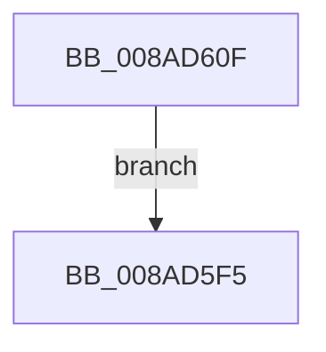

# sub_008AD5F5

- RVA: `0x008AD5F5`–`0x008AD61F` (길이 `42` bytes)
- VA: `0x00000001408AD5F5`
- 실행 섹션: `PAGE`
- PDB 이름 있음: `아니요`; PDB Function 태그: `아니요`
- unwind 정보 RVA: `0x0007F8DC`
- 디코드: `14`개 명령, `42/42` bytes 표시
- 미해석 바이트: `0` (있으면 어셈블리에 `.byte`로 보존)

> 이 문서는 커널 이미지의 기계어와 PDB 기호를 분석해 생성했습니다. 4번과 5번은 함수 원형과 자료형을 바이너리 사용 방식에서 추정한 C 해석이며 원본 소스 복구 결과는 아닙니다.

## 1. Dependencies

- 직접 호출 지점: **1**; 고유 호출 대상: **1**
- 직접 호출자로 확인된 함수: **0**
- RIP 상대 이미지 참조: **0**

### Outgoing calls
- `0x008AD613` → [ObfDereferenceObject](../../text/2F/ObfDereferenceObject_function_002F9350.md) (function, `0x002F9350`)

### Direct callers
- 이 함수 시작 RVA로 연결되는 직접 call은 확인되지 않았습니다. 간접 호출은 완전히 역산할 수 없습니다.

### Static image references
- 디코드된 RIP-relative 메모리 참조가 없습니다.

## 2. Other-region calls and transfers

- 다른 실행 섹션으로 향하는 call: **1**
  - `0x008AD613` → [ObfDereferenceObject](../../text/2F/ObfDereferenceObject_function_002F9350.md) (`PAGE` → `.text`)
- 별도 외부 분기/꼬리 이동을 확인하지 못했습니다.

## 3. Assembly (complete function range)

```asm
008AD5F5  4C 8D 5C 24 60                  lea r11, [rsp + 0x60]
008AD5FA  49 8B 5B 28                     mov rbx, qword ptr [r11 + 0x28]
008AD5FE  49 8B 6B 30                     mov rbp, qword ptr [r11 + 0x30]
008AD602  49 8B 73 38                     mov rsi, qword ptr [r11 + 0x38]
008AD606  49 8B E3                        mov rsp, r11
008AD609  41 5F                           pop r15
008AD60B  41 5E                           pop r14
008AD60D  5F                              pop rdi
008AD60E  C3                              ret
008AD60F  CC                              int3
008AD610  48 8B CF                        mov rcx, rdi
008AD613  E8 38 BD A4 FF                  call 0x1402f9350
008AD618  B8 9A 00 00 C0                  mov eax, 0xc000009a
008AD61D  EB D6                           jmp 0x1408ad5f5
```

## 4. C-style interpretation (structured pseudocode)

```c
__int64 __fastcall sub_008AD5F5(__int64 a1, __int64 a2, __int64 a3, __int64 a4, __int64 a5, __int64 a6, __int64 a7, __int64 a8, __int64 a9, __int64 a10, __int64 a11, __int64 a12)
{
    return result;
}
```

## 5. (Beta) C Style

```c
int64_t sub_008AD5F5(int64_t Arg1, int64_t Arg2, int64_t Arg3, int64_t Arg4, uint64_t Arg5, uint64_t Arg6, uint64_t Arg7, uint64_t Arg8, uint64_t Arg9, uint64_t Arg10, uint64_t Arg11, int64_t Arg12)
{
    return result;
}
```

## 6. Execution-region graph

[열기: 2D/3D 그래프와 함수 탐색 컨트롤 패널](../../../control-panel.html?section=page&rva=0x008AD5F5&view=graph)

- 2D 그래프는 위에서 아래로 흐르고, 3D 그래프는 빈 공간을 드래그해 회전합니다. Shift+드래그는 이동, 휠은 확대·축소, 함수 노드 선택은 대상 보고서 이동입니다.

### Static fallback


