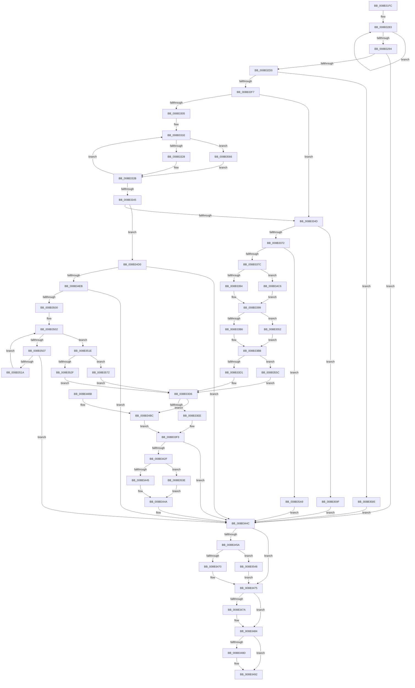

# CmEnumerateValueFromLayeredKey

- RVA: `0x008B31FC`–`0x008B35B3` (길이 `951` bytes)
- VA: `0x00000001408B31FC`
- 실행 섹션: `PAGE`
- PDB 이름 있음: `예`; PDB Function 태그: `아니요`
- unwind 정보 RVA: `0x00082714`
- 디코드: `242`개 명령, `951/951` bytes 표시
- 미해석 바이트: `0` (있으면 어셈블리에 `.byte`로 보존)

> 이 문서는 커널 이미지의 기계어와 PDB 기호를 분석해 생성했습니다. 4번과 5번은 함수 원형과 자료형을 바이너리 사용 방식에서 추정한 C 해석이며 원본 소스 복구 결과는 아닙니다.

## 1. Dependencies

- 직접 호출 지점: **29**; 고유 호출 대상: **18**
- 직접 호출자로 확인된 함수: **1**
- RIP 상대 이미지 참조: **1**

### Outgoing calls
- `0x008B326E` → [memset](../../text/6C/memset_function_006C6C40.md) (function, `0x006C6C40`)
- `0x008B3286` → [CmpValueEnumStackEntryInitialize](../../text/49/CmpValueEnumStackEntryInitialize_function_0049D4C4.md) (function, `0x0049D4C4`)
- `0x008B3299` → [HvpGetCellContextInitialize](../85/HvpGetCellContextInitialize_function_00855F10.md) (function, `0x00855F10`)
- `0x008B32A9` → [HvpGetCellContextInitialize](../85/HvpGetCellContextInitialize_function_00855F10.md) (function, `0x00855F10`)
- `0x008B32B3` → [HvpGetCellContextInitialize](../85/HvpGetCellContextInitialize_function_00855F10.md) (function, `0x00855F10`)
- `0x008B32C1` → [CmpStartKcbStackForTopLayerKcb](../84/CmpStartKcbStackForTopLayerKcb_function_00848390.md) (function, `0x00848390`)
- `0x008B32D5` → [CmpLockKcbStackShared](../94/CmpLockKcbStackShared_function_00948000.md) (function, `0x00948000`)
- `0x008B32E7` → [CmpIsKeyDeletedForKeyBody](../../pagecmrc/BC/CmpIsKeyDeletedForKeyBody_function_00BC9480.md) (function, `0x00BC9480`)
- `0x008B3360` → [CmpGetKeyNodeForKcb](../85/CmpGetKeyNodeForKcb_function_00856480.md) (function, `0x00856480`)
- `0x008B3394` → [HvpGetCellFlat](../85/HvpGetCellFlat_function_00854C60.md) (function, `0x00854C60`)
- `0x008B33B6` → [HvpReleaseCellPaged](../85/HvpReleaseCellPaged_function_00855F40.md) (function, `0x00855F40`)
- `0x008B33D1` → [HvpReleaseCellPaged](../85/HvpReleaseCellPaged_function_00855F40.md) (function, `0x00855F40`)
- `0x008B33EE` → [HvpGetCellFlat](../85/HvpGetCellFlat_function_00854C60.md) (function, `0x00854C60`)
- `0x008B341A` → [CmpQueryKeyValueData](../85/CmpQueryKeyValueData_function_00856650.md) (function, `0x00856650`)
- `0x008B3445` → [HvpReleaseCellPaged](../85/HvpReleaseCellPaged_function_00855F40.md) (function, `0x00855F40`)
- `0x008B3450` → [CmpValueEnumStackCleanup](CmpValueEnumStackCleanup_function_008B1F04.md) (function, `0x008B1F04`)
- `0x008B3470` → [HvpReleaseCellPaged](../85/HvpReleaseCellPaged_function_00855F40.md) (function, `0x00855F40`)
- `0x008B347F` → [CmpUnlockKcbStack](../84/CmpUnlockKcbStack_function_00848460.md) (function, `0x00848460`)
- `0x008B348D` → [CmSiFreeMemory](../../text/47/CmSiFreeMemory_function_00475D80.md) (function, `0x00475D80`)
- `0x008B349B` → [_security_check_cookie](../../text/6A/_security_check_cookie_function_006AC640.md) (function, `0x006AC640`)
- `0x008B34BC` → [HvpGetCellPaged](../85/HvpGetCellPaged_function_00854CB0.md) (function, `0x00854CB0`)
- `0x008B34C6` → [HvpGetCellPaged](../85/HvpGetCellPaged_function_00854CB0.md) (function, `0x00854CB0`)
- `0x008B34DC` → [CmpValueEnumStackStartFromKcbStack](../94/CmpValueEnumStackStartFromKcbStack_function_00944AA4.md) (function, `0x00944AA4`)
- `0x008B34EF` → [CmpValueEnumStackAdvance](CmpValueEnumStackAdvance_function_008B256C.md) (function, `0x008B256C`)
- `0x008B350B` → [CmpValueEnumStackAdvance](CmpValueEnumStackAdvance_function_008B256C.md) (function, `0x008B256C`)
- `0x008B353E` → [HvpReleaseCellFlat](../85/HvpReleaseCellFlat_function_0085CC20.md) (function, `0x0085CC20`)
- `0x008B3548` → [HvpReleaseCellFlat](../85/HvpReleaseCellFlat_function_0085CC20.md) (function, `0x0085CC20`)
- `0x008B3552` → [HvpReleaseCellFlat](../85/HvpReleaseCellFlat_function_0085CC20.md) (function, `0x0085CC20`)
- `0x008B355C` → [HvpReleaseCellFlat](../85/HvpReleaseCellFlat_function_0085CC20.md) (function, `0x0085CC20`)

### Direct callers
- [NtEnumerateValueKey](NtEnumerateValueKey_function_008B3B50.md) at `0x008B4416`

### Static image references
- `0x008B3218` → RVA `0x00E0A740` (`.data`; read)

## 2. Other-region calls and transfers

- 다른 실행 섹션으로 향하는 call: **5**
  - `0x008B326E` → [memset](../../text/6C/memset_function_006C6C40.md) (`PAGE` → `.text`)
  - `0x008B3286` → [CmpValueEnumStackEntryInitialize](../../text/49/CmpValueEnumStackEntryInitialize_function_0049D4C4.md) (`PAGE` → `.text`)
  - `0x008B32E7` → [CmpIsKeyDeletedForKeyBody](../../pagecmrc/BC/CmpIsKeyDeletedForKeyBody_function_00BC9480.md) (`PAGE` → `PAGECMRC`)
  - `0x008B348D` → [CmSiFreeMemory](../../text/47/CmSiFreeMemory_function_00475D80.md) (`PAGE` → `.text`)
  - `0x008B349B` → [_security_check_cookie](../../text/6A/_security_check_cookie_function_006AC640.md) (`PAGE` → `.text`)
- 별도 외부 분기/꼬리 이동을 확인하지 못했습니다.

## 3. Assembly (complete function range)

```asm
008B31FC  48 89 5C 24 18                  mov qword ptr [rsp + 0x18], rbx
008B3201  55                              push rbp
008B3202  56                              push rsi
008B3203  57                              push rdi
008B3204  41 54                           push r12
008B3206  41 55                           push r13
008B3208  41 56                           push r14
008B320A  41 57                           push r15
008B320C  48 8D 6C 24 E9                  lea rbp, [rsp - 0x17]
008B3211  48 81 EC 00 01 00 00            sub rsp, 0x100
008B3218  48 8B 05 21 75 55 00            mov rax, qword ptr [rip + 0x557521]
008B321F  48 33 C4                        xor rax, rsp
008B3222  48 89 45 07                     mov qword ptr [rbp + 7], rax
008B3226  48 8B 45 7F                     mov rax, qword ptr [rbp + 0x7f]
008B322A  33 DB                           xor ebx, ebx
008B322C  0F 57 C0                        xorps xmm0, xmm0
008B322F  48 89 45 8F                     mov qword ptr [rbp - 0x71], rax
008B3233  45 8B E8                        mov r13d, r8d
008B3236  44 8B F2                        mov r14d, edx
008B3239  48 8B F9                        mov rdi, rcx
008B323C  4C 89 4D 97                     mov qword ptr [rbp - 0x69], r9
008B3240  83 C8 FF                        or eax, 0xffffffff
008B3243  48 89 5C 24 50                  mov qword ptr [rsp + 0x50], rbx
008B3248  0F 11 44 24 58                  movups xmmword ptr [rsp + 0x58], xmm0
008B324D  44 8D 43 54                     lea r8d, [rbx + 0x54]
008B3251  48 89 5C 24 40                  mov qword ptr [rsp + 0x40], rbx
008B3256  33 D2                           xor edx, edx
008B3258  48 89 5C 24 48                  mov qword ptr [rsp + 0x48], rbx
008B325D  48 8D 4D AB                     lea rcx, [rbp - 0x55]
008B3261  66 89 44 24 5A                  mov word ptr [rsp + 0x5a], ax
008B3266  0F 11 44 24 68                  movups xmmword ptr [rsp + 0x68], xmm0
008B326B  44 8A E3                        mov r12b, bl
008B326E  E8 CD 39 E1 FF                  call 0x1406c6c40
008B3273  83 4D A7 FF                     or dword ptr [rbp - 0x59], 0xffffffff
008B3277  48 8D 55 B7                     lea rdx, [rbp - 0x49]
008B327B  44 8D 43 02                     lea r8d, [rbx + 2]
008B327F  44 8D 4B 01                     lea r9d, [rbx + 1]
008B3283  48 8B CA                        mov rcx, rdx
008B3286  E8 39 A2 BE FF                  call 0x14049d4c4
008B328B  48 83 C2 20                     add rdx, 0x20
008B328F  4D 2B C1                        sub r8, r9
008B3292  75 EF                           jne 0x1408b3283
008B3294  48 8D 4C 24 50                  lea rcx, [rsp + 0x50]
008B3299  E8 72 2C FA FF                  call 0x140855f10
008B329E  48 8D 4C 24 40                  lea rcx, [rsp + 0x40]
008B32A3  4C 8B FB                        mov r15, rbx
008B32A6  48 8B F3                        mov rsi, rbx
008B32A9  E8 62 2C FA FF                  call 0x140855f10
008B32AE  48 8D 4C 24 48                  lea rcx, [rsp + 0x48]
008B32B3  E8 58 2C FA FF                  call 0x140855f10
008B32B8  48 8B 57 08                     mov rdx, qword ptr [rdi + 8]
008B32BC  48 8D 4C 24 58                  lea rcx, [rsp + 0x58]
008B32C1  E8 CA 50 F9 FF                  call 0x140848390
008B32C6  8B D8                           mov ebx, eax
008B32C8  85 C0                           test eax, eax
008B32CA  0F 88 7C 01 00 00               js 0x1408b344c
008B32D0  48 8D 4C 24 58                  lea rcx, [rsp + 0x58]
008B32D5  E8 26 4D 09 00                  call 0x140948000
008B32DA  BB 01 00 00 00                  mov ebx, 1
008B32DF  33 D2                           xor edx, edx
008B32E1  48 8B CF                        mov rcx, rdi
008B32E4  44 8A E3                        mov r12b, bl
008B32E7  E8 94 61 31 00                  call 0x140bc9480
008B32EC  45 33 D2                        xor r10d, r10d
008B32EF  84 C0                           test al, al
008B32F1  0F 85 8E 02 00 00               jne 0x1408b3585
008B32F7  48 0F BF 4C 24 5A               movsx rcx, word ptr [rsp + 0x5a]
008B32FD  41 8A D2                        mov dl, r10b
008B3300  66 85 C9                        test cx, cx
008B3303  7E 48                           jle 0x1408b334d
008B3305  4C 8B 4D 87                     mov r9, qword ptr [rbp - 0x79]
008B3309  4C 8D 44 24 60                  lea r8, [rsp + 0x60]
008B330E  48 8D 44 24 60                  lea rax, [rsp + 0x60]
008B3313  4D 8D 04 C8                     lea r8, [r8 + rcx*8]
008B3317  4C 2B C8                        sub r9, rax
008B331A  44 8D 5B 01                     lea r11d, [rbx + 1]
008B331E  66 41 3B CB                     cmp cx, r11w
008B3322  0F 83 3E 02 00 00               jae 0x1408b3566
008B3328  49 8B C0                        mov rax, r8
008B332B  4C 8B 38                        mov r15, qword ptr [rax]
008B332E  0F B6 D2                        movzx edx, dl
008B3331  41 83 7F 28 FF                  cmp dword ptr [r15 + 0x28], -1
008B3336  0F 45 D3                        cmovne edx, ebx
008B3339  66 FF C9                        dec cx
008B333C  49 83 E8 08                     sub r8, 8
008B3340  66 85 C9                        test cx, cx
008B3343  7F D9                           jg 0x1408b331e
008B3345  84 D2                           test dl, dl
008B3347  0F 85 83 01 00 00               jne 0x1408b34d0
008B334D  4C 8B 7C 24 60                  mov r15, qword ptr [rsp + 0x60]
008B3352  48 8D 54 24 40                  lea rdx, [rsp + 0x40]
008B3357  49 8B CF                        mov rcx, r15
008B335A  45 33 C0                        xor r8d, r8d
008B335D  49 8B FF                        mov rdi, r15
008B3360  E8 1B 31 FA FF                  call 0x140856480
008B3365  48 8B F0                        mov rsi, rax
008B3368  F6 40 02 40                     test byte ptr [rax + 2], 0x40
008B336C  0F 85 2D 02 00 00               jne 0x1408b359f
008B3372  44 39 70 24                     cmp dword ptr [rax + 0x24], r14d
008B3376  0F 86 2D 02 00 00               jbe 0x1408b35a9
008B337C  49 8B 4F 20                     mov rcx, qword ptr [r15 + 0x20]
008B3380  4C 8D 44 24 48                  lea r8, [rsp + 0x48]
008B3385  8B 50 28                        mov edx, dword ptr [rax + 0x28]
008B3388  84 99 8C 00 00 00               test byte ptr [rcx + 0x8c], bl
008B338E  0F 84 32 01 00 00               je 0x1408b34c6
008B3394  E8 C7 18 FA FF                  call 0x140854c60
008B3399  49 8B 4F 20                     mov rcx, qword ptr [r15 + 0x20]
008B339D  48 8D 54 24 48                  lea rdx, [rsp + 0x48]
008B33A2  48 8B D8                        mov rbx, rax
008B33A5  42 8B 1C B0                     mov ebx, dword ptr [rax + r14*4]
008B33A9  44 84 A1 8C 00 00 00            test byte ptr [rcx + 0x8c], r12b
008B33B0  0F 85 9C 01 00 00               jne 0x1408b3552
008B33B6  E8 85 2B FA FF                  call 0x140855f40
008B33BB  49 8B 4F 20                     mov rcx, qword ptr [r15 + 0x20]
008B33BF  48 8D 54 24 40                  lea rdx, [rsp + 0x40]
008B33C4  44 84 A1 8C 00 00 00            test byte ptr [rcx + 0x8c], r12b
008B33CB  0F 85 8B 01 00 00               jne 0x1408b355c
008B33D1  E8 6A 2B FA FF                  call 0x140855f40
008B33D6  48 8B 4F 20                     mov rcx, qword ptr [rdi + 0x20]
008B33DA  4C 8D 44 24 50                  lea r8, [rsp + 0x50]
008B33DF  8B D3                           mov edx, ebx
008B33E1  44 84 A1 8C 00 00 00            test byte ptr [rcx + 0x8c], r12b
008B33E8  0F 84 CE 00 00 00               je 0x1408b34bc
008B33EE  E8 6D 18 FA FF                  call 0x140854c60
008B33F3  4C 8B F0                        mov r14, rax
008B33F6  45 8B CD                        mov r9d, r13d
008B33F9  48 8B 45 8F                     mov rax, qword ptr [rbp - 0x71]
008B33FD  4D 8B C6                        mov r8, r14
008B3400  48 89 44 24 30                  mov qword ptr [rsp + 0x30], rax
008B3405  8B D3                           mov edx, ebx
008B3407  8B 45 77                        mov eax, dword ptr [rbp + 0x77]
008B340A  48 8B CF                        mov rcx, rdi
008B340D  89 44 24 28                     mov dword ptr [rsp + 0x28], eax
008B3411  48 8B 45 97                     mov rax, qword ptr [rbp - 0x69]
008B3415  48 89 44 24 20                  mov qword ptr [rsp + 0x20], rax
008B341A  E8 31 32 FA FF                  call 0x140856650
008B341F  33 C9                           xor ecx, ecx
008B3421  85 C0                           test eax, eax
008B3423  8B D9                           mov ebx, ecx
008B3425  8B F1                           mov esi, ecx
008B3427  0F 48 D8                        cmovs ebx, eax
008B342A  4D 85 F6                        test r14, r14
008B342D  74 1D                           je 0x1408b344c
008B342F  48 8B 4F 20                     mov rcx, qword ptr [rdi + 0x20]
008B3433  48 8D 54 24 50                  lea rdx, [rsp + 0x50]
008B3438  44 84 A1 8C 00 00 00            test byte ptr [rcx + 0x8c], r12b
008B343F  0F 85 F9 00 00 00               jne 0x1408b353e
008B3445  E8 F6 2A FA FF                  call 0x140855f40
008B344A  33 C0                           xor eax, eax
008B344C  48 8D 4D A7                     lea rcx, [rbp - 0x59]
008B3450  E8 AF EA FF FF                  call 0x1408b1f04
008B3455  48 85 F6                        test rsi, rsi
008B3458  74 1B                           je 0x1408b3475
008B345A  49 8B 4F 20                     mov rcx, qword ptr [r15 + 0x20]
008B345E  48 8D 54 24 40                  lea rdx, [rsp + 0x40]
008B3463  F6 81 8C 00 00 00 01            test byte ptr [rcx + 0x8c], 1
008B346A  0F 85 D8 00 00 00               jne 0x1408b3548
008B3470  E8 CB 2A FA FF                  call 0x140855f40
008B3475  45 84 E4                        test r12b, r12b
008B3478  74 0A                           je 0x1408b3484
008B347A  48 8D 4C 24 58                  lea rcx, [rsp + 0x58]
008B347F  E8 DC 4F F9 FF                  call 0x140848460
008B3484  48 8B 4D 87                     mov rcx, qword ptr [rbp - 0x79]
008B3488  48 85 C9                        test rcx, rcx
008B348B  74 05                           je 0x1408b3492
008B348D  E8 EE 28 BC FF                  call 0x140475d80
008B3492  8B C3                           mov eax, ebx
008B3494  48 8B 4D 07                     mov rcx, qword ptr [rbp + 7]
008B3498  48 33 CC                        xor rcx, rsp
008B349B  E8 A0 91 DF FF                  call 0x1406ac640
008B34A0  48 8B 9C 24 50 01 00 00         mov rbx, qword ptr [rsp + 0x150]
008B34A8  48 81 C4 00 01 00 00            add rsp, 0x100
008B34AF  41 5F                           pop r15
008B34B1  41 5E                           pop r14
008B34B3  41 5D                           pop r13
008B34B5  41 5C                           pop r12
008B34B7  5F                              pop rdi
008B34B8  5E                              pop rsi
008B34B9  5D                              pop rbp
008B34BA  C3                              ret
008B34BB  CC                              int3
008B34BC  E8 EF 17 FA FF                  call 0x140854cb0
008B34C1  E9 2D FF FF FF                  jmp 0x1408b33f3
008B34C6  E8 E5 17 FA FF                  call 0x140854cb0
008B34CB  E9 C9 FE FF FF                  jmp 0x1408b3399
008B34D0  4C 8B C7                        mov r8, rdi
008B34D3  48 8D 54 24 58                  lea rdx, [rsp + 0x58]
008B34D8  48 8D 4D A7                     lea rcx, [rbp - 0x59]
008B34DC  E8 C3 15 09 00                  call 0x140944aa4
008B34E1  8B D8                           mov ebx, eax
008B34E3  85 C0                           test eax, eax
008B34E5  0F 88 61 FF FF FF               js 0x1408b344c
008B34EB  48 8D 4D A7                     lea rcx, [rbp - 0x59]
008B34EF  E8 78 F0 FF FF                  call 0x1408b256c
008B34F4  8B D8                           mov ebx, eax
008B34F6  33 C0                           xor eax, eax
008B34F8  85 DB                           test ebx, ebx
008B34FA  0F 88 4C FF FF FF               js 0x1408b344c
008B3500  8B F8                           mov edi, eax
008B3502  41 3B FE                        cmp edi, r14d
008B3505  73 17                           jae 0x1408b351e
008B3507  48 8D 4D A7                     lea rcx, [rbp - 0x59]
008B350B  E8 5C F0 FF FF                  call 0x1408b256c
008B3510  8B D8                           mov ebx, eax
008B3512  85 C0                           test eax, eax
008B3514  0F 88 32 FF FF FF               js 0x1408b344c
008B351A  FF C7                           inc edi
008B351C  EB E4                           jmp 0x1408b3502
008B351E  8B 5D A7                        mov ebx, dword ptr [rbp - 0x59]
008B3521  B8 02 00 00 00                  mov eax, 2
008B3526  66 39 45 AD                     cmp word ptr [rbp - 0x53], ax
008B352A  0F AE E8                        lfence
008B352D  7D 43                           jge 0x1408b3572
008B352F  48 0F BF 45 AD                  movsx rax, word ptr [rbp - 0x53]
008B3534  48 8B 7C C4 60                  mov rdi, qword ptr [rsp + rax*8 + 0x60]
008B3539  E9 98 FE FF FF                  jmp 0x1408b33d6
008B353E  E8 DD 96 FA FF                  call 0x14085cc20
008B3543  E9 02 FF FF FF                  jmp 0x1408b344a
008B3548  E8 D3 96 FA FF                  call 0x14085cc20
008B354D  E9 23 FF FF FF                  jmp 0x1408b3475
008B3552  E8 C9 96 FA FF                  call 0x14085cc20
008B3557  E9 5F FE FF FF                  jmp 0x1408b33bb
008B355C  E8 BF 96 FA FF                  call 0x14085cc20
008B3561  E9 70 FE FF FF                  jmp 0x1408b33d6
008B3566  49 8D 41 F0                     lea rax, [r9 - 0x10]
008B356A  49 03 C0                        add rax, r8
008B356D  E9 B9 FD FF FF                  jmp 0x1408b332b
008B3572  48 0F BF 4D AD                  movsx rcx, word ptr [rbp - 0x53]
008B3577  48 8B 45 87                     mov rax, qword ptr [rbp - 0x79]
008B357B  48 8B 7C C8 F0                  mov rdi, qword ptr [rax + rcx*8 - 0x10]
008B3580  E9 51 FE FF FF                  jmp 0x1408b33d6
008B3585  8A 47 30                        mov al, byte ptr [rdi + 0x30]
008B3588  22 C3                           and al, bl
008B358A  F6 D8                           neg al
008B358C  1B DB                           sbb ebx, ebx
008B358E  81 E3 A9 02 00 00               and ebx, 0x2a9
008B3594  81 C3 7C 01 00 C0               add ebx, 0xc000017c
008B359A  E9 AD FE FF FF                  jmp 0x1408b344c
008B359F  BB 08 00 00 C0                  mov ebx, 0xc0000008
008B35A4  E9 A3 FE FF FF                  jmp 0x1408b344c
008B35A9  BB 1A 00 00 80                  mov ebx, 0x8000001a
008B35AE  E9 99 FE FF FF                  jmp 0x1408b344c
```

## 4. C-style interpretation (structured pseudocode)

```c
__int64 __fastcall CmEnumerateValueFromLayeredKey(__int64 a1, int a2, int a3, __int64 a4, unsigned int a5, __int64 a6)
{
    __int64 result;
    __int64 v_r10;
    __int64 v_rbx;
    __int64 v_rdi;
    __int64 v_rsp;
    unsigned __int64 v_stack_m108;
    unsigned int v_stack_m110;
    unsigned __int64 v_stack_m118;
    unsigned __int64 v_stack_m48;
    unsigned __int64 v_stack_m4F;
    unsigned __int64 v_stack_m98;
    unsigned __int16 v_stack_mA2;
    unsigned __int64 v_stack_mA4;
    unsigned int v_stack_mA8;
    unsigned __int64 v_stack_mB8;
    unsigned __int64 v_stack_mC0;
    unsigned __int64 v_stack_mC8;
    unsigned __int64 v_stack_mD0;
    unsigned __int64 v_stack_mD8;
    unsigned __int16 v_stack_mDE;
    unsigned __int64 v_stack_mE0;
    unsigned __int64 v_stack_mE8;
    unsigned __int64 v_stack_mF0;
    unsigned __int64 v_stack_mF8;
    unsigned __int64 v_stack_p18;
    unsigned __int64 v_stack_p58;

    v_stack_p18 = v_rbx;
    v_rsp = (v_rsp) - (256);
    result = (*(unsigned __int64 *)(v_rip + 5600545)) ^ (v_rsp);
    v_stack_m48 = result;
    v_rbx = 0;
    v_stack_mC0 = a6;
    v_stack_mB8 = a4;
    result = (unsigned int)((a6) | (0xFFFFFFFFULL));
    v_stack_mE8 = 0;
    v_stack_mE0 = v_xmm0;
    v_stack_mF8 = 0;
    a2 = 0;
    v_stack_mF0 = 0;
    v_stack_mDE = (unsigned __int16)(result);
    v_stack_mD0 = v_xmm0;
    result = memset(v_stack_mA4, a2, v_rbx + 84, a4);
loc_008B3283:
    result = CmpValueEnumStackEntryInitialize(v_stack_m98, v_stack_m98, v_rbx + 2, v_rbx + 1);
    a2 = (v_stack_m98) + (32);
    a3 = (v_rbx + 2) - (v_rbx + 1);
    if (condition_is_not_equal) goto loc_008B3283;
    result = HvpGetCellContextInitialize(v_stack_mE8, a2, a3, v_rbx + 1);
    result = HvpGetCellContextInitialize(v_stack_mF8, a2, a3, v_rbx + 1);
    result = HvpGetCellContextInitialize(v_stack_mF0, a2, a3, v_rbx + 1);
    result = CmpStartKcbStackForTopLayerKcb(v_stack_mE0, *(unsigned __int64 *)(a1 + 8), a3, v_rbx + 1);
    if (sign_flag) goto loc_008B344C;
    result = CmpLockKcbStackShared(v_stack_mE0, *(unsigned __int64 *)(a1 + 8), a3, v_rbx + 1);
    a2 = 0;
    result = CmpIsKeyDeletedForKeyBody(a1, a2, a3, v_rbx + 1);
    v_r10 = 0;
    if ((unsigned __int8)(result) != 0) goto loc_008B3585;
    if (condition_is_less_or_equal) goto loc_008B334D;
    a4 = (v_stack_mC8) - (v_stack_mD8);
loc_008B331E:
    if (((unsigned __int16)((__int16)(v_stack_mDE))) >= ((unsigned __int16)(1 + 1))) goto loc_008B3566;
loc_008B332B:
    a2 = 0;
    if ((*(unsigned int *)(*(unsigned __int64 *)(v_stack_mD8 + (__int16)(v_stack_mDE) * 8) + 40)) != -1) { a2 = 1; }
    a1 = (unsigned __int16)(((__int16)(v_stack_mDE)) - 1);
    a3 = (v_stack_mD8 + (__int16)(v_stack_mDE) * 8) - (8);
    if (condition_is_greater) goto loc_008B331E;
    if ((unsigned __int8)(a2) != 0) goto loc_008B34D0;
loc_008B334D:
    a3 = 0;
    result = CmpGetKeyNodeForKcb(v_stack_mD8, v_stack_mF8, a3, a4);
    if (((*(unsigned __int8 *)(result + 2)) & (64)) != 0) goto loc_008B359F;
    if ((*(unsigned int *)(result + 36)) <= ((unsigned int)((unsigned int)(a2)))) goto loc_008B35A9;
    if (((*(unsigned __int8 *)(*(unsigned __int64 *)(v_stack_mD8 + 32) + 140)) & (1)) == 0) goto loc_008B34C6;
    result = HvpGetCellFlat(*(unsigned __int64 *)(v_stack_mD8 + 32), (unsigned int)(*(unsigned int *)(result + 40)), v_stack_mF0, a4);
loc_008B3399:
    if (((*(unsigned __int8 *)(*(unsigned __int64 *)(v_stack_mD8 + 32) + 140)) & (1)) != 0) goto loc_008B3552;
    result = HvpReleaseCellPaged(*(unsigned __int64 *)(v_stack_mD8 + 32), v_stack_mF0, v_stack_mF0, a4);
loc_008B33BB:
    if (((*(unsigned __int8 *)(*(unsigned __int64 *)(v_stack_mD8 + 32) + 140)) & (1)) != 0) goto loc_008B355C;
    result = HvpReleaseCellPaged(*(unsigned __int64 *)(v_stack_mD8 + 32), v_stack_mF8, v_stack_mF0, a4);
loc_008B33D6:
    if (((*(unsigned __int8 *)(*(unsigned __int64 *)(v_stack_mD8 + 32) + 140)) & (1)) == 0) goto loc_008B34BC;
    result = HvpGetCellFlat(*(unsigned __int64 *)(v_stack_mD8 + 32), (unsigned int)((unsigned int)((unsigned int)(*(unsigned int *)(result + (unsigned int)(a2) * 4)))), v_stack_mE8, a4);
loc_008B33F3:
    v_stack_m108 = v_stack_mC0;
    v_stack_m110 = (unsigned int)((unsigned int)(a5));
    v_stack_m118 = v_stack_mB8;
    result = CmpQueryKeyValueData(v_stack_mD8, (unsigned int)((unsigned int)((unsigned int)(*(unsigned int *)(result + (unsigned int)(a2) * 4)))), result, (unsigned int)((unsigned int)((unsigned int)(a3))));
    a1 = 0;
    v_rbx = 0;
    if (sign_flag) { v_rbx = (unsigned int)(result); }
    if (result == 0) goto loc_008B344C;
    if (((*(unsigned __int8 *)(*(unsigned __int64 *)(v_stack_mD8 + 32) + 140)) & (1)) != 0) goto loc_008B353E;
    result = HvpReleaseCellPaged(*(unsigned __int64 *)(v_stack_mD8 + 32), v_stack_mE8, result, (unsigned int)((unsigned int)((unsigned int)(a3))));
loc_008B344A:
    result = 0;
loc_008B344C:
    result = CmpValueEnumStackCleanup(v_stack_mA8, v_stack_mE8, result, (unsigned int)((unsigned int)((unsigned int)(a3))));
    if (0 == 0) goto loc_008B3475;
    if (((*(unsigned __int8 *)(*(unsigned __int64 *)(v_stack_mD8 + 32) + 140)) & (1)) != 0) goto loc_008B3548;
    result = HvpReleaseCellPaged(*(unsigned __int64 *)(v_stack_mD8 + 32), v_stack_mF8, result, (unsigned int)((unsigned int)((unsigned int)(a3))));
loc_008B3475:
    if (1 != 0) {
        a1 = v_stack_mE0;
        result = CmpUnlockKcbStack(a1, v_stack_mF8, result, (unsigned int)((unsigned int)((unsigned int)(a3))));
    }
    if (v_stack_mC8 != 0) {
        result = CmSiFreeMemory(v_stack_mC8, v_stack_mF8, result, (unsigned int)((unsigned int)((unsigned int)(a3))));
    }
    a1 = (v_stack_m48) ^ (v_rsp);
    result = _security_check_cookie(a1, v_stack_mF8, result, (unsigned int)((unsigned int)((unsigned int)(a3))));
    v_rsp = (v_rsp) + (256);
    return result;
loc_008B34BC:
    result = HvpGetCellPaged(a1, v_stack_mF8, result, (unsigned int)((unsigned int)((unsigned int)(a3))));
    goto loc_008B33F3;
loc_008B34C6:
    result = HvpGetCellPaged(a1, v_stack_mF8, result, (unsigned int)((unsigned int)((unsigned int)(a3))));
    goto loc_008B3399;
loc_008B34D0:
    result = CmpValueEnumStackStartFromKcbStack(v_stack_mA8, v_stack_p58, v_stack_mD8, (unsigned int)((unsigned int)((unsigned int)(a3))));
    if (sign_flag) goto loc_008B344C;
    result = CmpValueEnumStackAdvance(v_stack_mA8, v_stack_p58, v_stack_mD8, (unsigned int)((unsigned int)((unsigned int)(a3))));
    result = 0;
    if (sign_flag) goto loc_008B344C;
loc_008B3502:
    if (0 >= 0) goto loc_008B351E;
    result = CmpValueEnumStackAdvance(v_stack_mA8, v_stack_p58, v_stack_mD8, (unsigned int)((unsigned int)((unsigned int)(a3))));
    if (sign_flag) goto loc_008B344C;
    v_rdi = (unsigned int)((0) + 1);
    goto loc_008B3502;
loc_008B351E:
    if (v_stack_mA2 >= 2) goto loc_008B3572;
    goto loc_008B33D6;
loc_008B353E:
    result = HvpReleaseCellFlat(v_stack_mA8, v_stack_p58, v_stack_mD8, (unsigned int)((unsigned int)((unsigned int)(a3))));
    goto loc_008B344A;
loc_008B3548:
    result = HvpReleaseCellFlat(v_stack_mA8, v_stack_p58, v_stack_mD8, (unsigned int)((unsigned int)((unsigned int)(a3))));
    goto loc_008B3475;
loc_008B3552:
    result = HvpReleaseCellFlat(v_stack_mA8, v_stack_p58, v_stack_mD8, (unsigned int)((unsigned int)((unsigned int)(a3))));
    goto loc_008B33BB;
loc_008B355C:
    result = HvpReleaseCellFlat(v_stack_mA8, v_stack_p58, v_stack_mD8, (unsigned int)((unsigned int)((unsigned int)(a3))));
    goto loc_008B33D6;
loc_008B3566:
    result = ((unsigned int)((unsigned int)((unsigned int)(a3))) - 16) + (v_stack_mD8);
    goto loc_008B332B;
loc_008B3572:
    goto loc_008B33D6;
loc_008B3585:
    result = (unsigned __int8)((*(unsigned __int8 *)(*(unsigned __int64 *)(v_stack_mC8 + (__int16)(v_stack_mA2) * 8 - 16) + 48)) & ((unsigned __int8)((unsigned int)(v_stack_mA8))));
    result = (unsigned __int8)(-(result));
    v_rbx = (unsigned int)(((unsigned int)(v_stack_mA8)) & (681));
    v_rbx = (unsigned int)((v_rbx) + (0xC000017CULL));
    goto loc_008B344C;
loc_008B359F:
    goto loc_008B344C;
loc_008B35A9:
    goto loc_008B344C;
}
```

## 5. (Beta) C Style

```c
int64_t CmEnumerateValueFromLayeredKey(void *Arg1, int32_t Arg2, int32_t Arg3, int64_t Arg4, uint32_t Arg5, int64_t Arg6)
{
    uint8_t *arg1 = (uint8_t *)Arg1;

    int64_t result;
    int64_t local_r10;
    int64_t local_rbx;
    int64_t local_rdi;
    int64_t local_rsp;
    uint64_t v_stack_m108;
    uint32_t v_stack_m110;
    uint64_t v_stack_m118;
    uint64_t v_stack_m48;
    uint64_t v_stack_m4F;
    uint64_t v_stack_m98;
    uint16_t v_stack_mA2;
    uint64_t v_stack_mA4;
    uint32_t v_stack_mA8;
    uint64_t v_stack_mB8;
    uint64_t v_stack_mC0;
    uint64_t v_stack_mC8;
    uint64_t v_stack_mD0;
    uint64_t v_stack_mD8;
    uint16_t v_stack_mDE;
    uint64_t v_stack_mE0;
    uint64_t v_stack_mE8;
    uint64_t v_stack_mF0;
    uint64_t v_stack_mF8;
    uint64_t v_stack_p18;
    uint64_t v_stack_p58;

    v_stack_p18 = local_rbx;
    local_rsp = (local_rsp) - (256);
    result = (*(uint64_t *)(v_rip + 0x557521)) ^ (local_rsp);
    v_stack_m48 = result;
    local_rbx = 0;
    v_stack_mC0 = Arg6;
    v_stack_mB8 = Arg4;
    result = (uint32_t)((Arg6) | (0xFFFFFFFFULL));
    v_stack_mE8 = 0;
    v_stack_mE0 = v_xmm0;
    v_stack_mF8 = 0;
    Arg2 = 0;
    v_stack_mF0 = 0;
    v_stack_mDE = (uint16_t)(result);
    v_stack_mD0 = v_xmm0;
    result = memset(v_stack_mA4, Arg2, local_rbx + 84, Arg4);
loc_008B3283:
    result = CmpValueEnumStackEntryInitialize(v_stack_m98, v_stack_m98, local_rbx + 2, local_rbx + 1);
    Arg2 = (v_stack_m98) + (32);
    Arg3 = (local_rbx + 2) - (local_rbx + 1);
    if (condition_is_not_equal) goto loc_008B3283;
    result = HvpGetCellContextInitialize(v_stack_mE8, Arg2, Arg3, local_rbx + 1);
    result = HvpGetCellContextInitialize(v_stack_mF8, Arg2, Arg3, local_rbx + 1);
    result = HvpGetCellContextInitialize(v_stack_mF0, Arg2, Arg3, local_rbx + 1);
    result = CmpStartKcbStackForTopLayerKcb(v_stack_mE0, *(uint64_t *)(arg1 + 0x8), Arg3, local_rbx + 1);
    if (sign_flag) goto loc_008B344C;
    result = CmpLockKcbStackShared(v_stack_mE0, *(uint64_t *)(arg1 + 0x8), Arg3, local_rbx + 1);
    Arg2 = 0;
    result = CmpIsKeyDeletedForKeyBody(Arg1, Arg2, Arg3, local_rbx + 1);
    local_r10 = 0;
    if ((uint8_t)(result) != 0) goto loc_008B3585;
    if (condition_is_less_or_equal) goto loc_008B334D;
    Arg4 = (v_stack_mC8) - (v_stack_mD8);
loc_008B331E:
    if (((uint16_t)((int16_t)(v_stack_mDE))) >= ((uint16_t)(1 + 1))) goto loc_008B3566;
loc_008B332B:
    Arg2 = 0;
    if ((*(uint32_t *)(*(uint64_t *)(v_stack_mD8 + (int16_t)(v_stack_mDE) * 8) + 0x28)) != -1) { Arg2 = 1; }
    Arg1 = (uint16_t)(((int16_t)(v_stack_mDE)) - 1);
    Arg3 = (v_stack_mD8 + (int16_t)(v_stack_mDE) * 8) - (8);
    if (condition_is_greater) goto loc_008B331E;
    if ((uint8_t)(Arg2) != 0) goto loc_008B34D0;
loc_008B334D:
    Arg3 = 0;
    result = CmpGetKeyNodeForKcb(v_stack_mD8, v_stack_mF8, Arg3, Arg4);
    if (((*(uint8_t *)(result + 0x2)) & (64)) != 0) goto loc_008B359F;
    if ((*(uint32_t *)(result + 0x24)) <= ((uint32_t)((uint32_t)(Arg2)))) goto loc_008B35A9;
    if (((*(uint8_t *)(*(uint64_t *)(v_stack_mD8 + 0x20) + 0x8C)) & (1)) == 0) goto loc_008B34C6;
    result = HvpGetCellFlat(*(uint64_t *)(v_stack_mD8 + 0x20), (uint32_t)(*(uint32_t *)(result + 0x28)), v_stack_mF0, Arg4);
loc_008B3399:
    if (((*(uint8_t *)(*(uint64_t *)(v_stack_mD8 + 0x20) + 0x8C)) & (1)) != 0) goto loc_008B3552;
    result = HvpReleaseCellPaged(*(uint64_t *)(v_stack_mD8 + 0x20), v_stack_mF0, v_stack_mF0, Arg4);
loc_008B33BB:
    if (((*(uint8_t *)(*(uint64_t *)(v_stack_mD8 + 0x20) + 0x8C)) & (1)) != 0) goto loc_008B355C;
    result = HvpReleaseCellPaged(*(uint64_t *)(v_stack_mD8 + 0x20), v_stack_mF8, v_stack_mF0, Arg4);
loc_008B33D6:
    if (((*(uint8_t *)(*(uint64_t *)(v_stack_mD8 + 0x20) + 0x8C)) & (1)) == 0) goto loc_008B34BC;
    result = HvpGetCellFlat(*(uint64_t *)(v_stack_mD8 + 0x20), (uint32_t)((uint32_t)((uint32_t)(*(uint32_t *)(result + (uint32_t)(Arg2) * 4)))), v_stack_mE8, Arg4);
loc_008B33F3:
    v_stack_m108 = v_stack_mC0;
    v_stack_m110 = (uint32_t)((uint32_t)(Arg5));
    v_stack_m118 = v_stack_mB8;
    result = CmpQueryKeyValueData(v_stack_mD8, (uint32_t)((uint32_t)((uint32_t)(*(uint32_t *)(result + (uint32_t)(Arg2) * 4)))), result, (uint32_t)((uint32_t)((uint32_t)(Arg3))));
    Arg1 = 0;
    local_rbx = 0;
    if (sign_flag) { local_rbx = (uint32_t)(result); }
    if (result == 0) goto loc_008B344C;
    if (((*(uint8_t *)(*(uint64_t *)(v_stack_mD8 + 0x20) + 0x8C)) & (1)) != 0) goto loc_008B353E;
    result = HvpReleaseCellPaged(*(uint64_t *)(v_stack_mD8 + 0x20), v_stack_mE8, result, (uint32_t)((uint32_t)((uint32_t)(Arg3))));
loc_008B344A:
    result = 0;
loc_008B344C:
    result = CmpValueEnumStackCleanup(v_stack_mA8, v_stack_mE8, result, (uint32_t)((uint32_t)((uint32_t)(Arg3))));
    if (0 == 0) goto loc_008B3475;
    if (((*(uint8_t *)(*(uint64_t *)(v_stack_mD8 + 0x20) + 0x8C)) & (1)) != 0) goto loc_008B3548;
    result = HvpReleaseCellPaged(*(uint64_t *)(v_stack_mD8 + 0x20), v_stack_mF8, result, (uint32_t)((uint32_t)((uint32_t)(Arg3))));
loc_008B3475:
    if (1 != 0) {
        Arg1 = v_stack_mE0;
        result = CmpUnlockKcbStack(Arg1, v_stack_mF8, result, (uint32_t)((uint32_t)((uint32_t)(Arg3))));
    }
    if (v_stack_mC8 != 0) {
        result = CmSiFreeMemory(v_stack_mC8, v_stack_mF8, result, (uint32_t)((uint32_t)((uint32_t)(Arg3))));
    }
    Arg1 = (v_stack_m48) ^ (local_rsp);
    result = _security_check_cookie(Arg1, v_stack_mF8, result, (uint32_t)((uint32_t)((uint32_t)(Arg3))));
    local_rsp = (local_rsp) + (256);
    return result;
loc_008B34BC:
    result = HvpGetCellPaged(Arg1, v_stack_mF8, result, (uint32_t)((uint32_t)((uint32_t)(Arg3))));
    goto loc_008B33F3;
loc_008B34C6:
    result = HvpGetCellPaged(Arg1, v_stack_mF8, result, (uint32_t)((uint32_t)((uint32_t)(Arg3))));
    goto loc_008B3399;
loc_008B34D0:
    result = CmpValueEnumStackStartFromKcbStack(v_stack_mA8, v_stack_p58, v_stack_mD8, (uint32_t)((uint32_t)((uint32_t)(Arg3))));
    if (sign_flag) goto loc_008B344C;
    result = CmpValueEnumStackAdvance(v_stack_mA8, v_stack_p58, v_stack_mD8, (uint32_t)((uint32_t)((uint32_t)(Arg3))));
    result = 0;
    if (sign_flag) goto loc_008B344C;
loc_008B3502:
    if (0 >= 0) goto loc_008B351E;
    result = CmpValueEnumStackAdvance(v_stack_mA8, v_stack_p58, v_stack_mD8, (uint32_t)((uint32_t)((uint32_t)(Arg3))));
    if (sign_flag) goto loc_008B344C;
    local_rdi = (uint32_t)((0) + 1);
    goto loc_008B3502;
loc_008B351E:
    if (v_stack_mA2 >= 2) goto loc_008B3572;
    goto loc_008B33D6;
loc_008B353E:
    result = HvpReleaseCellFlat(v_stack_mA8, v_stack_p58, v_stack_mD8, (uint32_t)((uint32_t)((uint32_t)(Arg3))));
    goto loc_008B344A;
loc_008B3548:
    result = HvpReleaseCellFlat(v_stack_mA8, v_stack_p58, v_stack_mD8, (uint32_t)((uint32_t)((uint32_t)(Arg3))));
    goto loc_008B3475;
loc_008B3552:
    result = HvpReleaseCellFlat(v_stack_mA8, v_stack_p58, v_stack_mD8, (uint32_t)((uint32_t)((uint32_t)(Arg3))));
    goto loc_008B33BB;
loc_008B355C:
    result = HvpReleaseCellFlat(v_stack_mA8, v_stack_p58, v_stack_mD8, (uint32_t)((uint32_t)((uint32_t)(Arg3))));
    goto loc_008B33D6;
loc_008B3566:
    result = ((uint32_t)((uint32_t)((uint32_t)(Arg3))) - 16) + (v_stack_mD8);
    goto loc_008B332B;
loc_008B3572:
    goto loc_008B33D6;
loc_008B3585:
    result = (uint8_t)((*(uint8_t *)(*(uint64_t *)(v_stack_mC8 + (int16_t)(v_stack_mA2) * 8 - 0x10) + 0x30)) & ((uint8_t)((uint32_t)(v_stack_mA8))));
    result = (uint8_t)(-(result));
    local_rbx = (uint32_t)(((uint32_t)(v_stack_mA8)) & (681));
    local_rbx = (uint32_t)((local_rbx) + (0xC000017CULL));
    goto loc_008B344C;
loc_008B359F:
    goto loc_008B344C;
loc_008B35A9:
    goto loc_008B344C;
}
```

### 관측된 메모리 오프셋

구조체 형식이 확인되지 않은 접근은 인자 기준의 오프셋으로만 기록했습니다.

| 기준 인자 | 오프셋 표현 | 폭 (bit) | 접근 |
|---|---:|---:|---|
| `Arg1` | `+ 0x8` | `64` | `R` |
| `Arg1` | `+ 0x30` | `8` | `R` |

## 6. Execution-region graph

[열기: 2D/3D 그래프와 함수 탐색 컨트롤 패널](../../../control-panel.html?section=page&rva=0x008B31FC&view=graph)

- 2D 그래프는 위에서 아래로 흐르고, 3D 그래프는 빈 공간을 드래그해 회전합니다. Shift+드래그는 이동, 휠은 확대·축소, 함수 노드 선택은 대상 보고서 이동입니다.

### Static fallback


