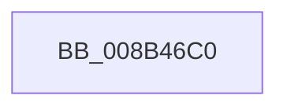

# CmKeyBodyRemapToVirtualForEnum

- RVA: `0x008B46C0`–`0x008B46E6` (길이 `38` bytes)
- VA: `0x00000001408B46C0`
- 실행 섹션: `PAGE`
- PDB 이름 있음: `예`; PDB Function 태그: `예`
- unwind 정보 RVA: `0x000827CC`
- 디코드: `10`개 명령, `38/38` bytes 표시
- 미해석 바이트: `0` (있으면 어셈블리에 `.byte`로 보존)

> 이 문서는 커널 이미지의 기계어와 PDB 기호를 분석해 생성했습니다. 4번과 5번은 함수 원형과 자료형을 바이너리 사용 방식에서 추정한 C 해석이며 원본 소스 복구 결과는 아닙니다.

## 1. Dependencies

- 직접 호출 지점: **0**; 고유 호출 대상: **0**
- 직접 호출자로 확인된 함수: **5**
- RIP 상대 이미지 참조: **1**

### Outgoing calls
- 직접 디코드된 call 명령이 없습니다.

### Direct callers
- [NtQueryKey](../86/NtQueryKey_function_008676E0.md) at `0x00867C15`
- [NtQueryMultipleValueKey](NtQueryMultipleValueKey_function_008B13B0.md) at `0x008B16E1`
- [NtEnumerateKey](NtEnumerateKey_function_008B1F70.md) at `0x008B214D`
- [NtQueryValueKey](NtQueryValueKey_function_008B2A00.md) at `0x008B2DD0`
- [NtEnumerateValueKey](NtEnumerateValueKey_function_008B3B50.md) at `0x008B3E3D`

### Static image references
- `0x008B46D5` → RVA `0x00E0A740` (`.data`; read)

## 2. Other-region calls and transfers

- 다른 실행 섹션으로 향하는 call: **0**
- 별도 외부 분기/꼬리 이동을 확인하지 못했습니다.

## 3. Assembly (complete function range)

```asm
008B46C0  4C 8B DC                        mov r11, rsp
008B46C3  55                              push rbp
008B46C4  53                              push rbx
008B46C5  56                              push rsi
008B46C6  57                              push rdi
008B46C7  49 8D AB 48 FC FF FF            lea rbp, [r11 - 0x3b8]
008B46CE  48 81 EC 98 04 00 00            sub rsp, 0x498
008B46D5  48 8B 05 64 60 55 00            mov rax, qword ptr [rip + 0x556064]
008B46DC  48 33 C4                        xor rax, rsp
008B46DF  48 89 85 70 03 00 00            mov qword ptr [rbp + 0x370], rax
```

## 4. C-style interpretation (structured pseudocode)

```c
__int64 __fastcall CmKeyBodyRemapToVirtualForEnum(void)
{
    __int64 result;
    __int64 v_rsp;

    v_rsp = (v_rsp) - (0x498ULL);
    result = (*(unsigned __int64 *)(v_rip + 5595236)) ^ (v_rsp);
    *(unsigned __int64 *)(v_rsp - 952 + 880) = result;
    return result;
}
```

## 5. (Beta) C Style

```c
void CmKeyBodyRemapToVirtualForEnum(void)
{
    int64_t result;
    int64_t local_rsp;

    local_rsp = (local_rsp) - (0x498ULL);
    result = (*(uint64_t *)(v_rip + 0x556064)) ^ (local_rsp);
    *(uint64_t *)(local_rsp - 0x3B8 + 0x370) = result;
    return result;
}
```

## 6. Execution-region graph

[열기: 2D/3D 그래프와 함수 탐색 컨트롤 패널](../../../control-panel.html?section=page&rva=0x008B46C0&view=graph)

- 2D 그래프는 위에서 아래로 흐르고, 3D 그래프는 빈 공간을 드래그해 회전합니다. Shift+드래그는 이동, 휠은 확대·축소, 함수 노드 선택은 대상 보고서 이동입니다.

### Static fallback


