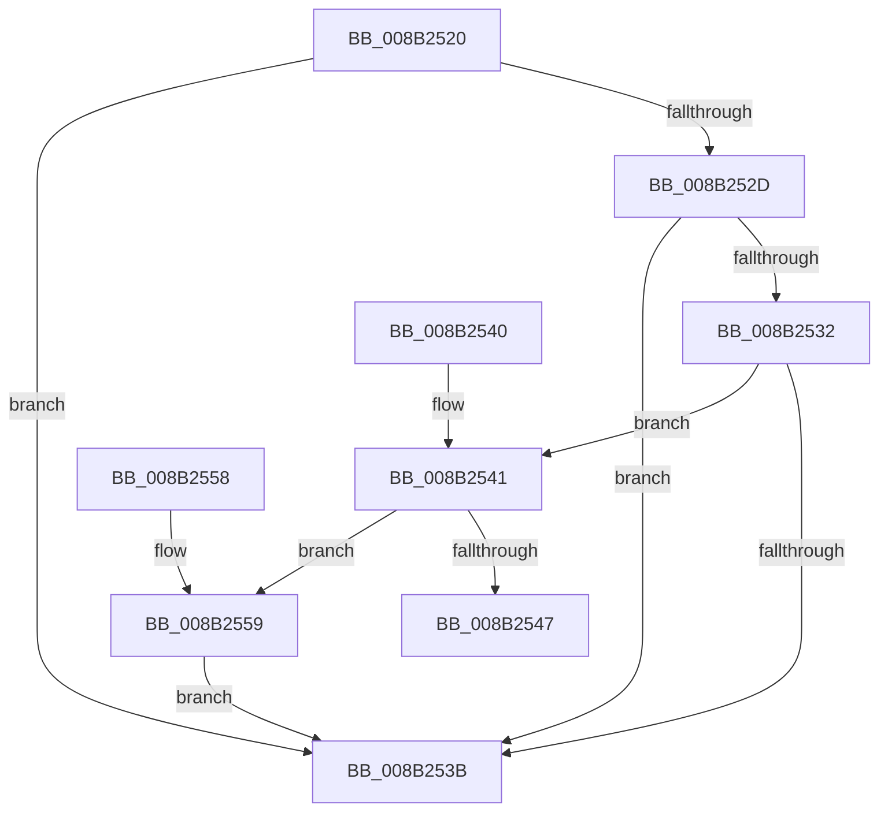

# CmpBounceContextCleanup

- RVA: `0x008B2520`–`0x008B2563` (길이 `67` bytes)
- VA: `0x00000001408B2520`
- 실행 섹션: `PAGE`
- PDB 이름 있음: `예`; PDB Function 태그: `아니요`
- unwind 정보 RVA: `0x000825E0`
- 디코드: `22`개 명령, `67/67` bytes 표시
- 미해석 바이트: `0` (있으면 어셈블리에 `.byte`로 보존)

> 이 문서는 커널 이미지의 기계어와 PDB 기호를 분석해 생성했습니다. 4번과 5번은 함수 원형과 자료형을 바이너리 사용 방식에서 추정한 C 해석이며 원본 소스 복구 결과는 아닙니다.

## 1. Dependencies

- 직접 호출 지점: **2**; 고유 호출 대상: **2**
- 직접 호출자로 확인된 함수: **2**
- RIP 상대 이미지 참조: **1**

### Outgoing calls
- `0x008B254E` → [ExFreeToLookasideListEx](../../text/38/ExFreeToLookasideListEx_function_0038ACC0.md) (function, `0x0038ACC0`)
- `0x008B255C` → [CmSiFreeMemory](../../text/47/CmSiFreeMemory_function_00475D80.md) (function, `0x00475D80`)

### Direct callers
- [NtQueryMultipleValueKey](NtQueryMultipleValueKey_function_008B13B0.md) at `0x008B18CD`
- [NtEnumerateKey](NtEnumerateKey_function_008B1F70.md) at `0x008B2349`

### Static image references
- `0x008B2547` → RVA `0x00E2CA40` (`.data`; read)

## 2. Other-region calls and transfers

- 다른 실행 섹션으로 향하는 call: **2**
  - `0x008B254E` → [ExFreeToLookasideListEx](../../text/38/ExFreeToLookasideListEx_function_0038ACC0.md) (`PAGE` → `.text`)
  - `0x008B255C` → [CmSiFreeMemory](../../text/47/CmSiFreeMemory_function_00475D80.md) (`PAGE` → `.text`)
- 별도 외부 분기/꼬리 이동을 확인하지 못했습니다.

## 3. Assembly (complete function range)

```asm
008B2520  48 83 EC 28                     sub rsp, 0x28
008B2524  48 8B 51 08                     mov rdx, qword ptr [rcx + 8]
008B2528  48 85 D2                        test rdx, rdx
008B252B  74 0E                           je 0x1408b253b
008B252D  48 3B 11                        cmp rdx, qword ptr [rcx]
008B2530  74 09                           je 0x1408b253b
008B2532  48 8D 41 11                     lea rax, [rcx + 0x11]
008B2536  48 3B D0                        cmp rdx, rax
008B2539  75 06                           jne 0x1408b2541
008B253B  48 83 C4 28                     add rsp, 0x28
008B253F  C3                              ret
008B2540  CC                              int3
008B2541  F6 41 10 01                     test byte ptr [rcx + 0x10], 1
008B2545  74 12                           je 0x1408b2559
008B2547  48 8D 0D F2 A4 57 00            lea rcx, [rip + 0x57a4f2]
008B254E  E8 6D 87 AD FF                  call 0x14038acc0
008B2553  48 83 C4 28                     add rsp, 0x28
008B2557  C3                              ret
008B2558  CC                              int3
008B2559  48 8B CA                        mov rcx, rdx
008B255C  E8 1F 38 BC FF                  call 0x140475d80
008B2561  EB D8                           jmp 0x1408b253b
```

## 4. C-style interpretation (structured pseudocode)

```c
__int64 __fastcall CmpBounceContextCleanup(__int64 a1)
{
    __int64 result;
    __int64 v_rsp;

    v_rsp = (v_rsp) - (40);
    if (*(unsigned __int64 *)(a1 + 8) == 0) goto loc_008B253B;
    if ((*(unsigned __int64 *)(a1 + 8)) == (*(unsigned __int64 *)(a1))) goto loc_008B253B;
    if ((*(unsigned __int64 *)(a1 + 8)) != (a1 + 17)) goto loc_008B2541;
loc_008B253B:
    v_rsp = (v_rsp) + (40);
    return a1 + 17;
loc_008B2541:
    if (((*(unsigned __int8 *)(a1 + 16)) & (1)) == 0) goto loc_008B2559;
    result = ExFreeToLookasideListEx(v_rip + 5743858, *(unsigned __int64 *)(a1 + 8), a3, a4);
    v_rsp = (v_rsp) + (40);
    return result;
loc_008B2559:
    result = CmSiFreeMemory(*(unsigned __int64 *)(a1 + 8), *(unsigned __int64 *)(a1 + 8), a3, a4);
    goto loc_008B253B;
}
```

## 5. (Beta) C Style

```c
void *CmpBounceContextCleanup(void *Arg1)
{
    uint8_t *arg1 = (uint8_t *)Arg1;

    int64_t result;
    int64_t local_rsp;

    local_rsp = (local_rsp) - (40);
    if (*(uint64_t *)(arg1 + 0x8) == 0) goto loc_008B253B;
    if ((*(uint64_t *)(arg1 + 0x8)) == (*(uint64_t *)(arg1))) goto loc_008B253B;
    if ((*(uint64_t *)(arg1 + 0x8)) != (Arg1 + 17)) goto loc_008B2541;
loc_008B253B:
    local_rsp = (local_rsp) + (40);
    return Arg1 + 17;
loc_008B2541:
    if (((*(uint8_t *)(arg1 + 0x10)) & (1)) == 0) goto loc_008B2559;
    result = ExFreeToLookasideListEx(v_rip + 5743858, *(uint64_t *)(arg1 + 0x8), a3, a4);
    local_rsp = (local_rsp) + (40);
    return result;
loc_008B2559:
    result = CmSiFreeMemory(*(uint64_t *)(arg1 + 0x8), *(uint64_t *)(arg1 + 0x8), a3, a4);
    goto loc_008B253B;
}
```

### 관측된 메모리 오프셋

구조체 형식이 확인되지 않은 접근은 인자 기준의 오프셋으로만 기록했습니다.

| 기준 인자 | 오프셋 표현 | 폭 (bit) | 접근 |
|---|---:|---:|---|
| `Arg1` | `+ 0x0` | `64` | `R` |
| `Arg1` | `+ 0x8` | `64` | `R` |
| `Arg1` | `+ 0x10` | `8` | `R` |
| `Arg1` | `+ 0x11` | `64` | `R` |

## 6. Execution-region graph

[열기: 2D/3D 그래프와 함수 탐색 컨트롤 패널](../../../control-panel.html?section=page&rva=0x008B2520&view=graph)

- 2D 그래프는 위에서 아래로 흐르고, 3D 그래프는 빈 공간을 드래그해 회전합니다. Shift+드래그는 이동, 휠은 확대·축소, 함수 노드 선택은 대상 보고서 이동입니다.

### Static fallback


