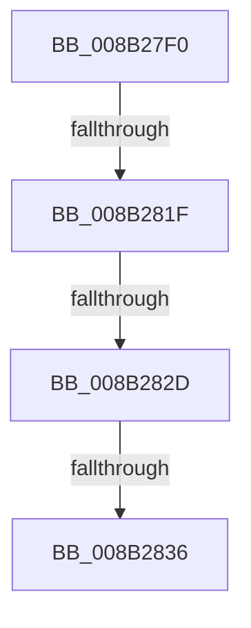

# CmpBounceContextStart

- RVA: `0x008B27F0`–`0x008B2845` (길이 `85` bytes)
- VA: `0x00000001408B27F0`
- 실행 섹션: `PAGE`
- PDB 이름 있음: `예`; PDB Function 태그: `아니요`
- unwind 정보 RVA: `0x00082620`
- 디코드: `19`개 명령, `85/85` bytes 표시
- 미해석 바이트: `0` (있으면 어셈블리에 `.byte`로 보존)

> 이 문서는 커널 이미지의 기계어와 PDB 기호를 분석해 생성했습니다. 4번과 5번은 함수 원형과 자료형을 바이너리 사용 방식에서 추정한 C 해석이며 원본 소스 복구 결과는 아닙니다.

## 1. Dependencies

- 직접 호출 지점: **0**; 고유 호출 대상: **0**
- 직접 호출자로 확인된 함수: **3**
- RIP 상대 이미지 참조: **3**

### Outgoing calls
- 직접 디코드된 call 명령이 없습니다.

### Direct callers
- [NtQueryMultipleValueKey](NtQueryMultipleValueKey_function_008B13B0.md) at `0x008B170D`
- [NtEnumerateKey](NtEnumerateKey_function_008B1F70.md) at `0x008B2174`
- [NtQueryValueKey](NtQueryValueKey_function_008B2A00.md) at `0x008B2DF8`

### Static image references
- `0x008B27FB` → RVA `0x00E0A740` (`.data`; read)
- `0x008B281F` → RVA `0x00EF7208` (`.data`; read)
- `0x008B2838` → RVA `0x00E09F58` (`.data`; read)

## 2. Other-region calls and transfers

- 다른 실행 섹션으로 향하는 call: **0**
- call이 아닌 외부 분기/꼬리 이동: **4**
  - `0x008B2819` → [sub_008B29A4 + 0x20](Unknown_function_008B29A4.md) (`tail-transfer`)
  - `0x008B2827` → [sub_008B29A4 + 0x13](Unknown_function_008B29A4.md) (`tail-transfer`)
  - `0x008B2830` → [sub_008B29A4](Unknown_function_008B29A4.md) (`tail-transfer`)
  - `0x008B283F` → [sub_008B28C6](Unknown_function_008B28C6.md) (`tail-transfer`)

## 3. Assembly (complete function range)

```asm
008B27F0  40 53                           push rbx
008B27F2  55                              push rbp
008B27F3  56                              push rsi
008B27F4  48 81 EC B0 00 00 00            sub rsp, 0xb0
008B27FB  48 8B 05 3E 7F 55 00            mov rax, qword ptr [rip + 0x557f3e]
008B2802  48 33 C4                        xor rax, rsp
008B2805  48 89 84 24 A0 00 00 00         mov qword ptr [rsp + 0xa0], rax
008B280D  48 89 11                        mov qword ptr [rcx], rdx
008B2810  49 8B D8                        mov rbx, r8
008B2813  48 8B F1                        mov rsi, rcx
008B2816  4D 85 C0                        test r8, r8
008B2819  0F 84 A5 01 00 00               je 0x1408b29c4
008B281F  48 83 3D E1 49 64 00 00         cmp qword ptr [rip + 0x6449e1], 0
008B2827  0F 84 8A 01 00 00               je 0x1408b29b7
008B282D  45 85 C9                        test r9d, r9d
008B2830  0F 84 6E 01 00 00               je 0x1408b29a4
008B2836  33 ED                           xor ebp, ebp
008B2838  83 3D 19 77 55 00 05            cmp dword ptr [rip + 0x557719], 5
008B283F  0F 87 81 00 00 00               ja 0x1408b28c6
```

## 4. C-style interpretation (structured pseudocode)

```c
__int64 __fastcall CmpBounceContextStart(__int64 a1, __int64 a2, __int64 a3, int a4)
{
    __int64 result;
    __int64 v_rbp;
    __int64 v_rsp;
    unsigned __int64 v_stack_m28;

    v_rsp = (v_rsp) - (176);
    result = (*(unsigned __int64 *)(v_rip + 5603134)) ^ (v_rsp);
    v_stack_m28 = result;
    *(unsigned __int64 *)(a1) = a2;
    v_rbp = 0;
}
```

## 5. (Beta) C Style

```c
int64_t CmpBounceContextStart(void *Arg1, int64_t Arg2, int64_t Arg3, int32_t Arg4)
{
    uint8_t *arg1 = (uint8_t *)Arg1;

    int64_t result;
    int64_t local_rbp;
    int64_t local_rsp;
    uint64_t v_stack_m28;

    local_rsp = (local_rsp) - (176);
    result = (*(uint64_t *)(v_rip + 0x557F3E)) ^ (local_rsp);
    v_stack_m28 = result;
    *(uint64_t *)(arg1) = Arg2;
    local_rbp = 0;
}
```

### 관측된 메모리 오프셋

구조체 형식이 확인되지 않은 접근은 인자 기준의 오프셋으로만 기록했습니다.

| 기준 인자 | 오프셋 표현 | 폭 (bit) | 접근 |
|---|---:|---:|---|
| `Arg1` | `+ 0x0` | `64` | `W` |

## 6. Execution-region graph

[열기: 2D/3D 그래프와 함수 탐색 컨트롤 패널](../../../control-panel.html?section=page&rva=0x008B27F0&view=graph)

- 2D 그래프는 위에서 아래로 흐르고, 3D 그래프는 빈 공간을 드래그해 회전합니다. Shift+드래그는 이동, 휠은 확대·축소, 함수 노드 선택은 대상 보고서 이동입니다.

### Static fallback


