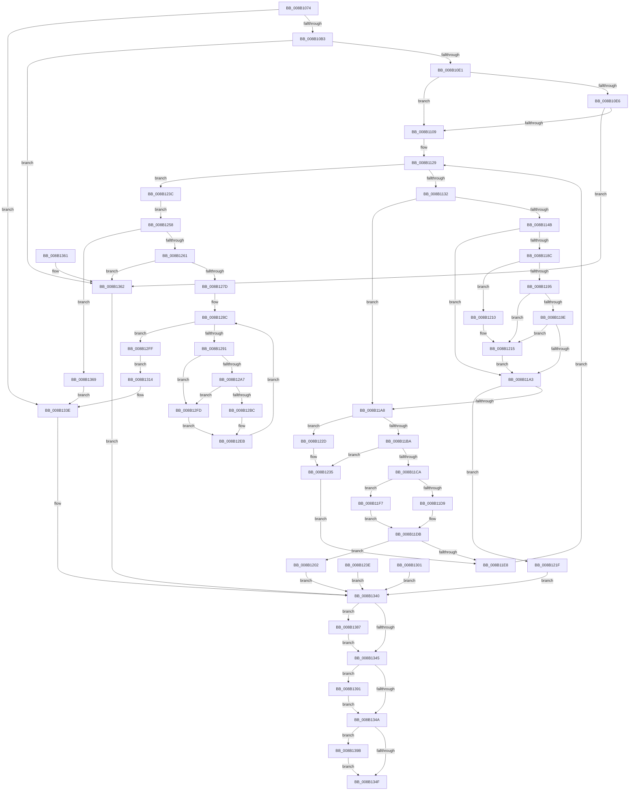

# CmpCaptureKeyValueArray

- RVA: `0x008B1074`–`0x008B13A5` (길이 `817` bytes)
- VA: `0x00000001408B1074`
- 실행 섹션: `PAGE`
- PDB 이름 있음: `예`; PDB Function 태그: `아니요`
- unwind 정보 RVA: `0x000824D0`
- 디코드: `225`개 명령, `817/817` bytes 표시
- 미해석 바이트: `0` (있으면 어셈블리에 `.byte`로 보존)

> 이 문서는 커널 이미지의 기계어와 PDB 기호를 분석해 생성했습니다. 4번과 5번은 함수 원형과 자료형을 바이너리 사용 방식에서 추정한 C 해석이며 원본 소스 복구 결과는 아닙니다.

## 1. Dependencies

- 직접 호출 지점: **10**; 고유 호출 대상: **5**
- 직접 호출자로 확인된 함수: **1**
- RIP 상대 이미지 참조: **0**

### Outgoing calls
- `0x008B10CB` → [CmpAllocateTransientPoolWithQuota](../../text/46/CmpAllocateTransientPoolWithQuota_function_00461190.md) (function, `0x00461190`)
- `0x008B10F3` → [CmpAllocateTransientPoolWithQuota](../../text/46/CmpAllocateTransientPoolWithQuota_function_00461190.md) (function, `0x00461190`)
- `0x008B11C1` → [CmpDoesBufferRequireCapturing](../84/CmpDoesBufferRequireCapturing_function_00848DF0.md) (function, `0x00848DF0`)
- `0x008B1210` → [ExRaiseDatatypeMisalignment](../89/ExRaiseDatatypeMisalignment_function_00899FD0.md) (function, `0x00899FD0`)
- `0x008B1267` → [CmpAllocateTransientPoolWithQuota](../../text/46/CmpAllocateTransientPoolWithQuota_function_00461190.md) (function, `0x00461190`)
- `0x008B12B3` → [CmpDoesBufferRequireCapturing](../84/CmpDoesBufferRequireCapturing_function_00848DF0.md) (function, `0x00848DF0`)
- `0x008B12C6` → [memcpy](../../text/6C/memcpy_function_006C6840.md) (function, `0x006C6840`)
- `0x008B138A` → [CmSiFreeMemory](../../text/47/CmSiFreeMemory_function_00475D80.md) (function, `0x00475D80`)
- `0x008B1394` → [CmSiFreeMemory](../../text/47/CmSiFreeMemory_function_00475D80.md) (function, `0x00475D80`)
- `0x008B139E` → [CmSiFreeMemory](../../text/47/CmSiFreeMemory_function_00475D80.md) (function, `0x00475D80`)

### Direct callers
- [NtQueryMultipleValueKey](NtQueryMultipleValueKey_function_008B13B0.md) at `0x008B160D`

### Static image references
- 디코드된 RIP-relative 메모리 참조가 없습니다.

## 2. Other-region calls and transfers

- 다른 실행 섹션으로 향하는 call: **7**
  - `0x008B10CB` → [CmpAllocateTransientPoolWithQuota](../../text/46/CmpAllocateTransientPoolWithQuota_function_00461190.md) (`PAGE` → `.text`)
  - `0x008B10F3` → [CmpAllocateTransientPoolWithQuota](../../text/46/CmpAllocateTransientPoolWithQuota_function_00461190.md) (`PAGE` → `.text`)
  - `0x008B1267` → [CmpAllocateTransientPoolWithQuota](../../text/46/CmpAllocateTransientPoolWithQuota_function_00461190.md) (`PAGE` → `.text`)
  - `0x008B12C6` → [memcpy](../../text/6C/memcpy_function_006C6840.md) (`PAGE` → `.text`)
  - `0x008B138A` → [CmSiFreeMemory](../../text/47/CmSiFreeMemory_function_00475D80.md) (`PAGE` → `.text`)
  - `0x008B1394` → [CmSiFreeMemory](../../text/47/CmSiFreeMemory_function_00475D80.md) (`PAGE` → `.text`)
  - `0x008B139E` → [CmSiFreeMemory](../../text/47/CmSiFreeMemory_function_00475D80.md) (`PAGE` → `.text`)
- 별도 외부 분기/꼬리 이동을 확인하지 못했습니다.

## 3. Assembly (complete function range)

```asm
008B1074  48 8B C4                        mov rax, rsp
008B1077  4C 89 48 20                     mov qword ptr [rax + 0x20], r9
008B107B  44 88 40 18                     mov byte ptr [rax + 0x18], r8b
008B107F  89 50 10                        mov dword ptr [rax + 0x10], edx
008B1082  48 89 48 08                     mov qword ptr [rax + 8], rcx
008B1086  53                              push rbx
008B1087  56                              push rsi
008B1088  57                              push rdi
008B1089  41 54                           push r12
008B108B  41 55                           push r13
008B108D  41 56                           push r14
008B108F  41 57                           push r15
008B1091  48 83 EC 70                     sub rsp, 0x70
008B1095  45 0F BE E0                     movsx r12d, r8b
008B1099  44 8B EA                        mov r13d, edx
008B109C  33 FF                           xor edi, edi
008B109E  8B F7                           mov esi, edi
008B10A0  44 8B F7                        mov r14d, edi
008B10A3  48 89 7C 24 38                  mov qword ptr [rsp + 0x38], rdi
008B10A8  44 8B FF                        mov r15d, edi
008B10AB  85 D2                           test edx, edx
008B10AD  0F 84 8B 02 00 00               je 0x1408b133e
008B10B3  41 8B DD                        mov ebx, r13d
008B10B6  4A 8D 14 6D 00 00 00 00         lea rdx, [r13*2]
008B10BE  49 03 D5                        add rdx, r13
008B10C1  48 C1 E2 03                     shl rdx, 3
008B10C5  41 B8 43 4D 38 33               mov r8d, 0x33384d43
008B10CB  E8 C0 00 BB FF                  call 0x140461190
008B10D0  48 8B F0                        mov rsi, rax
008B10D3  48 89 44 24 48                  mov qword ptr [rsp + 0x48], rax
008B10D8  48 85 C0                        test rax, rax
008B10DB  0F 84 81 02 00 00               je 0x1408b1362
008B10E1  45 84 E4                        test r12b, r12b
008B10E4  74 23                           je 0x1408b1109
008B10E6  48 C1 E3 04                     shl rbx, 4
008B10EA  41 B8 43 4D 38 33               mov r8d, 0x33384d43
008B10F0  48 8B D3                        mov rdx, rbx
008B10F3  E8 98 00 BB FF                  call 0x140461190
008B10F8  4C 8B F0                        mov r14, rax
008B10FB  48 89 44 24 38                  mov qword ptr [rsp + 0x38], rax
008B1100  48 85 C0                        test rax, rax
008B1103  0F 84 59 02 00 00               je 0x1408b1362
008B1109  48 8B D7                        mov rdx, rdi
008B110C  48 89 54 24 28                  mov qword ptr [rsp + 0x28], rdx
008B1111  8B C7                           mov eax, edi
008B1113  89 44 24 20                     mov dword ptr [rsp + 0x20], eax
008B1117  49 BA 00 00 FF FF FF 7F 00 00   movabs r10, 0x7fffffff0000
008B1121  4C 8B 8C 24 B0 00 00 00         mov r9, qword ptr [rsp + 0xb0]
008B1129  41 3B C5                        cmp eax, r13d
008B112C  0F 83 0A 01 00 00               jae 0x1408b123c
008B1132  44 8B C0                        mov r8d, eax
008B1135  4B 8D 0C 40                     lea rcx, [r8 + r8*2]
008B1139  48 8D 04 CE                     lea rax, [rsi + rcx*8]
008B113D  48 89 44 24 50                  mov qword ptr [rsp + 0x50], rax
008B1142  49 8B 14 C9                     mov rdx, qword ptr [r9 + rcx*8]
008B1146  45 84 E4                        test r12b, r12b
008B1149  74 5D                           je 0x1408b11a8
008B114B  49 C1 E0 04                     shl r8, 4
008B114F  4D 03 C6                        add r8, r14
008B1152  4C 89 44 24 30                  mov qword ptr [rsp + 0x30], r8
008B1157  0F 57 C0                        xorps xmm0, xmm0
008B115A  0F 11 44 24 58                  movups xmmword ptr [rsp + 0x58], xmm0
008B115F  49 3B D2                        cmp rdx, r10
008B1162  49 0F 43 D2                     cmovae rdx, r10
008B1166  90                              nop
008B1167  8B 02                           mov eax, dword ptr [rdx]
008B1169  89 44 24 58                     mov dword ptr [rsp + 0x58], eax
008B116D  48 8B 42 08                     mov rax, qword ptr [rdx + 8]
008B1171  48 89 44 24 60                  mov qword ptr [rsp + 0x60], rax
008B1176  0F 10 44 24 58                  movups xmm0, xmmword ptr [rsp + 0x58]
008B117B  48 8B 54 24 30                  mov rdx, qword ptr [rsp + 0x30]
008B1180  F3 0F 7F 02                     movdqu xmmword ptr [rdx], xmm0
008B1184  0F B7 02                        movzx eax, word ptr [rdx]
008B1187  66 85 C0                        test ax, ax
008B118A  74 17                           je 0x1408b11a3
008B118C  48 8B 4A 08                     mov rcx, qword ptr [rdx + 8]
008B1190  F6 C1 01                        test cl, 1
008B1193  75 7B                           jne 0x1408b1210
008B1195  4C 8D 04 01                     lea r8, [rcx + rax]
008B1199  4D 3B C2                        cmp r8, r10
008B119C  77 77                           ja 0x1408b1215
008B119E  4C 3B C1                        cmp r8, rcx
008B11A1  72 72                           jb 0x1408b1215
008B11A3  F6 02 01                        test byte ptr [rdx], 1
008B11A6  75 77                           jne 0x1408b121f
008B11A8  48 8B 44 24 50                  mov rax, qword ptr [rsp + 0x50]
008B11AD  48 89 10                        mov qword ptr [rax], rdx
008B11B0  44 0F B7 02                     movzx r8d, word ptr [rdx]
008B11B4  66 45 85 C0                     test r8w, r8w
008B11B8  74 73                           je 0x1408b122d
008B11BA  41 8B CC                        mov ecx, r12d
008B11BD  48 8B 52 08                     mov rdx, qword ptr [rdx + 8]
008B11C1  E8 2A 7C F9 FF                  call 0x140848df0
008B11C6  84 C0                           test al, al
008B11C8  74 6B                           je 0x1408b1235
008B11CA  41 8B D0                        mov edx, r8d
008B11CD  48 03 54 24 28                  add rdx, qword ptr [rsp + 0x28]
008B11D2  48 3B 54 24 28                  cmp rdx, qword ptr [rsp + 0x28]
008B11D7  72 1E                           jb 0x1408b11f7
008B11D9  8B C7                           mov eax, edi
008B11DB  48 89 54 24 28                  mov qword ptr [rsp + 0x28], rdx
008B11E0  89 44 24 24                     mov dword ptr [rsp + 0x24], eax
008B11E4  85 C0                           test eax, eax
008B11E6  78 1A                           js 0x1408b1202
008B11E8  8B 44 24 20                     mov eax, dword ptr [rsp + 0x20]
008B11EC  FF C0                           inc eax
008B11EE  89 44 24 20                     mov dword ptr [rsp + 0x20], eax
008B11F2  E9 32 FF FF FF                  jmp 0x1408b1129
008B11F7  48 83 CA FF                     or rdx, 0xffffffffffffffff
008B11FB  B8 95 00 00 C0                  mov eax, 0xc0000095
008B1200  EB D9                           jmp 0x1408b11db
008B1202  BB 9A 00 00 C0                  mov ebx, 0xc000009a
008B1207  89 5C 24 24                     mov dword ptr [rsp + 0x24], ebx
008B120B  E9 30 01 00 00                  jmp 0x1408b1340
008B1210  E8 BB 8D FE FF                  call 0x140899fd0
008B1215  41 8A 02                        mov al, byte ptr [r10]
008B1218  48 8B 54 24 30                  mov rdx, qword ptr [rsp + 0x30]
008B121D  EB 84                           jmp 0x1408b11a3
008B121F  BB 0D 00 00 C0                  mov ebx, 0xc000000d
008B1224  89 5C 24 24                     mov dword ptr [rsp + 0x24], ebx
008B1228  E9 13 01 00 00                  jmp 0x1408b1340
008B122D  48 89 7A 08                     mov qword ptr [rdx + 8], rdi
008B1231  66 89 7A 02                     mov word ptr [rdx + 2], di
008B1235  48 8B 54 24 28                  mov rdx, qword ptr [rsp + 0x28]
008B123A  EB AC                           jmp 0x1408b11e8
008B123C  EB 1A                           jmp 0x1408b1258
008B123E  8B D8                           mov ebx, eax
008B1240  89 44 24 24                     mov dword ptr [rsp + 0x24], eax
008B1244  33 FF                           xor edi, edi
008B1246  48 8B 74 24 48                  mov rsi, qword ptr [rsp + 0x48]
008B124B  4C 8B 74 24 38                  mov r14, qword ptr [rsp + 0x38]
008B1250  44 8B FF                        mov r15d, edi
008B1253  E9 E8 00 00 00                  jmp 0x1408b1340
008B1258  48 85 D2                        test rdx, rdx
008B125B  0F 84 08 01 00 00               je 0x1408b1369
008B1261  41 B8 43 4D 38 33               mov r8d, 0x33384d43
008B1267  E8 24 FF BA FF                  call 0x140461190
008B126C  4C 8B F8                        mov r15, rax
008B126F  48 89 44 24 40                  mov qword ptr [rsp + 0x40], rax
008B1274  48 85 C0                        test rax, rax
008B1277  0F 84 E5 00 00 00               je 0x1408b1362
008B127D  4C 8B C7                        mov r8, rdi
008B1280  48 89 7C 24 30                  mov qword ptr [rsp + 0x30], rdi
008B1285  44 8B E7                        mov r12d, edi
008B1288  89 7C 24 20                     mov dword ptr [rsp + 0x20], edi
008B128C  45 3B E5                        cmp r12d, r13d
008B128F  73 6E                           jae 0x1408b12ff
008B1291  41 8B C4                        mov eax, r12d
008B1294  48 8D 0C 40                     lea rcx, [rax + rax*2]
008B1298  4C 8B 2C CE                     mov r13, qword ptr [rsi + rcx*8]
008B129C  45 0F B7 4D 00                  movzx r9d, word ptr [r13]
008B12A1  66 45 85 C9                     test r9w, r9w
008B12A5  74 56                           je 0x1408b12fd
008B12A7  49 8B 55 08                     mov rdx, qword ptr [r13 + 8]
008B12AB  0F BE 8C 24 C0 00 00 00         movsx ecx, byte ptr [rsp + 0xc0]
008B12B3  E8 38 7B F9 FF                  call 0x140848df0
008B12B8  84 C0                           test al, al
008B12BA  74 41                           je 0x1408b12fd
008B12BC  4B 8D 1C 38                     lea rbx, [r8 + r15]
008B12C0  45 8B C1                        mov r8d, r9d
008B12C3  48 8B CB                        mov rcx, rbx
008B12C6  E8 75 55 E1 FF                  call 0x1406c6840
008B12CB  49 89 5D 08                     mov qword ptr [r13 + 8], rbx
008B12CF  41 0F B7 45 00                  movzx eax, word ptr [r13]
008B12D4  66 41 89 45 02                  mov word ptr [r13 + 2], ax
008B12D9  4C 8B 44 24 30                  mov r8, qword ptr [rsp + 0x30]
008B12DE  4C 03 C0                        add r8, rax
008B12E1  4C 89 44 24 30                  mov qword ptr [rsp + 0x30], r8
008B12E6  4C 89 44 24 68                  mov qword ptr [rsp + 0x68], r8
008B12EB  41 FF C4                        inc r12d
008B12EE  44 89 64 24 20                  mov dword ptr [rsp + 0x20], r12d
008B12F3  44 8B AC 24 B8 00 00 00         mov r13d, dword ptr [rsp + 0xb8]
008B12FB  EB 8F                           jmp 0x1408b128c
008B12FD  EB EC                           jmp 0x1408b12eb
008B12FF  EB 13                           jmp 0x1408b1314
008B1301  8B D8                           mov ebx, eax
008B1303  48 8B 74 24 48                  mov rsi, qword ptr [rsp + 0x48]
008B1308  4C 8B 74 24 38                  mov r14, qword ptr [rsp + 0x38]
008B130D  4C 8B 7C 24 40                  mov r15, qword ptr [rsp + 0x40]
008B1312  EB 2C                           jmp 0x1408b1340
008B1314  48 8B 84 24 C8 00 00 00         mov rax, qword ptr [rsp + 0xc8]
008B131C  48 89 30                        mov qword ptr [rax], rsi
008B131F  48 8B F7                        mov rsi, rdi
008B1322  48 8B 84 24 D0 00 00 00         mov rax, qword ptr [rsp + 0xd0]
008B132A  4C 89 30                        mov qword ptr [rax], r14
008B132D  4C 8B F7                        mov r14, rdi
008B1330  48 8B 84 24 D8 00 00 00         mov rax, qword ptr [rsp + 0xd8]
008B1338  4C 89 38                        mov qword ptr [rax], r15
008B133B  4C 8B FF                        mov r15, rdi
008B133E  8B DF                           mov ebx, edi
008B1340  48 85 F6                        test rsi, rsi
008B1343  75 42                           jne 0x1408b1387
008B1345  4D 85 F6                        test r14, r14
008B1348  75 47                           jne 0x1408b1391
008B134A  4D 85 FF                        test r15, r15
008B134D  75 4C                           jne 0x1408b139b
008B134F  8B C3                           mov eax, ebx
008B1351  48 83 C4 70                     add rsp, 0x70
008B1355  41 5F                           pop r15
008B1357  41 5E                           pop r14
008B1359  41 5D                           pop r13
008B135B  41 5C                           pop r12
008B135D  5F                              pop rdi
008B135E  5E                              pop rsi
008B135F  5B                              pop rbx
008B1360  C3                              ret
008B1361  CC                              int3
008B1362  BB 9A 00 00 C0                  mov ebx, 0xc000009a
008B1367  EB D7                           jmp 0x1408b1340
008B1369  48 8B 84 24 C8 00 00 00         mov rax, qword ptr [rsp + 0xc8]
008B1371  48 89 30                        mov qword ptr [rax], rsi
008B1374  48 8B F7                        mov rsi, rdi
008B1377  48 8B 84 24 D0 00 00 00         mov rax, qword ptr [rsp + 0xd0]
008B137F  4C 89 30                        mov qword ptr [rax], r14
008B1382  4C 8B F7                        mov r14, rdi
008B1385  EB B7                           jmp 0x1408b133e
008B1387  48 8B CE                        mov rcx, rsi
008B138A  E8 F1 49 BC FF                  call 0x140475d80
008B138F  EB B4                           jmp 0x1408b1345
008B1391  49 8B CE                        mov rcx, r14
008B1394  E8 E7 49 BC FF                  call 0x140475d80
008B1399  EB AF                           jmp 0x1408b134a
008B139B  49 8B CF                        mov rcx, r15
008B139E  E8 DD 49 BC FF                  call 0x140475d80
008B13A3  EB AA                           jmp 0x1408b134f
```

## 4. C-style interpretation (structured pseudocode)

```c
__int64 __fastcall CmpCaptureKeyValueArray(__int64 a1, int a2, unsigned __int8 a3, __int64 a4, __int64 a5, __int64 a6)
{
    __int64 result;
    __int64 v_r12;
    __int64 v_rbx;
    __int64 v_rdi;
    __int64 v_rsp;
    unsigned __int64 v_stack_m40;
    unsigned __int64 v_stack_m48;
    unsigned __int64 v_stack_m50;
    unsigned __int64 v_stack_m58;
    unsigned __int64 v_stack_m60;
    unsigned __int64 v_stack_m68;
    unsigned __int64 v_stack_m70;
    unsigned __int64 v_stack_m78;
    unsigned __int64 v_stack_m80;
    unsigned int v_stack_m84;
    unsigned int v_stack_m88;
    unsigned int v_stack_p10;
    unsigned __int8 v_stack_p18;
    unsigned __int64 v_stack_p20;
    unsigned __int64 v_stack_p8;
    unsigned __int64 v_stack_pC8;

    *(unsigned __int64 *)(v_rsp + 32) = a4;
    *(unsigned __int8 *)(v_rsp + 24) = a3;
    *(unsigned int *)(v_rsp + 16) = a2;
    *(unsigned __int64 *)(v_rsp + 8) = a1;
    v_rsp = (v_rsp) - (112);
    v_rdi = 0;
    v_stack_m70 = 0;
    if (a2 == 0) goto loc_008B133E;
    a2 = ((unsigned int)(a2) * 2) + ((unsigned int)(a2));
    a2 = (a2) << (3);
    result = CmpAllocateTransientPoolWithQuota(a1, a2, (unsigned int)(0x33384D43ULL), a4);
    v_stack_m60 = result;
    if (result == 0) goto loc_008B1362;
    if ((unsigned __int8)((__int8)(a3)) == 0) goto loc_008B1109;
    v_rbx = ((unsigned int)((unsigned int)((unsigned int)(a2)))) << (4);
    result = CmpAllocateTransientPoolWithQuota(a1, v_rbx, (unsigned int)(0x33384D43ULL), a4);
    v_stack_m70 = result;
    if (result == 0) goto loc_008B1362;
loc_008B1109:
    v_stack_m80 = 0;
    v_stack_m88 = 0;
loc_008B1129:
    if (0 >= ((unsigned int)((unsigned int)(a2)))) goto loc_008B123C;
    v_stack_m58 = result + 0 + 0 * 2 * 8;
    if ((unsigned __int8)((__int8)(a3)) == 0) goto loc_008B11A8;
    a3 = (0) << (4);
    a3 = (a3) + (result);
    v_stack_m78 = a3;
    v_stack_m50 = v_xmm0;
    a2 = *(unsigned __int64 *)(v_stack_p8 + 0 + 0 * 2 * 8);
    if ((*(unsigned __int64 *)(v_stack_p8 + 0 + 0 * 2 * 8)) >= v_r10) { a2 = v_r10; }
    v_stack_m50 = (unsigned int)((unsigned int)(*(unsigned int *)(a2)));
    v_stack_m48 = *(unsigned __int64 *)(a2 + 8);
    *(unsigned __int64 *)(v_stack_m78) = v_xmm0;
    if ((unsigned __int16)(*(unsigned __int16 *)(v_stack_m78)) == 0) goto loc_008B11A3;
    if ((((unsigned __int8)(*(unsigned __int64 *)(v_stack_m78 + 8))) & (1)) != 0) goto loc_008B1210;
    if ((*(unsigned __int64 *)(v_stack_m78 + 8) + *(unsigned __int16 *)(v_stack_m78) * 1) > v_r10) goto loc_008B1215;
    if ((*(unsigned __int64 *)(v_stack_m78 + 8) + *(unsigned __int16 *)(v_stack_m78) * 1) < (*(unsigned __int64 *)(v_stack_m78 + 8))) goto loc_008B1215;
loc_008B11A3:
    if (((*(unsigned __int8 *)(v_stack_m78)) & (1)) != 0) goto loc_008B121F;
loc_008B11A8:
    *(unsigned __int64 *)(v_stack_m58) = v_stack_m78;
    if ((unsigned __int16)(*(unsigned __int16 *)(v_stack_m78)) == 0) goto loc_008B122D;
    result = CmpDoesBufferRequireCapturing((unsigned int)((unsigned int)((__int8)(a3))), *(unsigned __int64 *)(v_stack_m78 + 8), *(unsigned __int16 *)(v_stack_m78), v_stack_p8);
    if ((unsigned __int8)(result) == 0) goto loc_008B1235;
    a2 = ((unsigned int)((unsigned int)(*(unsigned __int16 *)(v_stack_m78)))) + (v_stack_m80);
    if (a2 < v_stack_m80) goto loc_008B11F7;
loc_008B11DB:
    v_stack_m80 = a2;
    v_stack_m84 = 0;
    if (sign_flag) goto loc_008B1202;
loc_008B11E8:
    result = (unsigned int)(((unsigned int)(v_stack_m88)) + 1);
    v_stack_m88 = (unsigned int)(result);
    goto loc_008B1129;
loc_008B11F7:
    a2 = (a2) | (-1);
    goto loc_008B11DB;
loc_008B1202:
    v_stack_m84 = (unsigned int)((unsigned int)(0xC000009AULL));
    goto loc_008B1340;
loc_008B1210:
    result = ExRaiseDatatypeMisalignment((unsigned int)((unsigned int)((__int8)(a3))), a2, *(unsigned __int16 *)(v_stack_m78), v_stack_p8);
loc_008B1215:
    goto loc_008B11A3;
loc_008B121F:
    v_stack_m84 = (unsigned int)((unsigned int)(0xC000000DULL));
    goto loc_008B1340;
loc_008B122D:
    *(unsigned __int64 *)(v_stack_m78 + 8) = 0;
    *(unsigned __int16 *)(v_stack_m78 + 2) = 0;
loc_008B1235:
    goto loc_008B11E8;
loc_008B123C:
    goto loc_008B1258;
loc_008B1258:
    if (v_stack_m80 == 0) goto loc_008B1369;
    result = CmpAllocateTransientPoolWithQuota((unsigned int)((unsigned int)((__int8)(a3))), v_stack_m80, (unsigned int)(0x33384D43ULL), v_stack_p8);
    v_stack_m68 = result;
    if (result == 0) goto loc_008B1362;
    v_stack_m78 = 0;
    v_stack_m88 = 0;
loc_008B128C:
    if (0 >= ((unsigned int)((unsigned int)(a2)))) goto loc_008B12FF;
    if ((unsigned __int16)(*(unsigned __int16 *)(*(unsigned __int64 *)(result + 0 + 0 * 2 * 8))) == 0) goto loc_008B12FD;
    result = CmpDoesBufferRequireCapturing((__int8)(v_stack_p18), *(unsigned __int64 *)(*(unsigned __int64 *)(result + 0 + 0 * 2 * 8) + 8), 0, *(unsigned __int16 *)(*(unsigned __int64 *)(result + 0 + 0 * 2 * 8)));
    if ((unsigned __int8)(result) == 0) goto loc_008B12FD;
    result = memcpy(0 + result * 1, *(unsigned __int64 *)(*(unsigned __int64 *)(result + 0 + 0 * 2 * 8) + 8), (unsigned int)((unsigned int)(*(unsigned __int16 *)(*(unsigned __int64 *)(result + 0 + 0 * 2 * 8)))), *(unsigned __int16 *)(*(unsigned __int64 *)(result + 0 + 0 * 2 * 8)));
    *(unsigned __int64 *)(*(unsigned __int64 *)(result + 0 + 0 * 2 * 8) + 8) = 0 + result * 1;
    *(unsigned __int16 *)(*(unsigned __int64 *)(result + 0 + 0 * 2 * 8) + 2) = (unsigned __int16)(*(unsigned __int16 *)(*(unsigned __int64 *)(result + 0 + 0 * 2 * 8)));
    a3 = (v_stack_m78) + (*(unsigned __int16 *)(*(unsigned __int64 *)(result + 0 + 0 * 2 * 8)));
    v_stack_m78 = a3;
    v_stack_m40 = a3;
loc_008B12EB:
    v_r12 = (unsigned int)((0) + 1);
    v_stack_m88 = (unsigned int)(v_r12);
    goto loc_008B128C;
loc_008B12FD:
    goto loc_008B12EB;
loc_008B12FF:
    goto loc_008B1314;
loc_008B1314:
    *(unsigned __int64 *)(v_stack_p20) = result;
    *(unsigned __int64 *)(a5) = result;
    *(unsigned __int64 *)(a6) = result;
loc_008B133E:
loc_008B1340:
    if (0 != 0) goto loc_008B1387;
loc_008B1345:
    if (0 != 0) goto loc_008B1391;
loc_008B134A:
    if (0 != 0) goto loc_008B139B;
loc_008B134F:
    v_rsp = (v_rsp) + (112);
    return 0;
loc_008B1362:
    goto loc_008B1340;
loc_008B1369:
    *(unsigned __int64 *)(v_stack_pC8) = 0;
    *(unsigned __int64 *)(a5) = 0;
    goto loc_008B133E;
loc_008B1387:
    result = CmSiFreeMemory(0, *(unsigned __int64 *)(*(unsigned __int64 *)(result + 0 + 0 * 2 * 8) + 8), a3, *(unsigned __int16 *)(*(unsigned __int64 *)(result + 0 + 0 * 2 * 8)));
    goto loc_008B1345;
loc_008B1391:
    result = CmSiFreeMemory(0, *(unsigned __int64 *)(*(unsigned __int64 *)(result + 0 + 0 * 2 * 8) + 8), a3, *(unsigned __int16 *)(*(unsigned __int64 *)(result + 0 + 0 * 2 * 8)));
    goto loc_008B134A;
loc_008B139B:
    result = CmSiFreeMemory(0, *(unsigned __int64 *)(*(unsigned __int64 *)(result + 0 + 0 * 2 * 8) + 8), a3, *(unsigned __int16 *)(*(unsigned __int64 *)(result + 0 + 0 * 2 * 8)));
    goto loc_008B134F;
}
```

## 5. (Beta) C Style

```c
int64_t CmpCaptureKeyValueArray(int64_t Arg1, int32_t Arg2, uint8_t Arg3, int64_t Arg4, void *Arg5, void *Arg6)
{
    uint8_t *arg5 = (uint8_t *)Arg5;
    uint8_t *arg6 = (uint8_t *)Arg6;

    int64_t result;
    int64_t local_r12;
    int64_t local_rbx;
    int64_t local_rdi;
    int64_t local_rsp;
    uint64_t v_stack_m40;
    uint64_t v_stack_m48;
    uint64_t v_stack_m50;
    uint64_t v_stack_m58;
    uint64_t v_stack_m60;
    uint64_t v_stack_m68;
    uint64_t v_stack_m70;
    uint64_t v_stack_m78;
    uint64_t v_stack_m80;
    uint32_t v_stack_m84;
    uint32_t v_stack_m88;
    uint32_t v_stack_p10;
    uint8_t v_stack_p18;
    uint64_t v_stack_p20;
    uint64_t v_stack_p8;
    uint64_t v_stack_pC8;

    *(uint64_t *)(local_rsp + 0x20) = Arg4;
    *(uint8_t *)(local_rsp + 0x18) = Arg3;
    *(uint32_t *)(local_rsp + 0x10) = Arg2;
    *(uint64_t *)(local_rsp + 0x8) = Arg1;
    local_rsp = (local_rsp) - (112);
    local_rdi = 0;
    v_stack_m70 = 0;
    if (Arg2 == 0) goto loc_008B133E;
    Arg2 = ((uint32_t)(Arg2) * 2) + ((uint32_t)(Arg2));
    Arg2 = (Arg2) << (3);
    result = CmpAllocateTransientPoolWithQuota(Arg1, Arg2, (uint32_t)(0x33384D43ULL), Arg4);
    v_stack_m60 = result;
    if (result == 0) goto loc_008B1362;
    if ((uint8_t)((int8_t)(Arg3)) == 0) goto loc_008B1109;
    local_rbx = ((uint32_t)((uint32_t)((uint32_t)(Arg2)))) << (4);
    result = CmpAllocateTransientPoolWithQuota(Arg1, local_rbx, (uint32_t)(0x33384D43ULL), Arg4);
    v_stack_m70 = result;
    if (result == 0) goto loc_008B1362;
loc_008B1109:
    v_stack_m80 = 0;
    v_stack_m88 = 0;
loc_008B1129:
    if (0 >= ((uint32_t)((uint32_t)(Arg2)))) goto loc_008B123C;
    v_stack_m58 = result + 0 + 0 * 2 * 8;
    if ((uint8_t)((int8_t)(Arg3)) == 0) goto loc_008B11A8;
    Arg3 = (0) << (4);
    Arg3 = (Arg3) + (result);
    v_stack_m78 = Arg3;
    v_stack_m50 = v_xmm0;
    Arg2 = *(uint64_t *)(v_stack_p8 + 0x0 + 0x0 * 2 * 8);
    if ((*(uint64_t *)(v_stack_p8 + 0x0 + 0x0 * 2 * 8)) >= local_r10) { Arg2 = local_r10; }
    v_stack_m50 = (uint32_t)((uint32_t)(*(uint32_t *)(Arg2)));
    v_stack_m48 = *(uint64_t *)(Arg2 + 0x8);
    *(uint64_t *)(v_stack_m78) = v_xmm0;
    if ((uint16_t)(*(uint16_t *)(v_stack_m78)) == 0) goto loc_008B11A3;
    if ((((uint8_t)(*(uint64_t *)(v_stack_m78 + 0x8))) & (1)) != 0) goto loc_008B1210;
    if ((*(uint64_t *)(v_stack_m78 + 0x8) + *(uint16_t *)(v_stack_m78) * 1) > local_r10) goto loc_008B1215;
    if ((*(uint64_t *)(v_stack_m78 + 0x8) + *(uint16_t *)(v_stack_m78) * 1) < (*(uint64_t *)(v_stack_m78 + 0x8))) goto loc_008B1215;
loc_008B11A3:
    if (((*(uint8_t *)(v_stack_m78)) & (1)) != 0) goto loc_008B121F;
loc_008B11A8:
    *(uint64_t *)(v_stack_m58) = v_stack_m78;
    if ((uint16_t)(*(uint16_t *)(v_stack_m78)) == 0) goto loc_008B122D;
    result = CmpDoesBufferRequireCapturing((uint32_t)((uint32_t)((int8_t)(Arg3))), *(uint64_t *)(v_stack_m78 + 0x8), *(uint16_t *)(v_stack_m78), v_stack_p8);
    if ((uint8_t)(result) == 0) goto loc_008B1235;
    Arg2 = ((uint32_t)((uint32_t)(*(uint16_t *)(v_stack_m78)))) + (v_stack_m80);
    if (Arg2 < v_stack_m80) goto loc_008B11F7;
loc_008B11DB:
    v_stack_m80 = Arg2;
    v_stack_m84 = 0;
    if (sign_flag) goto loc_008B1202;
loc_008B11E8:
    result = (uint32_t)(((uint32_t)(v_stack_m88)) + 1);
    v_stack_m88 = (uint32_t)(result);
    goto loc_008B1129;
loc_008B11F7:
    Arg2 = (Arg2) | (-1);
    goto loc_008B11DB;
loc_008B1202:
    v_stack_m84 = (uint32_t)((uint32_t)(0xC000009AULL));
    goto loc_008B1340;
loc_008B1210:
    result = ExRaiseDatatypeMisalignment((uint32_t)((uint32_t)((int8_t)(Arg3))), Arg2, *(uint16_t *)(v_stack_m78), v_stack_p8);
loc_008B1215:
    goto loc_008B11A3;
loc_008B121F:
    v_stack_m84 = (uint32_t)((uint32_t)(0xC000000DULL));
    goto loc_008B1340;
loc_008B122D:
    *(uint64_t *)(v_stack_m78 + 0x8) = 0;
    *(uint16_t *)(v_stack_m78 + 0x2) = 0;
loc_008B1235:
    goto loc_008B11E8;
loc_008B123C:
    goto loc_008B1258;
loc_008B1258:
    if (v_stack_m80 == 0) goto loc_008B1369;
    result = CmpAllocateTransientPoolWithQuota((uint32_t)((uint32_t)((int8_t)(Arg3))), v_stack_m80, (uint32_t)(0x33384D43ULL), v_stack_p8);
    v_stack_m68 = result;
    if (result == 0) goto loc_008B1362;
    v_stack_m78 = 0;
    v_stack_m88 = 0;
loc_008B128C:
    if (0 >= ((uint32_t)((uint32_t)(Arg2)))) goto loc_008B12FF;
    if ((uint16_t)(*(uint16_t *)(*(uint64_t *)(result + 0x0 + 0x0 * 2 * 8))) == 0) goto loc_008B12FD;
    result = CmpDoesBufferRequireCapturing((int8_t)(v_stack_p18), *(uint64_t *)(*(uint64_t *)(result + 0x0 + 0x0 * 2 * 8) + 0x8), 0, *(uint16_t *)(*(uint64_t *)(result + 0x0 + 0x0 * 2 * 8)));
    if ((uint8_t)(result) == 0) goto loc_008B12FD;
    result = memcpy(0 + result * 1, *(uint64_t *)(*(uint64_t *)(result + 0x0 + 0x0 * 2 * 8) + 0x8), (uint32_t)((uint32_t)(*(uint16_t *)(*(uint64_t *)(result + 0x0 + 0x0 * 2 * 8)))), *(uint16_t *)(*(uint64_t *)(result + 0x0 + 0x0 * 2 * 8)));
    *(uint64_t *)(*(uint64_t *)(result + 0x0 + 0x0 * 2 * 8) + 0x8) = 0 + result * 1;
    *(uint16_t *)(*(uint64_t *)(result + 0x0 + 0x0 * 2 * 8) + 0x2) = (uint16_t)(*(uint16_t *)(*(uint64_t *)(result + 0x0 + 0x0 * 2 * 8)));
    Arg3 = (v_stack_m78) + (*(uint16_t *)(*(uint64_t *)(result + 0x0 + 0x0 * 2 * 8)));
    v_stack_m78 = Arg3;
    v_stack_m40 = Arg3;
loc_008B12EB:
    local_r12 = (uint32_t)((0) + 1);
    v_stack_m88 = (uint32_t)(local_r12);
    goto loc_008B128C;
loc_008B12FD:
    goto loc_008B12EB;
loc_008B12FF:
    goto loc_008B1314;
loc_008B1314:
    *(uint64_t *)(v_stack_p20) = result;
    *(uint64_t *)(arg5) = result;
    *(uint64_t *)(arg6) = result;
loc_008B133E:
loc_008B1340:
    if (0 != 0) goto loc_008B1387;
loc_008B1345:
    if (0 != 0) goto loc_008B1391;
loc_008B134A:
    if (0 != 0) goto loc_008B139B;
loc_008B134F:
    local_rsp = (local_rsp) + (112);
    return 0;
loc_008B1362:
    goto loc_008B1340;
loc_008B1369:
    *(uint64_t *)(v_stack_pC8) = 0;
    *(uint64_t *)(arg5) = 0;
    goto loc_008B133E;
loc_008B1387:
    result = CmSiFreeMemory(0, *(uint64_t *)(*(uint64_t *)(result + 0x0 + 0x0 * 2 * 8) + 0x8), Arg3, *(uint16_t *)(*(uint64_t *)(result + 0x0 + 0x0 * 2 * 8)));
    goto loc_008B1345;
loc_008B1391:
    result = CmSiFreeMemory(0, *(uint64_t *)(*(uint64_t *)(result + 0x0 + 0x0 * 2 * 8) + 0x8), Arg3, *(uint16_t *)(*(uint64_t *)(result + 0x0 + 0x0 * 2 * 8)));
    goto loc_008B134A;
loc_008B139B:
    result = CmSiFreeMemory(0, *(uint64_t *)(*(uint64_t *)(result + 0x0 + 0x0 * 2 * 8) + 0x8), Arg3, *(uint16_t *)(*(uint64_t *)(result + 0x0 + 0x0 * 2 * 8)));
    goto loc_008B134F;
}
```

### 관측된 메모리 오프셋

구조체 형식이 확인되지 않은 접근은 인자 기준의 오프셋으로만 기록했습니다.

| 기준 인자 | 오프셋 표현 | 폭 (bit) | 접근 |
|---|---:|---:|---|
| `Arg5` | `+ 0x0` | `64` | `W` |
| `Arg6` | `+ 0x0` | `64` | `W` |

## 6. Execution-region graph

[열기: 2D/3D 그래프와 함수 탐색 컨트롤 패널](../../../control-panel.html?section=page&rva=0x008B1074&view=graph)

- 2D 그래프는 위에서 아래로 흐르고, 3D 그래프는 빈 공간을 드래그해 회전합니다. Shift+드래그는 이동, 휠은 확대·축소, 함수 노드 선택은 대상 보고서 이동입니다.

### Static fallback


