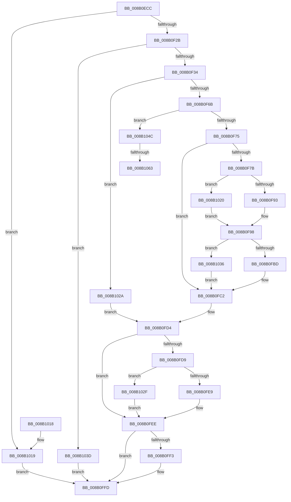

# CmpConcatenateValueLists

- RVA: `0x008B0ECC`–`0x008B106E` (길이 `418` bytes)
- VA: `0x00000001408B0ECC`
- 실행 섹션: `PAGE`
- PDB 이름 있음: `예`; PDB Function 태그: `예`
- unwind 정보 RVA: `0x000824A4`
- 디코드: `117`개 명령, `418/418` bytes 표시
- 미해석 바이트: `0` (있으면 어셈블리에 `.byte`로 보존)

> 이 문서는 커널 이미지의 기계어와 PDB 기호를 분석해 생성했습니다. 4번과 5번은 함수 원형과 자료형을 바이너리 사용 방식에서 추정한 C 해석이며 원본 소스 복구 결과는 아닙니다.

## 1. Dependencies

- 직접 호출 지점: **12**; 고유 호출 대상: **8**
- 직접 호출자로 확인된 함수: **1**
- RIP 상대 이미지 참조: **0**

### Outgoing calls
- `0x008B0F0C` → [HvpGetCellContextInitialize](../85/HvpGetCellContextInitialize_function_00855F10.md) (function, `0x00855F10`)
- `0x008B0F15` → [HvpGetCellContextInitialize](../85/HvpGetCellContextInitialize_function_00855F10.md) (function, `0x00855F10`)
- `0x008B0F58` → [HvAllocateCell](../85/HvAllocateCell_function_00859C94.md) (function, `0x00859C94`)
- `0x008B0F93` → [HvpGetCellFlat](../85/HvpGetCellFlat_function_00854C60.md) (function, `0x00854C60`)
- `0x008B0FA8` → [memcpy](../../text/6C/memcpy_function_006C6840.md) (function, `0x006C6840`)
- `0x008B0FBD` → [HvpReleaseCellPaged](../85/HvpReleaseCellPaged_function_00855F40.md) (function, `0x00855F40`)
- `0x008B0FE9` → [HvpReleaseCellPaged](../85/HvpReleaseCellPaged_function_00855F40.md) (function, `0x00855F40`)
- `0x008B0FF8` → [HvFreeCell](../85/HvFreeCell_function_0085A72C.md) (function, `0x0085A72C`)
- `0x008B1020` → [HvpGetCellPaged](../85/HvpGetCellPaged_function_00854CB0.md) (function, `0x00854CB0`)
- `0x008B102F` → [HvpReleaseCellFlat](../85/HvpReleaseCellFlat_function_0085CC20.md) (function, `0x0085CC20`)
- `0x008B1036` → [HvpReleaseCellFlat](../85/HvpReleaseCellFlat_function_0085CC20.md) (function, `0x0085CC20`)
- `0x008B1063` → [HvpGetCellFlat](../85/HvpGetCellFlat_function_00854C60.md) (function, `0x00854C60`)

### Direct callers
- [CmpFullPromoteSingleKeyFromKeyNodeStacks](CmpFullPromoteSingleKeyFromKeyNodeStacks_function_008B1A40.md) at `0x008B1C99`

### Static image references
- 디코드된 RIP-relative 메모리 참조가 없습니다.

## 2. Other-region calls and transfers

- 다른 실행 섹션으로 향하는 call: **1**
  - `0x008B0FA8` → [memcpy](../../text/6C/memcpy_function_006C6840.md) (`PAGE` → `.text`)
- call이 아닌 외부 분기/꼬리 이동: **2**
  - `0x008B105D` → [sub_00B1A6A6](../B1/Unknown_function_00B1A6A6.md) (`tail-transfer`)
  - `0x008B1069` → [sub_00B1A6A6 + 0x5](../B1/Unknown_function_00B1A6A6.md) (`tail-transfer`)

## 3. Assembly (complete function range)

```asm
008B0ECC  48 89 5C 24 08                  mov qword ptr [rsp + 8], rbx
008B0ED1  48 89 74 24 20                  mov qword ptr [rsp + 0x20], rsi
008B0ED6  55                              push rbp
008B0ED7  57                              push rdi
008B0ED8  41 54                           push r12
008B0EDA  41 56                           push r14
008B0EDC  41 57                           push r15
008B0EDE  48 8B EC                        mov rbp, rsp
008B0EE1  48 83 EC 40                     sub rsp, 0x40
008B0EE5  48 83 65 40 00                  and qword ptr [rbp + 0x40], 0
008B0EEA  48 8B D9                        mov rbx, rcx
008B0EED  48 83 65 F0 00                  and qword ptr [rbp - 0x10], 0
008B0EF2  48 8D 4D F0                     lea rcx, [rbp - 0x10]
008B0EF6  48 83 65 F8 00                  and qword ptr [rbp - 8], 0
008B0EFB  4D 8B F0                        mov r14, r8
008B0EFE  41 83 C8 FF                     or r8d, 0xffffffff
008B0F02  45 8B D1                        mov r10d, r9d
008B0F05  44 89 45 38                     mov dword ptr [rbp + 0x38], r8d
008B0F09  48 8B F2                        mov rsi, rdx
008B0F0C  E8 FF 4F FA FF                  call 0x140855f10
008B0F11  48 8D 4D 40                     lea rcx, [rbp + 0x40]
008B0F15  E8 F6 4F FA FF                  call 0x140855f10
008B0F1A  8B 12                           mov edx, dword ptr [rdx]
008B0F1C  45 8B 3E                        mov r15d, dword ptr [r14]
008B0F1F  44 03 FA                        add r15d, edx
008B0F22  44 3B FA                        cmp r15d, edx
008B0F25  0F 82 EE 00 00 00               jb 0x1408b1019
008B0F2B  45 85 FF                        test r15d, r15d
008B0F2E  0F 84 09 01 00 00               je 0x1408b103d
008B0F34  48 8D 45 F0                     lea rax, [rbp - 0x10]
008B0F38  45 8B C2                        mov r8d, r10d
008B0F3B  48 89 44 24 28                  mov qword ptr [rsp + 0x28], rax
008B0F40  42 8D 14 BD 00 00 00 00         lea edx, [r15*4]
008B0F48  48 8D 45 F8                     lea rax, [rbp - 8]
008B0F4C  48 8B CB                        mov rcx, rbx
008B0F4F  4C 8D 4D 38                     lea r9, [rbp + 0x38]
008B0F53  48 89 44 24 20                  mov qword ptr [rsp + 0x20], rax
008B0F58  E8 37 8D FA FF                  call 0x140859c94
008B0F5D  4C 8B 65 F8                     mov r12, qword ptr [rbp - 8]
008B0F61  8B F8                           mov edi, eax
008B0F63  85 C0                           test eax, eax
008B0F65  0F 88 BF 00 00 00               js 0x1408b102a
008B0F6B  33 FF                           xor edi, edi
008B0F6D  39 3E                           cmp dword ptr [rsi], edi
008B0F6F  0F 85 D7 00 00 00               jne 0x1408b104c
008B0F75  41 83 3E 00                     cmp dword ptr [r14], 0
008B0F79  74 47                           je 0x1408b0fc2
008B0F7B  F6 83 8C 00 00 00 01            test byte ptr [rbx + 0x8c], 1
008B0F82  4C 8D 45 40                     lea r8, [rbp + 0x40]
008B0F86  41 8B 56 04                     mov edx, dword ptr [r14 + 4]
008B0F8A  48 8B CB                        mov rcx, rbx
008B0F8D  0F 84 8D 00 00 00               je 0x1408b1020
008B0F93  E8 C8 3C FA FF                  call 0x140854c60
008B0F98  45 8B 06                        mov r8d, dword ptr [r14]
008B0F9B  48 8B D0                        mov rdx, rax
008B0F9E  8B C7                           mov eax, edi
008B0FA0  49 C1 E0 02                     shl r8, 2
008B0FA4  49 8D 0C 84                     lea rcx, [r12 + rax*4]
008B0FA8  E8 93 58 E1 FF                  call 0x1406c6840
008B0FAD  F6 83 8C 00 00 00 01            test byte ptr [rbx + 0x8c], 1
008B0FB4  48 8D 55 40                     lea rdx, [rbp + 0x40]
008B0FB8  48 8B CB                        mov rcx, rbx
008B0FBB  75 79                           jne 0x1408b1036
008B0FBD  E8 7E 4F FA FF                  call 0x140855f40
008B0FC2  48 8B 4D 50                     mov rcx, qword ptr [rbp + 0x50]
008B0FC6  83 CE FF                        or esi, 0xffffffff
008B0FC9  8B 45 38                        mov eax, dword ptr [rbp + 0x38]
008B0FCC  33 FF                           xor edi, edi
008B0FCE  44 89 39                        mov dword ptr [rcx], r15d
008B0FD1  89 41 04                        mov dword ptr [rcx + 4], eax
008B0FD4  4D 85 E4                        test r12, r12
008B0FD7  74 15                           je 0x1408b0fee
008B0FD9  F6 83 8C 00 00 00 01            test byte ptr [rbx + 0x8c], 1
008B0FE0  48 8D 55 F0                     lea rdx, [rbp - 0x10]
008B0FE4  48 8B CB                        mov rcx, rbx
008B0FE7  75 46                           jne 0x1408b102f
008B0FE9  E8 52 4F FA FF                  call 0x140855f40
008B0FEE  83 FE FF                        cmp esi, -1
008B0FF1  74 0A                           je 0x1408b0ffd
008B0FF3  8B D6                           mov edx, esi
008B0FF5  48 8B CB                        mov rcx, rbx
008B0FF8  E8 2F 97 FA FF                  call 0x14085a72c
008B0FFD  4C 8D 5C 24 40                  lea r11, [rsp + 0x40]
008B1002  8B C7                           mov eax, edi
008B1004  49 8B 5B 30                     mov rbx, qword ptr [r11 + 0x30]
008B1008  49 8B 73 48                     mov rsi, qword ptr [r11 + 0x48]
008B100C  49 8B E3                        mov rsp, r11
008B100F  41 5F                           pop r15
008B1011  41 5E                           pop r14
008B1013  41 5C                           pop r12
008B1015  5F                              pop rdi
008B1016  5D                              pop rbp
008B1017  C3                              ret
008B1018  CC                              int3
008B1019  BF 9A 00 00 C0                  mov edi, 0xc000009a
008B101E  EB DD                           jmp 0x1408b0ffd
008B1020  E8 8B 3C FA FF                  call 0x140854cb0
008B1025  E9 6E FF FF FF                  jmp 0x1408b0f98
008B102A  8B 75 38                        mov esi, dword ptr [rbp + 0x38]
008B102D  EB A5                           jmp 0x1408b0fd4
008B102F  E8 EC BB FA FF                  call 0x14085cc20
008B1034  EB B8                           jmp 0x1408b0fee
008B1036  E8 E5 BB FA FF                  call 0x14085cc20
008B103B  EB 85                           jmp 0x1408b0fc2
008B103D  48 8B 45 50                     mov rax, qword ptr [rbp + 0x50]
008B1041  83 20 00                        and dword ptr [rax], 0
008B1044  33 FF                           xor edi, edi
008B1046  44 89 40 04                     mov dword ptr [rax + 4], r8d
008B104A  EB B1                           jmp 0x1408b0ffd
008B104C  F6 83 8C 00 00 00 01            test byte ptr [rbx + 0x8c], 1
008B1053  4C 8D 45 40                     lea r8, [rbp + 0x40]
008B1057  8B 56 04                        mov edx, dword ptr [rsi + 4]
008B105A  48 8B CB                        mov rcx, rbx
008B105D  0F 84 43 96 26 00               je 0x140b1a6a6
008B1063  E8 F8 3B FA FF                  call 0x140854c60
008B1068  90                              nop
008B1069  E9 3D 96 26 00                  jmp 0x140b1a6ab
```

## 4. C-style interpretation (structured pseudocode)

```c
__int64 __fastcall CmpConcatenateValueLists(__int64 a1, __int64 a2, __int64 a3, int a4, __int64 a5)
{
    __int64 result;
    __int64 v_r15;
    __int64 v_rdi;
    __int64 v_rsi;
    __int64 v_rsp;
    unsigned __int64 v_stack_m28;
    unsigned __int64 v_stack_m30;
    unsigned __int64 v_stack_m38;
    unsigned __int64 v_stack_m40;
    unsigned __int64 v_stack_m48;
    unsigned int v_stack_p10;
    unsigned __int64 v_stack_p18;
    unsigned __int64 v_stack_p20;
    unsigned __int64 v_stack_p8;

    v_stack_p8 = v_rbx;
    v_stack_p20 = v_rsi;
    v_rsp = (v_rsp) - (64);
    a3 = (unsigned int)((a3) | (0xFFFFFFFFULL));
    v_stack_p10 = (unsigned int)(a3);
    result = HvpGetCellContextInitialize(v_stack_m38, a2, a3, a4);
    result = HvpGetCellContextInitialize(v_stack_p18, a2, a3, a4);
    v_r15 = (unsigned int)(((unsigned int)(*(unsigned int *)(a3))) + ((unsigned int)((unsigned int)(*(unsigned int *)(a2)))));
    if (((unsigned int)(v_r15)) < ((unsigned int)((unsigned int)(*(unsigned int *)(a2))))) goto loc_008B1019;
    if ((unsigned int)(v_r15) == 0) goto loc_008B103D;
    v_stack_m40 = v_stack_m38;
    v_stack_m48 = v_stack_m30;
    result = HvAllocateCell(a1, v_r15 * 4, (unsigned int)((unsigned int)((unsigned int)(a4))), v_stack_p10);
    if (sign_flag) goto loc_008B102A;
    v_rdi = 0;
    if ((*(unsigned int *)(a2)) != 0) goto loc_008B104C;
    if ((*(unsigned int *)(a3)) == 0) goto loc_008B0FC2;
    if (((*(unsigned __int8 *)(a1 + 140)) & (1)) == 0) goto loc_008B1020;
    result = HvpGetCellFlat(a1, (unsigned int)(*(unsigned int *)(a3 + 4)), v_stack_p18, v_stack_p10);
loc_008B0F98:
    a3 = ((unsigned int)(*(unsigned int *)(a3))) << (2);
    result = memcpy(v_stack_m30 + 0 * 4, result, a3, v_stack_p10);
    if (((*(unsigned __int8 *)(a1 + 140)) & (1)) != 0) goto loc_008B1036;
    result = HvpReleaseCellPaged(a1, v_stack_p18, a3, v_stack_p10);
loc_008B0FC2:
    v_rsi = (unsigned int)((a2) | (0xFFFFFFFFULL));
    v_rdi = 0;
    *(unsigned int *)(a5) = (unsigned int)(v_r15);
    *(unsigned int *)(a5 + 4) = (unsigned int)((unsigned int)(v_stack_p10));
loc_008B0FD4:
    if (v_stack_m30 == 0) goto loc_008B0FEE;
    if (((*(unsigned __int8 *)(a1 + 140)) & (1)) != 0) goto loc_008B102F;
    result = HvpReleaseCellPaged(a1, v_stack_m38, a3, v_stack_p10);
loc_008B0FEE:
    if (((unsigned int)(v_rsi)) != -1) {
        a2 = (unsigned int)(v_rsi);
        a1 = a1;
        result = HvFreeCell(a1, a2, a3, v_stack_p10);
    }
    return 0;
loc_008B1019:
    goto loc_008B0FFD;
loc_008B1020:
    result = HvpGetCellPaged(a1, a2, a3, v_stack_p10);
    goto loc_008B0F98;
loc_008B102A:
    goto loc_008B0FD4;
loc_008B102F:
    result = HvpReleaseCellFlat(a1, a2, a3, v_stack_p10);
    goto loc_008B0FEE;
loc_008B1036:
    result = HvpReleaseCellFlat(a1, a2, a3, v_stack_p10);
    goto loc_008B0FC2;
loc_008B103D:
    v_rdi = 0;
    *(unsigned int *)(a5 + 4) = (unsigned int)(a3);
    goto loc_008B0FFD;
loc_008B104C:
    result = HvpGetCellFlat(*(unsigned __int64 *)(v_stack_m28 + 48), (unsigned int)(*(unsigned int *)((unsigned int)(v_stack_p10) + 4)), v_stack_p18, v_stack_p10);
}
```

## 5. (Beta) C Style

```c
int64_t CmpConcatenateValueLists(void *Arg1, void *Arg2, void *Arg3, int32_t Arg4, void *Arg5)
{
    uint8_t *arg1 = (uint8_t *)Arg1;
    uint8_t *arg2 = (uint8_t *)Arg2;
    uint8_t *arg3 = (uint8_t *)Arg3;
    uint8_t *arg5 = (uint8_t *)Arg5;

    int64_t result;
    int64_t local_r15;
    int64_t local_rdi;
    int64_t local_rsi;
    int64_t local_rsp;
    uint64_t v_stack_m28;
    uint64_t v_stack_m30;
    uint64_t v_stack_m38;
    uint64_t v_stack_m40;
    uint64_t v_stack_m48;
    uint32_t v_stack_p10;
    uint64_t v_stack_p18;
    uint64_t v_stack_p20;
    uint64_t v_stack_p8;

    v_stack_p8 = local_rbx;
    v_stack_p20 = local_rsi;
    local_rsp = (local_rsp) - (64);
    Arg3 = (uint32_t)((Arg3) | (0xFFFFFFFFULL));
    v_stack_p10 = (uint32_t)(Arg3);
    result = HvpGetCellContextInitialize(v_stack_m38, Arg2, Arg3, Arg4);
    result = HvpGetCellContextInitialize(v_stack_p18, Arg2, Arg3, Arg4);
    local_r15 = (uint32_t)(((uint32_t)(*(uint32_t *)(arg3))) + ((uint32_t)((uint32_t)(*(uint32_t *)(arg2)))));
    if (((uint32_t)(local_r15)) < ((uint32_t)((uint32_t)(*(uint32_t *)(arg2))))) goto loc_008B1019;
    if ((uint32_t)(local_r15) == 0) goto loc_008B103D;
    v_stack_m40 = v_stack_m38;
    v_stack_m48 = v_stack_m30;
    result = HvAllocateCell(Arg1, local_r15 * 4, (uint32_t)((uint32_t)((uint32_t)(Arg4))), v_stack_p10);
    if (sign_flag) goto loc_008B102A;
    local_rdi = 0;
    if ((*(uint32_t *)(arg2)) != 0) goto loc_008B104C;
    if ((*(uint32_t *)(arg3)) == 0) goto loc_008B0FC2;
    if (((*(uint8_t *)(arg1 + 0x8C)) & (1)) == 0) goto loc_008B1020;
    result = HvpGetCellFlat(Arg1, (uint32_t)(*(uint32_t *)(arg3 + 0x4)), v_stack_p18, v_stack_p10);
loc_008B0F98:
    Arg3 = ((uint32_t)(*(uint32_t *)(arg3))) << (2);
    result = memcpy(v_stack_m30 + 0 * 4, result, Arg3, v_stack_p10);
    if (((*(uint8_t *)(arg1 + 0x8C)) & (1)) != 0) goto loc_008B1036;
    result = HvpReleaseCellPaged(Arg1, v_stack_p18, Arg3, v_stack_p10);
loc_008B0FC2:
    local_rsi = (uint32_t)((Arg2) | (0xFFFFFFFFULL));
    local_rdi = 0;
    *(uint32_t *)(arg5) = (uint32_t)(local_r15);
    *(uint32_t *)(arg5 + 0x4) = (uint32_t)((uint32_t)(v_stack_p10));
loc_008B0FD4:
    if (v_stack_m30 == 0) goto loc_008B0FEE;
    if (((*(uint8_t *)(arg1 + 0x8C)) & (1)) != 0) goto loc_008B102F;
    result = HvpReleaseCellPaged(Arg1, v_stack_m38, Arg3, v_stack_p10);
loc_008B0FEE:
    if (((uint32_t)(local_rsi)) != -1) {
        Arg2 = (uint32_t)(local_rsi);
        Arg1 = Arg1;
        result = HvFreeCell(Arg1, Arg2, Arg3, v_stack_p10);
    }
    return 0;
loc_008B1019:
    goto loc_008B0FFD;
loc_008B1020:
    result = HvpGetCellPaged(Arg1, Arg2, Arg3, v_stack_p10);
    goto loc_008B0F98;
loc_008B102A:
    goto loc_008B0FD4;
loc_008B102F:
    result = HvpReleaseCellFlat(Arg1, Arg2, Arg3, v_stack_p10);
    goto loc_008B0FEE;
loc_008B1036:
    result = HvpReleaseCellFlat(Arg1, Arg2, Arg3, v_stack_p10);
    goto loc_008B0FC2;
loc_008B103D:
    local_rdi = 0;
    *(uint32_t *)(arg5 + 0x4) = (uint32_t)(Arg3);
    goto loc_008B0FFD;
loc_008B104C:
    result = HvpGetCellFlat(*(uint64_t *)(v_stack_m28 + 0x30), (uint32_t)(*(uint32_t *)((uint32_t)(v_stack_p10) + 0x4)), v_stack_p18, v_stack_p10);
}
```

### 관측된 메모리 오프셋

구조체 형식이 확인되지 않은 접근은 인자 기준의 오프셋으로만 기록했습니다.

| 기준 인자 | 오프셋 표현 | 폭 (bit) | 접근 |
|---|---:|---:|---|
| `Arg1` | `+ 0x8C` | `8` | `R` |
| `Arg2` | `+ 0x0` | `32` | `R` |
| `Arg2` | `+ 0x4` | `32` | `R` |
| `Arg3` | `+ 0x0` | `32` | `R` |
| `Arg3` | `+ 0x4` | `32` | `R` |
| `Arg5` | `+ 0x0` | `32` | `R/W` |
| `Arg5` | `+ 0x0` | `32` | `W` |
| `Arg5` | `+ 0x4` | `32` | `W` |

## 6. Execution-region graph

[열기: 2D/3D 그래프와 함수 탐색 컨트롤 패널](../../../control-panel.html?section=page&rva=0x008B0ECC&view=graph)

- 2D 그래프는 위에서 아래로 흐르고, 3D 그래프는 빈 공간을 드래그해 회전합니다. Shift+드래그는 이동, 휠은 확대·축소, 함수 노드 선택은 대상 보고서 이동입니다.

### Static fallback


