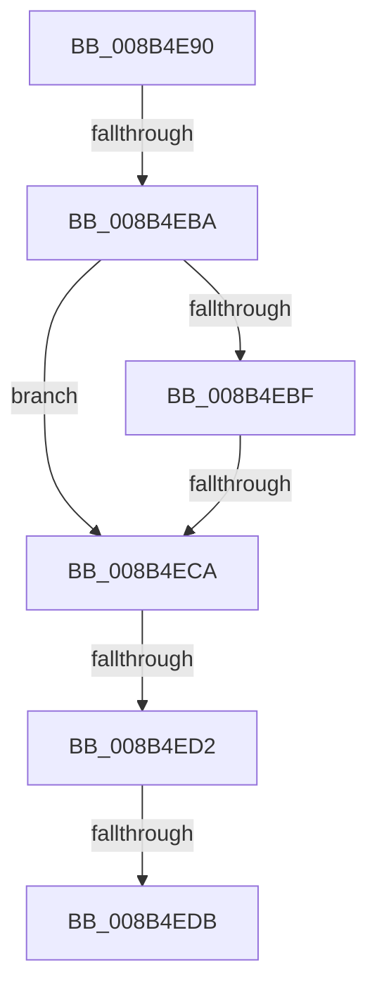

# CmpIsSystemEntity

- RVA: `0x008B4E90`–`0x008B4EDF` (길이 `79` bytes)
- VA: `0x00000001408B4E90`
- 실행 섹션: `PAGE`
- PDB 이름 있음: `예`; PDB Function 태그: `아니요`
- unwind 정보 RVA: `0x000829A4`
- 디코드: `20`개 명령, `79/79` bytes 표시
- 미해석 바이트: `0` (있으면 어셈블리에 `.byte`로 보존)

> 이 문서는 커널 이미지의 기계어와 PDB 기호를 분석해 생성했습니다. 4번과 5번은 함수 원형과 자료형을 바이너리 사용 방식에서 추정한 C 해석이며 원본 소스 복구 결과는 아닙니다.

## 1. Dependencies

- 직접 호출 지점: **0**; 고유 호출 대상: **0**
- 직접 호출자로 확인된 함수: **11**
- RIP 상대 이미지 참조: **1**

### Outgoing calls
- 직접 디코드된 call 명령이 없습니다.

### Direct callers
- [KCBNeedsVirtualImage](../../text/42/KCBNeedsVirtualImage_function_0042E9FC.md) at `0x0042EA1E`
- [CmDoVirtualTest](../../text/4A/CmDoVirtualTest_function_004AB560.md) at `0x004AB585`
- [KCBNeedsVirtualImage](../../text/4B/KCBNeedsVirtualImage_function_004B88FC.md) at `0x004B8930`
- [NtSetInformationKey](../84/NtSetInformationKey_function_00843720.md) at `0x00843D79`
- [NtSetValueKey](../84/NtSetValueKey_function_00844EA0.md) at `0x008456E5`
- [NtDeleteValueKey](../84/NtDeleteValueKey_function_00848770.md) at `0x00848C7F`
- [CmQueryKey](../85/CmQueryKey_function_00858240.md) at `0x00858679`
- [CmpDoParseKey](../85/CmpDoParseKey_function_0085F750.md) at `0x0085FD85`
- [CmpCheckOpenAccessOnKeyBody](../87/CmpCheckOpenAccessOnKeyBody_function_00870000.md) at `0x00870723`
- [CmpCreateChild](../94/CmpCreateChild_function_0094817C.md) at `0x00948F08`
- [sub_00B169F2](../B1/Unknown_function_00B169F2.md) at `0x00B16A06`

### Static image references
- `0x008B4EA0` → RVA `0x00E0ECA0` (`.data`; read)

## 2. Other-region calls and transfers

- 다른 실행 섹션으로 향하는 call: **0**
- call이 아닌 외부 분기/꼬리 이동: **4**
  - `0x008B4EB4` → [sub_008B5001](Unknown_function_008B5001.md) (`tail-transfer`)
  - `0x008B4EC4` → [sub_008B507C](Unknown_function_008B507C.md) (`tail-transfer`)
  - `0x008B4ECC` → [sub_008B5001](Unknown_function_008B5001.md) (`tail-transfer`)
  - `0x008B4ED5` → [sub_008B4FCE](Unknown_function_008B4FCE.md) (`tail-transfer`)

## 3. Assembly (complete function range)

```asm
008B4E90  48 89 5C 24 10                  mov qword ptr [rsp + 0x10], rbx
008B4E95  56                              push rsi
008B4E96  48 83 EC 40                     sub rsp, 0x40
008B4E9A  0F 57 C0                        xorps xmm0, xmm0
008B4E9D  40 32 F6                        xor sil, sil
008B4EA0  40 38 35 F9 9D 55 00            cmp byte ptr [rip + 0x559df9], sil
008B4EA7  49 8B D8                        mov rbx, r8
008B4EAA  0F 11 44 24 20                  movups xmmword ptr [rsp + 0x20], xmm0
008B4EAF  0F 11 44 24 30                  movups xmmword ptr [rsp + 0x30], xmm0
008B4EB4  0F 84 47 01 00 00               je 0x1408b5001
008B4EBA  48 85 DB                        test rbx, rbx
008B4EBD  74 0B                           je 0x1408b4eca
008B4EBF  41 8B 00                        mov eax, dword ptr [r8]
008B4EC2  A8 01                           test al, 1
008B4EC4  0F 85 B2 01 00 00               jne 0x1408b507c
008B4ECA  84 C9                           test cl, cl
008B4ECC  0F 84 2F 01 00 00               je 0x1408b5001
008B4ED2  48 85 D2                        test rdx, rdx
008B4ED5  0F 84 F3 00 00 00               je 0x1408b4fce
008B4EDB  48 83 3A 00                     cmp qword ptr [rdx], 0
```

## 4. C-style interpretation (structured pseudocode)

```c
__int64 __fastcall CmpIsSystemEntity(unsigned __int8 a1, __int64 a2, __int64 a3)
{
    __int64 v_rsi;
    __int64 v_rsp;
    unsigned __int64 v_stack_m18;
    unsigned __int64 v_stack_m28;
    unsigned __int64 v_stack_p10;

    v_stack_p10 = v_rbx;
    v_rsp = (v_rsp) - (64);
    v_rsi = 0;
    v_stack_m28 = v_xmm0;
    v_stack_m18 = v_xmm0;
    if (a3 == 0) goto loc_008B4ECA;
loc_008B4ECA:
    return (unsigned int)(*(unsigned int *)(a3));
}
```

## 5. (Beta) C Style

```c
int64_t CmpIsSystemEntity(uint8_t Arg1, int64_t Arg2, void *Arg3)
{
    uint8_t *arg3 = (uint8_t *)Arg3;

    int64_t local_rsi;
    int64_t local_rsp;
    uint64_t v_stack_m18;
    uint64_t v_stack_m28;
    uint64_t v_stack_p10;

    v_stack_p10 = local_rbx;
    local_rsp = (local_rsp) - (64);
    local_rsi = 0;
    v_stack_m28 = v_xmm0;
    v_stack_m18 = v_xmm0;
    if (Arg3 == NULL) goto loc_008B4ECA;
loc_008B4ECA:
    return (uint32_t)(*(uint32_t *)(arg3));
}
```

### 관측된 메모리 오프셋

구조체 형식이 확인되지 않은 접근은 인자 기준의 오프셋으로만 기록했습니다.

| 기준 인자 | 오프셋 표현 | 폭 (bit) | 접근 |
|---|---:|---:|---|
| `Arg3` | `+ 0x0` | `32` | `R` |

## 6. Execution-region graph

[열기: 2D/3D 그래프와 함수 탐색 컨트롤 패널](../../../control-panel.html?section=page&rva=0x008B4E90&view=graph)

- 2D 그래프는 위에서 아래로 흐르고, 3D 그래프는 빈 공간을 드래그해 회전합니다. Shift+드래그는 이동, 휠은 확대·축소, 함수 노드 선택은 대상 보고서 이동입니다.

### Static fallback


