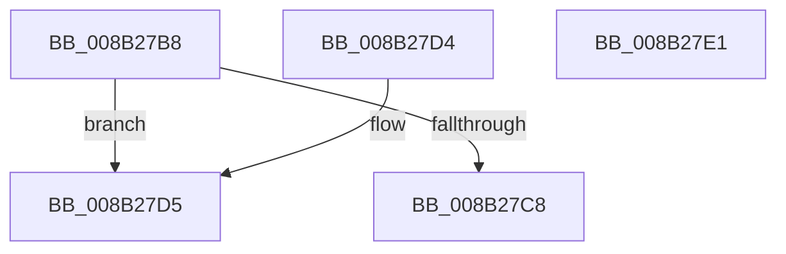

# CmpSortedValueEnumStackGetEntryAtLayerHeight

- RVA: `0x008B27B8`–`0x008B27E2` (길이 `42` bytes)
- VA: `0x00000001408B27B8`
- 실행 섹션: `PAGE`
- PDB 이름 있음: `예`; PDB Function 태그: `아니요`
- unwind 정보 RVA: `0x000DB714`
- 디코드: `14`개 명령, `42/42` bytes 표시
- 미해석 바이트: `0` (있으면 어셈블리에 `.byte`로 보존)

> 이 문서는 커널 이미지의 기계어와 PDB 기호를 분석해 생성했습니다. 4번과 5번은 함수 원형과 자료형을 바이너리 사용 방식에서 추정한 C 해석이며 원본 소스 복구 결과는 아닙니다.

## 1. Dependencies

- 직접 호출 지점: **0**; 고유 호출 대상: **0**
- 직접 호출자로 확인된 함수: **8**
- RIP 상대 이미지 참조: **0**

### Outgoing calls
- 직접 디코드된 call 명령이 없습니다.

### Direct callers
- [CmpValueEnumStackStartFromKeyNodeStack](../../text/46/CmpValueEnumStackStartFromKeyNodeStack_function_0046B2E0.md) at `0x0046B321`
- [CmpValueEnumStackGetCurrentValueHive](../../text/4A/CmpValueEnumStackGetCurrentValueHive_function_004A7A60.md) at `0x004A7A68`
- [CmpValueEnumStackCleanup](CmpValueEnumStackCleanup_function_008B1F04.md) at `0x008B1F27`
- [CmpValueEnumStackAdvance](CmpValueEnumStackAdvance_function_008B256C.md) at `0x008B25CB`
- [CmpValueEnumStackMatchingValueInUpperLayer](CmpValueEnumStackMatchingValueInUpperLayer_function_008B26E0.md) at `0x008B276F`
- [CmpSortedValueEnumStackCleanup](../A3/CmpSortedValueEnumStackCleanup_function_00A30C8C.md) at `0x00A30CC9`
- [CmpSortedValueEnumStackStartFromKeyNodeStack](../A3/CmpSortedValueEnumStackStartFromKeyNodeStack_function_00A30CF0.md) at `0x00A30D3D`
- [CmpSortedValueEnumStackAdvanceInternal](../A3/CmpSortedValueEnumStackAdvanceInternal_function_00A30E14.md) at `0x00A30E50`
- [CmpSortedValueEnumStackAdvanceInternal](../A3/CmpSortedValueEnumStackAdvanceInternal_function_00A30E14.md) at `0x00A30E9D`

### Static image references
- 디코드된 RIP-relative 메모리 참조가 없습니다.

## 2. Other-region calls and transfers

- 다른 실행 섹션으로 향하는 call: **0**
- 별도 외부 분기/꼬리 이동을 확인하지 못했습니다.

## 3. Assembly (complete function range)

```asm
008B27B8  41 B8 02 00 00 00               mov r8d, 2
008B27BE  48 0F BF C2                     movsx rax, dx
008B27C2  66 41 3B D0                     cmp dx, r8w
008B27C6  7D 0D                           jge 0x1408b27d5
008B27C8  48 C1 E0 05                     shl rax, 5
008B27CC  48 83 C0 10                     add rax, 0x10
008B27D0  48 03 C1                        add rax, rcx
008B27D3  C3                              ret
008B27D4  CC                              int3
008B27D5  49 2B C0                        sub rax, r8
008B27D8  48 C1 E0 05                     shl rax, 5
008B27DC  48 03 41 50                     add rax, qword ptr [rcx + 0x50]
008B27E0  C3                              ret
008B27E1  CC                              int3
```

## 4. C-style interpretation (structured pseudocode)

```c
__int64 __fastcall CmpSortedValueEnumStackGetEntryAtLayerHeight(__int64 a1, unsigned __int16 a2)
{
    __int64 result;

    if (a2 >= 2) goto loc_008B27D5;
    result = ((__int16)(a2)) << (5);
    result = (result) + (16);
    result = (result) + (a1);
    return result;
loc_008B27D5:
    result = (result) - (2);
    result = (result) << (5);
    result = (result) + (*(unsigned __int64 *)(a1 + 80));
    return result;
}
```

## 5. (Beta) C Style

```c
int64_t CmpSortedValueEnumStackGetEntryAtLayerHeight(void *Arg1, uint16_t Arg2)
{
    uint8_t *arg1 = (uint8_t *)Arg1;

    int64_t result;

    if (Arg2 >= 2) goto loc_008B27D5;
    result = ((int16_t)(Arg2)) << (5);
    result = (result) + (16);
    result = (result) + (Arg1);
    return result;
loc_008B27D5:
    result = (result) - (2);
    result = (result) << (5);
    result = (result) + (*(uint64_t *)(arg1 + 0x50));
    return result;
}
```

### 관측된 메모리 오프셋

구조체 형식이 확인되지 않은 접근은 인자 기준의 오프셋으로만 기록했습니다.

| 기준 인자 | 오프셋 표현 | 폭 (bit) | 접근 |
|---|---:|---:|---|
| `Arg1` | `+ 0x50` | `64` | `R` |

## 6. Execution-region graph

[열기: 2D/3D 그래프와 함수 탐색 컨트롤 패널](../../../control-panel.html?section=page&rva=0x008B27B8&view=graph)

- 2D 그래프는 위에서 아래로 흐르고, 3D 그래프는 빈 공간을 드래그해 회전합니다. Shift+드래그는 이동, 휠은 확대·축소, 함수 노드 선택은 대상 보고서 이동입니다.

### Static fallback


