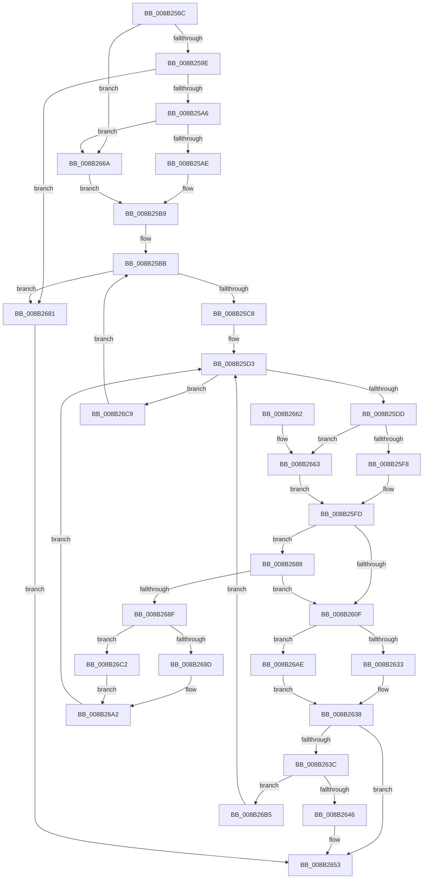

# CmpValueEnumStackAdvance

- RVA: `0x008B256C`–`0x008B26D8` (길이 `364` bytes)
- VA: `0x00000001408B256C`
- 실행 섹션: `PAGE`
- PDB 이름 있음: `예`; PDB Function 태그: `아니요`
- unwind 정보 RVA: `0x000825F0`
- 디코드: `102`개 명령, `364/364` bytes 표시
- 미해석 바이트: `0` (있으면 어셈블리에 `.byte`로 보존)

> 이 문서는 커널 이미지의 기계어와 PDB 기호를 분석해 생성했습니다. 4번과 5번은 함수 원형과 자료형을 바이너리 사용 방식에서 추정한 C 해석이며 원본 소스 복구 결과는 아닙니다.

## 1. Dependencies

- 직접 호출 지점: **9**; 고유 호출 대상: **7**
- 직접 호출자로 확인된 함수: **3**
- RIP 상대 이미지 참조: **0**

### Outgoing calls
- `0x008B258B` → [HvpGetCellContextInitialize](../85/HvpGetCellContextInitialize_function_00855F10.md) (function, `0x00855F10`)
- `0x008B25CB` → [CmpSortedValueEnumStackGetEntryAtLayerHeight](CmpSortedValueEnumStackGetEntryAtLayerHeight_function_008B27B8.md) (function, `0x008B27B8`)
- `0x008B25F8` → [HvpGetCellFlat](../85/HvpGetCellFlat_function_00854C60.md) (function, `0x00854C60`)
- `0x008B261B` → [CmpValueEnumStackMatchingValueInUpperLayer](CmpValueEnumStackMatchingValueInUpperLayer_function_008B26E0.md) (function, `0x008B26E0`)
- `0x008B2633` → [HvpReleaseCellPaged](../85/HvpReleaseCellPaged_function_00855F40.md) (function, `0x00855F40`)
- `0x008B2663` → [HvpGetCellPaged](../85/HvpGetCellPaged_function_00854CB0.md) (function, `0x00854CB0`)
- `0x008B269D` → [HvpReleaseCellPaged](../85/HvpReleaseCellPaged_function_00855F40.md) (function, `0x00855F40`)
- `0x008B26AE` → [HvpReleaseCellFlat](../85/HvpReleaseCellFlat_function_0085CC20.md) (function, `0x0085CC20`)
- `0x008B26C2` → [HvpReleaseCellFlat](../85/HvpReleaseCellFlat_function_0085CC20.md) (function, `0x0085CC20`)

### Direct callers
- [CmpGetValueCountForKeyNodeStack](../../text/46/CmpGetValueCountForKeyNodeStack_function_0046B118.md) at `0x0046B231`
- [CmpFullPromoteSingleKeyFromKeyNodeStacks](CmpFullPromoteSingleKeyFromKeyNodeStacks_function_008B1A40.md) at `0x008B1B75`
- [CmEnumerateValueFromLayeredKey](CmEnumerateValueFromLayeredKey_function_008B31FC.md) at `0x008B34EF`
- [CmEnumerateValueFromLayeredKey](CmEnumerateValueFromLayeredKey_function_008B31FC.md) at `0x008B350B`

### Static image references
- 디코드된 RIP-relative 메모리 참조가 없습니다.

## 2. Other-region calls and transfers

- 다른 실행 섹션으로 향하는 call: **0**
- 별도 외부 분기/꼬리 이동을 확인하지 못했습니다.

## 3. Assembly (complete function range)

```asm
008B256C  48 8B C4                        mov rax, rsp
008B256F  48 89 58 18                     mov qword ptr [rax + 0x18], rbx
008B2573  55                              push rbp
008B2574  56                              push rsi
008B2575  57                              push rdi
008B2576  48 83 EC 20                     sub rsp, 0x20
008B257A  48 8B D9                        mov rbx, rcx
008B257D  33 ED                           xor ebp, ebp
008B257F  48 8D 48 10                     lea rcx, [rax + 0x10]
008B2583  48 89 68 10                     mov qword ptr [rax + 0x10], rbp
008B2587  40 88 68 08                     mov byte ptr [rax + 8], bpl
008B258B  E8 80 39 FA FF                  call 0x140855f10
008B2590  8A 43 04                        mov al, byte ptr [rbx + 4]
008B2593  83 C9 FF                        or ecx, 0xffffffff
008B2596  84 C0                           test al, al
008B2598  0F 84 CC 00 00 00               je 0x1408b266a
008B259E  39 0B                           cmp dword ptr [rbx], ecx
008B25A0  0F 84 DB 00 00 00               je 0x1408b2681
008B25A6  84 C0                           test al, al
008B25A8  0F 84 BC 00 00 00               je 0x1408b266a
008B25AE  44 8B 4B 08                     mov r9d, dword ptr [rbx + 8]
008B25B2  41 FF C1                        inc r9d
008B25B5  44 89 4B 08                     mov dword ptr [rbx + 8], r9d
008B25B9  89 0B                           mov dword ptr [rbx], ecx
008B25BB  0F B7 53 06                     movzx edx, word ptr [rbx + 6]
008B25BF  66 85 D2                        test dx, dx
008B25C2  0F 88 B9 00 00 00               js 0x1408b2681
008B25C8  48 8B CB                        mov rcx, rbx
008B25CB  E8 E8 01 00 00                  call 0x1408b27b8
008B25D0  48 8B F0                        mov rsi, rax
008B25D3  44 3B 4E 18                     cmp r9d, dword ptr [rsi + 0x18]
008B25D7  0F 83 EC 00 00 00               jae 0x1408b26c9
008B25DD  48 8B 46 08                     mov rax, qword ptr [rsi + 8]
008B25E1  4C 8D 44 24 48                  lea r8, [rsp + 0x48]
008B25E6  41 8B C9                        mov ecx, r9d
008B25E9  8B 14 88                        mov edx, dword ptr [rax + rcx*4]
008B25EC  48 8B 0E                        mov rcx, qword ptr [rsi]
008B25EF  F6 81 8C 00 00 00 01            test byte ptr [rcx + 0x8c], 1
008B25F6  74 6B                           je 0x1408b2663
008B25F8  E8 63 26 FA FF                  call 0x140854c60
008B25FD  48 8B 0E                        mov rcx, qword ptr [rsi]
008B2600  4C 8B C0                        mov r8, rax
008B2603  F7 81 A0 00 00 00 00 00 08 00   test dword ptr [rcx + 0xa0], 0x80000
008B260D  75 79                           jne 0x1408b2688
008B260F  0F B7 53 06                     movzx edx, word ptr [rbx + 6]
008B2613  4C 8D 4C 24 40                  lea r9, [rsp + 0x40]
008B2618  48 8B CB                        mov rcx, rbx
008B261B  E8 C0 00 00 00                  call 0x1408b26e0
008B2620  48 8B 0E                        mov rcx, qword ptr [rsi]
008B2623  48 8D 54 24 48                  lea rdx, [rsp + 0x48]
008B2628  8B F8                           mov edi, eax
008B262A  F6 81 8C 00 00 00 01            test byte ptr [rcx + 0x8c], 1
008B2631  75 7B                           jne 0x1408b26ae
008B2633  E8 08 39 FA FF                  call 0x140855f40
008B2638  85 FF                           test edi, edi
008B263A  78 17                           js 0x1408b2653
008B263C  8B 43 08                        mov eax, dword ptr [rbx + 8]
008B263F  40 38 6C 24 40                  cmp byte ptr [rsp + 0x40], bpl
008B2644  75 6F                           jne 0x1408b26b5
008B2646  8B C8                           mov ecx, eax
008B2648  8B FD                           mov edi, ebp
008B264A  48 8B 46 08                     mov rax, qword ptr [rsi + 8]
008B264E  8B 0C 88                        mov ecx, dword ptr [rax + rcx*4]
008B2651  89 0B                           mov dword ptr [rbx], ecx
008B2653  48 8B 5C 24 50                  mov rbx, qword ptr [rsp + 0x50]
008B2658  8B C7                           mov eax, edi
008B265A  48 83 C4 20                     add rsp, 0x20
008B265E  5F                              pop rdi
008B265F  5E                              pop rsi
008B2660  5D                              pop rbp
008B2661  C3                              ret
008B2662  CC                              int3
008B2663  E8 48 26 FA FF                  call 0x140854cb0
008B2668  EB 93                           jmp 0x1408b25fd
008B266A  0F B7 43 0C                     movzx eax, word ptr [rbx + 0xc]
008B266E  44 8B CD                        mov r9d, ebp
008B2671  66 89 43 06                     mov word ptr [rbx + 6], ax
008B2675  C6 43 04 01                     mov byte ptr [rbx + 4], 1
008B2679  89 6B 08                        mov dword ptr [rbx + 8], ebp
008B267C  E9 38 FF FF FF                  jmp 0x1408b25b9
008B2681  BF 1A 00 00 80                  mov edi, 0x8000001a
008B2686  EB CB                           jmp 0x1408b2653
008B2688  41 F6 40 10 02                  test byte ptr [r8 + 0x10], 2
008B268D  74 80                           je 0x1408b260f
008B268F  F6 81 8C 00 00 00 01            test byte ptr [rcx + 0x8c], 1
008B2696  48 8D 54 24 48                  lea rdx, [rsp + 0x48]
008B269B  75 25                           jne 0x1408b26c2
008B269D  E8 9E 38 FA FF                  call 0x140855f40
008B26A2  FF 43 08                        inc dword ptr [rbx + 8]
008B26A5  44 8B 4B 08                     mov r9d, dword ptr [rbx + 8]
008B26A9  E9 25 FF FF FF                  jmp 0x1408b25d3
008B26AE  E8 6D A5 FA FF                  call 0x14085cc20
008B26B3  EB 83                           jmp 0x1408b2638
008B26B5  44 8D 48 01                     lea r9d, [rax + 1]
008B26B9  44 89 4B 08                     mov dword ptr [rbx + 8], r9d
008B26BD  E9 11 FF FF FF                  jmp 0x1408b25d3
008B26C2  E8 59 A5 FA FF                  call 0x14085cc20
008B26C7  EB D9                           jmp 0x1408b26a2
008B26C9  66 FF 4B 06                     dec word ptr [rbx + 6]
008B26CD  44 8B CD                        mov r9d, ebp
008B26D0  89 6B 08                        mov dword ptr [rbx + 8], ebp
008B26D3  E9 E3 FE FF FF                  jmp 0x1408b25bb
```

## 4. C-style interpretation (structured pseudocode)

```c
__int64 __fastcall CmpValueEnumStackAdvance(__int64 a1)
{
    __int64 result;
    __int64 v_rbp;
    __int64 v_rsp;
    unsigned __int64 v_stack_p10;
    unsigned __int64 v_stack_p18;
    unsigned __int64 v_stack_p48;
    unsigned __int64 v_stack_p8;

    *(unsigned __int64 *)(v_rsp + 24) = v_rbx;
    v_rsp = (v_rsp) - (32);
    v_rbp = 0;
    *(unsigned __int64 *)(v_rsp + 16) = 0;
    *(unsigned __int8 *)(v_rsp + 8) = 0;
    result = HvpGetCellContextInitialize(v_rsp + 16, a2, a3, a4);
    a1 = (unsigned int)((v_rsp + 16) | (0xFFFFFFFFULL));
    if ((unsigned __int8)(*(unsigned __int8 *)(a1 + 4)) == 0) goto loc_008B266A;
    if ((*(unsigned int *)(a1)) == ((unsigned int)(a1))) goto loc_008B2681;
    if ((unsigned __int8)(*(unsigned __int8 *)(a1 + 4)) == 0) goto loc_008B266A;
    a4 = (unsigned int)(((unsigned int)(*(unsigned int *)(a1 + 8))) + 1);
    *(unsigned int *)(a1 + 8) = (unsigned int)(a4);
loc_008B25B9:
    *(unsigned int *)(a1) = (unsigned int)(a1);
loc_008B25BB:
    if (sign_flag) goto loc_008B2681;
    result = CmpSortedValueEnumStackGetEntryAtLayerHeight(a1, *(unsigned __int16 *)(a1 + 6), a3, a4);
loc_008B25D3:
    if (((unsigned int)(a4)) >= (*(unsigned int *)(result + 24))) goto loc_008B26C9;
    if (((*(unsigned __int8 *)(*(unsigned __int64 *)(result) + 140)) & (1)) == 0) goto loc_008B2663;
    result = HvpGetCellFlat(*(unsigned __int64 *)(result), (unsigned int)(*(unsigned int *)(*(unsigned __int64 *)(result + 8) + (unsigned int)((unsigned int)(a4)) * 4)), v_stack_p10, a4);
loc_008B25FD:
    if (((*(unsigned int *)(*(unsigned __int64 *)(result) + 160)) & (0x80000ULL)) != 0) goto loc_008B2688;
loc_008B260F:
    result = CmpValueEnumStackMatchingValueInUpperLayer(a1, *(unsigned __int16 *)(a1 + 6), result, v_stack_p8);
    if (((*(unsigned __int8 *)(*(unsigned __int64 *)(result) + 140)) & (1)) != 0) goto loc_008B26AE;
    result = HvpReleaseCellPaged(*(unsigned __int64 *)(result), v_stack_p10, result, v_stack_p8);
loc_008B2638:
    if (sign_flag) goto loc_008B2653;
    if (v_stack_p8 != 0) goto loc_008B26B5;
    *(unsigned int *)(a1) = (unsigned int)((unsigned int)(*(unsigned int *)(*(unsigned __int64 *)(result + 8) + (unsigned int)((unsigned int)((unsigned int)(*(unsigned int *)(a1 + 8)))) * 4)));
loc_008B2653:
    v_rsp = (v_rsp) + (32);
    return 0;
loc_008B2663:
    result = HvpGetCellPaged((unsigned int)(*(unsigned int *)(*(unsigned __int64 *)(result + 8) + (unsigned int)((unsigned int)((unsigned int)(*(unsigned int *)(a1 + 8)))) * 4)), v_stack_p10, result, v_stack_p8);
    goto loc_008B25FD;
loc_008B266A:
    *(unsigned __int16 *)(v_stack_p18 + 6) = (unsigned __int16)(*(unsigned __int16 *)(v_stack_p18 + 12));
    *(unsigned __int8 *)(v_stack_p18 + 4) = 1;
    *(unsigned int *)(v_stack_p18 + 8) = 0;
    goto loc_008B25B9;
loc_008B2681:
    goto loc_008B2653;
loc_008B2688:
    if (((*(unsigned __int8 *)(result + 16)) & (2)) == 0) goto loc_008B260F;
    if (((*(unsigned __int8 *)((unsigned int)(*(unsigned int *)(*(unsigned __int64 *)(result + 8) + (unsigned int)((unsigned int)((unsigned int)(*(unsigned int *)(a1 + 8)))) * 4)) + 140)) & (1)) != 0) goto loc_008B26C2;
    result = HvpReleaseCellPaged((unsigned int)(*(unsigned int *)(*(unsigned __int64 *)(result + 8) + (unsigned int)((unsigned int)((unsigned int)(*(unsigned int *)(a1 + 8)))) * 4)), v_stack_p48, result, 0);
loc_008B26A2:
    goto loc_008B25D3;
loc_008B26AE:
    result = HvpReleaseCellFlat((unsigned int)(*(unsigned int *)(*(unsigned __int64 *)(result + 8) + (unsigned int)((unsigned int)((unsigned int)(*(unsigned int *)(a1 + 8)))) * 4)), v_stack_p48, result, (unsigned int)(*(unsigned int *)(v_stack_p18 + 8)));
    goto loc_008B2638;
loc_008B26B5:
    *(unsigned int *)(v_stack_p18 + 8) = (unsigned int)(result + 1);
    goto loc_008B25D3;
loc_008B26C2:
    result = HvpReleaseCellFlat((unsigned int)(*(unsigned int *)(*(unsigned __int64 *)(result + 8) + (unsigned int)((unsigned int)((unsigned int)(*(unsigned int *)(a1 + 8)))) * 4)), v_stack_p48, result, result + 1);
    goto loc_008B26A2;
loc_008B26C9:
    *(unsigned int *)(v_stack_p18 + 8) = 0;
    goto loc_008B25BB;
}
```

## 5. (Beta) C Style

```c
int64_t CmpValueEnumStackAdvance(void *Arg1)
{
    uint8_t *arg1 = (uint8_t *)Arg1;

    int64_t result;
    int64_t local_rbp;
    int64_t local_rsp;
    uint64_t v_stack_p10;
    uint64_t v_stack_p18;
    uint64_t v_stack_p48;
    uint64_t v_stack_p8;

    *(uint64_t *)(local_rsp + 0x18) = local_rbx;
    local_rsp = (local_rsp) - (32);
    local_rbp = 0;
    *(uint64_t *)(local_rsp + 0x10) = 0;
    *(uint8_t *)(local_rsp + 0x8) = 0;
    result = HvpGetCellContextInitialize(local_rsp + 16, a2, a3, a4);
    Arg1 = (uint32_t)((local_rsp + 16) | (0xFFFFFFFFULL));
    if ((uint8_t)(*(uint8_t *)(arg1 + 0x4)) == 0) goto loc_008B266A;
    if ((*(uint32_t *)(arg1)) == ((uint32_t)(Arg1))) goto loc_008B2681;
    if ((uint8_t)(*(uint8_t *)(arg1 + 0x4)) == 0) goto loc_008B266A;
    a4 = (uint32_t)(((uint32_t)(*(uint32_t *)(arg1 + 0x8))) + 1);
    *(uint32_t *)(arg1 + 0x8) = (uint32_t)(a4);
loc_008B25B9:
    *(uint32_t *)(arg1) = (uint32_t)(Arg1);
loc_008B25BB:
    if (sign_flag) goto loc_008B2681;
    result = CmpSortedValueEnumStackGetEntryAtLayerHeight(Arg1, *(uint16_t *)(arg1 + 0x6), a3, a4);
loc_008B25D3:
    if (((uint32_t)(a4)) >= (*(uint32_t *)(result + 0x18))) goto loc_008B26C9;
    if (((*(uint8_t *)(*(uint64_t *)(result) + 0x8C)) & (1)) == 0) goto loc_008B2663;
    result = HvpGetCellFlat(*(uint64_t *)(result), (uint32_t)(*(uint32_t *)(*(uint64_t *)(result + 0x8) + (uint32_t)((uint32_t)(a4)) * 4)), v_stack_p10, a4);
loc_008B25FD:
    if (((*(uint32_t *)(*(uint64_t *)(result) + 0xA0)) & (0x80000ULL)) != 0) goto loc_008B2688;
loc_008B260F:
    result = CmpValueEnumStackMatchingValueInUpperLayer(Arg1, *(uint16_t *)(arg1 + 0x6), result, v_stack_p8);
    if (((*(uint8_t *)(*(uint64_t *)(result) + 0x8C)) & (1)) != 0) goto loc_008B26AE;
    result = HvpReleaseCellPaged(*(uint64_t *)(result), v_stack_p10, result, v_stack_p8);
loc_008B2638:
    if (sign_flag) goto loc_008B2653;
    if (v_stack_p8 != 0) goto loc_008B26B5;
    *(uint32_t *)(arg1) = (uint32_t)((uint32_t)(*(uint32_t *)(*(uint64_t *)(result + 0x8) + (uint32_t)((uint32_t)((uint32_t)(*(uint32_t *)(arg1 + 0x8)))) * 4)));
loc_008B2653:
    local_rsp = (local_rsp) + (32);
    return 0;
loc_008B2663:
    result = HvpGetCellPaged((uint32_t)(*(uint32_t *)(*(uint64_t *)(result + 0x8) + (uint32_t)((uint32_t)((uint32_t)(*(uint32_t *)(arg1 + 0x8)))) * 4)), v_stack_p10, result, v_stack_p8);
    goto loc_008B25FD;
loc_008B266A:
    *(uint16_t *)(v_stack_p18 + 0x6) = (uint16_t)(*(uint16_t *)(v_stack_p18 + 0xC));
    *(uint8_t *)(v_stack_p18 + 0x4) = 1;
    *(uint32_t *)(v_stack_p18 + 0x8) = 0;
    goto loc_008B25B9;
loc_008B2681:
    goto loc_008B2653;
loc_008B2688:
    if (((*(uint8_t *)(result + 0x10)) & (2)) == 0) goto loc_008B260F;
    if (((*(uint8_t *)((uint32_t)(*(uint32_t *)(*(uint64_t *)(result + 0x8) + (uint32_t)((uint32_t)((uint32_t)(*(uint32_t *)(arg1 + 0x8)))) * 4)) + 0x8C)) & (1)) != 0) goto loc_008B26C2;
    result = HvpReleaseCellPaged((uint32_t)(*(uint32_t *)(*(uint64_t *)(result + 0x8) + (uint32_t)((uint32_t)((uint32_t)(*(uint32_t *)(arg1 + 0x8)))) * 4)), v_stack_p48, result, 0);
loc_008B26A2:
    goto loc_008B25D3;
loc_008B26AE:
    result = HvpReleaseCellFlat((uint32_t)(*(uint32_t *)(*(uint64_t *)(result + 0x8) + (uint32_t)((uint32_t)((uint32_t)(*(uint32_t *)(arg1 + 0x8)))) * 4)), v_stack_p48, result, (uint32_t)(*(uint32_t *)(v_stack_p18 + 0x8)));
    goto loc_008B2638;
loc_008B26B5:
    *(uint32_t *)(v_stack_p18 + 0x8) = (uint32_t)(result + 1);
    goto loc_008B25D3;
loc_008B26C2:
    result = HvpReleaseCellFlat((uint32_t)(*(uint32_t *)(*(uint64_t *)(result + 0x8) + (uint32_t)((uint32_t)((uint32_t)(*(uint32_t *)(arg1 + 0x8)))) * 4)), v_stack_p48, result, result + 1);
    goto loc_008B26A2;
loc_008B26C9:
    *(uint32_t *)(v_stack_p18 + 0x8) = 0;
    goto loc_008B25BB;
}
```

### 관측된 메모리 오프셋

구조체 형식이 확인되지 않은 접근은 인자 기준의 오프셋으로만 기록했습니다.

| 기준 인자 | 오프셋 표현 | 폭 (bit) | 접근 |
|---|---:|---:|---|
| `Arg1` | `+ 0x0` | `32` | `R` |
| `Arg1` | `+ 0x0` | `32` | `W` |
| `Arg1` | `+ 0x4` | `8` | `R` |
| `Arg1` | `+ 0x4` | `8` | `W` |
| `Arg1` | `+ 0x6` | `16` | `R` |
| `Arg1` | `+ 0x6` | `16` | `R/W` |
| `Arg1` | `+ 0x6` | `16` | `W` |
| `Arg1` | `+ 0x8` | `32` | `R` |
| `Arg1` | `+ 0x8` | `32` | `R/W` |
| `Arg1` | `+ 0x8` | `32` | `W` |
| `Arg1` | `+ 0xC` | `16` | `R` |

## 6. Execution-region graph

[열기: 2D/3D 그래프와 함수 탐색 컨트롤 패널](../../../control-panel.html?section=page&rva=0x008B256C&view=graph)

- 2D 그래프는 위에서 아래로 흐르고, 3D 그래프는 빈 공간을 드래그해 회전합니다. Shift+드래그는 이동, 휠은 확대·축소, 함수 노드 선택은 대상 보고서 이동입니다.

### Static fallback


