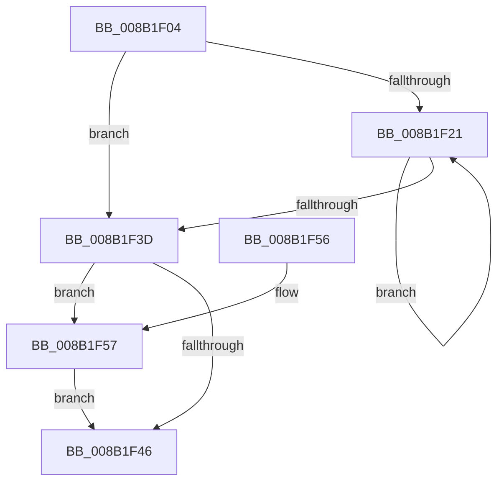

# CmpValueEnumStackCleanup

- RVA: `0x008B1F04`–`0x008B1F5E` (길이 `90` bytes)
- VA: `0x00000001408B1F04`
- 실행 섹션: `PAGE`
- PDB 이름 있음: `예`; PDB Function 태그: `아니요`
- unwind 정보 RVA: `0x0006383C`
- 디코드: `28`개 명령, `90/90` bytes 표시
- 미해석 바이트: `0` (있으면 어셈블리에 `.byte`로 보존)

> 이 문서는 커널 이미지의 기계어와 PDB 기호를 분석해 생성했습니다. 4번과 5번은 함수 원형과 자료형을 바이너리 사용 방식에서 추정한 C 해석이며 원본 소스 복구 결과는 아닙니다.

## 1. Dependencies

- 직접 호출 지점: **3**; 고유 호출 대상: **3**
- 직접 호출자로 확인된 함수: **3**
- RIP 상대 이미지 참조: **0**

### Outgoing calls
- `0x008B1F27` → [CmpSortedValueEnumStackGetEntryAtLayerHeight](CmpSortedValueEnumStackGetEntryAtLayerHeight_function_008B27B8.md) (function, `0x008B27B8`)
- `0x008B1F2F` → [CmpValueEnumStackEntryCleanup](../../text/49/CmpValueEnumStackEntryCleanup_function_0049C5A4.md) (function, `0x0049C5A4`)
- `0x008B1F57` → [CmSiFreeMemory](../../text/47/CmSiFreeMemory_function_00475D80.md) (function, `0x00475D80`)

### Direct callers
- [CmpGetValueCountForKeyNodeStack](../../text/46/CmpGetValueCountForKeyNodeStack_function_0046B118.md) at `0x0046B197`
- [CmpFullPromoteSingleKeyFromKeyNodeStacks](CmpFullPromoteSingleKeyFromKeyNodeStacks_function_008B1A40.md) at `0x008B1DBC`
- [CmEnumerateValueFromLayeredKey](CmEnumerateValueFromLayeredKey_function_008B31FC.md) at `0x008B3450`

### Static image references
- 디코드된 RIP-relative 메모리 참조가 없습니다.

## 2. Other-region calls and transfers

- 다른 실행 섹션으로 향하는 call: **2**
  - `0x008B1F2F` → [CmpValueEnumStackEntryCleanup](../../text/49/CmpValueEnumStackEntryCleanup_function_0049C5A4.md) (`PAGE` → `.text`)
  - `0x008B1F57` → [CmSiFreeMemory](../../text/47/CmSiFreeMemory_function_00475D80.md) (`PAGE` → `.text`)
- 별도 외부 분기/꼬리 이동을 확인하지 못했습니다.

## 3. Assembly (complete function range)

```asm
008B1F04  48 89 5C 24 08                  mov qword ptr [rsp + 8], rbx
008B1F09  48 89 74 24 10                  mov qword ptr [rsp + 0x10], rsi
008B1F0E  57                              push rdi
008B1F0F  48 83 EC 20                     sub rsp, 0x20
008B1F13  33 F6                           xor esi, esi
008B1F15  48 8B D9                        mov rbx, rcx
008B1F18  0F B7 FE                        movzx edi, si
008B1F1B  66 3B 71 0C                     cmp si, word ptr [rcx + 0xc]
008B1F1F  7F 1C                           jg 0x1408b1f3d
008B1F21  0F B7 D7                        movzx edx, di
008B1F24  48 8B CB                        mov rcx, rbx
008B1F27  E8 8C 08 00 00                  call 0x1408b27b8
008B1F2C  48 8B C8                        mov rcx, rax
008B1F2F  E8 70 A6 BE FF                  call 0x14049c5a4
008B1F34  66 FF C7                        inc di
008B1F37  66 3B 7B 0C                     cmp di, word ptr [rbx + 0xc]
008B1F3B  7E E4                           jle 0x1408b1f21
008B1F3D  48 8B 4B 50                     mov rcx, qword ptr [rbx + 0x50]
008B1F41  48 85 C9                        test rcx, rcx
008B1F44  75 11                           jne 0x1408b1f57
008B1F46  48 8B 5C 24 30                  mov rbx, qword ptr [rsp + 0x30]
008B1F4B  48 8B 74 24 38                  mov rsi, qword ptr [rsp + 0x38]
008B1F50  48 83 C4 20                     add rsp, 0x20
008B1F54  5F                              pop rdi
008B1F55  C3                              ret
008B1F56  CC                              int3
008B1F57  E8 24 3E BC FF                  call 0x140475d80
008B1F5C  EB E8                           jmp 0x1408b1f46
```

## 4. C-style interpretation (structured pseudocode)

```c
__int64 __fastcall CmpValueEnumStackCleanup(__int64 a1)
{
    __int64 result;
    __int64 v_rdi;
    __int64 v_rsi;
    __int64 v_rsp;
    unsigned __int64 v_stack_p10;
    unsigned __int64 v_stack_p8;

    v_stack_p8 = v_rbx;
    v_stack_p10 = v_rsi;
    v_rsp = (v_rsp) - (32);
    v_rsi = 0;
    if (0 > (*(unsigned __int16 *)(a1 + 12))) goto loc_008B1F3D;
loc_008B1F21:
    result = CmpSortedValueEnumStackGetEntryAtLayerHeight(a1, 0, a3, a4);
    result = CmpValueEnumStackEntryCleanup(result, 0, a3, a4);
    v_rdi = (unsigned __int16)((0) + 1);
    if (((unsigned __int16)(v_rdi)) <= (*(unsigned __int16 *)(a1 + 12))) goto loc_008B1F21;
loc_008B1F3D:
    if (*(unsigned __int64 *)(a1 + 80) != 0) goto loc_008B1F57;
loc_008B1F46:
    v_rsp = (v_rsp) + (32);
    return result;
loc_008B1F57:
    result = CmSiFreeMemory(*(unsigned __int64 *)(a1 + 80), 0, a3, a4);
    goto loc_008B1F46;
}
```

## 5. (Beta) C Style

```c
int64_t CmpValueEnumStackCleanup(void *Arg1)
{
    uint8_t *arg1 = (uint8_t *)Arg1;

    int64_t result;
    int64_t local_rdi;
    int64_t local_rsi;
    int64_t local_rsp;
    uint64_t v_stack_p10;
    uint64_t v_stack_p8;

    v_stack_p8 = local_rbx;
    v_stack_p10 = local_rsi;
    local_rsp = (local_rsp) - (32);
    local_rsi = 0;
    if (0 > (*(uint16_t *)(arg1 + 0xC))) goto loc_008B1F3D;
loc_008B1F21:
    result = CmpSortedValueEnumStackGetEntryAtLayerHeight(Arg1, 0, a3, a4);
    result = CmpValueEnumStackEntryCleanup(result, 0, a3, a4);
    local_rdi = (uint16_t)((0) + 1);
    if (((uint16_t)(local_rdi)) <= (*(uint16_t *)(arg1 + 0xC))) goto loc_008B1F21;
loc_008B1F3D:
    if (*(uint64_t *)(arg1 + 0x50) != 0) goto loc_008B1F57;
loc_008B1F46:
    local_rsp = (local_rsp) + (32);
    return result;
loc_008B1F57:
    result = CmSiFreeMemory(*(uint64_t *)(arg1 + 0x50), 0, a3, a4);
    goto loc_008B1F46;
}
```

### 관측된 메모리 오프셋

구조체 형식이 확인되지 않은 접근은 인자 기준의 오프셋으로만 기록했습니다.

| 기준 인자 | 오프셋 표현 | 폭 (bit) | 접근 |
|---|---:|---:|---|
| `Arg1` | `+ 0xC` | `16` | `R` |
| `Arg1` | `+ 0x50` | `64` | `R` |

## 6. Execution-region graph

[열기: 2D/3D 그래프와 함수 탐색 컨트롤 패널](../../../control-panel.html?section=page&rva=0x008B1F04&view=graph)

- 2D 그래프는 위에서 아래로 흐르고, 3D 그래프는 빈 공간을 드래그해 회전합니다. Shift+드래그는 이동, 휠은 확대·축소, 함수 노드 선택은 대상 보고서 이동입니다.

### Static fallback


