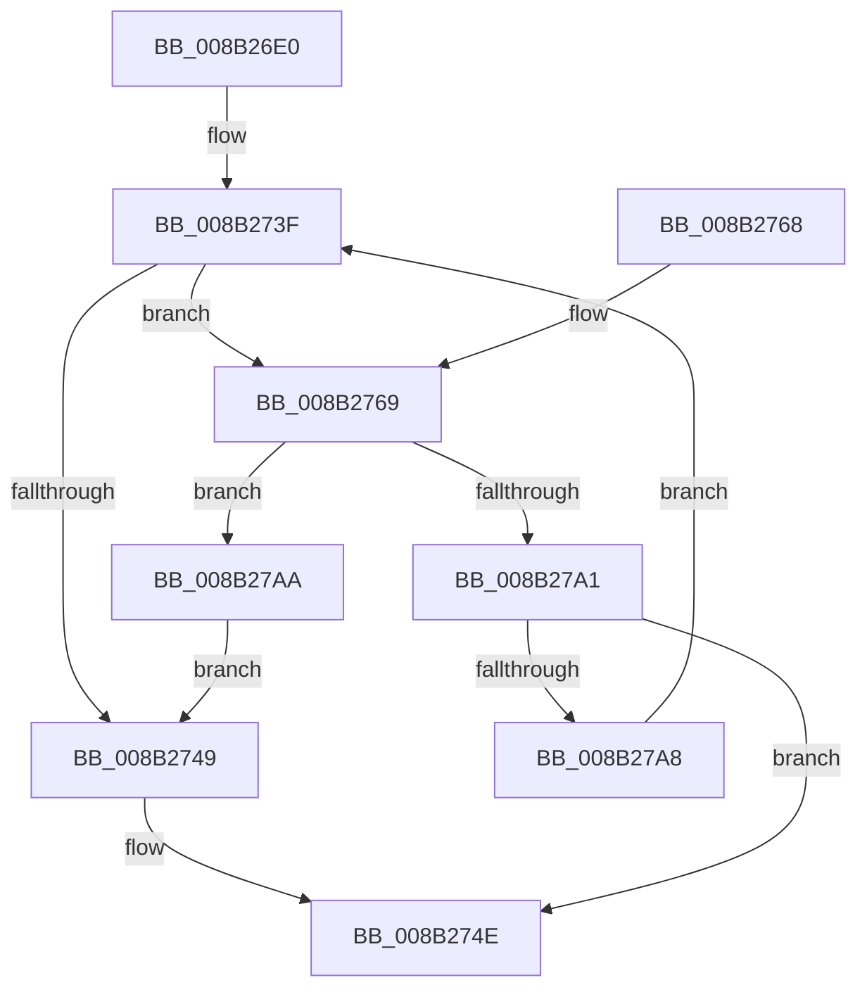

# CmpValueEnumStackMatchingValueInUpperLayer

- RVA: `0x008B26E0`–`0x008B27AF` (길이 `207` bytes)
- VA: `0x00000001408B26E0`
- 실행 섹션: `PAGE`
- PDB 이름 있음: `예`; PDB Function 태그: `아니요`
- unwind 정보 RVA: `0x00082604`
- 디코드: `61`개 명령, `207/207` bytes 표시
- 미해석 바이트: `0` (있으면 어셈블리에 `.byte`로 보존)

> 이 문서는 커널 이미지의 기계어와 PDB 기호를 분석해 생성했습니다. 4번과 5번은 함수 원형과 자료형을 바이너리 사용 방식에서 추정한 C 해석이며 원본 소스 복구 결과는 아닙니다.

## 1. Dependencies

- 직접 호출 지점: **3**; 고유 호출 대상: **3**
- 직접 호출자로 확인된 함수: **1**
- RIP 상대 이미지 참조: **0**

### Outgoing calls
- `0x008B2711` → [RtlInitUnicodeString](../../text/42/RtlInitUnicodeString_function_0042A780.md) (function, `0x0042A780`)
- `0x008B276F` → [CmpSortedValueEnumStackGetEntryAtLayerHeight](CmpSortedValueEnumStackGetEntryAtLayerHeight_function_008B27B8.md) (function, `0x008B27B8`)
- `0x008B2798` → [CmpFindNameInListCellWithStatus](../85/CmpFindNameInListCellWithStatus_function_00855FA0.md) (function, `0x00855FA0`)

### Direct callers
- [CmpValueEnumStackAdvance](CmpValueEnumStackAdvance_function_008B256C.md) at `0x008B261B`

### Static image references
- 디코드된 RIP-relative 메모리 참조가 없습니다.

## 2. Other-region calls and transfers

- 다른 실행 섹션으로 향하는 call: **1**
  - `0x008B2711` → [RtlInitUnicodeString](../../text/42/RtlInitUnicodeString_function_0042A780.md) (`PAGE` → `.text`)
- 별도 외부 분기/꼬리 이동을 확인하지 못했습니다.

## 3. Assembly (complete function range)

```asm
008B26E0  48 8B C4                        mov rax, rsp
008B26E3  48 89 58 08                     mov qword ptr [rax + 8], rbx
008B26E7  48 89 68 18                     mov qword ptr [rax + 0x18], rbp
008B26EB  48 89 70 20                     mov qword ptr [rax + 0x20], rsi
008B26EF  57                              push rdi
008B26F0  41 56                           push r14
008B26F2  41 57                           push r15
008B26F4  48 83 EC 50                     sub rsp, 0x50
008B26F8  0F B7 FA                        movzx edi, dx
008B26FB  48 8B F1                        mov rsi, rcx
008B26FE  0F 57 C0                        xorps xmm0, xmm0
008B2701  48 8D 48 D8                     lea rcx, [rax - 0x28]
008B2705  33 D2                           xor edx, edx
008B2707  4D 8B F1                        mov r14, r9
008B270A  0F 11 40 D8                     movups xmmword ptr [rax - 0x28], xmm0
008B270E  49 8B D8                        mov rbx, r8
008B2711  E8 6A 80 B7 FF                  call 0x14042a780
008B2716  0F B7 6B 10                     movzx ebp, word ptr [rbx + 0x10]
008B271A  48 8D 43 14                     lea rax, [rbx + 0x14]
008B271E  41 BF 01 00 00 00               mov r15d, 1
008B2724  48 89 44 24 48                  mov qword ptr [rsp + 0x48], rax
008B2729  0F B7 43 02                     movzx eax, word ptr [rbx + 2]
008B272D  41 23 EF                        and ebp, r15d
008B2730  C1 E5 10                        shl ebp, 0x10
008B2733  66 89 44 24 40                  mov word ptr [rsp + 0x40], ax
008B2738  32 DB                           xor bl, bl
008B273A  66 89 44 24 42                  mov word ptr [rsp + 0x42], ax
008B273F  66 41 03 FF                     add di, r15w
008B2743  66 3B 7E 0C                     cmp di, word ptr [rsi + 0xc]
008B2747  7E 20                           jle 0x1408b2769
008B2749  41 88 1E                        mov byte ptr [r14], bl
008B274C  33 C0                           xor eax, eax
008B274E  4C 8D 5C 24 50                  lea r11, [rsp + 0x50]
008B2753  49 8B 5B 20                     mov rbx, qword ptr [r11 + 0x20]
008B2757  49 8B 6B 30                     mov rbp, qword ptr [r11 + 0x30]
008B275B  49 8B 73 38                     mov rsi, qword ptr [r11 + 0x38]
008B275F  49 8B E3                        mov rsp, r11
008B2762  41 5F                           pop r15
008B2764  41 5E                           pop r14
008B2766  5F                              pop rdi
008B2767  C3                              ret
008B2768  CC                              int3
008B2769  0F B7 D7                        movzx edx, di
008B276C  48 8B CE                        mov rcx, rsi
008B276F  E8 44 00 00 00                  call 0x1408b27b8
008B2774  48 8D 4C 24 78                  lea rcx, [rsp + 0x78]
008B2779  48 89 4C 24 30                  mov qword ptr [rsp + 0x30], rcx
008B277E  4C 8D 4C 24 40                  lea r9, [rsp + 0x40]
008B2783  48 83 64 24 28 00               and qword ptr [rsp + 0x28], 0
008B2789  44 8B 40 18                     mov r8d, dword ptr [rax + 0x18]
008B278D  48 8B 50 08                     mov rdx, qword ptr [rax + 8]
008B2791  48 8B 08                        mov rcx, qword ptr [rax]
008B2794  89 6C 24 20                     mov dword ptr [rsp + 0x20], ebp
008B2798  E8 03 38 FA FF                  call 0x140855fa0
008B279D  85 C0                           test eax, eax
008B279F  79 09                           jns 0x1408b27aa
008B27A1  3D 34 00 00 C0                  cmp eax, 0xc0000034
008B27A6  75 A6                           jne 0x1408b274e
008B27A8  EB 95                           jmp 0x1408b273f
008B27AA  41 8A DF                        mov bl, r15b
008B27AD  EB 9A                           jmp 0x1408b2749
```

## 4. C-style interpretation (structured pseudocode)

```c
__int64 __fastcall CmpValueEnumStackMatchingValueInUpperLayer(__int64 a1, int a2, __int64 a3, __int64 a4)
{
    __int64 result;
    __int64 v_rbp;
    __int64 v_rbx;
    __int64 v_rdi;
    __int64 v_rsp;
    unsigned __int64 v_stack_m10;
    unsigned __int64 v_stack_m18;
    unsigned __int64 v_stack_m20;
    unsigned __int16 v_stack_m26;
    unsigned __int16 v_stack_m28;
    unsigned int v_stack_m30;
    unsigned __int64 v_stack_p28;

    *(unsigned __int64 *)(v_rsp + 8) = v_rbx;
    *(unsigned __int64 *)(v_rsp + 24) = v_rbp;
    *(unsigned __int64 *)(v_rsp + 32) = v_rsi;
    v_rsp = (v_rsp) - (80);
    a2 = 0;
    *(unsigned __int64 *)(v_rsp - 40) = v_xmm0;
    result = RtlInitUnicodeString(v_rsp - 40, a2, a3, a4);
    v_stack_m20 = a3 + 20;
    v_rbp = (unsigned int)((*(unsigned __int16 *)(a3 + 16)) & (1));
    v_rbp = (unsigned int)((v_rbp) << (16));
    v_stack_m28 = (unsigned __int16)(*(unsigned __int16 *)(a3 + 2));
    v_rbx = 0;
    v_stack_m26 = (unsigned __int16)(*(unsigned __int16 *)(a3 + 2));
loc_008B273F:
    v_rdi = (unsigned __int16)(((unsigned __int16)(a2)) + (1));
    if (((unsigned __int16)(v_rdi)) <= (*(unsigned __int16 *)(a1 + 12))) goto loc_008B2769;
loc_008B2749:
    *(unsigned __int8 *)(a4) = 0;
    result = 0;
loc_008B274E:
    return result;
loc_008B2769:
    result = CmpSortedValueEnumStackGetEntryAtLayerHeight(*(unsigned __int64 *)(v_stack_m18 + 56), (unsigned __int16)(v_rdi), a3, a4);
    v_stack_m20 = v_stack_p28;
    v_stack_m30 = (unsigned int)(*(unsigned __int64 *)(v_stack_m18 + 48));
    result = CmpFindNameInListCellWithStatus(*(unsigned __int64 *)(result), *(unsigned __int64 *)(result + 8), (unsigned int)(*(unsigned int *)(result + 24)), v_stack_m10);
    if (!sign_flag) goto loc_008B27AA;
    if (((unsigned int)(result)) != 0xC0000034ULL) goto loc_008B274E;
    goto loc_008B273F;
loc_008B27AA:
    goto loc_008B2749;
}
```

## 5. (Beta) C Style

```c
int64_t CmpValueEnumStackMatchingValueInUpperLayer(void *Arg1, int32_t Arg2, void *Arg3, void *Arg4)
{
    uint8_t *arg1 = (uint8_t *)Arg1;
    uint8_t *arg3 = (uint8_t *)Arg3;
    uint8_t *arg4 = (uint8_t *)Arg4;

    int64_t result;
    int64_t local_rbp;
    int64_t local_rbx;
    int64_t local_rdi;
    int64_t local_rsp;
    uint64_t v_stack_m10;
    uint64_t v_stack_m18;
    uint64_t v_stack_m20;
    uint16_t v_stack_m26;
    uint16_t v_stack_m28;
    uint32_t v_stack_m30;
    uint64_t v_stack_p28;

    *(uint64_t *)(local_rsp + 0x8) = local_rbx;
    *(uint64_t *)(local_rsp + 0x18) = local_rbp;
    *(uint64_t *)(local_rsp + 0x20) = local_rsi;
    local_rsp = (local_rsp) - (80);
    Arg2 = 0;
    *(uint64_t *)(local_rsp - 0x28) = v_xmm0;
    result = RtlInitUnicodeString(local_rsp - 40, Arg2, Arg3, Arg4);
    v_stack_m20 = Arg3 + 20;
    local_rbp = (uint32_t)((*(uint16_t *)(arg3 + 0x10)) & (1));
    local_rbp = (uint32_t)((local_rbp) << (16));
    v_stack_m28 = (uint16_t)(*(uint16_t *)(arg3 + 0x2));
    local_rbx = 0;
    v_stack_m26 = (uint16_t)(*(uint16_t *)(arg3 + 0x2));
loc_008B273F:
    local_rdi = (uint16_t)(((uint16_t)(Arg2)) + (1));
    if (((uint16_t)(local_rdi)) <= (*(uint16_t *)(arg1 + 0xC))) goto loc_008B2769;
loc_008B2749:
    *(uint8_t *)(arg4) = 0;
    result = 0;
loc_008B274E:
    return result;
loc_008B2769:
    result = CmpSortedValueEnumStackGetEntryAtLayerHeight(*(uint64_t *)(v_stack_m18 + 0x38), (uint16_t)(local_rdi), Arg3, Arg4);
    v_stack_m20 = v_stack_p28;
    v_stack_m30 = (uint32_t)(*(uint64_t *)(v_stack_m18 + 0x30));
    result = CmpFindNameInListCellWithStatus(*(uint64_t *)(result), *(uint64_t *)(result + 0x8), (uint32_t)(*(uint32_t *)(result + 0x18)), v_stack_m10);
    if (!sign_flag) goto loc_008B27AA;
    if (((uint32_t)(result)) != 0xC0000034ULL) goto loc_008B274E;
    goto loc_008B273F;
loc_008B27AA:
    goto loc_008B2749;
}
```

### 관측된 메모리 오프셋

구조체 형식이 확인되지 않은 접근은 인자 기준의 오프셋으로만 기록했습니다.

| 기준 인자 | 오프셋 표현 | 폭 (bit) | 접근 |
|---|---:|---:|---|
| `Arg1` | `+ 0xC` | `16` | `R` |
| `Arg3` | `+ 0x2` | `16` | `R` |
| `Arg3` | `+ 0x10` | `16` | `R` |
| `Arg3` | `+ 0x14` | `64` | `R` |
| `Arg4` | `+ 0x0` | `8` | `W` |

## 6. Execution-region graph

[열기: 2D/3D 그래프와 함수 탐색 컨트롤 패널](../../../control-panel.html?section=page&rva=0x008B26E0&view=graph)

- 2D 그래프는 위에서 아래로 흐르고, 3D 그래프는 빈 공간을 드래그해 회전합니다. Shift+드래그는 이동, 휠은 확대·축소, 함수 노드 선택은 대상 보고서 이동입니다.

### Static fallback


