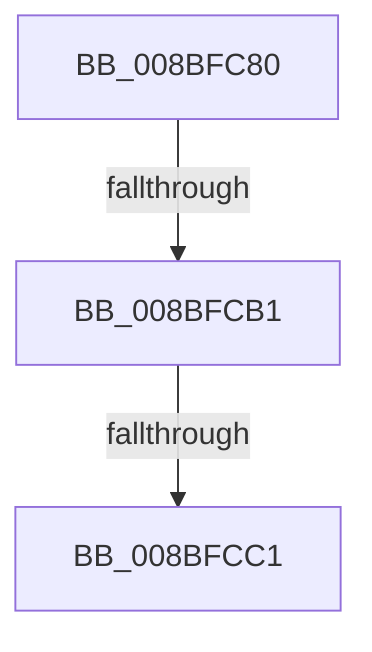

# EtwpAddGuidEntry

- RVA: `0x008BFC80`–`0x008BFCE3` (길이 `99` bytes)
- VA: `0x00000001408BFC80`
- 실행 섹션: `PAGE`
- PDB 이름 있음: `예`; PDB Function 태그: `예`
- unwind 정보 RVA: `0x00083358`
- 디코드: `29`개 명령, `99/99` bytes 표시
- 미해석 바이트: `0` (있으면 어셈블리에 `.byte`로 보존)

> 이 문서는 커널 이미지의 기계어와 PDB 기호를 분석해 생성했습니다. 4번과 5번은 함수 원형과 자료형을 바이너리 사용 방식에서 추정한 C 해석이며 원본 소스 복구 결과는 아닙니다.

## 1. Dependencies

- 직접 호출 지점: **1**; 고유 호출 대상: **1**
- 직접 호출자로 확인된 함수: **4**
- RIP 상대 이미지 참조: **1**

### Outgoing calls
- `0x008BFCA0` → [EtwpAllocGuidEntry](EtwpAllocGuidEntry_function_008BFF20.md) (function, `0x008BFF20`)

### Direct callers
- [sub_008BFE0A](Unknown_function_008BFE0A.md) at `0x008BFE2E`
- [EtwpFindOrCreateGuidEntry](../8C/EtwpFindOrCreateGuidEntry_function_008C1B70.md) at `0x008C1D45`
- [sub_008C28B0](../8C/Unknown_function_008C28B0.md) at `0x008C290B`
- [EtwpEnableGuid](../A5/EtwpEnableGuid_function_00A5CD28.md) at `0x00A5CFB7`

### Static image references
- `0x008BFCB1` → RVA `0x00FC6AA8` (`ALMOSTRO`; read)

## 2. Other-region calls and transfers

- 다른 실행 섹션으로 향하는 call: **0**
- call이 아닌 외부 분기/꼬리 이동: **2**
  - `0x008BFCAB` → [sub_008BFDEA + 0x1](Unknown_function_008BFDEA.md) (`tail-transfer`)
  - `0x008BFCBB` → [sub_008BFE0A](Unknown_function_008BFE0A.md) (`tail-transfer`)

## 3. Assembly (complete function range)

```asm
008BFC80  48 89 5C 24 18                  mov qword ptr [rsp + 0x18], rbx
008BFC85  56                              push rsi
008BFC86  57                              push rdi
008BFC87  41 54                           push r12
008BFC89  41 55                           push r13
008BFC8B  41 57                           push r15
008BFC8D  48 83 EC 20                     sub rsp, 0x20
008BFC91  45 33 E4                        xor r12d, r12d
008BFC94  41 8B F0                        mov esi, r8d
008BFC97  45 8B EC                        mov r13d, r12d
008BFC9A  48 8B FA                        mov rdi, rdx
008BFC9D  48 8B D9                        mov rbx, rcx
008BFCA0  E8 7B 02 00 00                  call 0x1408bff20
008BFCA5  4C 8B F8                        mov r15, rax
008BFCA8  48 85 C0                        test rax, rax
008BFCAB  0F 84 3A 01 00 00               je 0x1408bfdeb
008BFCB1  48 8B 0D F0 6D 70 00            mov rcx, qword ptr [rip + 0x706df0]
008BFCB8  48 3B D9                        cmp rbx, rcx
008BFCBB  0F 85 49 01 00 00               jne 0x1408bfe0a
008BFCC1  8B 47 08                        mov eax, dword ptr [rdi + 8]
008BFCC4  48 81 C3 D0 02 00 00            add rbx, 0x2d0
008BFCCB  8B 4F 0C                        mov ecx, dword ptr [rdi + 0xc]
008BFCCE  48 33 C8                        xor rcx, rax
008BFCD1  48 C1 E6 04                     shl rsi, 4
008BFCD5  8B 47 04                        mov eax, dword ptr [rdi + 4]
008BFCD8  48 33 C8                        xor rcx, rax
008BFCDB  8B 07                           mov eax, dword ptr [rdi]
008BFCDD  48 33 C8                        xor rcx, rax
008BFCE0  83 E1 3F                        and ecx, 0x3f
```

## 4. C-style interpretation (structured pseudocode)

```c
__int64 __fastcall EtwpAddGuidEntry(__int64 a1, __int64 a2, int a3)
{
    __int64 result;
    __int64 v_r12;
    __int64 v_rbx;
    __int64 v_rsi;
    __int64 v_rsp;
    unsigned __int64 v_stack_p18;

    v_stack_p18 = v_rbx;
    v_rsp = (v_rsp) - (32);
    v_r12 = 0;
    result = EtwpAllocGuidEntry(a1, a2, a3, a4);
    v_rbx = (a1) + (720);
    a1 = ((unsigned int)(*(unsigned int *)(a2 + 12))) ^ ((unsigned int)(*(unsigned int *)(a2 + 8)));
    v_rsi = ((unsigned int)(a3)) << (4);
    a1 = (a1) ^ ((unsigned int)(*(unsigned int *)(a2 + 4)));
    a1 = (a1) ^ ((unsigned int)(*(unsigned int *)(a2)));
    a1 = (unsigned int)((a1) & (63));
    return (unsigned int)(*(unsigned int *)(a2));
}
```

## 5. (Beta) C Style

```c
int64_t EtwpAddGuidEntry(int64_t Arg1, void *Arg2, int32_t Arg3)
{
    uint8_t *arg2 = (uint8_t *)Arg2;

    int64_t result;
    int64_t local_r12;
    int64_t local_rbx;
    int64_t local_rsi;
    int64_t local_rsp;
    uint64_t v_stack_p18;

    v_stack_p18 = local_rbx;
    local_rsp = (local_rsp) - (32);
    local_r12 = 0;
    result = EtwpAllocGuidEntry(Arg1, Arg2, Arg3, a4);
    local_rbx = (Arg1) + (720);
    Arg1 = ((uint32_t)(*(uint32_t *)(arg2 + 0xC))) ^ ((uint32_t)(*(uint32_t *)(arg2 + 0x8)));
    local_rsi = ((uint32_t)(Arg3)) << (4);
    Arg1 = (Arg1) ^ ((uint32_t)(*(uint32_t *)(arg2 + 0x4)));
    Arg1 = (Arg1) ^ ((uint32_t)(*(uint32_t *)(arg2)));
    Arg1 = (uint32_t)((Arg1) & (63));
    return (uint32_t)(*(uint32_t *)(arg2));
}
```

### 관측된 메모리 오프셋

구조체 형식이 확인되지 않은 접근은 인자 기준의 오프셋으로만 기록했습니다.

| 기준 인자 | 오프셋 표현 | 폭 (bit) | 접근 |
|---|---:|---:|---|
| `Arg2` | `+ 0x0` | `32` | `R` |
| `Arg2` | `+ 0x4` | `32` | `R` |
| `Arg2` | `+ 0x8` | `32` | `R` |
| `Arg2` | `+ 0xC` | `32` | `R` |

## 6. Execution-region graph

[열기: 2D/3D 그래프와 함수 탐색 컨트롤 패널](../../../control-panel.html?section=page&rva=0x008BFC80&view=graph)

- 2D 그래프는 위에서 아래로 흐르고, 3D 그래프는 빈 공간을 드래그해 회전합니다. Shift+드래그는 이동, 휠은 확대·축소, 함수 노드 선택은 대상 보고서 이동입니다.

### Static fallback


