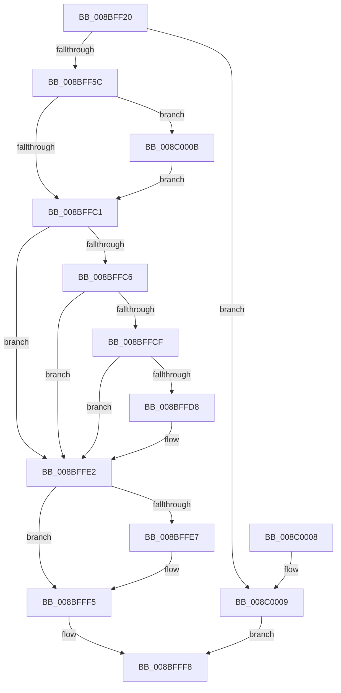

# EtwpAllocGuidEntry

- RVA: `0x008BFF20`–`0x008C0019` (길이 `249` bytes)
- VA: `0x00000001408BFF20`
- 실행 섹션: `PAGE`
- PDB 이름 있음: `예`; PDB Function 태그: `아니요`
- unwind 정보 RVA: `0x00083408`
- 디코드: `62`개 명령, `249/249` bytes 표시
- 미해석 바이트: `0` (있으면 어셈블리에 `.byte`로 보존)

> 이 문서는 커널 이미지의 기계어와 PDB 기호를 분석해 생성했습니다. 4번과 5번은 함수 원형과 자료형을 바이너리 사용 방식에서 추정한 C 해석이며 원본 소스 복구 결과는 아닙니다.

## 1. Dependencies

- 직접 호출 지점: **5**; 고유 호출 대상: **4**
- 직접 호출자로 확인된 함수: **1**
- RIP 상대 이미지 참조: **2**

### Outgoing calls
- `0x008BFF4B` → [ExAllocatePool2](../../poolcode/B8/ExAllocatePool2_function_00B820F0.md) (function, `0x00B820F0`)
- `0x008BFFA1` → [EtwpGetSecurityDescriptorByGuid](../8C/EtwpGetSecurityDescriptorByGuid_function_008C04C0.md) (function, `0x008C04C0`)
- `0x008BFFB8` → [ObLogSecurityDescriptor](../8C/ObLogSecurityDescriptor_function_008C0020.md) (function, `0x008C0020`)
- `0x008BFFDD` → [ExFreePoolWithTag](../../poolcode/B8/ExFreePoolWithTag_function_00B82870.md) (function, `0x00B82870`)
- `0x008C0010` → [ExFreePoolWithTag](../../poolcode/B8/ExFreePoolWithTag_function_00B82870.md) (function, `0x00B82870`)

### Direct callers
- [EtwpAddGuidEntry](EtwpAddGuidEntry_function_008BFC80.md) at `0x008BFCA0`

### Static image references
- `0x008BFFC6` → RVA `0x00FC6D68` (`ALMOSTRO`; read)
- `0x008BFFCF` → RVA `0x00E68510` (`.data`; read)

## 2. Other-region calls and transfers

- 다른 실행 섹션으로 향하는 call: **3**
  - `0x008BFF4B` → [ExAllocatePool2](../../poolcode/B8/ExAllocatePool2_function_00B820F0.md) (`PAGE` → `POOLCODE`)
  - `0x008BFFDD` → [ExFreePoolWithTag](../../poolcode/B8/ExFreePoolWithTag_function_00B82870.md) (`PAGE` → `POOLCODE`)
  - `0x008C0010` → [ExFreePoolWithTag](../../poolcode/B8/ExFreePoolWithTag_function_00B82870.md) (`PAGE` → `POOLCODE`)
- 별도 외부 분기/꼬리 이동을 확인하지 못했습니다.

## 3. Assembly (complete function range)

```asm
008BFF20  48 89 5C 24 08                  mov qword ptr [rsp + 8], rbx
008BFF25  48 89 74 24 10                  mov qword ptr [rsp + 0x10], rsi
008BFF2A  57                              push rdi
008BFF2B  48 83 EC 20                     sub rsp, 0x20
008BFF2F  48 83 64 24 40 00               and qword ptr [rsp + 0x40], 0
008BFF35  48 8B FA                        mov rdi, rdx
008BFF38  48 8B F1                        mov rsi, rcx
008BFF3B  BA A8 02 00 00                  mov edx, 0x2a8
008BFF40  B9 40 00 00 00                  mov ecx, 0x40
008BFF45  41 B8 45 74 77 47               mov r8d, 0x47777445
008BFF4B  E8 A0 21 2C 00                  call 0x140b820f0
008BFF50  48 8B D8                        mov rbx, rax
008BFF53  48 85 C0                        test rax, rax
008BFF56  0F 84 AD 00 00 00               je 0x1408c0009
008BFF5C  48 C7 40 20 01 00 00 00         mov qword ptr [rax + 0x20], 1
008BFF64  48 8D 54 24 40                  lea rdx, [rsp + 0x40]
008BFF69  0F 10 07                        movups xmm0, xmmword ptr [rdi]
008BFF6C  48 8B CF                        mov rcx, rdi
008BFF6F  F3 0F 7F 40 28                  movdqu xmmword ptr [rax + 0x28], xmm0
008BFF74  48 83 C0 38                     add rax, 0x38
008BFF78  48 89 40 08                     mov qword ptr [rax + 8], rax
008BFF7C  48 89 00                        mov qword ptr [rax], rax
008BFF7F  48 8D 43 10                     lea rax, [rbx + 0x10]
008BFF83  48 89 40 08                     mov qword ptr [rax + 8], rax
008BFF87  48 89 00                        mov qword ptr [rax], rax
008BFF8A  48 83 A3 A0 02 00 00 00         and qword ptr [rbx + 0x2a0], 0
008BFF92  48 83 A3 98 02 00 00 00         and qword ptr [rbx + 0x298], 0
008BFF9A  48 89 B3 88 02 00 00            mov qword ptr [rbx + 0x288], rsi
008BFFA1  E8 1A 05 00 00                  call 0x1408c04c0
008BFFA6  48 8B 7C 24 40                  mov rdi, qword ptr [rsp + 0x40]
008BFFAB  48 8D 53 48                     lea rdx, [rbx + 0x48]
008BFFAF  48 8B CF                        mov rcx, rdi
008BFFB2  41 B8 01 00 00 00               mov r8d, 1
008BFFB8  E8 63 00 00 00                  call 0x1408c0020
008BFFBD  85 C0                           test eax, eax
008BFFBF  78 4A                           js 0x1408c000b
008BFFC1  48 85 FF                        test rdi, rdi
008BFFC4  74 1C                           je 0x1408bffe2
008BFFC6  48 3B 3D 9B 6D 70 00            cmp rdi, qword ptr [rip + 0x706d9b]
008BFFCD  74 13                           je 0x1408bffe2
008BFFCF  48 3B 3D 3A 85 5A 00            cmp rdi, qword ptr [rip + 0x5a853a]
008BFFD6  74 0A                           je 0x1408bffe2
008BFFD8  33 D2                           xor edx, edx
008BFFDA  48 8B CF                        mov rcx, rdi
008BFFDD  E8 8E 28 2C 00                  call 0x140b82870
008BFFE2  48 85 DB                        test rbx, rbx
008BFFE5  74 0E                           je 0x1408bfff5
008BFFE7  48 8B 83 88 02 00 00            mov rax, qword ptr [rbx + 0x288]
008BFFEE  F0 FF 80 28 11 00 00            lock inc dword ptr [rax + 0x1128]
008BFFF5  48 8B C3                        mov rax, rbx
008BFFF8  48 8B 5C 24 30                  mov rbx, qword ptr [rsp + 0x30]
008BFFFD  48 8B 74 24 38                  mov rsi, qword ptr [rsp + 0x38]
008C0002  48 83 C4 20                     add rsp, 0x20
008C0006  5F                              pop rdi
008C0007  C3                              ret
008C0008  CC                              int3
008C0009  EB ED                           jmp 0x1408bfff8
008C000B  33 D2                           xor edx, edx
008C000D  48 8B CB                        mov rcx, rbx
008C0010  E8 5B 28 2C 00                  call 0x140b82870
008C0015  33 DB                           xor ebx, ebx
008C0017  EB A8                           jmp 0x1408bffc1
```

## 4. C-style interpretation (structured pseudocode)

```c
__int64 __fastcall EtwpAllocGuidEntry(__int64 a1, __int64 a2)
{
    __int64 result;
    __int64 v_rbx;
    __int64 v_rsp;
    unsigned __int64 v_stack_p10;
    unsigned __int64 v_stack_p18;
    unsigned __int64 v_stack_p8;

    v_stack_p8 = v_rbx;
    v_stack_p10 = v_rsi;
    v_rsp = (v_rsp) - (32);
    result = ExAllocatePool2(64, 680, (unsigned int)(0x47777445ULL), a4);
    if (result == 0) goto loc_008C0009;
    *(unsigned __int64 *)(result + 32) = 1;
    *(unsigned __int64 *)(result + 40) = v_xmm0;
    result = (result) + (56);
    *(unsigned __int64 *)(result + 8) = result;
    *(unsigned __int64 *)(result) = result;
    *(unsigned __int64 *)(result + 16 + 8) = result + 16;
    *(unsigned __int64 *)(result + 16) = result + 16;
    *(unsigned __int64 *)(result + 648) = a1;
    result = EtwpGetSecurityDescriptorByGuid(a2, v_stack_p18, (unsigned int)(0x47777445ULL), a4);
    result = ObLogSecurityDescriptor(v_stack_p18, result + 72, 1, a4);
    if (sign_flag) goto loc_008C000B;
loc_008BFFC1:
    if (v_stack_p18 == 0) goto loc_008BFFE2;
    if (v_stack_p18 == (*(unsigned __int64 *)(v_rip + 7368091))) goto loc_008BFFE2;
    if (v_stack_p18 != (*(unsigned __int64 *)(v_rip + 5932346))) {
        a2 = 0;
        a1 = v_stack_p18;
        result = ExFreePoolWithTag(a1, a2, 1, a4);
    }
    if (result != 0) {
        result = *(unsigned __int64 *)(result + 648);
    }
loc_008BFFF8:
    v_rsp = (v_rsp) + (32);
    return result;
loc_008C0009:
    goto loc_008BFFF8;
loc_008C000B:
    a2 = 0;
    result = ExFreePoolWithTag(v_stack_p8, a2, 1, a4);
    v_rbx = 0;
    goto loc_008BFFC1;
}
```

## 5. (Beta) C Style

```c
int64_t EtwpAllocGuidEntry(int64_t Arg1, void *Arg2)
{
    uint8_t *arg2 = (uint8_t *)Arg2;

    int64_t result;
    int64_t local_rbx;
    int64_t local_rsp;
    uint64_t v_stack_p10;
    uint64_t v_stack_p18;
    uint64_t v_stack_p8;

    v_stack_p8 = local_rbx;
    v_stack_p10 = local_rsi;
    local_rsp = (local_rsp) - (32);
    result = ExAllocatePool2(64, 680, (uint32_t)(0x47777445ULL), a4);
    if (result == 0) goto loc_008C0009;
    *(uint64_t *)(result + 0x20) = 1;
    *(uint64_t *)(result + 0x28) = v_xmm0;
    result = (result) + (56);
    *(uint64_t *)(result + 0x8) = result;
    *(uint64_t *)(result) = result;
    *(uint64_t *)(result + 0x10 + 0x8) = result + 16;
    *(uint64_t *)(result + 0x10) = result + 16;
    *(uint64_t *)(result + 0x288) = Arg1;
    result = EtwpGetSecurityDescriptorByGuid(Arg2, v_stack_p18, (uint32_t)(0x47777445ULL), a4);
    result = ObLogSecurityDescriptor(v_stack_p18, result + 72, 1, a4);
    if (sign_flag) goto loc_008C000B;
loc_008BFFC1:
    if (v_stack_p18 == 0) goto loc_008BFFE2;
    if (v_stack_p18 == (*(uint64_t *)(v_rip + 0x706D9B))) goto loc_008BFFE2;
    if (v_stack_p18 != (*(uint64_t *)(v_rip + 0x5A853A))) {
        Arg2 = 0;
        Arg1 = v_stack_p18;
        result = ExFreePoolWithTag(Arg1, Arg2, 1, a4);
    }
    if (result != 0) {
        result = *(uint64_t *)(result + 0x288);
    }
loc_008BFFF8:
    local_rsp = (local_rsp) + (32);
    return result;
loc_008C0009:
    goto loc_008BFFF8;
loc_008C000B:
    Arg2 = 0;
    result = ExFreePoolWithTag(v_stack_p8, Arg2, 1, a4);
    local_rbx = 0;
    goto loc_008BFFC1;
}
```

### 관측된 메모리 오프셋

구조체 형식이 확인되지 않은 접근은 인자 기준의 오프셋으로만 기록했습니다.

| 기준 인자 | 오프셋 표현 | 폭 (bit) | 접근 |
|---|---:|---:|---|
| `Arg2` | `+ 0x0` | `128` | `R` |

## 6. Execution-region graph

[열기: 2D/3D 그래프와 함수 탐색 컨트롤 패널](../../../control-panel.html?section=page&rva=0x008BFF20&view=graph)

- 2D 그래프는 위에서 아래로 흐르고, 3D 그래프는 빈 공간을 드래그해 회전합니다. Shift+드래그는 이동, 휠은 확대·축소, 함수 노드 선택은 대상 보고서 이동입니다.

### Static fallback


