# EtwpGetLoggerInfoFromContext

- RVA: `0x008BEF90`–`0x008BF34C` (길이 `956` bytes)
- VA: `0x00000001408BEF90`
- 실행 섹션: `PAGE`
- PDB 이름 있음: `예`; PDB Function 태그: `아니요`
- unwind 정보 RVA: `0x00083288`
- 디코드: `224`개 명령, `956/956` bytes 표시
- 미해석 바이트: `0` (있으면 어셈블리에 `.byte`로 보존)

> 이 문서는 커널 이미지의 기계어와 PDB 기호를 분석해 생성했습니다. 4번과 5번은 함수 원형과 자료형을 바이너리 사용 방식에서 추정한 C 해석이며 원본 소스 복구 결과는 아닙니다.

## 1. Dependencies

- 직접 호출 지점: **12**; 고유 호출 대상: **10**
- 직접 호출자로 확인된 함수: **7**
- RIP 상대 이미지 참조: **2**

### Outgoing calls
- `0x008BF0F1` → [KeAbPreAcquire](../../text/21/KeAbPreAcquire_function_00210230.md) (function, `0x00210230`)
- `0x008BF10A` → [ExfAcquirePushLockExclusiveEx](../../text/20/ExfAcquirePushLockExclusiveEx_function_0020FC90.md) (function, `0x0020FC90`)
- `0x008BF146` → [KeAbPostRelease](../../text/2E/KeAbPostRelease_function_002E1600.md) (function, `0x002E1600`)
- `0x008BF15F` → [_security_check_cookie](../../text/6A/_security_check_cookie_function_006AC640.md) (function, `0x006AC640`)
- `0x008BF238` → [PsGetCurrentServerSiloGlobals](../../text/2F/PsGetCurrentServerSiloGlobals_function_002FE1F0.md) (function, `0x002FE1F0`)
- `0x008BF261` → [ProbeForWrite](../8E/ProbeForWrite_function_008E91C0.md) (function, `0x008E91C0`)
- `0x008BF270` → [RtlCopyUnicodeString](../../text/3F/RtlCopyUnicodeString_function_003FEF30.md) (function, `0x003FEF30`)
- `0x008BF28F` → [memcmp](../../text/6C/memcmp_function_006C6B10.md) (function, `0x006C6B10`)
- `0x008BF2C9` → [ExRaiseDatatypeMisalignment](../89/ExRaiseDatatypeMisalignment_function_00899FD0.md) (function, `0x00899FD0`)
- `0x008BF2FE` → [ProbeForWrite](../8E/ProbeForWrite_function_008E91C0.md) (function, `0x008E91C0`)
- `0x008BF30D` → [RtlCopyUnicodeString](../../text/3F/RtlCopyUnicodeString_function_003FEF30.md) (function, `0x003FEF30`)
- `0x008BF342` → [ExfTryToWakePushLock](../../text/26/ExfTryToWakePushLock_function_00265DD0.md) (function, `0x00265DD0`)

### Direct callers
- [EtwpTransitionToRealtime](../../text/65/EtwpTransitionToRealtime_function_006518D8.md) at `0x006519FA`
- [EtwpIncrementTraceFile](../7B/EtwpIncrementTraceFile_function_007B9210.md) at `0x007B92C1`
- [EtwpQueryTrace](EtwpQueryTrace_function_008BF8B0.md) at `0x008BF929`
- [EtwpStopTrace](../9B/EtwpStopTrace_function_009BCE84.md) at `0x009BCFA4`
- [EtwpStopTrace](../9B/EtwpStopTrace_function_009BCE84.md) at `0x009BD106`
- [EtwpStartLogger](../A9/EtwpStartLogger_function_00A99D80.md) at `0x00A9ADB5`
- [EtwpStartLogger](../A9/EtwpStartLogger_function_00A99D80.md) at `0x00A9ADEA`
- [EtwpUpdateTrace](../AB/EtwpUpdateTrace_function_00ABCC7C.md) at `0x00ABD0EC`
- [EtwpFlushTrace](../AF/EtwpFlushTrace_function_00AF47B4.md) at `0x00AF4968`

### Static image references
- `0x008BEFAA` → RVA `0x00E0A740` (`.data`; read)
- `0x008BF1AE` → RVA `0x00B4D4C0` (`EtwpEnableFlagMap`; read)

## 2. Other-region calls and transfers

- 다른 실행 섹션으로 향하는 call: **9**
  - `0x008BF0F1` → [KeAbPreAcquire](../../text/21/KeAbPreAcquire_function_00210230.md) (`PAGE` → `.text`)
  - `0x008BF10A` → [ExfAcquirePushLockExclusiveEx](../../text/20/ExfAcquirePushLockExclusiveEx_function_0020FC90.md) (`PAGE` → `.text`)
  - `0x008BF146` → [KeAbPostRelease](../../text/2E/KeAbPostRelease_function_002E1600.md) (`PAGE` → `.text`)
  - `0x008BF15F` → [_security_check_cookie](../../text/6A/_security_check_cookie_function_006AC640.md) (`PAGE` → `.text`)
  - `0x008BF238` → [PsGetCurrentServerSiloGlobals](../../text/2F/PsGetCurrentServerSiloGlobals_function_002FE1F0.md) (`PAGE` → `.text`)
  - `0x008BF270` → [RtlCopyUnicodeString](../../text/3F/RtlCopyUnicodeString_function_003FEF30.md) (`PAGE` → `.text`)
  - `0x008BF28F` → [memcmp](../../text/6C/memcmp_function_006C6B10.md) (`PAGE` → `.text`)
  - `0x008BF30D` → [RtlCopyUnicodeString](../../text/3F/RtlCopyUnicodeString_function_003FEF30.md) (`PAGE` → `.text`)
  - `0x008BF342` → [ExfTryToWakePushLock](../../text/26/ExfTryToWakePushLock_function_00265DD0.md) (`PAGE` → `.text`)
- 별도 외부 분기/꼬리 이동을 확인하지 못했습니다.

## 3. Assembly (complete function range)

```asm
008BEF90  48 89 5C 24 18                  mov qword ptr [rsp + 0x18], rbx
008BEF95  48 89 74 24 20                  mov qword ptr [rsp + 0x20], rsi
008BEF9A  57                              push rdi
008BEF9B  41 54                           push r12
008BEF9D  41 55                           push r13
008BEF9F  41 56                           push r14
008BEFA1  41 57                           push r15
008BEFA3  48 81 EC 80 00 00 00            sub rsp, 0x80
008BEFAA  48 8B 05 8F B7 54 00            mov rax, qword ptr [rip + 0x54b78f]
008BEFB1  48 33 C4                        xor rax, rsp
008BEFB4  48 89 44 24 70                  mov qword ptr [rsp + 0x70], rax
008BEFB9  48 8B F2                        mov rsi, rdx
008BEFBC  48 8B D9                        mov rbx, rcx
008BEFBF  48 89 4C 24 30                  mov qword ptr [rsp + 0x30], rcx
008BEFC4  48 89 54 24 38                  mov qword ptr [rsp + 0x38], rdx
008BEFC9  33 FF                           xor edi, edi
008BEFCB  44 8B FF                        mov r15d, edi
008BEFCE  F7 42 0C 00 00 00 02            test dword ptr [rdx + 0xc], 0x2000000
008BEFD5  0F 85 A7 01 00 00               jne 0x1408bf182
008BEFDB  89 79 48                        mov dword ptr [rcx + 0x48], edi
008BEFDE  0F 10 86 14 01 00 00            movups xmm0, xmmword ptr [rsi + 0x114]
008BEFE5  F3 0F 7F 43 18                  movdqu xmmword ptr [rbx + 0x18], xmm0
008BEFEA  8B 46 0C                        mov eax, dword ptr [rsi + 0xc]
008BEFED  89 43 40                        mov dword ptr [rbx + 0x40], eax
008BEFF0  8B 86 24 01 00 00               mov eax, dword ptr [rsi + 0x124]
008BEFF6  89 43 3C                        mov dword ptr [rbx + 0x3c], eax
008BEFF9  8B 86 D0 00 00 00               mov eax, dword ptr [rsi + 0xd0]
008BEFFF  89 43 44                        mov dword ptr [rbx + 0x44], eax
008BF002  8B 46 04                        mov eax, dword ptr [rsi + 4]
008BF005  C1 E8 0A                        shr eax, 0xa
008BF008  89 43 30                        mov dword ptr [rbx + 0x30], eax
008BF00B  8B 86 E8 00 00 00               mov eax, dword ptr [rsi + 0xe8]
008BF011  89 43 60                        mov dword ptr [rbx + 0x60], eax
008BF014  8B 86 E0 00 00 00               mov eax, dword ptr [rsi + 0xe0]
008BF01A  89 43 34                        mov dword ptr [rbx + 0x34], eax
008BF01D  8B 86 EC 00 00 00               mov eax, dword ptr [rsi + 0xec]
008BF023  89 43 38                        mov dword ptr [rbx + 0x38], eax
008BF026  8B 86 F0 00 00 00               mov eax, dword ptr [rsi + 0xf0]
008BF02C  89 43 68                        mov dword ptr [rbx + 0x68], eax
008BF02F  8B 86 E4 00 00 00               mov eax, dword ptr [rsi + 0xe4]
008BF035  89 43 64                        mov dword ptr [rbx + 0x64], eax
008BF038  8B 8E F8 00 00 00               mov ecx, dword ptr [rsi + 0xf8]
008BF03E  8B 86 00 01 00 00               mov eax, dword ptr [rsi + 0x100]
008BF044  3B C8                           cmp ecx, eax
008BF046  0F 46 C8                        cmovbe ecx, eax
008BF049  89 4B 6C                        mov dword ptr [rbx + 0x6c], ecx
008BF04C  48 89 7B 50                     mov qword ptr [rbx + 0x50], rdi
008BF050  8B 8E 30 03 00 00               mov ecx, dword ptr [rsi + 0x330]
008BF056  48 C1 E9 04                     shr rcx, 4
008BF05A  83 E1 01                        and ecx, 1
008BF05D  48 89 4B 50                     mov qword ptr [rbx + 0x50], rcx
008BF061  8B 86 30 03 00 00               mov eax, dword ptr [rsi + 0x330]
008BF067  48 C1 E8 1A                     shr rax, 0x1a
008BF06B  83 E0 02                        and eax, 2
008BF06E  48 0B C1                        or rax, rcx
008BF071  48 89 43 50                     mov qword ptr [rbx + 0x50], rax
008BF075  8B 86 FC 00 00 00               mov eax, dword ptr [rsi + 0xfc]
008BF07B  89 43 70                        mov dword ptr [rbx + 0x70], eax
008BF07E  8B 86 04 01 00 00               mov eax, dword ptr [rsi + 0x104]
008BF084  89 43 74                        mov dword ptr [rbx + 0x74], eax
008BF087  8B 86 58 01 00 00               mov eax, dword ptr [rsi + 0x158]
008BF08D  89 83 A0 00 00 00               mov dword ptr [rbx + 0xa0], eax
008BF093  8B 86 D4 00 00 00               mov eax, dword ptr [rsi + 0xd4]
008BF099  89 43 4C                        mov dword ptr [rbx + 0x4c], eax
008BF09C  39 3E                           cmp dword ptr [rsi], edi
008BF09E  0F 84 91 02 00 00               je 0x1408bf335
008BF0A4  0F B7 06                        movzx eax, word ptr [rsi]
008BF0A7  66 89 43 08                     mov word ptr [rbx + 8], ax
008BF0AB  48 8B 46 20                     mov rax, qword ptr [rsi + 0x20]
008BF0AF  48 85 C0                        test rax, rax
008BF0B2  74 0B                           je 0x1408bf0bf
008BF0B4  48 8B 80 10 05 00 00            mov rax, qword ptr [rax + 0x510]
008BF0BB  48 89 43 78                     mov qword ptr [rbx + 0x78], rax
008BF0BF  8B 86 C8 00 00 00               mov eax, dword ptr [rsi + 0xc8]
008BF0C5  89 43 28                        mov dword ptr [rbx + 0x28], eax
008BF0C8  65 48 8B 04 25 88 01 00 00      mov rax, qword ptr gs:[0x188]
008BF0D1  44 8A A0 32 02 00 00            mov r12b, byte ptr [rax + 0x232]
008BF0D8  44 88 64 24 20                  mov byte ptr [rsp + 0x20], r12b
008BF0DD  4C 8D B6 B0 02 00 00            lea r14, [rsi + 0x2b0]
008BF0E4  4C 89 74 24 28                  mov qword ptr [rsp + 0x28], r14
008BF0E9  45 33 C0                        xor r8d, r8d
008BF0EC  33 D2                           xor edx, edx
008BF0EE  49 8B CE                        mov rcx, r14
008BF0F1  E8 3A 11 95 FF                  call 0x140210230
008BF0F6  4C 8B E8                        mov r13, rax
008BF0F9  F0 49 0F BA 2E 00               lock bts qword ptr [r14], 0
008BF0FF  73 0E                           jae 0x1408bf10f
008BF101  4D 8B C6                        mov r8, r14
008BF104  48 8B D0                        mov rdx, rax
008BF107  49 8B CE                        mov rcx, r14
008BF10A  E8 81 0B 95 FF                  call 0x14020fc90
008BF10F  4D 85 ED                        test r13, r13
008BF112  74 05                           je 0x1408bf119
008BF114  41 C6 45 0A 01                  mov byte ptr [r13 + 0xa], 1
008BF119  4C 8D AE 98 00 00 00            lea r13, [rsi + 0x98]
008BF120  41 0F B7 45 00                  movzx eax, word ptr [r13]
008BF125  66 85 C0                        test ax, ax
008BF128  0F 85 AD 01 00 00               jne 0x1408bf2db
008BF12E  48 83 C9 FF                     or rcx, 0xffffffffffffffff
008BF132  F0 49 0F C1 0E                  lock xadd qword ptr [r14], rcx
008BF137  80 E1 06                        and cl, 6
008BF13A  80 F9 02                        cmp cl, 2
008BF13D  0F 84 FC 01 00 00               je 0x1408bf33f
008BF143  49 8B CE                        mov rcx, r14
008BF146  E8 B5 24 A2 FF                  call 0x1402e1600
008BF14B  45 85 FF                        test r15d, r15d
008BF14E  0F 84 A8 00 00 00               je 0x1408bf1fc
008BF154  41 8B C7                        mov eax, r15d
008BF157  48 8B 4C 24 70                  mov rcx, qword ptr [rsp + 0x70]
008BF15C  48 33 CC                        xor rcx, rsp
008BF15F  E8 DC D4 DE FF                  call 0x1406ac640
008BF164  4C 8D 9C 24 80 00 00 00         lea r11, [rsp + 0x80]
008BF16C  49 8B 5B 40                     mov rbx, qword ptr [r11 + 0x40]
008BF170  49 8B 73 48                     mov rsi, qword ptr [r11 + 0x48]
008BF174  49 8B E3                        mov rsp, r11
008BF177  41 5F                           pop r15
008BF179  41 5E                           pop r14
008BF17B  41 5D                           pop r13
008BF17D  41 5C                           pop r12
008BF17F  5F                              pop rdi
008BF180  C3                              ret
008BF181  CC                              int3
008BF182  0F B6 8A 32 03 00 00            movzx ecx, byte ptr [rdx + 0x332]
008BF189  48 C1 E1 05                     shl rcx, 5
008BF18D  48 8B 82 50 05 00 00            mov rax, qword ptr [rdx + 0x550]
008BF194  0F 10 84 01 CC 11 00 00         movups xmm0, xmmword ptr [rcx + rax + 0x11cc]
008BF19C  0F 11 44 24 50                  movups xmmword ptr [rsp + 0x50], xmm0
008BF1A1  0F 10 8C 01 DC 11 00 00         movups xmm1, xmmword ptr [rcx + rax + 0x11dc]
008BF1A9  0F 11 4C 24 60                  movups xmmword ptr [rsp + 0x60], xmm1
008BF1AE  4C 8D 05 0B E3 28 00            lea r8, [rip + 0x28e30b]
008BF1B5  41 B9 08 00 00 00               mov r9d, 8
008BF1BB  41 BA FF FF FF 1F               mov r10d, 0x1fffffff
008BF1C1  41 8B 50 04                     mov edx, dword ptr [r8 + 4]
008BF1C5  8B C2                           mov eax, edx
008BF1C7  48 C1 E8 1D                     shr rax, 0x1d
008BF1CB  8B 4C 84 50                     mov ecx, dword ptr [rsp + rax*4 + 0x50]
008BF1CF  23 CA                           and ecx, edx
008BF1D1  41 85 CA                        test r10d, ecx
008BF1D4  74 10                           je 0x1408bf1e6
008BF1D6  41 8B 08                        mov ecx, dword ptr [r8]
008BF1D9  8B C1                           mov eax, ecx
008BF1DB  48 C1 E8 1D                     shr rax, 0x1d
008BF1DF  41 23 CA                        and ecx, r10d
008BF1E2  09 4C 84 50                     or dword ptr [rsp + rax*4 + 0x50], ecx
008BF1E6  49 83 C0 08                     add r8, 8
008BF1EA  49 83 E9 01                     sub r9, 1
008BF1EE  75 D1                           jne 0x1408bf1c1
008BF1F0  8B 44 24 50                     mov eax, dword ptr [rsp + 0x50]
008BF1F4  89 43 48                        mov dword ptr [rbx + 0x48], eax
008BF1F7  E9 E2 FD FF FF                  jmp 0x1408befde
008BF1FC  66 39 BE 88 00 00 00            cmp word ptr [rsi + 0x88], di
008BF203  0F 86 4B FF FF FF               jbe 0x1408bf154
008BF209  66 39 BB 92 00 00 00            cmp word ptr [rbx + 0x92], di
008BF210  0F 86 3E FF FF FF               jbe 0x1408bf154
008BF216  45 84 E4                        test r12b, r12b
008BF219  74 0C                           je 0x1408bf227
008BF21B  0F B7 83 90 00 00 00            movzx eax, word ptr [rbx + 0x90]
008BF222  66 85 C0                        test ax, ax
008BF225  75 73                           jne 0x1408bf29a
008BF227  4C 8D B3 90 00 00 00            lea r14, [rbx + 0x90]
008BF22E  48 89 7C 24 40                  mov qword ptr [rsp + 0x40], rdi
008BF233  48 89 7C 24 48                  mov qword ptr [rsp + 0x48], rdi
008BF238  E8 B3 EF A3 FF                  call 0x1402fe1f0
008BF23D  44 0F B7 AE 88 00 00 00         movzx r13d, word ptr [rsi + 0x88]
008BF245  66 45 3B 2E                     cmp r13w, word ptr [r14]
008BF249  74 2C                           je 0x1408bf277
008BF24B  45 84 E4                        test r12b, r12b
008BF24E  74 16                           je 0x1408bf266
008BF250  49 8D 55 02                     lea rdx, [r13 + 2]
008BF254  41 B8 02 00 00 00               mov r8d, 2
008BF25A  48 8B 8B 98 00 00 00            mov rcx, qword ptr [rbx + 0x98]
008BF261  E8 5A 9F 02 00                  call 0x1408e91c0
008BF266  48 8D 96 88 00 00 00            lea rdx, [rsi + 0x88]
008BF26D  49 8B CE                        mov rcx, r14
008BF270  E8 BB FC B3 FF                  call 0x1403fef30
008BF275  EB 57                           jmp 0x1408bf2ce
008BF277  48 8B 8E 90 00 00 00            mov rcx, qword ptr [rsi + 0x90]
008BF27E  48 89 4C 24 40                  mov qword ptr [rsp + 0x40], rcx
008BF283  49 8B 56 08                     mov rdx, qword ptr [r14 + 8]
008BF287  48 89 54 24 48                  mov qword ptr [rsp + 0x48], rdx
008BF28C  4D 8B C5                        mov r8, r13
008BF28F  E8 7C 78 E0 FF                  call 0x1406c6b10
008BF294  85 C0                           test eax, eax
008BF296  74 36                           je 0x1408bf2ce
008BF298  EB B1                           jmp 0x1408bf24b
008BF29A  48 8B 8B 98 00 00 00            mov rcx, qword ptr [rbx + 0x98]
008BF2A1  F6 C1 01                        test cl, 1
008BF2A4  75 23                           jne 0x1408bf2c9
008BF2A6  48 8D 14 01                     lea rdx, [rcx + rax]
008BF2AA  48 B8 00 00 FF FF FF 7F 00 00   movabs rax, 0x7fffffff0000
008BF2B4  48 3B D0                        cmp rdx, rax
008BF2B7  77 09                           ja 0x1408bf2c2
008BF2B9  48 3B D1                        cmp rdx, rcx
008BF2BC  0F 83 65 FF FF FF               jae 0x1408bf227
008BF2C2  8A 00                           mov al, byte ptr [rax]
008BF2C4  E9 5E FF FF FF                  jmp 0x1408bf227
008BF2C9  E8 02 AD FD FF                  call 0x140899fd0
008BF2CE  E9 81 FE FF FF                  jmp 0x1408bf154
008BF2D3  44 8B F8                        mov r15d, eax
008BF2D6  E9 79 FE FF FF                  jmp 0x1408bf154
008BF2DB  66 39 BB 82 00 00 00            cmp word ptr [rbx + 0x82], di
008BF2E2  0F 86 46 FE FF FF               jbe 0x1408bf12e
008BF2E8  45 84 E4                        test r12b, r12b
008BF2EB  74 16                           je 0x1408bf303
008BF2ED  48 8D 50 02                     lea rdx, [rax + 2]
008BF2F1  41 B8 02 00 00 00               mov r8d, 2
008BF2F7  48 8B 8B 88 00 00 00            mov rcx, qword ptr [rbx + 0x88]
008BF2FE  E8 BD 9E 02 00                  call 0x1408e91c0
008BF303  48 8D 8B 80 00 00 00            lea rcx, [rbx + 0x80]
008BF30A  49 8B D5                        mov rdx, r13
008BF30D  E8 1E FC B3 FF                  call 0x1403fef30
008BF312  E9 17 FE FF FF                  jmp 0x1408bf12e
008BF317  44 8B F8                        mov r15d, eax
008BF31A  33 FF                           xor edi, edi
008BF31C  44 8A 64 24 20                  mov r12b, byte ptr [rsp + 0x20]
008BF321  4C 8B 74 24 28                  mov r14, qword ptr [rsp + 0x28]
008BF326  48 8B 5C 24 30                  mov rbx, qword ptr [rsp + 0x30]
008BF32B  48 8B 74 24 38                  mov rsi, qword ptr [rsp + 0x38]
008BF330  E9 F9 FD FF FF                  jmp 0x1408bf12e
008BF335  B8 FF FF 00 00                  mov eax, 0xffff
008BF33A  E9 68 FD FF FF                  jmp 0x1408bf0a7
008BF33F  49 8B CE                        mov rcx, r14
008BF342  E8 89 6A 9A FF                  call 0x140265dd0
008BF347  E9 F7 FD FF FF                  jmp 0x1408bf143
```

## 4. C-style interpretation (structured pseudocode)

```c
__int64 __fastcall EtwpGetLoggerInfoFromContext(__int64 a1, __int64 a2, int a3)
{
    __int64 result;
    __int64 v_rdi;
    __int64 v_rsp;
    unsigned __int64 v_stack_m20;
    unsigned __int64 v_stack_m28;
    unsigned __int64 v_stack_m30;
    unsigned __int64 v_stack_m38;
    unsigned __int64 v_stack_m40;
    unsigned __int64 v_stack_m48;
    unsigned __int64 v_stack_m50;
    unsigned __int64 v_stack_m58;
    unsigned __int8 v_stack_m60;
    unsigned __int64 v_stack_m70;
    unsigned __int64 v_stack_m78;
    unsigned __int64 v_stack_m80;
    unsigned __int8 v_stack_m88;
    unsigned __int64 v_stack_p18;
    unsigned __int64 v_stack_p20;

    v_stack_p18 = v_rbx;
    v_stack_p20 = v_rsi;
    v_rsp = (v_rsp) - (128);
    result = (*(unsigned __int64 *)(v_rip + 5552015)) ^ (v_rsp);
    v_stack_m38 = result;
    v_stack_m78 = a1;
    v_stack_m70 = a2;
    v_rdi = 0;
    if (((*(unsigned int *)(a2 + 12)) & (0x2000000ULL)) != 0) goto loc_008BF182;
    *(unsigned int *)(a1 + 72) = 0;
loc_008BEFDE:
    *(unsigned __int64 *)(a1 + 24) = v_xmm0;
    *(unsigned int *)(a1 + 64) = (unsigned int)((unsigned int)(*(unsigned int *)(a2 + 12)));
    *(unsigned int *)(a1 + 60) = (unsigned int)((unsigned int)(*(unsigned int *)(a2 + 292)));
    *(unsigned int *)(a1 + 68) = (unsigned int)((unsigned int)(*(unsigned int *)(a2 + 208)));
    result = (unsigned int)(((unsigned int)(*(unsigned int *)(a2 + 4))) >> (10));
    *(unsigned int *)(a1 + 48) = (unsigned int)(result);
    *(unsigned int *)(a1 + 96) = (unsigned int)((unsigned int)(*(unsigned int *)(a2 + 232)));
    *(unsigned int *)(a1 + 52) = (unsigned int)((unsigned int)(*(unsigned int *)(a2 + 224)));
    *(unsigned int *)(a1 + 56) = (unsigned int)((unsigned int)(*(unsigned int *)(a2 + 236)));
    *(unsigned int *)(a1 + 104) = (unsigned int)((unsigned int)(*(unsigned int *)(a2 + 240)));
    *(unsigned int *)(a1 + 100) = (unsigned int)((unsigned int)(*(unsigned int *)(a2 + 228)));
    a1 = (unsigned int)(*(unsigned int *)(a2 + 248));
    if (((unsigned int)((unsigned int)(*(unsigned int *)(a2 + 248)))) <= ((unsigned int)((unsigned int)(*(unsigned int *)(a2 + 256))))) { a1 = (unsigned int)((unsigned int)(*(unsigned int *)(a2 + 256))); }
    *(unsigned int *)(a1 + 108) = (unsigned int)(a1);
    *(unsigned __int64 *)(a1 + 80) = 0;
    a1 = ((unsigned int)(*(unsigned int *)(a2 + 816))) >> (4);
    a1 = (unsigned int)((a1) & (1));
    *(unsigned __int64 *)(a1 + 80) = a1;
    result = ((unsigned int)(*(unsigned int *)(a2 + 816))) >> (26);
    result = (unsigned int)((result) & (2));
    result = (result) | (a1);
    *(unsigned __int64 *)(a1 + 80) = result;
    *(unsigned int *)(a1 + 112) = (unsigned int)((unsigned int)(*(unsigned int *)(a2 + 252)));
    *(unsigned int *)(a1 + 116) = (unsigned int)((unsigned int)(*(unsigned int *)(a2 + 260)));
    *(unsigned int *)(a1 + 160) = (unsigned int)((unsigned int)(*(unsigned int *)(a2 + 344)));
    *(unsigned int *)(a1 + 76) = (unsigned int)((unsigned int)(*(unsigned int *)(a2 + 212)));
    if ((*(unsigned int *)(a2)) == 0) goto loc_008BF335;
loc_008BF0A7:
    *(unsigned __int16 *)(a1 + 8) = (unsigned __int16)(*(unsigned __int16 *)(a2));
    result = *(unsigned __int64 *)(a2 + 32);
    if (*(unsigned __int64 *)(a2 + 32) != 0) {
        result = *(unsigned __int64 *)(*(unsigned __int64 *)(a2 + 32) + 1296);
        *(unsigned __int64 *)(a1 + 120) = result;
    }
    *(unsigned int *)(a1 + 40) = (unsigned int)((unsigned int)(*(unsigned int *)(a2 + 200)));
    v_stack_m88 = (unsigned __int8)(*(unsigned __int8 *)(*(unsigned __int64 *)(gs_base + (0 + 392)) + 562));
    v_stack_m80 = a2 + 688;
    a3 = 0;
    a2 = 0;
    result = KeAbPreAcquire(a2 + 688, a2, a3, a4);
    if (!(condition_is_above_or_equal)) {
        a3 = a2 + 688;
        a2 = result;
        a1 = a2 + 688;
        result = ExfAcquirePushLockExclusiveEx(a1, a2, a3, a4);
    }
    if (result != 0) {
        *(unsigned __int8 *)(result + 10) = 1;
    }
    if ((unsigned __int16)(*(unsigned __int16 *)(a2 + 152)) != 0) goto loc_008BF2DB;
loc_008BF12E:
    a1 = (a1) | (-1);
    a1 = (unsigned __int8)((a1) & (6));
    if (((unsigned __int8)(a1)) == 2) goto loc_008BF33F;
loc_008BF143:
    result = KeAbPostRelease(a2 + 688, a2, a3, a4);
    if (0 == 0) goto loc_008BF1FC;
loc_008BF154:
    a1 = (v_stack_m38) ^ (v_rsp);
    result = _security_check_cookie(a1, a2, a3, a4);
    return result;
loc_008BF182:
    a1 = (*(unsigned __int8 *)(a2 + 818)) << (5);
    v_stack_m30 = v_xmm0;
    v_stack_m20 = v_xmm1;
loc_008BF1C1:
    result = ((unsigned int)((unsigned int)((unsigned int)(*(unsigned int *)(v_rip + 2679563 + 4))))) >> (29);
    a1 = (unsigned int)(((unsigned int)(*(unsigned int *)(v_stack_m28 + result * 4 + 80))) & ((unsigned int)((unsigned int)(*(unsigned int *)(v_rip + 2679563 + 4)))));
    if ((((unsigned int)((unsigned int)(0x1FFFFFFFULL))) & ((unsigned int)(a1))) != 0) {
        a1 = *(unsigned int *)(v_rip + 2679563);
        result = (unsigned int)(a1);
        result = (result) >> (29);
        a1 = (unsigned int)((a1) & ((unsigned int)((unsigned int)(0x1FFFFFFFULL))));
    }
    a3 = (v_rip + 2679563) + (8);
    a4 = (8) - (1);
    if (condition_is_not_equal) goto loc_008BF1C1;
    *(unsigned int *)(*(unsigned __int64 *)(v_stack_m28 + 64) + 72) = (unsigned int)((unsigned int)(v_stack_m30));
    goto loc_008BEFDE;
loc_008BF1FC:
    if ((*(unsigned __int16 *)(*(unsigned __int64 *)(v_stack_m28 + 72) + 136)) <= 0) goto loc_008BF154;
    if ((*(unsigned __int16 *)(*(unsigned __int64 *)(v_stack_m28 + 64) + 146)) <= 0) goto loc_008BF154;
    if ((unsigned __int8)(*(unsigned __int8 *)(*(unsigned __int64 *)(gs_base + (0 + 392)) + 562)) == 0) goto loc_008BF227;
    if ((unsigned __int16)(*(unsigned __int16 *)(*(unsigned __int64 *)(v_stack_m28 + 64) + 144)) != 0) goto loc_008BF29A;
loc_008BF227:
    v_stack_m40 = 0;
    v_stack_m38 = 0;
    result = PsGetCurrentServerSiloGlobals(a1, (unsigned int)(*(unsigned int *)(v_rip + 2679563 + 4)), a3, a4);
    if (((unsigned __int16)(*(unsigned __int16 *)(*(unsigned __int64 *)(v_stack_m28 + 72) + 136))) == (*(unsigned __int16 *)(*(unsigned __int64 *)(v_stack_m28 + 64) + 144))) goto loc_008BF277;
loc_008BF24B:
    if ((unsigned __int8)(*(unsigned __int8 *)(*(unsigned __int64 *)(gs_base + (0 + 392)) + 562)) != 0) {
        a2 = *(unsigned __int16 *)(*(unsigned __int64 *)(v_stack_m28 + 72) + 136) + 2;
        a3 = 2;
        a1 = *(unsigned __int64 *)(*(unsigned __int64 *)(v_stack_m28 + 64) + 152);
        result = ProbeForWrite(a1, a2, a3, a4);
    }
    result = RtlCopyUnicodeString(*(unsigned __int64 *)(v_stack_m28 + 64) + 144, *(unsigned __int64 *)(v_stack_m28 + 72) + 136, a3, a4);
    goto loc_008BF2CE;
loc_008BF277:
    v_stack_m40 = *(unsigned __int64 *)(*(unsigned __int64 *)(v_stack_m28 + 72) + 144);
    v_stack_m38 = *(unsigned __int64 *)(*(unsigned __int64 *)(v_stack_m28 + 64) + 144 + 8);
    result = memcmp(*(unsigned __int64 *)(*(unsigned __int64 *)(v_stack_m28 + 72) + 144), *(unsigned __int64 *)(*(unsigned __int64 *)(v_stack_m28 + 64) + 144 + 8), *(unsigned __int16 *)(*(unsigned __int64 *)(v_stack_m28 + 72) + 136), a4);
    if ((unsigned int)(result) == 0) goto loc_008BF2CE;
    goto loc_008BF24B;
loc_008BF29A:
    if ((((unsigned __int8)(*(unsigned __int64 *)(*(unsigned __int64 *)(v_stack_m28 + 64) + 152))) & (1)) != 0) goto loc_008BF2C9;
    if ((*(unsigned __int64 *)(*(unsigned __int64 *)(v_stack_m28 + 64) + 152) + result * 1) > result) goto loc_008BF2C2;
    if ((*(unsigned __int64 *)(*(unsigned __int64 *)(v_stack_m28 + 64) + 152) + result * 1) >= (*(unsigned __int64 *)(*(unsigned __int64 *)(v_stack_m28 + 64) + 152))) goto loc_008BF227;
loc_008BF2C2:
    goto loc_008BF227;
loc_008BF2C9:
    result = ExRaiseDatatypeMisalignment(*(unsigned __int64 *)(*(unsigned __int64 *)(v_stack_m28 + 64) + 152), *(unsigned __int64 *)(*(unsigned __int64 *)(v_stack_m28 + 64) + 152) + result * 1, *(unsigned __int16 *)(*(unsigned __int64 *)(v_stack_m28 + 72) + 136), a4);
loc_008BF2CE:
    goto loc_008BF154;
loc_008BF2DB:
    if ((*(unsigned __int16 *)(*(unsigned __int64 *)(v_stack_m28 + 64) + 130)) <= 0) goto loc_008BF12E;
    if ((unsigned __int8)(*(unsigned __int8 *)(*(unsigned __int64 *)(gs_base + (0 + 392)) + 562)) != 0) {
        a2 = result + 2;
        a3 = 2;
        a1 = *(unsigned __int64 *)(*(unsigned __int64 *)(v_stack_m28 + 64) + 136);
        result = ProbeForWrite(a1, a2, a3, a4);
    }
    result = RtlCopyUnicodeString(*(unsigned __int64 *)(v_stack_m28 + 64) + 128, *(unsigned __int16 *)(*(unsigned __int64 *)(v_stack_m28 + 72) + 136), a3, a4);
    goto loc_008BF12E;
loc_008BF335:
    goto loc_008BF0A7;
loc_008BF33F:
    result = ExfTryToWakePushLock(*(unsigned __int64 *)(v_stack_m28 + 64) + 144, *(unsigned __int16 *)(*(unsigned __int64 *)(v_stack_m28 + 72) + 136), a3, a4);
    goto loc_008BF143;
}
```

## 5. (Beta) C Style

```c
int64_t EtwpGetLoggerInfoFromContext(void *Arg1, void *Arg2, int32_t Arg3)
{
    uint8_t *arg1 = (uint8_t *)Arg1;
    uint8_t *arg2 = (uint8_t *)Arg2;

    int64_t result;
    int64_t local_rdi;
    int64_t local_rsp;
    uint64_t v_stack_m20;
    uint64_t v_stack_m28;
    uint64_t v_stack_m30;
    uint64_t v_stack_m38;
    uint64_t v_stack_m40;
    uint64_t v_stack_m48;
    uint64_t v_stack_m50;
    uint64_t v_stack_m58;
    uint8_t v_stack_m60;
    uint64_t v_stack_m70;
    uint64_t v_stack_m78;
    uint64_t v_stack_m80;
    uint8_t v_stack_m88;
    uint64_t v_stack_p18;
    uint64_t v_stack_p20;

    v_stack_p18 = local_rbx;
    v_stack_p20 = local_rsi;
    local_rsp = (local_rsp) - (128);
    result = (*(uint64_t *)(v_rip + 0x54B78F)) ^ (local_rsp);
    v_stack_m38 = result;
    v_stack_m78 = Arg1;
    v_stack_m70 = Arg2;
    local_rdi = 0;
    if (((*(uint32_t *)(arg2 + 0xC)) & (0x2000000ULL)) != 0) goto loc_008BF182;
    *(uint32_t *)(arg1 + 0x48) = 0;
loc_008BEFDE:
    *(uint64_t *)(arg1 + 0x18) = v_xmm0;
    *(uint32_t *)(arg1 + 0x40) = (uint32_t)((uint32_t)(*(uint32_t *)(arg2 + 0xC)));
    *(uint32_t *)(arg1 + 0x3C) = (uint32_t)((uint32_t)(*(uint32_t *)(arg2 + 0x124)));
    *(uint32_t *)(arg1 + 0x44) = (uint32_t)((uint32_t)(*(uint32_t *)(arg2 + 0xD0)));
    result = (uint32_t)(((uint32_t)(*(uint32_t *)(arg2 + 0x4))) >> (10));
    *(uint32_t *)(arg1 + 0x30) = (uint32_t)(result);
    *(uint32_t *)(arg1 + 0x60) = (uint32_t)((uint32_t)(*(uint32_t *)(arg2 + 0xE8)));
    *(uint32_t *)(arg1 + 0x34) = (uint32_t)((uint32_t)(*(uint32_t *)(arg2 + 0xE0)));
    *(uint32_t *)(arg1 + 0x38) = (uint32_t)((uint32_t)(*(uint32_t *)(arg2 + 0xEC)));
    *(uint32_t *)(arg1 + 0x68) = (uint32_t)((uint32_t)(*(uint32_t *)(arg2 + 0xF0)));
    *(uint32_t *)(arg1 + 0x64) = (uint32_t)((uint32_t)(*(uint32_t *)(arg2 + 0xE4)));
    Arg1 = (uint32_t)(*(uint32_t *)(arg2 + 0xF8));
    if (((uint32_t)((uint32_t)(*(uint32_t *)(arg2 + 0xF8)))) <= ((uint32_t)((uint32_t)(*(uint32_t *)(arg2 + 0x100))))) { Arg1 = (uint32_t)((uint32_t)(*(uint32_t *)(arg2 + 0x100))); }
    *(uint32_t *)(arg1 + 0x6C) = (uint32_t)(Arg1);
    *(uint64_t *)(arg1 + 0x50) = 0;
    Arg1 = ((uint32_t)(*(uint32_t *)(arg2 + 0x330))) >> (4);
    Arg1 = (uint32_t)((Arg1) & (1));
    *(void **)(arg1 + 0x50) = Arg1;
    result = ((uint32_t)(*(uint32_t *)(arg2 + 0x330))) >> (26);
    result = (uint32_t)((result) & (2));
    result = (result) | (Arg1);
    *(uint64_t *)(arg1 + 0x50) = result;
    *(uint32_t *)(arg1 + 0x70) = (uint32_t)((uint32_t)(*(uint32_t *)(arg2 + 0xFC)));
    *(uint32_t *)(arg1 + 0x74) = (uint32_t)((uint32_t)(*(uint32_t *)(arg2 + 0x104)));
    *(uint32_t *)(arg1 + 0xA0) = (uint32_t)((uint32_t)(*(uint32_t *)(arg2 + 0x158)));
    *(uint32_t *)(arg1 + 0x4C) = (uint32_t)((uint32_t)(*(uint32_t *)(arg2 + 0xD4)));
    if ((*(uint32_t *)(arg2)) == 0) goto loc_008BF335;
loc_008BF0A7:
    *(uint16_t *)(arg1 + 0x8) = (uint16_t)(*(uint16_t *)(arg2));
    result = *(uint64_t *)(arg2 + 0x20);
    if (*(uint64_t *)(arg2 + 0x20) != 0) {
        result = *(uint64_t *)(*(uint64_t *)(arg2 + 0x20) + 0x510);
        *(uint64_t *)(arg1 + 0x78) = result;
    }
    *(uint32_t *)(arg1 + 0x28) = (uint32_t)((uint32_t)(*(uint32_t *)(arg2 + 0xC8)));
    v_stack_m88 = (uint8_t)(*(uint8_t *)(*(uint64_t *)(gs_base + (0 + 0x188)) + 0x232));
    v_stack_m80 = Arg2 + 688;
    Arg3 = 0;
    Arg2 = 0;
    result = KeAbPreAcquire(Arg2 + 688, Arg2, Arg3, a4);
    if (!(condition_is_above_or_equal)) {
        Arg3 = Arg2 + 688;
        Arg2 = result;
        Arg1 = Arg2 + 688;
        result = ExfAcquirePushLockExclusiveEx(Arg1, Arg2, Arg3, a4);
    }
    if (result != 0) {
        *(uint8_t *)(result + 0xA) = 1;
    }
    if ((uint16_t)(*(uint16_t *)(arg2 + 0x98)) != 0) goto loc_008BF2DB;
loc_008BF12E:
    Arg1 = (Arg1) | (-1);
    Arg1 = (uint8_t)((Arg1) & (6));
    if (((uint8_t)(Arg1)) == 2) goto loc_008BF33F;
loc_008BF143:
    result = KeAbPostRelease(Arg2 + 688, Arg2, Arg3, a4);
    if (0 == 0) goto loc_008BF1FC;
loc_008BF154:
    Arg1 = (v_stack_m38) ^ (local_rsp);
    result = _security_check_cookie(Arg1, Arg2, Arg3, a4);
    return result;
loc_008BF182:
    Arg1 = (*(uint8_t *)(arg2 + 0x332)) << (5);
    v_stack_m30 = v_xmm0;
    v_stack_m20 = v_xmm1;
loc_008BF1C1:
    result = ((uint32_t)((uint32_t)((uint32_t)(*(uint32_t *)(v_rip + 0x28E30B + 0x4))))) >> (29);
    Arg1 = (uint32_t)(((uint32_t)(*(uint32_t *)(v_stack_m28 + result * 4 + 0x50))) & ((uint32_t)((uint32_t)(*(uint32_t *)(v_rip + 0x28E30B + 0x4)))));
    if ((((uint32_t)((uint32_t)(0x1FFFFFFFULL))) & ((uint32_t)(Arg1))) != 0) {
        Arg1 = *(uint32_t *)(v_rip + 0x28E30B);
        result = (uint32_t)(Arg1);
        result = (result) >> (29);
        Arg1 = (uint32_t)((Arg1) & ((uint32_t)((uint32_t)(0x1FFFFFFFULL))));
    }
    Arg3 = (v_rip + 2679563) + (8);
    a4 = (8) - (1);
    if (condition_is_not_equal) goto loc_008BF1C1;
    *(uint32_t *)(*(uint64_t *)(v_stack_m28 + 0x40) + 0x48) = (uint32_t)((uint32_t)(v_stack_m30));
    goto loc_008BEFDE;
loc_008BF1FC:
    if ((*(uint16_t *)(*(uint64_t *)(v_stack_m28 + 0x48) + 0x88)) <= 0) goto loc_008BF154;
    if ((*(uint16_t *)(*(uint64_t *)(v_stack_m28 + 0x40) + 0x92)) <= 0) goto loc_008BF154;
    if ((uint8_t)(*(uint8_t *)(*(uint64_t *)(gs_base + (0 + 0x188)) + 0x232)) == 0) goto loc_008BF227;
    if ((uint16_t)(*(uint16_t *)(*(uint64_t *)(v_stack_m28 + 0x40) + 0x90)) != 0) goto loc_008BF29A;
loc_008BF227:
    v_stack_m40 = 0;
    v_stack_m38 = 0;
    result = PsGetCurrentServerSiloGlobals(Arg1, (uint32_t)(*(uint32_t *)(v_rip + 0x28E30B + 0x4)), Arg3, a4);
    if (((uint16_t)(*(uint16_t *)(*(uint64_t *)(v_stack_m28 + 0x48) + 0x88))) == (*(uint16_t *)(*(uint64_t *)(v_stack_m28 + 0x40) + 0x90))) goto loc_008BF277;
loc_008BF24B:
    if ((uint8_t)(*(uint8_t *)(*(uint64_t *)(gs_base + (0 + 0x188)) + 0x232)) != 0) {
        Arg2 = *(uint16_t *)(*(uint64_t *)(v_stack_m28 + 0x48) + 0x88) + 2;
        Arg3 = 2;
        Arg1 = *(uint64_t *)(*(uint64_t *)(v_stack_m28 + 0x40) + 0x98);
        result = ProbeForWrite(Arg1, Arg2, Arg3, a4);
    }
    result = RtlCopyUnicodeString(*(uint64_t *)(v_stack_m28 + 0x40) + 144, *(uint64_t *)(v_stack_m28 + 0x48) + 136, Arg3, a4);
    goto loc_008BF2CE;
loc_008BF277:
    v_stack_m40 = *(uint64_t *)(*(uint64_t *)(v_stack_m28 + 0x48) + 0x90);
    v_stack_m38 = *(uint64_t *)(*(uint64_t *)(v_stack_m28 + 0x40) + 0x90 + 0x8);
    result = memcmp(*(uint64_t *)(*(uint64_t *)(v_stack_m28 + 0x48) + 0x90), *(uint64_t *)(*(uint64_t *)(v_stack_m28 + 0x40) + 0x90 + 0x8), *(uint16_t *)(*(uint64_t *)(v_stack_m28 + 0x48) + 0x88), a4);
    if ((uint32_t)(result) == 0) goto loc_008BF2CE;
    goto loc_008BF24B;
loc_008BF29A:
    if ((((uint8_t)(*(uint64_t *)(*(uint64_t *)(v_stack_m28 + 0x40) + 0x98))) & (1)) != 0) goto loc_008BF2C9;
    if ((*(uint64_t *)(*(uint64_t *)(v_stack_m28 + 0x40) + 0x98) + result * 1) > result) goto loc_008BF2C2;
    if ((*(uint64_t *)(*(uint64_t *)(v_stack_m28 + 0x40) + 0x98) + result * 1) >= (*(uint64_t *)(*(uint64_t *)(v_stack_m28 + 0x40) + 0x98))) goto loc_008BF227;
loc_008BF2C2:
    goto loc_008BF227;
loc_008BF2C9:
    result = ExRaiseDatatypeMisalignment(*(uint64_t *)(*(uint64_t *)(v_stack_m28 + 0x40) + 0x98), *(uint64_t *)(*(uint64_t *)(v_stack_m28 + 0x40) + 0x98) + result * 1, *(uint16_t *)(*(uint64_t *)(v_stack_m28 + 0x48) + 0x88), a4);
loc_008BF2CE:
    goto loc_008BF154;
loc_008BF2DB:
    if ((*(uint16_t *)(*(uint64_t *)(v_stack_m28 + 0x40) + 0x82)) <= 0) goto loc_008BF12E;
    if ((uint8_t)(*(uint8_t *)(*(uint64_t *)(gs_base + (0 + 0x188)) + 0x232)) != 0) {
        Arg2 = result + 2;
        Arg3 = 2;
        Arg1 = *(uint64_t *)(*(uint64_t *)(v_stack_m28 + 0x40) + 0x88);
        result = ProbeForWrite(Arg1, Arg2, Arg3, a4);
    }
    result = RtlCopyUnicodeString(*(uint64_t *)(v_stack_m28 + 0x40) + 128, *(uint16_t *)(*(uint64_t *)(v_stack_m28 + 0x48) + 0x88), Arg3, a4);
    goto loc_008BF12E;
loc_008BF335:
    goto loc_008BF0A7;
loc_008BF33F:
    result = ExfTryToWakePushLock(*(uint64_t *)(v_stack_m28 + 0x40) + 144, *(uint16_t *)(*(uint64_t *)(v_stack_m28 + 0x48) + 0x88), Arg3, a4);
    goto loc_008BF143;
}
```

### 관측된 메모리 오프셋

구조체 형식이 확인되지 않은 접근은 인자 기준의 오프셋으로만 기록했습니다.

| 기준 인자 | 오프셋 표현 | 폭 (bit) | 접근 |
|---|---:|---:|---|
| `Arg1` | `+ 0x0` | `16` | `R` |
| `Arg1` | `+ 0x8` | `16` | `W` |
| `Arg1` | `+ 0x8` | `64` | `R` |
| `Arg1` | `+ 0x18` | `128` | `W` |
| `Arg1` | `+ 0x28` | `32` | `W` |
| `Arg1` | `+ 0x30` | `32` | `W` |
| `Arg1` | `+ 0x34` | `32` | `W` |
| `Arg1` | `+ 0x38` | `32` | `W` |
| `Arg1` | `+ 0x3C` | `32` | `W` |
| `Arg1` | `+ 0x40` | `32` | `W` |
| `Arg1` | `+ 0x44` | `32` | `W` |
| `Arg1` | `+ 0x48` | `32` | `W` |
| `Arg1` | `+ 0x4C` | `32` | `W` |
| `Arg1` | `+ 0x50` | `64` | `W` |
| `Arg1` | `+ 0x60` | `32` | `W` |
| `Arg1` | `+ 0x64` | `32` | `W` |
| `Arg1` | `+ 0x68` | `32` | `W` |
| `Arg1` | `+ 0x6C` | `32` | `W` |
| `Arg1` | `+ 0x70` | `32` | `W` |
| `Arg1` | `+ 0x74` | `32` | `W` |
| `Arg1` | `+ 0x78` | `64` | `W` |
| `Arg1` | `+ 0x80` | `64` | `R` |
| `Arg1` | `+ 0x82` | `16` | `R` |
| `Arg1` | `+ 0x88` | `64` | `R` |
| `Arg1` | `+ 0x90` | `16` | `R` |
| `Arg1` | `+ 0x90` | `64` | `R` |
| `Arg1` | `+ 0x92` | `16` | `R` |
| `Arg1` | `+ 0x98` | `64` | `R` |
| `Arg1` | `+ 0xA0` | `32` | `W` |
| `Arg2` | `+ 0x0` | `16` | `R` |
| `Arg2` | `+ 0x0` | `32` | `R` |
| `Arg2` | `+ 0x0` | `64` | `R/W` |

추가 오프셋 26개는 표에서 생략했습니다.

## 6. Execution-region graph

[열기: 2D/3D 그래프와 함수 탐색 컨트롤 패널](../../../control-panel.html?section=page&rva=0x008BEF90&view=graph)

- 2D 그래프는 위에서 아래로 흐르고, 3D 그래프는 빈 공간을 드래그해 회전합니다. Shift+드래그는 이동, 휠은 확대·축소, 함수 노드 선택은 대상 보고서 이동입니다.

### Static fallback

```mermaid
flowchart TD
  bb_008BEF90[BB_008BEF90]
  bb_008BEFDB[BB_008BEFDB]
  bb_008BEFDE[BB_008BEFDE]
  bb_008BF0A4[BB_008BF0A4]
  bb_008BF0A7[BB_008BF0A7]
  bb_008BF0B4[BB_008BF0B4]
  bb_008BF0BF[BB_008BF0BF]
  bb_008BF101[BB_008BF101]
  bb_008BF10F[BB_008BF10F]
  bb_008BF114[BB_008BF114]
  bb_008BF119[BB_008BF119]
  bb_008BF12E[BB_008BF12E]
  bb_008BF143[BB_008BF143]
  bb_008BF154[BB_008BF154]
  bb_008BF181[BB_008BF181]
  bb_008BF182[BB_008BF182]
  bb_008BF1C1[BB_008BF1C1]
  bb_008BF1D6[BB_008BF1D6]
  bb_008BF1E6[BB_008BF1E6]
  bb_008BF1F0[BB_008BF1F0]
  bb_008BF1FC[BB_008BF1FC]
  bb_008BF209[BB_008BF209]
  bb_008BF216[BB_008BF216]
  bb_008BF21B[BB_008BF21B]
  bb_008BF227[BB_008BF227]
  bb_008BF24B[BB_008BF24B]
  bb_008BF250[BB_008BF250]
  bb_008BF266[BB_008BF266]
  bb_008BF277[BB_008BF277]
  bb_008BF298[BB_008BF298]
  bb_008BF29A[BB_008BF29A]
  bb_008BF2A6[BB_008BF2A6]
  bb_008BF2B9[BB_008BF2B9]
  bb_008BF2C2[BB_008BF2C2]
  bb_008BF2C9[BB_008BF2C9]
  bb_008BF2CE[BB_008BF2CE]
  bb_008BF2D3[BB_008BF2D3]
  bb_008BF2DB[BB_008BF2DB]
  bb_008BF2E8[BB_008BF2E8]
  bb_008BF2ED[BB_008BF2ED]
  bb_008BF303[BB_008BF303]
  bb_008BF317[BB_008BF317]
  bb_008BF335[BB_008BF335]
  bb_008BF33F[BB_008BF33F]
  bb_008BEF90 -->|branch| bb_008BF182
  bb_008BEF90 -->|fallthrough| bb_008BEFDB
  bb_008BEFDB -->|flow| bb_008BEFDE
  bb_008BEFDE -->|branch| bb_008BF335
  bb_008BEFDE -->|fallthrough| bb_008BF0A4
  bb_008BF0A4 -->|flow| bb_008BF0A7
  bb_008BF0A7 -->|branch| bb_008BF0BF
  bb_008BF0A7 -->|fallthrough| bb_008BF0B4
  bb_008BF0B4 -->|flow| bb_008BF0BF
  bb_008BF0BF -->|branch| bb_008BF10F
  bb_008BF0BF -->|fallthrough| bb_008BF101
  bb_008BF101 -->|flow| bb_008BF10F
  bb_008BF10F -->|branch| bb_008BF119
  bb_008BF10F -->|fallthrough| bb_008BF114
  bb_008BF114 -->|flow| bb_008BF119
  bb_008BF119 -->|branch| bb_008BF2DB
  bb_008BF119 -->|fallthrough| bb_008BF12E
  bb_008BF12E -->|branch| bb_008BF33F
  bb_008BF12E -->|fallthrough| bb_008BF143
  bb_008BF143 -->|branch| bb_008BF1FC
  bb_008BF143 -->|fallthrough| bb_008BF154
  bb_008BF181 -->|flow| bb_008BF182
  bb_008BF182 -->|flow| bb_008BF1C1
  bb_008BF1C1 -->|branch| bb_008BF1E6
  bb_008BF1C1 -->|fallthrough| bb_008BF1D6
  bb_008BF1D6 -->|flow| bb_008BF1E6
  bb_008BF1E6 -->|branch| bb_008BF1C1
  bb_008BF1E6 -->|fallthrough| bb_008BF1F0
  bb_008BF1F0 -->|branch| bb_008BEFDE
  bb_008BF1FC -->|branch| bb_008BF154
  bb_008BF1FC -->|fallthrough| bb_008BF209
  bb_008BF209 -->|branch| bb_008BF154
  bb_008BF209 -->|fallthrough| bb_008BF216
  bb_008BF216 -->|branch| bb_008BF227
  bb_008BF216 -->|fallthrough| bb_008BF21B
  bb_008BF21B -->|branch| bb_008BF29A
  bb_008BF21B -->|fallthrough| bb_008BF227
  bb_008BF227 -->|branch| bb_008BF277
  bb_008BF227 -->|fallthrough| bb_008BF24B
  bb_008BF24B -->|branch| bb_008BF266
  bb_008BF24B -->|fallthrough| bb_008BF250
  bb_008BF250 -->|flow| bb_008BF266
  bb_008BF266 -->|branch| bb_008BF2CE
  bb_008BF277 -->|branch| bb_008BF2CE
  bb_008BF277 -->|fallthrough| bb_008BF298
  bb_008BF298 -->|branch| bb_008BF24B
  bb_008BF29A -->|branch| bb_008BF2C9
  bb_008BF29A -->|fallthrough| bb_008BF2A6
  bb_008BF2A6 -->|branch| bb_008BF2C2
  bb_008BF2A6 -->|fallthrough| bb_008BF2B9
  bb_008BF2B9 -->|branch| bb_008BF227
  bb_008BF2B9 -->|fallthrough| bb_008BF2C2
  bb_008BF2C2 -->|branch| bb_008BF227
  bb_008BF2C9 -->|flow| bb_008BF2CE
  bb_008BF2CE -->|branch| bb_008BF154
  bb_008BF2D3 -->|branch| bb_008BF154
  bb_008BF2DB -->|branch| bb_008BF12E
  bb_008BF2DB -->|fallthrough| bb_008BF2E8
  bb_008BF2E8 -->|branch| bb_008BF303
  bb_008BF2E8 -->|fallthrough| bb_008BF2ED
  bb_008BF2ED -->|flow| bb_008BF303
  bb_008BF303 -->|branch| bb_008BF12E
  bb_008BF317 -->|branch| bb_008BF12E
  bb_008BF335 -->|branch| bb_008BF0A7
  bb_008BF33F -->|branch| bb_008BF143
```


