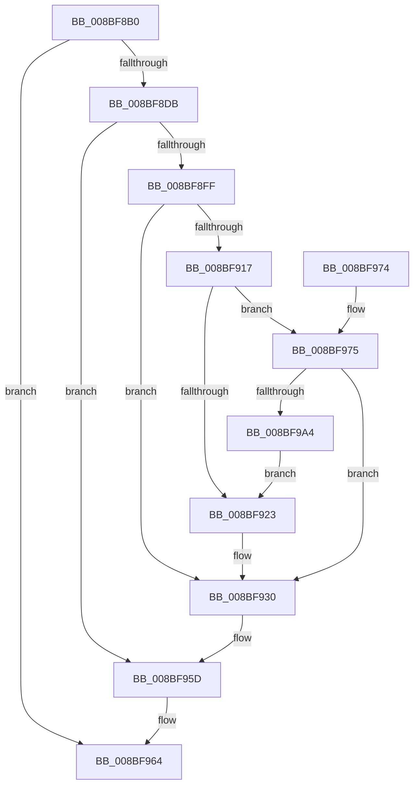

# EtwpQueryTrace

- RVA: `0x008BF8B0`–`0x008BF9A9` (길이 `249` bytes)
- VA: `0x00000001408BF8B0`
- 실행 섹션: `PAGE`
- PDB 이름 있음: `예`; PDB Function 태그: `아니요`
- unwind 정보 RVA: `0x00081628`
- 디코드: `60`개 명령, `249/249` bytes 표시
- 미해석 바이트: `0` (있으면 어셈블리에 `.byte`로 보존)

> 이 문서는 커널 이미지의 기계어와 PDB 기호를 분석해 생성했습니다. 4번과 5번은 함수 원형과 자료형을 바이너리 사용 방식에서 추정한 C 해석이며 원본 소스 복구 결과는 아닙니다.

## 1. Dependencies

- 직접 호출 지점: **8**; 고유 호출 대상: **8**
- 직접 호출자로 확인된 함수: **2**
- RIP 상대 이미지 참조: **0**

### Outgoing calls
- `0x008BF8CE` → [EtwpValidateLoggerInfo](EtwpValidateLoggerInfo_function_008BF9B0.md) (function, `0x008BF9B0`)
- `0x008BF8F4` → [EtwpAcquireLoggerContext](../93/EtwpAcquireLoggerContext_function_009326AC.md) (function, `0x009326AC`)
- `0x008BF90C` → [EtwpCheckLoggerControlAccess](../8C/EtwpCheckLoggerControlAccess_function_008C0AE0.md) (function, `0x008C0AE0`)
- `0x008BF929` → [EtwpGetLoggerInfoFromContext](EtwpGetLoggerInfoFromContext_function_008BEF90.md) (function, `0x008BEF90`)
- `0x008BF939` → [KeReleaseMutex](../../text/39/KeReleaseMutex_function_00396810.md) (function, `0x00396810`)
- `0x008BF958` → [ExReleaseRundownProtectionCacheAwareEx](../../text/25/ExReleaseRundownProtectionCacheAwareEx_function_0025F050.md) (function, `0x0025F050`)
- `0x008BF95D` → [KeLeaveCriticalRegion](../../text/25/KeLeaveCriticalRegion_function_0025D8B0.md) (function, `0x0025D8B0`)
- `0x008BF994` → [EtwCheckSecurityLoggerAccess](../A0/EtwCheckSecurityLoggerAccess_function_00A0FE94.md) (function, `0x00A0FE94`)

### Direct callers
- [EtwWmitraceWorker](../7B/EtwWmitraceWorker_function_007BBD3C.md) at `0x007BBE25`
- [EtwWmitraceWorker](../7B/EtwWmitraceWorker_function_007BBD3C.md) at `0x007BBEBE`
- [EtwWmitraceWorker](../7B/EtwWmitraceWorker_function_007BBD3C.md) at `0x007BBF00`
- [NtTraceControl](../A9/NtTraceControl_function_00A9ED40.md) at `0x00A9F0A9`

### Static image references
- 디코드된 RIP-relative 메모리 참조가 없습니다.

## 2. Other-region calls and transfers

- 다른 실행 섹션으로 향하는 call: **3**
  - `0x008BF939` → [KeReleaseMutex](../../text/39/KeReleaseMutex_function_00396810.md) (`PAGE` → `.text`)
  - `0x008BF958` → [ExReleaseRundownProtectionCacheAwareEx](../../text/25/ExReleaseRundownProtectionCacheAwareEx_function_0025F050.md) (`PAGE` → `.text`)
  - `0x008BF95D` → [KeLeaveCriticalRegion](../../text/25/KeLeaveCriticalRegion_function_0025D8B0.md) (`PAGE` → `.text`)
- 별도 외부 분기/꼬리 이동을 확인하지 못했습니다.

## 3. Assembly (complete function range)

```asm
008BF8B0  48 89 5C 24 08                  mov qword ptr [rsp + 8], rbx
008BF8B5  48 89 74 24 10                  mov qword ptr [rsp + 0x10], rsi
008BF8BA  57                              push rdi
008BF8BB  48 83 EC 20                     sub rsp, 0x20
008BF8BF  48 83 64 24 40 00               and qword ptr [rsp + 0x40], 0
008BF8C5  4C 8B C9                        mov r9, rcx
008BF8C8  48 8B CA                        mov rcx, rdx
008BF8CB  48 8B F2                        mov rsi, rdx
008BF8CE  E8 DD 00 00 00                  call 0x1408bf9b0
008BF8D3  85 C0                           test eax, eax
008BF8D5  0F 88 89 00 00 00               js 0x1408bf964
008BF8DB  65 48 8B 04 25 88 01 00 00      mov rax, qword ptr gs:[0x188]
008BF8E4  4C 8D 44 24 40                  lea r8, [rsp + 0x40]
008BF8E9  49 8B C9                        mov rcx, r9
008BF8EC  66 FF 88 E4 01 00 00            dec word ptr [rax + 0x1e4]
008BF8F3  90                              nop
008BF8F4  E8 B3 2D 07 00                  call 0x1409326ac
008BF8F9  8B F8                           mov edi, eax
008BF8FB  85 C0                           test eax, eax
008BF8FD  78 5E                           js 0x1408bf95d
008BF8FF  48 8B 5C 24 40                  mov rbx, qword ptr [rsp + 0x40]
008BF904  B9 01 00 00 00                  mov ecx, 1
008BF909  48 8B D3                        mov rdx, rbx
008BF90C  E8 CF 11 00 00                  call 0x1408c0ae0
008BF911  8B F8                           mov edi, eax
008BF913  85 C0                           test eax, eax
008BF915  78 19                           js 0x1408bf930
008BF917  F7 83 30 03 00 00 00 40 00 00   test dword ptr [rbx + 0x330], 0x4000
008BF921  75 52                           jne 0x1408bf975
008BF923  48 8B D3                        mov rdx, rbx
008BF926  48 8B CE                        mov rcx, rsi
008BF929  E8 62 F6 FF FF                  call 0x1408bef90
008BF92E  8B F8                           mov edi, eax
008BF930  33 D2                           xor edx, edx
008BF932  48 8D 8B 78 02 00 00            lea rcx, [rbx + 0x278]
008BF939  E8 D2 6E AD FF                  call 0x140396810
008BF93E  48 8B 83 50 05 00 00            mov rax, qword ptr [rbx + 0x550]
008BF945  BA 01 00 00 00                  mov edx, 1
008BF94A  44 8B 03                        mov r8d, dword ptr [rbx]
008BF94D  48 8B 88 C0 02 00 00            mov rcx, qword ptr [rax + 0x2c0]
008BF954  4A 8B 0C C1                     mov rcx, qword ptr [rcx + r8*8]
008BF958  E8 F3 F6 99 FF                  call 0x14025f050
008BF95D  E8 4E DF 99 FF                  call 0x14025d8b0
008BF962  8B C7                           mov eax, edi
008BF964  48 8B 5C 24 30                  mov rbx, qword ptr [rsp + 0x30]
008BF969  48 8B 74 24 38                  mov rsi, qword ptr [rsp + 0x38]
008BF96E  48 83 C4 20                     add rsp, 0x20
008BF972  5F                              pop rdi
008BF973  C3                              ret
008BF974  CC                              int3
008BF975  65 48 8B 14 25 88 01 00 00      mov rdx, qword ptr gs:[0x188]
008BF97E  65 48 8B 0C 25 88 01 00 00      mov rcx, qword ptr gs:[0x188]
008BF987  8A 92 32 02 00 00               mov dl, byte ptr [rdx + 0x232]
008BF98D  48 8B 89 B8 00 00 00            mov rcx, qword ptr [rcx + 0xb8]
008BF994  E8 FB 04 15 00                  call 0x140a0fe94
008BF999  48 8B 5C 24 40                  mov rbx, qword ptr [rsp + 0x40]
008BF99E  8B F8                           mov edi, eax
008BF9A0  85 C0                           test eax, eax
008BF9A2  78 8C                           js 0x1408bf930
008BF9A4  E9 7A FF FF FF                  jmp 0x1408bf923
```

## 4. C-style interpretation (structured pseudocode)

```c
__int64 __fastcall EtwpQueryTrace(__int64 a1, __int64 a2)
{
    __int64 result;
    __int64 v_rsp;
    unsigned __int64 v_stack_p10;
    unsigned __int64 v_stack_p18;
    unsigned __int64 v_stack_p40;
    unsigned __int64 v_stack_p8;

    v_stack_p8 = v_rbx;
    v_stack_p10 = v_rsi;
    v_rsp = (v_rsp) - (32);
    result = EtwpValidateLoggerInfo(a2, a2, a3, a1);
    if (sign_flag) goto loc_008BF964;
    result = EtwpAcquireLoggerContext(a1, a2, v_stack_p18, a1);
    if (sign_flag) goto loc_008BF95D;
    result = EtwpCheckLoggerControlAccess(1, v_stack_p18, v_stack_p18, a1);
    if (sign_flag) goto loc_008BF930;
    if (((*(unsigned int *)(v_stack_p18 + 816)) & (0x4000ULL)) != 0) goto loc_008BF975;
loc_008BF923:
    result = EtwpGetLoggerInfoFromContext(a2, v_stack_p18, v_stack_p18, a1);
loc_008BF930:
    a2 = 0;
    result = KeReleaseMutex(v_stack_p18 + 632, a2, v_stack_p18, a1);
    result = ExReleaseRundownProtectionCacheAwareEx(*(unsigned __int64 *)(*(unsigned __int64 *)(*(unsigned __int64 *)(v_stack_p18 + 1360) + 704) + (unsigned int)(*(unsigned int *)(v_stack_p18)) * 8), 1, (unsigned int)(*(unsigned int *)(v_stack_p18)), a1);
loc_008BF95D:
    result = KeLeaveCriticalRegion(*(unsigned __int64 *)(*(unsigned __int64 *)(*(unsigned __int64 *)(v_stack_p18 + 1360) + 704) + (unsigned int)(*(unsigned int *)(v_stack_p18)) * 8), 1, (unsigned int)(*(unsigned int *)(v_stack_p18)), a1);
loc_008BF964:
    v_rsp = (v_rsp) + (32);
    return (unsigned int)((unsigned int)((unsigned int)((unsigned int)(result))));
loc_008BF975:
    result = EtwCheckSecurityLoggerAccess(*(unsigned __int64 *)(*(unsigned __int64 *)(gs_base + (0 + 392)) + 184), *(unsigned __int8 *)(*(unsigned __int64 *)(gs_base + (0 + 392)) + 562), (unsigned int)(*(unsigned int *)(v_stack_p18)), a1);
    if (sign_flag) goto loc_008BF930;
    goto loc_008BF923;
}
```

## 5. (Beta) C Style

```c
int64_t EtwpQueryTrace(int64_t Arg1, int64_t Arg2)
{
    int64_t result;
    int64_t local_rsp;
    uint64_t v_stack_p10;
    uint64_t v_stack_p18;
    uint64_t v_stack_p40;
    uint64_t v_stack_p8;

    v_stack_p8 = local_rbx;
    v_stack_p10 = local_rsi;
    local_rsp = (local_rsp) - (32);
    result = EtwpValidateLoggerInfo(Arg2, Arg2, a3, Arg1);
    if (sign_flag) goto loc_008BF964;
    result = EtwpAcquireLoggerContext(Arg1, Arg2, v_stack_p18, Arg1);
    if (sign_flag) goto loc_008BF95D;
    result = EtwpCheckLoggerControlAccess(1, v_stack_p18, v_stack_p18, Arg1);
    if (sign_flag) goto loc_008BF930;
    if (((*(uint32_t *)(v_stack_p18 + 0x330)) & (0x4000ULL)) != 0) goto loc_008BF975;
loc_008BF923:
    result = EtwpGetLoggerInfoFromContext(Arg2, v_stack_p18, v_stack_p18, Arg1);
loc_008BF930:
    Arg2 = 0;
    result = KeReleaseMutex(v_stack_p18 + 632, Arg2, v_stack_p18, Arg1);
    result = ExReleaseRundownProtectionCacheAwareEx(*(uint64_t *)(*(uint64_t *)(*(uint64_t *)(v_stack_p18 + 0x550) + 0x2C0) + (uint32_t)(*(uint32_t *)(v_stack_p18)) * 8), 1, (uint32_t)(*(uint32_t *)(v_stack_p18)), Arg1);
loc_008BF95D:
    result = KeLeaveCriticalRegion(*(uint64_t *)(*(uint64_t *)(*(uint64_t *)(v_stack_p18 + 0x550) + 0x2C0) + (uint32_t)(*(uint32_t *)(v_stack_p18)) * 8), 1, (uint32_t)(*(uint32_t *)(v_stack_p18)), Arg1);
loc_008BF964:
    local_rsp = (local_rsp) + (32);
    return (uint32_t)((uint32_t)((uint32_t)((uint32_t)(result))));
loc_008BF975:
    result = EtwCheckSecurityLoggerAccess(*(uint64_t *)(*(uint64_t *)(gs_base + (0 + 0x188)) + 0xB8), *(uint8_t *)(*(uint64_t *)(gs_base + (0 + 0x188)) + 0x232), (uint32_t)(*(uint32_t *)(v_stack_p18)), Arg1);
    if (sign_flag) goto loc_008BF930;
    goto loc_008BF923;
}
```

## 6. Execution-region graph

[열기: 2D/3D 그래프와 함수 탐색 컨트롤 패널](../../../control-panel.html?section=page&rva=0x008BF8B0&view=graph)

- 2D 그래프는 위에서 아래로 흐르고, 3D 그래프는 빈 공간을 드래그해 회전합니다. Shift+드래그는 이동, 휠은 확대·축소, 함수 노드 선택은 대상 보고서 이동입니다.

### Static fallback


