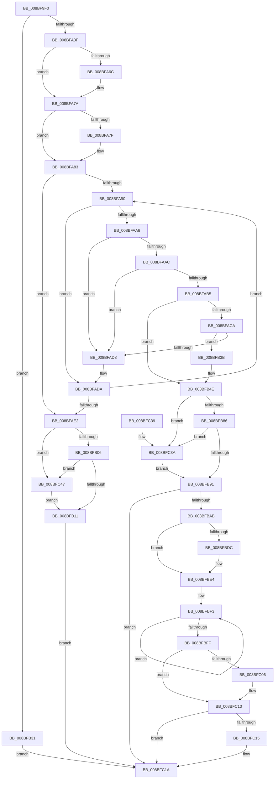

# EtwpReceiveNotification

- RVA: `0x008BF9F0`–`0x008BFC54` (길이 `612` bytes)
- VA: `0x00000001408BF9F0`
- 실행 섹션: `PAGE`
- PDB 이름 있음: `예`; PDB Function 태그: `아니요`
- unwind 정보 RVA: `0x00083338`
- 디코드: `164`개 명령, `612/612` bytes 표시
- 미해석 바이트: `0` (있으면 어셈블리에 `.byte`로 보존)

> 이 문서는 커널 이미지의 기계어와 PDB 기호를 분석해 생성했습니다. 4번과 5번은 함수 원형과 자료형을 바이너리 사용 방식에서 추정한 C 해석이며 원본 소스 복구 결과는 아닙니다.

## 1. Dependencies

- 직접 호출 지점: **11**; 고유 호출 대상: **8**
- 직접 호출자로 확인된 함수: **1**
- RIP 상대 이미지 참조: **0**

### Outgoing calls
- `0x008BFA5C` → [KeAbPreAcquire](../../text/21/KeAbPreAcquire_function_00210230.md) (function, `0x00210230`)
- `0x008BFA75` → [ExfAcquirePushLockExclusiveEx](../../text/20/ExfAcquirePushLockExclusiveEx_function_0020FC90.md) (function, `0x0020FC90`)
- `0x008BFB14` → [KeAbPostRelease](../../text/2E/KeAbPostRelease_function_002E1600.md) (function, `0x002E1600`)
- `0x008BFB22` → [KeLeaveCriticalRegionThread](../../text/25/KeLeaveCriticalRegionThread_function_0025EFF0.md) (function, `0x0025EFF0`)
- `0x008BFB94` → [KeAbPostRelease](../../text/2E/KeAbPostRelease_function_002E1600.md) (function, `0x002E1600`)
- `0x008BFBA2` → [KeLeaveCriticalRegionThread](../../text/25/KeLeaveCriticalRegionThread_function_0025EFF0.md) (function, `0x0025EFF0`)
- `0x008BFBC1` → [memcpy](../../text/6C/memcpy_function_006C6840.md) (function, `0x006C6840`)
- `0x008BFBE7` → [EtwpUnreferenceDataBlock](EtwpUnreferenceDataBlock_function_008BFC5C.md) (function, `0x008BFC5C`)
- `0x008BFC0B` → [ExFreePoolWithTag](../../poolcode/B8/ExFreePoolWithTag_function_00B82870.md) (function, `0x00B82870`)
- `0x008BFC3D` → [ExfReleasePushLock](../../text/26/ExfReleasePushLock_function_002638D0.md) (function, `0x002638D0`)
- `0x008BFC4A` → [ExfReleasePushLock](../../text/26/ExfReleasePushLock_function_002638D0.md) (function, `0x002638D0`)

### Direct callers
- [NtTraceControl](../A9/NtTraceControl_function_00A9ED40.md) at `0x00A9F23F`

### Static image references
- 디코드된 RIP-relative 메모리 참조가 없습니다.

## 2. Other-region calls and transfers

- 다른 실행 섹션으로 향하는 call: **10**
  - `0x008BFA5C` → [KeAbPreAcquire](../../text/21/KeAbPreAcquire_function_00210230.md) (`PAGE` → `.text`)
  - `0x008BFA75` → [ExfAcquirePushLockExclusiveEx](../../text/20/ExfAcquirePushLockExclusiveEx_function_0020FC90.md) (`PAGE` → `.text`)
  - `0x008BFB14` → [KeAbPostRelease](../../text/2E/KeAbPostRelease_function_002E1600.md) (`PAGE` → `.text`)
  - `0x008BFB22` → [KeLeaveCriticalRegionThread](../../text/25/KeLeaveCriticalRegionThread_function_0025EFF0.md) (`PAGE` → `.text`)
  - `0x008BFB94` → [KeAbPostRelease](../../text/2E/KeAbPostRelease_function_002E1600.md) (`PAGE` → `.text`)
  - `0x008BFBA2` → [KeLeaveCriticalRegionThread](../../text/25/KeLeaveCriticalRegionThread_function_0025EFF0.md) (`PAGE` → `.text`)
  - `0x008BFBC1` → [memcpy](../../text/6C/memcpy_function_006C6840.md) (`PAGE` → `.text`)
  - `0x008BFC0B` → [ExFreePoolWithTag](../../poolcode/B8/ExFreePoolWithTag_function_00B82870.md) (`PAGE` → `POOLCODE`)
  - `0x008BFC3D` → [ExfReleasePushLock](../../text/26/ExfReleasePushLock_function_002638D0.md) (`PAGE` → `.text`)
  - `0x008BFC4A` → [ExfReleasePushLock](../../text/26/ExfReleasePushLock_function_002638D0.md) (`PAGE` → `.text`)
- 별도 외부 분기/꼬리 이동을 확인하지 못했습니다.

## 3. Assembly (complete function range)

```asm
008BF9F0  48 89 5C 24 08                  mov qword ptr [rsp + 8], rbx
008BF9F5  48 89 6C 24 10                  mov qword ptr [rsp + 0x10], rbp
008BF9FA  48 89 74 24 18                  mov qword ptr [rsp + 0x18], rsi
008BF9FF  4C 89 4C 24 20                  mov qword ptr [rsp + 0x20], r9
008BFA04  57                              push rdi
008BFA05  41 54                           push r12
008BFA07  41 55                           push r13
008BFA09  41 56                           push r14
008BFA0B  41 57                           push r15
008BFA0D  48 83 EC 20                     sub rsp, 0x20
008BFA11  33 C0                           xor eax, eax
008BFA13  41 0F B6 F0                     movzx esi, r8b
008BFA17  8B E8                           mov ebp, eax
008BFA19  44 8B E2                        mov r12d, edx
008BFA1C  65 48 8B 04 25 88 01 00 00      mov rax, qword ptr gs:[0x188]
008BFA25  4C 8B F9                        mov r15, rcx
008BFA28  4C 8B 90 B8 00 00 00            mov r10, qword ptr [rax + 0xb8]
008BFA2F  4D 8B AA 20 03 00 00            mov r13, qword ptr [r10 + 0x320]
008BFA36  4D 85 ED                        test r13, r13
008BFA39  0F 84 F2 00 00 00               je 0x1408bfb31
008BFA3F  65 48 8B 04 25 88 01 00 00      mov rax, qword ptr gs:[0x188]
008BFA48  49 8D 7D 10                     lea rdi, [r13 + 0x10]
008BFA4C  45 33 C0                        xor r8d, r8d
008BFA4F  33 D2                           xor edx, edx
008BFA51  48 8B CF                        mov rcx, rdi
008BFA54  66 FF 88 E4 01 00 00            dec word ptr [rax + 0x1e4]
008BFA5B  90                              nop
008BFA5C  E8 CF 07 95 FF                  call 0x140210230
008BFA61  F0 48 0F BA 2F 00               lock bts qword ptr [rdi], 0
008BFA67  48 8B D8                        mov rbx, rax
008BFA6A  73 0E                           jae 0x1408bfa7a
008BFA6C  4C 8B C7                        mov r8, rdi
008BFA6F  48 8B D0                        mov rdx, rax
008BFA72  48 8B CF                        mov rcx, rdi
008BFA75  E8 16 02 95 FF                  call 0x14020fc90
008BFA7A  48 85 DB                        test rbx, rbx
008BFA7D  74 04                           je 0x1408bfa83
008BFA7F  C6 43 0A 01                     mov byte ptr [rbx + 0xa], 1
008BFA83  49 8B 5D 18                     mov rbx, qword ptr [r13 + 0x18]
008BFA87  4D 8D 75 18                     lea r14, [r13 + 0x18]
008BFA8B  49 3B DE                        cmp rbx, r14
008BFA8E  74 52                           je 0x1408bfae2
008BFA90  48 8B 43 18                     mov rax, qword ptr [rbx + 0x18]
008BFA94  48 8B 13                        mov rdx, qword ptr [rbx]
008BFA97  0F B6 48 62                     movzx ecx, byte ptr [rax + 0x62]
008BFA9B  C0 E9 07                        shr cl, 7
008BFA9E  80 E1 01                        and cl, 1
008BFAA1  40 3A F1                        cmp sil, cl
008BFAA4  75 34                           jne 0x1408bfada
008BFAA6  48 39 5A 08                     cmp qword ptr [rdx + 8], rbx
008BFAAA  75 27                           jne 0x1408bfad3
008BFAAC  48 8B 43 08                     mov rax, qword ptr [rbx + 8]
008BFAB0  48 39 18                        cmp qword ptr [rax], rbx
008BFAB3  75 1E                           jne 0x1408bfad3
008BFAB5  48 89 10                        mov qword ptr [rax], rdx
008BFAB8  48 89 42 08                     mov qword ptr [rdx + 8], rax
008BFABC  48 8B 73 10                     mov rsi, qword ptr [rbx + 0x10]
008BFAC0  44 39 66 04                     cmp dword ptr [rsi + 4], r12d
008BFAC4  0F 86 84 00 00 00               jbe 0x1408bfb4e
008BFACA  49 8B 06                        mov rax, qword ptr [r14]
008BFACD  4C 39 70 08                     cmp qword ptr [rax + 8], r14
008BFAD1  74 68                           je 0x1408bfb3b
008BFAD3  B9 03 00 00 00                  mov ecx, 3
008BFAD8  CD 29                           int 0x29
008BFADA  48 8B DA                        mov rbx, rdx
008BFADD  49 3B D6                        cmp rdx, r14
008BFAE0  75 AE                           jne 0x1408bfa90
008BFAE2  0F 0D 0F                        prefetchw byte ptr [rdi]
008BFAE5  48 8B 07                        mov rax, qword ptr [rdi]
008BFAE8  4C 8B ED                        mov r13, rbp
008BFAEB  48 8B C8                        mov rcx, rax
008BFAEE  48 83 E1 F0                     and rcx, 0xfffffffffffffff0
008BFAF2  48 83 F9 10                     cmp rcx, 0x10
008BFAF6  48 8D 50 F0                     lea rdx, [rax - 0x10]
008BFAFA  48 0F 46 D5                     cmovbe rdx, rbp
008BFAFE  A8 02                           test al, 2
008BFB00  0F 85 41 01 00 00               jne 0x1408bfc47
008BFB06  F0 48 0F B1 17                  lock cmpxchg qword ptr [rdi], rdx
008BFB0B  0F 85 36 01 00 00               jne 0x1408bfc47
008BFB11  48 8B CF                        mov rcx, rdi
008BFB14  E8 E7 1A A2 FF                  call 0x1402e1600
008BFB19  65 48 8B 0C 25 88 01 00 00      mov rcx, qword ptr gs:[0x188]
008BFB22  E8 C9 F4 99 FF                  call 0x14025eff0
008BFB27  BD 1A 00 00 80                  mov ebp, 0x8000001a
008BFB2C  E9 E9 00 00 00                  jmp 0x1408bfc1a
008BFB31  BD 0D 00 00 C0                  mov ebp, 0xc000000d
008BFB36  E9 DF 00 00 00                  jmp 0x1408bfc1a
008BFB3B  48 89 03                        mov qword ptr [rbx], rax
008BFB3E  BD 23 00 00 C0                  mov ebp, 0xc0000023
008BFB43  4C 89 73 08                     mov qword ptr [rbx + 8], r14
008BFB47  48 89 58 08                     mov qword ptr [rax + 8], rbx
008BFB4B  49 89 1E                        mov qword ptr [r14], rbx
008BFB4E  48 8B 4C 24 68                  mov rcx, qword ptr [rsp + 0x68]
008BFB53  49 8D 7D 10                     lea rdi, [r13 + 0x10]
008BFB57  4D 8B 26                        mov r12, qword ptr [r14]
008BFB5A  8B 46 04                        mov eax, dword ptr [rsi + 4]
008BFB5D  89 01                           mov dword ptr [rcx], eax
008BFB5F  0F 0D 0F                        prefetchw byte ptr [rdi]
008BFB62  48 8B 07                        mov rax, qword ptr [rdi]
008BFB65  41 BD 00 00 00 00               mov r13d, 0
008BFB6B  48 8B C8                        mov rcx, rax
008BFB6E  48 83 E1 F0                     and rcx, 0xfffffffffffffff0
008BFB72  48 83 F9 10                     cmp rcx, 0x10
008BFB76  48 8D 50 F0                     lea rdx, [rax - 0x10]
008BFB7A  49 0F 46 D5                     cmovbe rdx, r13
008BFB7E  A8 02                           test al, 2
008BFB80  0F 85 B4 00 00 00               jne 0x1408bfc3a
008BFB86  F0 48 0F B1 17                  lock cmpxchg qword ptr [rdi], rdx
008BFB8B  0F 85 A9 00 00 00               jne 0x1408bfc3a
008BFB91  48 8B CF                        mov rcx, rdi
008BFB94  E8 67 1A A2 FF                  call 0x1402e1600
008BFB99  65 48 8B 0C 25 88 01 00 00      mov rcx, qword ptr gs:[0x188]
008BFBA2  E8 49 F4 99 FF                  call 0x14025eff0
008BFBA7  85 ED                           test ebp, ebp
008BFBA9  78 6F                           js 0x1408bfc1a
008BFBAB  BF 01 00 00 00                  mov edi, 1
008BFBB0  F0 0F C1 7E 14                  lock xadd dword ptr [rsi + 0x14], edi
008BFBB5  44 8B 46 04                     mov r8d, dword ptr [rsi + 4]
008BFBB9  48 8B D6                        mov rdx, rsi
008BFBBC  49 8B CF                        mov rcx, r15
008BFBBF  FF C7                           inc edi
008BFBC1  E8 7A 6C E0 FF                  call 0x1406c6840
008BFBC6  4D 89 6F 18                     mov qword ptr [r15 + 0x18], r13
008BFBCA  41 89 7F 14                     mov dword ptr [r15 + 0x14], edi
008BFBCE  0F B7 43 30                     movzx eax, word ptr [rbx + 0x30]
008BFBD2  41 89 47 18                     mov dword ptr [r15 + 0x18], eax
008BFBD6  44 38 6E 0C                     cmp byte ptr [rsi + 0xc], r13b
008BFBDA  74 08                           je 0x1408bfbe4
008BFBDC  0F B7 43 32                     movzx eax, word ptr [rbx + 0x32]
008BFBE0  41 89 47 10                     mov dword ptr [r15 + 0x10], eax
008BFBE4  48 8B CE                        mov rcx, rsi
008BFBE7  E8 70 00 00 00                  call 0x1408bfc5c
008BFBEC  0F 0D 4B 34                     prefetchw byte ptr [rbx + 0x34]
008BFBF0  8B 43 34                        mov eax, dword ptr [rbx + 0x34]
008BFBF3  8B C8                           mov ecx, eax
008BFBF5  83 E1 FE                        and ecx, 0xfffffffe
008BFBF8  F0 0F B1 4B 34                  lock cmpxchg dword ptr [rbx + 0x34], ecx
008BFBFD  75 F4                           jne 0x1408bfbf3
008BFBFF  A9 FE FF FF FF                  test eax, 0xfffffffe
008BFC04  75 0A                           jne 0x1408bfc10
008BFC06  33 D2                           xor edx, edx
008BFC08  48 8B CB                        mov rcx, rbx
008BFC0B  E8 60 2C 2C 00                  call 0x140b82870
008BFC10  4D 3B E6                        cmp r12, r14
008BFC13  74 05                           je 0x1408bfc1a
008BFC15  BD 05 01 00 00                  mov ebp, 0x105
008BFC1A  48 8B 5C 24 50                  mov rbx, qword ptr [rsp + 0x50]
008BFC1F  8B C5                           mov eax, ebp
008BFC21  48 8B 6C 24 58                  mov rbp, qword ptr [rsp + 0x58]
008BFC26  48 8B 74 24 60                  mov rsi, qword ptr [rsp + 0x60]
008BFC2B  48 83 C4 20                     add rsp, 0x20
008BFC2F  41 5F                           pop r15
008BFC31  41 5E                           pop r14
008BFC33  41 5D                           pop r13
008BFC35  41 5C                           pop r12
008BFC37  5F                              pop rdi
008BFC38  C3                              ret
008BFC39  CC                              int3
008BFC3A  48 8B CF                        mov rcx, rdi
008BFC3D  E8 8E 3C 9A FF                  call 0x1402638d0
008BFC42  E9 4A FF FF FF                  jmp 0x1408bfb91
008BFC47  48 8B CF                        mov rcx, rdi
008BFC4A  E8 81 3C 9A FF                  call 0x1402638d0
008BFC4F  E9 BD FE FF FF                  jmp 0x1408bfb11
```

## 4. C-style interpretation (structured pseudocode)

```c
__int64 __fastcall EtwpReceiveNotification(__int64 a1, int a2, int a3, __int64 a4)
{
    __int64 result;
    __int64 v_rbp;
    __int64 v_rdi;
    __int64 v_rsp;
    unsigned __int64 v_stack_p10;
    unsigned __int64 v_stack_p18;
    unsigned __int64 v_stack_p20;
    unsigned __int64 v_stack_p8;

    v_stack_p8 = v_rbx;
    v_stack_p10 = v_rbp;
    v_stack_p18 = v_rsi;
    v_stack_p20 = a4;
    v_rsp = (v_rsp) - (32);
    result = 0;
    if (*(unsigned __int64 *)(*(unsigned __int64 *)(*(unsigned __int64 *)(gs_base + (0 + 392)) + 184) + 800) == 0) goto loc_008BFB31;
    a3 = 0;
    a2 = 0;
    result = KeAbPreAcquire(*(unsigned __int64 *)(*(unsigned __int64 *)(*(unsigned __int64 *)(gs_base + (0 + 392)) + 184) + 800) + 16, a2, a3, a4);
    if (!(condition_is_above_or_equal)) {
        a3 = *(unsigned __int64 *)(*(unsigned __int64 *)(*(unsigned __int64 *)(gs_base + (0 + 392)) + 184) + 800) + 16;
        a2 = result;
        a1 = *(unsigned __int64 *)(*(unsigned __int64 *)(*(unsigned __int64 *)(gs_base + (0 + 392)) + 184) + 800) + 16;
        result = ExfAcquirePushLockExclusiveEx(a1, a2, a3, a4);
    }
    if (result != 0) {
        *(unsigned __int8 *)(result + 10) = 1;
    }
    if ((*(unsigned __int64 *)(*(unsigned __int64 *)(*(unsigned __int64 *)(*(unsigned __int64 *)(gs_base + (0 + 392)) + 184) + 800) + 24)) == (*(unsigned __int64 *)(*(unsigned __int64 *)(*(unsigned __int64 *)(gs_base + (0 + 392)) + 184) + 800) + 24)) goto loc_008BFAE2;
loc_008BFA90:
    a1 = (unsigned __int8)((*(unsigned __int8 *)(*(unsigned __int64 *)(*(unsigned __int64 *)(*(unsigned __int64 *)(*(unsigned __int64 *)(*(unsigned __int64 *)(gs_base + (0 + 392)) + 184) + 800) + 24) + 24) + 98)) >> (7));
    a1 = (unsigned __int8)((a1) & (1));
    if (((unsigned __int8)((unsigned __int8)(a3))) != ((unsigned __int8)(a1))) goto loc_008BFADA;
    if ((*(unsigned __int64 *)(*(unsigned __int64 *)(*(unsigned __int64 *)(*(unsigned __int64 *)(*(unsigned __int64 *)(*(unsigned __int64 *)(gs_base + (0 + 392)) + 184) + 800) + 24)) + 8)) != (*(unsigned __int64 *)(*(unsigned __int64 *)(*(unsigned __int64 *)(*(unsigned __int64 *)(gs_base + (0 + 392)) + 184) + 800) + 24))) goto loc_008BFAD3;
    if ((*(unsigned __int64 *)(*(unsigned __int64 *)(*(unsigned __int64 *)(*(unsigned __int64 *)(*(unsigned __int64 *)(*(unsigned __int64 *)(gs_base + (0 + 392)) + 184) + 800) + 24) + 8))) != (*(unsigned __int64 *)(*(unsigned __int64 *)(*(unsigned __int64 *)(*(unsigned __int64 *)(gs_base + (0 + 392)) + 184) + 800) + 24))) goto loc_008BFAD3;
    *(unsigned __int64 *)(*(unsigned __int64 *)(*(unsigned __int64 *)(*(unsigned __int64 *)(*(unsigned __int64 *)(*(unsigned __int64 *)(gs_base + (0 + 392)) + 184) + 800) + 24) + 8)) = *(unsigned __int64 *)(*(unsigned __int64 *)(*(unsigned __int64 *)(*(unsigned __int64 *)(*(unsigned __int64 *)(gs_base + (0 + 392)) + 184) + 800) + 24));
    *(unsigned __int64 *)(*(unsigned __int64 *)(*(unsigned __int64 *)(*(unsigned __int64 *)(*(unsigned __int64 *)(*(unsigned __int64 *)(gs_base + (0 + 392)) + 184) + 800) + 24)) + 8) = *(unsigned __int64 *)(*(unsigned __int64 *)(*(unsigned __int64 *)(*(unsigned __int64 *)(*(unsigned __int64 *)(gs_base + (0 + 392)) + 184) + 800) + 24) + 8);
    if ((*(unsigned int *)(*(unsigned __int64 *)(*(unsigned __int64 *)(*(unsigned __int64 *)(*(unsigned __int64 *)(*(unsigned __int64 *)(gs_base + (0 + 392)) + 184) + 800) + 24) + 16) + 4)) <= ((unsigned int)((unsigned int)(a2)))) goto loc_008BFB4E;
    if ((*(unsigned __int64 *)(*(unsigned __int64 *)(*(unsigned __int64 *)(*(unsigned __int64 *)(*(unsigned __int64 *)(gs_base + (0 + 392)) + 184) + 800) + 24) + 8)) == (*(unsigned __int64 *)(*(unsigned __int64 *)(*(unsigned __int64 *)(gs_base + (0 + 392)) + 184) + 800) + 24)) goto loc_008BFB3B;
loc_008BFAD3:
loc_008BFADA:
    if ((*(unsigned __int64 *)(*(unsigned __int64 *)(*(unsigned __int64 *)(*(unsigned __int64 *)(*(unsigned __int64 *)(gs_base + (0 + 392)) + 184) + 800) + 24))) != (*(unsigned __int64 *)(*(unsigned __int64 *)(*(unsigned __int64 *)(gs_base + (0 + 392)) + 184) + 800) + 24)) goto loc_008BFA90;
loc_008BFAE2:
    a1 = (*(unsigned __int64 *)(*(unsigned __int64 *)(*(unsigned __int64 *)(*(unsigned __int64 *)(gs_base + (0 + 392)) + 184) + 800) + 16)) & (-16);
    a2 = *(unsigned __int64 *)(*(unsigned __int64 *)(*(unsigned __int64 *)(*(unsigned __int64 *)(gs_base + (0 + 392)) + 184) + 800) + 16) - 16;
    if (a1 <= 16) { a2 = 0; }
    if ((((unsigned __int8)(*(unsigned __int64 *)(*(unsigned __int64 *)(*(unsigned __int64 *)(*(unsigned __int64 *)(gs_base + (0 + 392)) + 184) + 800) + 16))) & (2)) != 0) goto loc_008BFC47;
    if ((((unsigned __int8)(*(unsigned __int64 *)(*(unsigned __int64 *)(*(unsigned __int64 *)(*(unsigned __int64 *)(gs_base + (0 + 392)) + 184) + 800) + 16))) & (2)) != 0) goto loc_008BFC47;
loc_008BFB11:
    result = KeAbPostRelease(*(unsigned __int64 *)(*(unsigned __int64 *)(*(unsigned __int64 *)(gs_base + (0 + 392)) + 184) + 800) + 16, a2, a3, a4);
    result = KeLeaveCriticalRegionThread(*(unsigned __int64 *)(gs_base + (0 + 392)), a2, a3, a4);
    goto loc_008BFC1A;
loc_008BFB31:
    goto loc_008BFC1A;
loc_008BFB3B:
    *(unsigned __int64 *)(*(unsigned __int64 *)(*(unsigned __int64 *)(*(unsigned __int64 *)(*(unsigned __int64 *)(*(unsigned __int64 *)(gs_base + (0 + 392)) + 184) + 800) + 24))) = result;
    *(unsigned __int64 *)(*(unsigned __int64 *)(*(unsigned __int64 *)(*(unsigned __int64 *)(*(unsigned __int64 *)(*(unsigned __int64 *)(gs_base + (0 + 392)) + 184) + 800) + 24)) + 8) = *(unsigned __int64 *)(*(unsigned __int64 *)(*(unsigned __int64 *)(gs_base + (0 + 392)) + 184) + 800) + 24;
    *(unsigned __int64 *)(result + 8) = *(unsigned __int64 *)(*(unsigned __int64 *)(*(unsigned __int64 *)(*(unsigned __int64 *)(*(unsigned __int64 *)(gs_base + (0 + 392)) + 184) + 800) + 24));
    *(unsigned __int64 *)(*(unsigned __int64 *)(*(unsigned __int64 *)(*(unsigned __int64 *)(gs_base + (0 + 392)) + 184) + 800) + 24) = *(unsigned __int64 *)(*(unsigned __int64 *)(*(unsigned __int64 *)(*(unsigned __int64 *)(*(unsigned __int64 *)(gs_base + (0 + 392)) + 184) + 800) + 24));
loc_008BFB4E:
    *(unsigned int *)(v_stack_p20) = (unsigned int)((unsigned int)(*(unsigned int *)(*(unsigned __int64 *)(*(unsigned __int64 *)(*(unsigned __int64 *)(*(unsigned __int64 *)(*(unsigned __int64 *)(gs_base + (0 + 392)) + 184) + 800) + 24) + 16) + 4)));
    a1 = (*(unsigned __int64 *)(0 + 16)) & (-16);
    a2 = *(unsigned __int64 *)(0 + 16) - 16;
    if (a1 <= 16) { a2 = 0; }
    if ((((unsigned __int8)(*(unsigned __int64 *)(0 + 16))) & (2)) != 0) goto loc_008BFC3A;
    if ((((unsigned __int8)(*(unsigned __int64 *)(0 + 16))) & (2)) != 0) goto loc_008BFC3A;
loc_008BFB91:
    result = KeAbPostRelease(0 + 16, a2, a3, a4);
    result = KeLeaveCriticalRegionThread(*(unsigned __int64 *)(gs_base + (0 + 392)), a2, a3, a4);
    if (sign_flag) goto loc_008BFC1A;
    v_rdi = (unsigned int)((1) + 1);
    result = memcpy(a1, *(unsigned __int64 *)(*(unsigned __int64 *)(*(unsigned __int64 *)(*(unsigned __int64 *)(*(unsigned __int64 *)(gs_base + (0 + 392)) + 184) + 800) + 24) + 16), (unsigned int)(*(unsigned int *)(*(unsigned __int64 *)(*(unsigned __int64 *)(*(unsigned __int64 *)(*(unsigned __int64 *)(*(unsigned __int64 *)(gs_base + (0 + 392)) + 184) + 800) + 24) + 16) + 4)), a4);
    *(unsigned __int64 *)(a1 + 24) = 0;
    *(unsigned int *)(a1 + 20) = (unsigned int)(v_rdi);
    *(unsigned int *)(a1 + 24) = (unsigned int)(*(unsigned __int16 *)(*(unsigned __int64 *)(*(unsigned __int64 *)(*(unsigned __int64 *)(*(unsigned __int64 *)(*(unsigned __int64 *)(gs_base + (0 + 392)) + 184) + 800) + 24)) + 48));
    result = *(unsigned __int16 *)(*(unsigned __int64 *)(*(unsigned __int64 *)(*(unsigned __int64 *)(*(unsigned __int64 *)(*(unsigned __int64 *)(gs_base + (0 + 392)) + 184) + 800) + 24)) + 48);
    if ((*(unsigned __int8 *)(*(unsigned __int64 *)(*(unsigned __int64 *)(*(unsigned __int64 *)(*(unsigned __int64 *)(*(unsigned __int64 *)(gs_base + (0 + 392)) + 184) + 800) + 24) + 16) + 12)) != 0) {
        result = *(unsigned __int16 *)(*(unsigned __int64 *)(*(unsigned __int64 *)(*(unsigned __int64 *)(*(unsigned __int64 *)(*(unsigned __int64 *)(gs_base + (0 + 392)) + 184) + 800) + 24)) + 50);
        *(unsigned int *)(a1 + 16) = (unsigned int)(result);
    }
    result = EtwpUnreferenceDataBlock(*(unsigned __int64 *)(*(unsigned __int64 *)(*(unsigned __int64 *)(*(unsigned __int64 *)(*(unsigned __int64 *)(gs_base + (0 + 392)) + 184) + 800) + 24) + 16), *(unsigned __int64 *)(*(unsigned __int64 *)(*(unsigned __int64 *)(*(unsigned __int64 *)(*(unsigned __int64 *)(gs_base + (0 + 392)) + 184) + 800) + 24) + 16), (unsigned int)(*(unsigned int *)(*(unsigned __int64 *)(*(unsigned __int64 *)(*(unsigned __int64 *)(*(unsigned __int64 *)(*(unsigned __int64 *)(gs_base + (0 + 392)) + 184) + 800) + 24) + 16) + 4)), a4);
loc_008BFBF3:
    a1 = (unsigned int)(((unsigned int)((unsigned int)((unsigned int)(*(unsigned int *)(*(unsigned __int64 *)(*(unsigned __int64 *)(*(unsigned __int64 *)(*(unsigned __int64 *)(*(unsigned __int64 *)(gs_base + (0 + 392)) + 184) + 800) + 24)) + 52))))) & (0xFFFFFFFEULL));
    if (condition_is_not_equal) goto loc_008BFBF3;
    result = (unsigned int)(*(unsigned int *)(*(unsigned __int64 *)(*(unsigned __int64 *)(*(unsigned __int64 *)(*(unsigned __int64 *)(*(unsigned __int64 *)(gs_base + (0 + 392)) + 184) + 800) + 24)) + 52));
    if ((((unsigned int)((unsigned int)(*(unsigned int *)(*(unsigned __int64 *)(*(unsigned __int64 *)(*(unsigned __int64 *)(*(unsigned __int64 *)(*(unsigned __int64 *)(gs_base + (0 + 392)) + 184) + 800) + 24)) + 52)))) & (0xFFFFFFFEULL)) == 0) {
        a2 = 0;
        a1 = *(unsigned __int64 *)(*(unsigned __int64 *)(*(unsigned __int64 *)(*(unsigned __int64 *)(*(unsigned __int64 *)(gs_base + (0 + 392)) + 184) + 800) + 24));
        result = ExFreePoolWithTag(a1, a2, (unsigned int)(*(unsigned int *)(*(unsigned __int64 *)(*(unsigned __int64 *)(*(unsigned __int64 *)(*(unsigned __int64 *)(*(unsigned __int64 *)(gs_base + (0 + 392)) + 184) + 800) + 24) + 16) + 4)), a4);
    }
    v_rbp = (unsigned int)(0xC0000023ULL);
    if ((*(unsigned __int64 *)(*(unsigned __int64 *)(*(unsigned __int64 *)(*(unsigned __int64 *)(gs_base + (0 + 392)) + 184) + 800) + 24)) != (*(unsigned __int64 *)(*(unsigned __int64 *)(*(unsigned __int64 *)(gs_base + (0 + 392)) + 184) + 800) + 24)) {
        v_rbp = 261;
    }
    v_rsp = (v_rsp) + (32);
    return (unsigned int)((unsigned int)(v_rbp));
loc_008BFC3A:
    result = ExfReleasePushLock(v_rdi, a2, (unsigned int)(*(unsigned int *)(*(unsigned __int64 *)(*(unsigned __int64 *)(*(unsigned __int64 *)(*(unsigned __int64 *)(*(unsigned __int64 *)(gs_base + (0 + 392)) + 184) + 800) + 24) + 16) + 4)), a4);
    goto loc_008BFB91;
loc_008BFC47:
    result = ExfReleasePushLock(v_rdi, a2, (unsigned int)(*(unsigned int *)(*(unsigned __int64 *)(*(unsigned __int64 *)(*(unsigned __int64 *)(*(unsigned __int64 *)(*(unsigned __int64 *)(gs_base + (0 + 392)) + 184) + 800) + 24) + 16) + 4)), a4);
    goto loc_008BFB11;
}
```

## 5. (Beta) C Style

```c
int64_t EtwpReceiveNotification(void *Arg1, int32_t Arg2, int32_t Arg3, int64_t Arg4)
{
    uint8_t *arg1 = (uint8_t *)Arg1;

    int64_t result;
    int64_t local_rbp;
    int64_t local_rdi;
    int64_t local_rsp;
    uint64_t v_stack_p10;
    uint64_t v_stack_p18;
    uint64_t v_stack_p20;
    uint64_t v_stack_p8;

    v_stack_p8 = local_rbx;
    v_stack_p10 = local_rbp;
    v_stack_p18 = local_rsi;
    v_stack_p20 = Arg4;
    local_rsp = (local_rsp) - (32);
    result = 0;
    if (*(uint64_t *)(*(uint64_t *)(*(uint64_t *)(gs_base + (0 + 0x188)) + 0xB8) + 0x320) == 0) goto loc_008BFB31;
    Arg3 = 0;
    Arg2 = 0;
    result = KeAbPreAcquire(*(uint64_t *)(*(uint64_t *)(*(uint64_t *)(gs_base + (0 + 0x188)) + 0xB8) + 0x320) + 16, Arg2, Arg3, Arg4);
    if (!(condition_is_above_or_equal)) {
        Arg3 = *(uint64_t *)(*(uint64_t *)(*(uint64_t *)(gs_base + (0 + 0x188)) + 0xB8) + 0x320) + 16;
        Arg2 = result;
        Arg1 = *(uint64_t *)(*(uint64_t *)(*(uint64_t *)(gs_base + (0 + 0x188)) + 0xB8) + 0x320) + 16;
        result = ExfAcquirePushLockExclusiveEx(Arg1, Arg2, Arg3, Arg4);
    }
    if (result != 0) {
        *(uint8_t *)(result + 0xA) = 1;
    }
    if ((*(uint64_t *)(*(uint64_t *)(*(uint64_t *)(*(uint64_t *)(gs_base + (0 + 0x188)) + 0xB8) + 0x320) + 0x18)) == (*(uint64_t *)(*(uint64_t *)(*(uint64_t *)(gs_base + (0 + 0x188)) + 0xB8) + 0x320) + 24)) goto loc_008BFAE2;
loc_008BFA90:
    Arg1 = (uint8_t)((*(uint8_t *)(*(uint64_t *)(*(uint64_t *)(*(uint64_t *)(*(uint64_t *)(*(uint64_t *)(gs_base + (0 + 0x188)) + 0xB8) + 0x320) + 0x18) + 0x18) + 0x62)) >> (7));
    Arg1 = (uint8_t)((Arg1) & (1));
    if (((uint8_t)((uint8_t)(Arg3))) != ((uint8_t)(Arg1))) goto loc_008BFADA;
    if ((*(uint64_t *)(*(uint64_t *)(*(uint64_t *)(*(uint64_t *)(*(uint64_t *)(*(uint64_t *)(gs_base + (0 + 0x188)) + 0xB8) + 0x320) + 0x18)) + 0x8)) != (*(uint64_t *)(*(uint64_t *)(*(uint64_t *)(*(uint64_t *)(gs_base + (0 + 0x188)) + 0xB8) + 0x320) + 0x18))) goto loc_008BFAD3;
    if ((*(uint64_t *)(*(uint64_t *)(*(uint64_t *)(*(uint64_t *)(*(uint64_t *)(*(uint64_t *)(gs_base + (0 + 0x188)) + 0xB8) + 0x320) + 0x18) + 0x8))) != (*(uint64_t *)(*(uint64_t *)(*(uint64_t *)(*(uint64_t *)(gs_base + (0 + 0x188)) + 0xB8) + 0x320) + 0x18))) goto loc_008BFAD3;
    *(uint64_t *)(*(uint64_t *)(*(uint64_t *)(*(uint64_t *)(*(uint64_t *)(*(uint64_t *)(gs_base + (0 + 0x188)) + 0xB8) + 0x320) + 0x18) + 0x8)) = *(uint64_t *)(*(uint64_t *)(*(uint64_t *)(*(uint64_t *)(*(uint64_t *)(gs_base + (0 + 0x188)) + 0xB8) + 0x320) + 0x18));
    *(uint64_t *)(*(uint64_t *)(*(uint64_t *)(*(uint64_t *)(*(uint64_t *)(*(uint64_t *)(gs_base + (0 + 0x188)) + 0xB8) + 0x320) + 0x18)) + 0x8) = *(uint64_t *)(*(uint64_t *)(*(uint64_t *)(*(uint64_t *)(*(uint64_t *)(gs_base + (0 + 0x188)) + 0xB8) + 0x320) + 0x18) + 0x8);
    if ((*(uint32_t *)(*(uint64_t *)(*(uint64_t *)(*(uint64_t *)(*(uint64_t *)(*(uint64_t *)(gs_base + (0 + 0x188)) + 0xB8) + 0x320) + 0x18) + 0x10) + 0x4)) <= ((uint32_t)((uint32_t)(Arg2)))) goto loc_008BFB4E;
    if ((*(uint64_t *)(*(uint64_t *)(*(uint64_t *)(*(uint64_t *)(*(uint64_t *)(gs_base + (0 + 0x188)) + 0xB8) + 0x320) + 0x18) + 0x8)) == (*(uint64_t *)(*(uint64_t *)(*(uint64_t *)(gs_base + (0 + 0x188)) + 0xB8) + 0x320) + 24)) goto loc_008BFB3B;
loc_008BFAD3:
loc_008BFADA:
    if ((*(uint64_t *)(*(uint64_t *)(*(uint64_t *)(*(uint64_t *)(*(uint64_t *)(gs_base + (0 + 0x188)) + 0xB8) + 0x320) + 0x18))) != (*(uint64_t *)(*(uint64_t *)(*(uint64_t *)(gs_base + (0 + 0x188)) + 0xB8) + 0x320) + 24)) goto loc_008BFA90;
loc_008BFAE2:
    Arg1 = (*(uint64_t *)(*(uint64_t *)(*(uint64_t *)(*(uint64_t *)(gs_base + (0 + 0x188)) + 0xB8) + 0x320) + 0x10)) & (-16);
    Arg2 = *(uint64_t *)(*(uint64_t *)(*(uint64_t *)(*(uint64_t *)(gs_base + (0 + 0x188)) + 0xB8) + 0x320) + 0x10) - 16;
    if (Arg1 <= 16) { Arg2 = 0; }
    if ((((uint8_t)(*(uint64_t *)(*(uint64_t *)(*(uint64_t *)(*(uint64_t *)(gs_base + (0 + 0x188)) + 0xB8) + 0x320) + 0x10))) & (2)) != 0) goto loc_008BFC47;
    if ((((uint8_t)(*(uint64_t *)(*(uint64_t *)(*(uint64_t *)(*(uint64_t *)(gs_base + (0 + 0x188)) + 0xB8) + 0x320) + 0x10))) & (2)) != 0) goto loc_008BFC47;
loc_008BFB11:
    result = KeAbPostRelease(*(uint64_t *)(*(uint64_t *)(*(uint64_t *)(gs_base + (0 + 0x188)) + 0xB8) + 0x320) + 16, Arg2, Arg3, Arg4);
    result = KeLeaveCriticalRegionThread(*(uint64_t *)(gs_base + (0 + 0x188)), Arg2, Arg3, Arg4);
    goto loc_008BFC1A;
loc_008BFB31:
    goto loc_008BFC1A;
loc_008BFB3B:
    *(uint64_t *)(*(uint64_t *)(*(uint64_t *)(*(uint64_t *)(*(uint64_t *)(*(uint64_t *)(gs_base + (0 + 0x188)) + 0xB8) + 0x320) + 0x18))) = result;
    *(uint64_t *)(*(uint64_t *)(*(uint64_t *)(*(uint64_t *)(*(uint64_t *)(*(uint64_t *)(gs_base + (0 + 0x188)) + 0xB8) + 0x320) + 0x18)) + 0x8) = *(uint64_t *)(*(uint64_t *)(*(uint64_t *)(gs_base + (0 + 0x188)) + 0xB8) + 0x320) + 24;
    *(uint64_t *)(result + 0x8) = *(uint64_t *)(*(uint64_t *)(*(uint64_t *)(*(uint64_t *)(*(uint64_t *)(gs_base + (0 + 0x188)) + 0xB8) + 0x320) + 0x18));
    *(uint64_t *)(*(uint64_t *)(*(uint64_t *)(*(uint64_t *)(gs_base + (0 + 0x188)) + 0xB8) + 0x320) + 0x18) = *(uint64_t *)(*(uint64_t *)(*(uint64_t *)(*(uint64_t *)(*(uint64_t *)(gs_base + (0 + 0x188)) + 0xB8) + 0x320) + 0x18));
loc_008BFB4E:
    *(uint32_t *)(v_stack_p20) = (uint32_t)((uint32_t)(*(uint32_t *)(*(uint64_t *)(*(uint64_t *)(*(uint64_t *)(*(uint64_t *)(*(uint64_t *)(gs_base + (0 + 0x188)) + 0xB8) + 0x320) + 0x18) + 0x10) + 0x4)));
    Arg1 = (*(uint64_t *)(0 + 0x10)) & (-16);
    Arg2 = *(uint64_t *)(0 + 0x10) - 16;
    if (Arg1 <= 16) { Arg2 = 0; }
    if ((((uint8_t)(*(uint64_t *)(0 + 0x10))) & (2)) != 0) goto loc_008BFC3A;
    if ((((uint8_t)(*(uint64_t *)(0 + 0x10))) & (2)) != 0) goto loc_008BFC3A;
loc_008BFB91:
    result = KeAbPostRelease(0 + 16, Arg2, Arg3, Arg4);
    result = KeLeaveCriticalRegionThread(*(uint64_t *)(gs_base + (0 + 0x188)), Arg2, Arg3, Arg4);
    if (sign_flag) goto loc_008BFC1A;
    local_rdi = (uint32_t)((1) + 1);
    result = memcpy(Arg1, *(uint64_t *)(*(uint64_t *)(*(uint64_t *)(*(uint64_t *)(*(uint64_t *)(gs_base + (0 + 0x188)) + 0xB8) + 0x320) + 0x18) + 0x10), (uint32_t)(*(uint32_t *)(*(uint64_t *)(*(uint64_t *)(*(uint64_t *)(*(uint64_t *)(*(uint64_t *)(gs_base + (0 + 0x188)) + 0xB8) + 0x320) + 0x18) + 0x10) + 0x4)), Arg4);
    *(uint64_t *)(arg1 + 0x18) = 0;
    *(uint32_t *)(arg1 + 0x14) = (uint32_t)(local_rdi);
    *(uint32_t *)(arg1 + 0x18) = (uint32_t)(*(uint16_t *)(*(uint64_t *)(*(uint64_t *)(*(uint64_t *)(*(uint64_t *)(*(uint64_t *)(gs_base + (0 + 0x188)) + 0xB8) + 0x320) + 0x18)) + 0x30));
    result = *(uint16_t *)(*(uint64_t *)(*(uint64_t *)(*(uint64_t *)(*(uint64_t *)(*(uint64_t *)(gs_base + (0 + 0x188)) + 0xB8) + 0x320) + 0x18)) + 0x30);
    if ((*(uint8_t *)(*(uint64_t *)(*(uint64_t *)(*(uint64_t *)(*(uint64_t *)(*(uint64_t *)(gs_base + (0 + 0x188)) + 0xB8) + 0x320) + 0x18) + 0x10) + 0xC)) != 0) {
        result = *(uint16_t *)(*(uint64_t *)(*(uint64_t *)(*(uint64_t *)(*(uint64_t *)(*(uint64_t *)(gs_base + (0 + 0x188)) + 0xB8) + 0x320) + 0x18)) + 0x32);
        *(uint32_t *)(arg1 + 0x10) = (uint32_t)(result);
    }
    result = EtwpUnreferenceDataBlock(*(uint64_t *)(*(uint64_t *)(*(uint64_t *)(*(uint64_t *)(*(uint64_t *)(gs_base + (0 + 0x188)) + 0xB8) + 0x320) + 0x18) + 0x10), *(uint64_t *)(*(uint64_t *)(*(uint64_t *)(*(uint64_t *)(*(uint64_t *)(gs_base + (0 + 0x188)) + 0xB8) + 0x320) + 0x18) + 0x10), (uint32_t)(*(uint32_t *)(*(uint64_t *)(*(uint64_t *)(*(uint64_t *)(*(uint64_t *)(*(uint64_t *)(gs_base + (0 + 0x188)) + 0xB8) + 0x320) + 0x18) + 0x10) + 0x4)), Arg4);
loc_008BFBF3:
    Arg1 = (uint32_t)(((uint32_t)((uint32_t)((uint32_t)(*(uint32_t *)(*(uint64_t *)(*(uint64_t *)(*(uint64_t *)(*(uint64_t *)(*(uint64_t *)(gs_base + (0 + 0x188)) + 0xB8) + 0x320) + 0x18)) + 0x34))))) & (0xFFFFFFFEULL));
    if (condition_is_not_equal) goto loc_008BFBF3;
    result = (uint32_t)(*(uint32_t *)(*(uint64_t *)(*(uint64_t *)(*(uint64_t *)(*(uint64_t *)(*(uint64_t *)(gs_base + (0 + 0x188)) + 0xB8) + 0x320) + 0x18)) + 0x34));
    if ((((uint32_t)((uint32_t)(*(uint32_t *)(*(uint64_t *)(*(uint64_t *)(*(uint64_t *)(*(uint64_t *)(*(uint64_t *)(gs_base + (0 + 0x188)) + 0xB8) + 0x320) + 0x18)) + 0x34)))) & (0xFFFFFFFEULL)) == 0) {
        Arg2 = 0;
        Arg1 = *(uint64_t *)(*(uint64_t *)(*(uint64_t *)(*(uint64_t *)(*(uint64_t *)(gs_base + (0 + 0x188)) + 0xB8) + 0x320) + 0x18));
        result = ExFreePoolWithTag(Arg1, Arg2, (uint32_t)(*(uint32_t *)(*(uint64_t *)(*(uint64_t *)(*(uint64_t *)(*(uint64_t *)(*(uint64_t *)(gs_base + (0 + 0x188)) + 0xB8) + 0x320) + 0x18) + 0x10) + 0x4)), Arg4);
    }
    local_rbp = (uint32_t)(0xC0000023ULL);
    if ((*(uint64_t *)(*(uint64_t *)(*(uint64_t *)(*(uint64_t *)(gs_base + (0 + 0x188)) + 0xB8) + 0x320) + 0x18)) != (*(uint64_t *)(*(uint64_t *)(*(uint64_t *)(gs_base + (0 + 0x188)) + 0xB8) + 0x320) + 24)) {
        local_rbp = 261;
    }
    local_rsp = (local_rsp) + (32);
    return (uint32_t)((uint32_t)(local_rbp));
loc_008BFC3A:
    result = ExfReleasePushLock(local_rdi, Arg2, (uint32_t)(*(uint32_t *)(*(uint64_t *)(*(uint64_t *)(*(uint64_t *)(*(uint64_t *)(*(uint64_t *)(gs_base + (0 + 0x188)) + 0xB8) + 0x320) + 0x18) + 0x10) + 0x4)), Arg4);
    goto loc_008BFB91;
loc_008BFC47:
    result = ExfReleasePushLock(local_rdi, Arg2, (uint32_t)(*(uint32_t *)(*(uint64_t *)(*(uint64_t *)(*(uint64_t *)(*(uint64_t *)(*(uint64_t *)(gs_base + (0 + 0x188)) + 0xB8) + 0x320) + 0x18) + 0x10) + 0x4)), Arg4);
    goto loc_008BFB11;
}
```

### 관측된 메모리 오프셋

구조체 형식이 확인되지 않은 접근은 인자 기준의 오프셋으로만 기록했습니다.

| 기준 인자 | 오프셋 표현 | 폭 (bit) | 접근 |
|---|---:|---:|---|
| `Arg1` | `+ 0x10` | `32` | `W` |
| `Arg1` | `+ 0x14` | `32` | `W` |
| `Arg1` | `+ 0x18` | `32` | `W` |
| `Arg1` | `+ 0x18` | `64` | `W` |

## 6. Execution-region graph

[열기: 2D/3D 그래프와 함수 탐색 컨트롤 패널](../../../control-panel.html?section=page&rva=0x008BF9F0&view=graph)

- 2D 그래프는 위에서 아래로 흐르고, 3D 그래프는 빈 공간을 드래그해 회전합니다. Shift+드래그는 이동, 휠은 확대·축소, 함수 노드 선택은 대상 보고서 이동입니다.

### Static fallback


