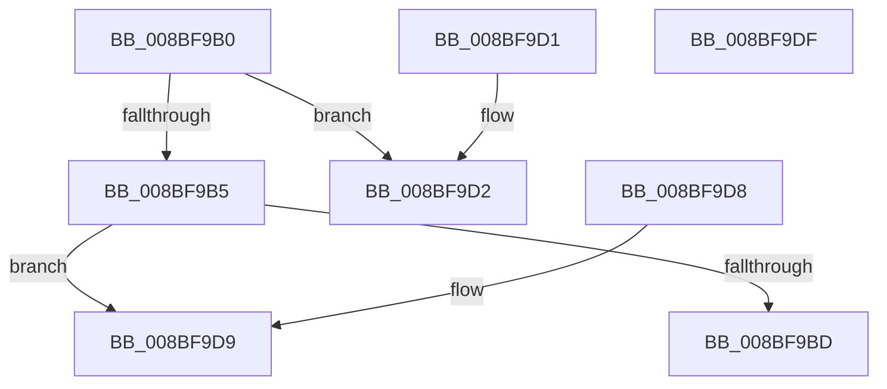

# EtwpValidateLoggerInfo

- RVA: `0x008BF9B0`–`0x008BF9E0` (길이 `48` bytes)
- VA: `0x00000001408BF9B0`
- 실행 섹션: `PAGE`
- PDB 이름 있음: `예`; PDB Function 태그: `아니요`
- unwind 정보 RVA: `0x000DB714`
- 디코드: `18`개 명령, `48/48` bytes 표시
- 미해석 바이트: `0` (있으면 어셈블리에 `.byte`로 보존)

> 이 문서는 커널 이미지의 기계어와 PDB 기호를 분석해 생성했습니다. 4번과 5번은 함수 원형과 자료형을 바이너리 사용 방식에서 추정한 C 해석이며 원본 소스 복구 결과는 아닙니다.

## 1. Dependencies

- 직접 호출 지점: **0**; 고유 호출 대상: **0**
- 직접 호출자로 확인된 함수: **7**
- RIP 상대 이미지 참조: **0**

### Outgoing calls
- 직접 디코드된 call 명령이 없습니다.

### Direct callers
- [EtwpTransitionToRealtime](../../text/65/EtwpTransitionToRealtime_function_006518D8.md) at `0x006518FA`
- [EtwpIncrementTraceFile](../7B/EtwpIncrementTraceFile_function_007B9210.md) at `0x007B922E`
- [EtwpQueryTrace](EtwpQueryTrace_function_008BF8B0.md) at `0x008BF8CE`
- [EtwpStopTrace](../9B/EtwpStopTrace_function_009BCE84.md) at `0x009BCEB9`
- [NtTraceControl](../A9/NtTraceControl_function_00A9ED40.md) at `0x00A9EF6D`
- [EtwpUpdateTrace](../AB/EtwpUpdateTrace_function_00ABCC7C.md) at `0x00ABCCAF`
- [EtwpFlushTrace](../AF/EtwpFlushTrace_function_00AF47B4.md) at `0x00AF47E7`

### Static image references
- 디코드된 RIP-relative 메모리 참조가 없습니다.

## 2. Other-region calls and transfers

- 다른 실행 섹션으로 향하는 call: **0**
- 별도 외부 분기/꼬리 이동을 확인하지 못했습니다.

## 3. Assembly (complete function range)

```asm
008BF9B0  48 85 C9                        test rcx, rcx
008BF9B3  74 1D                           je 0x1408bf9d2
008BF9B5  81 39 B0 00 00 00               cmp dword ptr [rcx], 0xb0
008BF9BB  72 1C                           jb 0x1408bf9d9
008BF9BD  8B 41 2C                        mov eax, dword ptr [rcx + 0x2c]
008BF9C0  25 00 00 02 00                  and eax, 0x20000
008BF9C5  F7 D8                           neg eax
008BF9C7  1B C0                           sbb eax, eax
008BF9C9  F7 D0                           not eax
008BF9CB  25 0D 00 00 C0                  and eax, 0xc000000d
008BF9D0  C3                              ret
008BF9D1  CC                              int3
008BF9D2  B8 0D 00 00 C0                  mov eax, 0xc000000d
008BF9D7  C3                              ret
008BF9D8  CC                              int3
008BF9D9  B8 06 02 00 C0                  mov eax, 0xc0000206
008BF9DE  C3                              ret
008BF9DF  CC                              int3
```

## 4. C-style interpretation (structured pseudocode)

```c
__int64 __fastcall EtwpValidateLoggerInfo(__int64 a1)
{
    __int64 result;

    if (a1 == 0) goto loc_008BF9D2;
    if ((*(unsigned int *)(a1)) < 176) goto loc_008BF9D9;
    result = (unsigned int)(((unsigned int)(*(unsigned int *)(a1 + 44))) & (0x20000ULL));
    result = (unsigned int)(-(result));
    result = (unsigned int)(~(result));
    result = (unsigned int)((result) & (0xC000000DULL));
    return result;
loc_008BF9D2:
    return (unsigned int)(0xC000000DULL);
loc_008BF9D9:
    return (unsigned int)(0xC0000206ULL);
}
```

## 5. (Beta) C Style

```c
int64_t EtwpValidateLoggerInfo(int64_t Arg1)
{
    int64_t result;

    if (Arg1 == 0) goto loc_008BF9D2;
    if ((*(uint32_t *)(Arg1)) < 176) goto loc_008BF9D9;
    result = (uint32_t)(((uint32_t)(*(uint32_t *)(Arg1 + 0x2C))) & (0x20000ULL));
    result = (uint32_t)(-(result));
    result = (uint32_t)(~(result));
    result = (uint32_t)((result) & (0xC000000DULL));
    return result;
loc_008BF9D2:
    return (uint32_t)(0xC000000DULL);
loc_008BF9D9:
    return (uint32_t)(0xC0000206ULL);
}
```

## 6. Execution-region graph

[열기: 2D/3D 그래프와 함수 탐색 컨트롤 패널](../../../control-panel.html?section=page&rva=0x008BF9B0&view=graph)

- 2D 그래프는 위에서 아래로 흐르고, 3D 그래프는 빈 공간을 드래그해 회전합니다. Shift+드래그는 이동, 휠은 확대·축소, 함수 노드 선택은 대상 보고서 이동입니다.

### Static fallback


